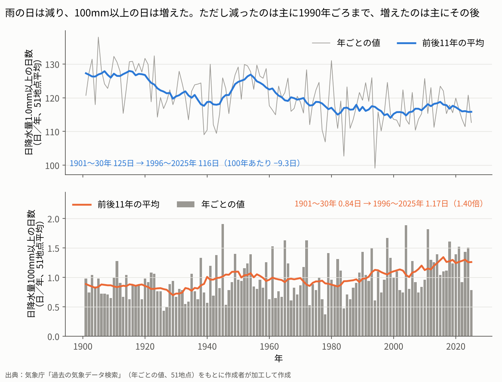
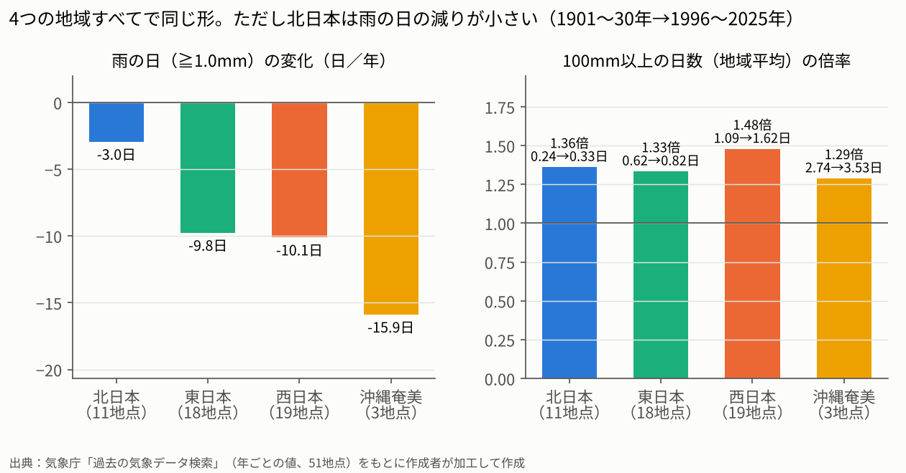
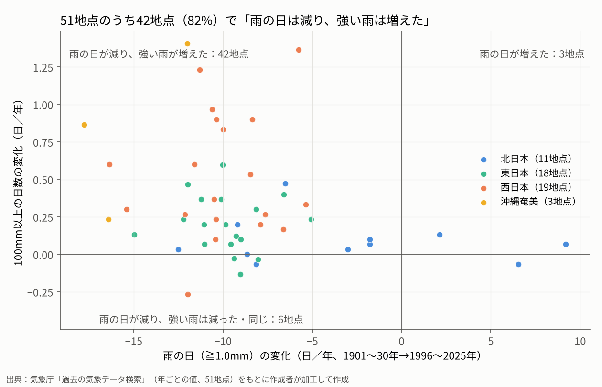
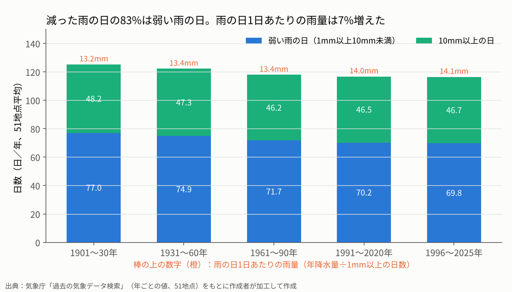

# F499 「雨の日は減り、強い雨は増えた」は、地点のデータでどう見えるか？ 51地点のうち42地点で同じ形。雨の日は100年で9日減り、100mm以上の日は1.4倍。ただし減ったのは主に1990年ごろまで、増えたのは主にその後

## 結論（先に）
- 気象庁の51地点の平均で、雨の日（日降水量1.0mm以上）は1901〜2025年に **100年あたり −9.3日**（95%区間 −12.1〜−6.4）減りました。気象庁の報告の「雨の降らない日は100年あたり9.2日増えた」とほぼ同じです。
- 日降水量100mm以上の日は、1901〜1930年の平均0.84日から1996〜2025年の1.17日へ **1.40倍** になりました（51地点の合計で年43日→60日）。
- 地点ごとに見ると、**51地点のうち42地点（82%）** で「雨の日は減り、100mm以上の日は増えた」形でした。北日本・東日本・西日本・沖縄奄美の4地域すべてで、地域の平均も同じ形です。ただし北日本は雨の日の減りが −3.0日と小さく、旭川・網走・札幌では雨の日が増えました。
- 2つの変化は時期がずれています。雨の日の減りの83%は1961〜1990年までに起き、100mm以上の日の増えの69%はそのあと（1961〜1990年→1996〜2025年）に起きました。
- 問い直し：減った雨の日の83%は弱い雨（1mm以上10mm未満）の日でした。年降水量はほとんど変わらず（1,643mm→1,629mm）、雨の日1日あたりの雨量は13.2mm→14.1mm（+7.2%）になりました。

## 問い
気象庁の「気候変動監視レポート2025」は、全国51地点で、日降水量100mm以上・200mm以上の日数は増え、日降水量1.0mm未満の日（雨の降らない日）は100年あたり9.2日増えた、とまとめています。報道でも「雨の日は減ったのに、強い雨は増えた」とよく言われます。

ただ、これは51地点を平均した姿です。屋外の行事・工事・農作業・物流など、雨の日の数と強い雨の両方に予定を左右される人にとっては、**自分の地域の地点でも同じ形なのか**、全国の形がどれくらいの地点に当てはまるのかが気になります。この記事では、51地点の年ごとの値で、地点ごと・地域ごとに確かめます。

なお、強い雨の「100年に1度の値」は F167、年降水量の年ごとのばらつきは F428、梅雨の雨量は F333、1時間50mm以上の大雨の回数（アメダス）は F284 で扱いました。ここでは、雨の日と強い雨の日の「数」を並べて見ます。

## データ（出典）
- 気象庁「過去の気象データ検索」年ごとの値（詳細：降水量など）。51地点（気象庁が日本の年降水量偏差を求める地点）、1901〜2025年。
- 使った値：年降水量、日降水量 ≧1.0mm・≧10mm・≧50mm・≧100mm の日数。0.5mm の階級は、2008年に観測の最小単位が変わった影響を受けるので使いません（気象庁の報告と同じ考え方）。
- 「]」の付いた資料不足値は除き（6,375地点年のうち約20）、「)」の準正常値は使いました。
- 地域は気象庁の区分に合わせ、北日本11・東日本18・西日本19・沖縄奄美3地点に分けました。
- 取得日：2026-11-18。51地点のページを data/raw に gzip で同梱しています（計0.6MB。一覧は data/raw/SOURCES.md）。

## 事前の計画
[PLAN.md](PLAN.md)（2026-11-18 20:22、集計の前に作成）。下見では、東京の1875〜1878年の行を見ただけでした。

| 仮説 | 外れの基準 | 結果 | 判定 |
|---|---|---|---|
| H1 雨の日の傾きが −5日/100年以下で、区間が0をまたがない | −5日より大きい、または区間が0をまたぐ | −9.27日（−12.10〜−6.44） | 支持 |
| H2 100mm以上の日が1.2倍以上 | 1.2倍未満 | 1.40倍 | 支持 |
| H3 「雨の日が減り、強い雨が増えた」地点が半分（26地点）以上 | 半分未満 | 42地点（82%） | 支持 |
| H4 4地域すべてで地域の平均が同じ形 | どれか1地域で崩れる | 4地域すべて | 支持 |

## やったこと
1. 地点・年ごとの値から、51地点の平均の年ごとの系列を作りました。
2. 傾きは最小二乗法の直線で、95%区間は自己相関を考えた Newey–West（ラグ5）で出しました。
3. 100mm以上の日は1地点で年に0〜数回と少ないので、地点をまとめたポアソン回帰（地点ごとの水準の違いを入れ、年の直線で増え方を見る。区間は年ごとのまとまりを考えた方法）でも、100年あたりの倍率を出しました。
4. 1901〜1930年と1996〜2025年の30年平均を、地点ごと・地域ごとに比べました。

地点の順位は作っていません。地域は北から南の順に示しています。

## 分かったこと

### 図1：雨の日は減り、100mm以上の日は増えた。ただし時期がずれている


- 雨の日は、1901〜1930年の125.2日から1996〜2025年の116.5日へ減りました。
- 100mm以上の日は0.84日から1.17日へ。ポアソン回帰の倍率は100年あたり1.38倍（1.21〜1.57倍）でした。
- 30年ごとに見ると、雨の日は1961〜1990年（117.9日）までにほとんど減り、その後はほぼ横ばいです。100mm以上の日は1931〜1990年に0.94日前後で横ばい、その後1.17日に増えました。「雨の日が減った」と「強い雨が増えた」は、同じ時期に起きたことではありません。

### 図2：4つの地域すべてで同じ形


- 雨の日の変化は、北日本 −3.0日、東日本 −9.8日、西日本 −10.1日、沖縄奄美 −15.9日でした。
- 100mm以上の日の倍率は、北日本1.36倍、東日本1.33倍、西日本1.48倍、沖縄奄美1.29倍でした。
- 北日本はもともと100mm以上の日が少なく（0.24日→0.33日）、増えた日数は小さいままです。

### 図3：51地点のうち42地点で「雨の日は減り、強い雨は増えた」


- 雨の日が減った地点は48、100mm以上の日が増えた地点は44、両方そろった地点は42でした。
- 雨の日が増えたのは北日本の旭川・網走・札幌の3地点です。雨の日が減っても100mm以上の日が減った・同じだった地点は6地点ありました。
- 1地点の100mm以上の日は30年で数日から数十日の違いなので、地点ごとの差はぶれが大きく、1つの地点の結果だけで判断するのは難しい点に注意が要ります。

## 問い直し（結果を見てから足した）
雨の日が減ったのに年降水量が変わらないなら、どの雨の日が減ったのでしょうか。雨の日を、弱い雨（1mm以上10mm未満）の日と10mm以上の日に分けました。



- 1901〜1930年→1996〜2025年 で、弱い雨の日は77.0日→69.8日（−7.3日）、10mm以上の日は48.2日→46.7日（−1.5日）でした。減った雨の日（−8.8日）の83%が弱い雨の日です。
- 傾きでも、弱い雨の日は100年あたり −7.7日（−8.9〜−6.5）、10mm以上の日は −1.6日（−3.5〜+0.4、0をまたぐ）でした。
- 年降水量は1,643mm→1,629mm で、傾きの区間は0をまたぎます（気象庁の報告の「変化傾向は確認できない」と同じ）。その結果、雨の日1日あたりの雨量は13.2mm→14.1mm（+7.2%）になり、47地点で増えていました。

## 頑健性

| 確かめ | 雨の日の傾き（100年あたり） | 95%区間 | Theil–Sen | 強い雨の倍率 | 結論は変わったか |
|---|---|---|---|---|---|
| 本線（1901〜2025年） | −9.27日 | −12.10〜−6.44 | −9.27日 | 1.40倍（≧100mm） | — |
| 期間 1931〜2025年 | −7.49日 | −12.39〜−2.58 | −8.31日 | — | 変わらない |
| 期間 1961〜2025年 | −4.37日 | −9.12〜+0.38 | −4.68日 | 1.75倍/100年（ポアソン、1.13〜2.71） | 雨の日の減りは0をまたぐ |
| 1991〜2020年平均との差の平均 | −9.29日 | −12.11〜−6.47 | −9.29日 | 1.40倍 | 変わらない |
| 資料不足値も含める | −9.20日 | −12.05〜−6.34 | −9.16日 | 1.40倍 | 変わらない |
| しきい値を ≧10mm・≧50mm に | −1.59日 | −3.53〜+0.35 | −1.79日 | 1.14倍（≧50mm） | 10mm以上の日はほぼ減らない |
| 地点ごとの形を ≧50mm で | — | — | — | — | 38地点（75%）で同じ形 |

- 1961年以降に限ると、雨の日の減りは区間が0をまたぎ、はっきりしません。一方、100mm以上の日の増え方は1961年以降のほうが速く出ます。図1の「時期のずれ」と同じことを示しています。
- 強い雨のしきい値を50mmに下げると、増え方は1.14倍と小さくなります。増えたのは、より強い雨の側です。

## 言えないこと
- 地点の移転や、測る道具・測り方の変化の影響は分けていません。気象庁がこの51地点を選んだのは長く比べやすいからですが、完全ではありません。
- 1時間などの短い時間の強い雨は扱っていません（年ごとの表の、日の値だけです）。
- 変化の原因（温暖化・自然の変動など）は分けていません。とくに、雨の日の減りと強い雨の増えの時期がずれている理由は、このデータからは言えません。
- 51地点のない場所（山間部など）のことは言えません。地点の結果を、近くの市町村にそのまま当てはめることもできません。
- 雨による影響の大きさは扱っていません。

## 仕事で使うなら
- 「雨の日」と「強い雨の日」は、別々の時期に別々の速さで動いてきました。過去の記録から予定の余裕を見積もるときは、どちらの数を使っているかを分けて見るのが、この結果の読み方です。
- 地点ごとの30年平均は results/station_table.csv、地域ごとは results/region_table.csv にあります。

## 計画からの変更
- 大きな変更はありません。問い直しは候補の2つ（弱い雨の日、雨の日1日あたりの雨量）を1つの節にまとめました。
- 図1の「時期のずれ」は計画になかった見方で、結果を見てから30年ごとの表（results/period_table.csv）を足して確かめました。

## 再現のしかた
```
sh src/run_all.sh        # オフライン。所要約6〜9秒（CPU 1つ）
python3 src/01_fetch.py  # 元データを取り直すときだけ（ネットを使う）
```

| ファイル | 中身 |
|---|---|
| src/01_fetch.py | 51地点の年ごとの値のページを取得（run_all.sh からは呼ばない） |
| src/02_build.py | data/raw → data/annual.csv |
| src/03_analysis.py | 傾き・倍率・仮説・地域・頑健性 → results/main.json ほか |
| src/03b_requestion.py | 問い直し → results/requestion.json・period_table.csv |
| src/04_figures.py | 図4枚 |

repro_check：/tmp に写し、02 以降が作るファイルを消して流すと、12ファイル（results 7、figures 4、data 1）がすべて cmp で一致（results/repro_check.txt。レビュー後に再実行）。乱数は使っていません。

## レビューで直したこと
| # | 指摘 | 直し方 |
|---|---|---|
| 1 | 題名の「減ったのは1990年ごろまで」が強い（1961年以降も100年あたり −4.4日の傾きが残る。区間は0をまたぐ） | 「減ったのは主に1990年ごろまで」とし、図1の題とそろえた |
| 2 | 同じ大雨を扱う F284 が「関連する記事」になかった | 問いの節に足した（F284 は1時間の雨の回数、この記事は日の雨の日数） |
| 3 | 図3の左下の注記が地点の点に重なっていた | 下に余白を足して注記を移した |

## 出典
- 気象庁「過去の気象データ検索」：https://www.data.jma.go.jp/stats/etrn/index.php （各地点の URL は data/raw/SOURCES.md）
- 気象庁「日本の年降水量偏差の算出方法」（51地点の一覧）：https://www.data.jma.go.jp/cpdinfo/temp/clc_jpn_r.html
- 気象庁「気候変動監視レポート2025」第5章：https://www.data.jma.go.jp/cpdinfo/ccj/2025/html_honpen/cc2025_honpen_5.html

（いずれも 気象庁「過去の気象データ検索」をもとに作成者が加工して作成）
