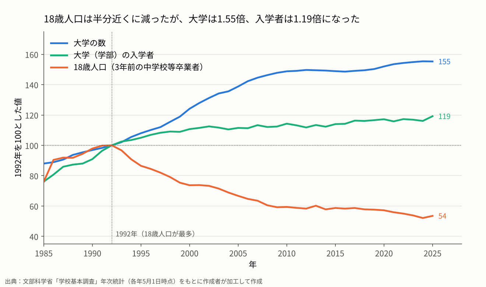
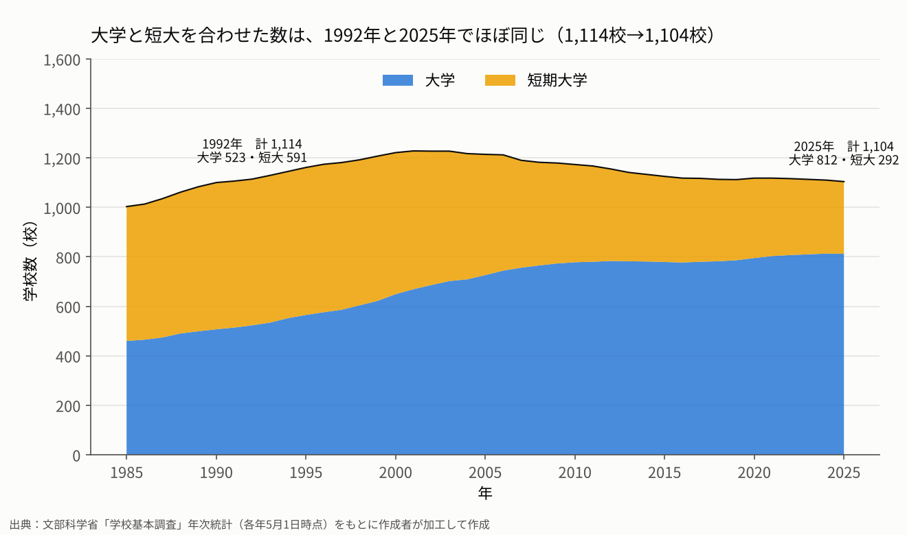
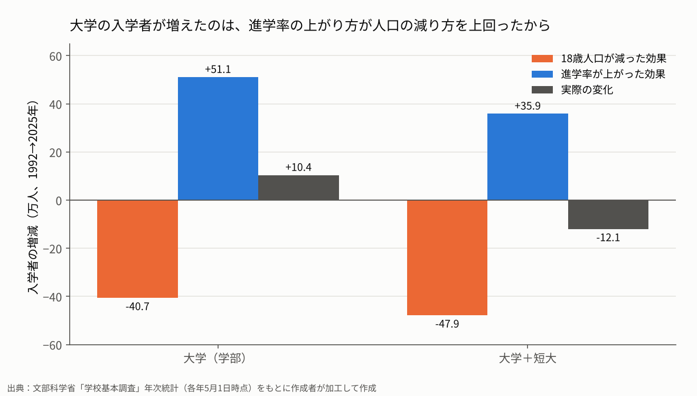
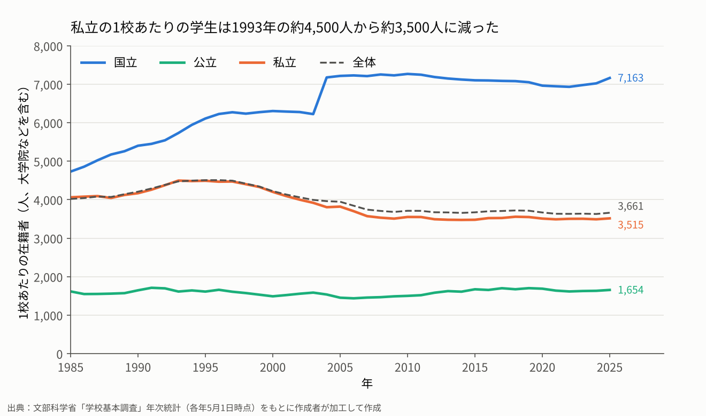

# F500 18歳の人口が減っても、大学は増え続けたのか？ 1992→2025年に18歳人口は46.5%減、大学は523校から812校に増えたが、2010年以降は4.4%増にとどまる。入学者は19.2%増、短大と合わせた学校数はほぼ同じ

## 結論（先に）
- 18歳人口の目安（3年前の中学校等卒業者）は、最も多かった1992年の205.9万人から2025年の110.1万人へ、46.5%減りました。同じ間に大学の数は523校から812校へ、55.3%増えました。
- 大学（学部）の入学者は54.2万人から64.6万人へ19.2%増え、2025年が過去最多です。入学者の変化（+10.4万人）を分けると、18歳人口が減った効果が −40.7万人、進学率（26.3%→58.6%）が上がった効果が +51.1万人でした。
- 一方、短期大学は591校から292校へ半分になり、入学者は25.5万人から3.0万人に減りました。大学と短大を合わせた学校数は1,114校→1,104校（−0.9%）で、ほぼ同じです。合わせた入学者は79.6万人→67.6万人（−15.1%）と減っています。
- 大学の増え方は2010年以降ゆるやかで（2010→2020年は+17校、2010→2025年は+4.4%）、2013〜2016年と2025年は前の年より減りました。設置者別では、公立大学が41校から103校へ2.5倍、私立が384校から624校へ1.6倍、国立は98校から85校へ減りました。
- 問い直しで1校あたりの在籍者を見ると、私立は1993年の約4,500人から2025年の約3,500人に減りました（−19.7%、1992年比）。

## 問い
中央教育審議会の答申に向けた資料（2024年12月の総会の「答申案 要旨」）では、18歳人口は1992年をピークに減り続け、大学に進む人の数も2026年ごろを山に減っていくと見込まれています。では、これまでの30年あまり、18歳人口が減る中で大学の数と入学者はどう動いたのか。増えたのなら、それは進学率が上がったからなのか。同じ時期に減った短期大学とはどう関係しているのか。大学に進む人や大学で働く人のために、公的な統計で確かめます。

## データ（出典）
- 文部科学省「学校基本調査」年次統計（e-Stat、各年5月1日時点）。
  - 総括表9「高等教育機関への入学状況（過年度高卒者等を含む）の推移」：3年前の中学校等卒業者数、大学（学部）・短期大学（本科）の入学者数、進学率（1954〜2025年）。この記事では「3年前の中学校等卒業者」を18歳人口の目安とします（文部科学省の進学率もこれを分母にしています）。
  - 学校種ごと10「大学の学校数、在籍者数、教職員数」、学校種ごと12「短期大学の…」：国立・公立・私立別の学校数と在籍者数（大学は1948〜2025年）。在籍者には大学院・専攻科なども含みます。
  - 総括表1「学校数」：大学・短大の学校数（通信教育のみを行う学校の別掲つき、2026年まで）。
  - 総括表13「卒業者数」：高等学校の卒業者数（各年3月）。
- 列は表の見出しの文字（「学校数｜公立」など）で選び、国立・公立・私立の和と計、総括表1と学校種ごと10の大学の数、入学者の大学＋短大と計が一致することを確かめました（data/build_checks.json）。2025年の大学（学部）入学者 645,513人は、同じ年の別の表（関係学科別 大学入学状況）の計とも一致しました。

## 事前の計画
[PLAN.md](PLAN.md)（2026-11-18 20:20、集計の前に作成）。下見では、2025年の大学の数（812校）と、総括表9の先頭の行だけを見ていました。

| 仮説 | 外れの基準 | 結果 | 判定 |
|---|---|---|---|
| H1 1992→2025年に18歳人口は40%以上減り、大学は40%以上増えた | どちらかが40%に届かない | 18歳人口 −46.5%、大学 +55.3% | 支持 |
| H2 大学（学部）の入学者は増え、進学率の効果が人口の効果を上回る | 入学者が減った、または進学率の効果が小さい | +10.4万人（人口 −40.7万、進学率 +51.1万） | 支持 |
| H3 大学＋短大の学校数は±10%の範囲 | 10%以上の増減 | 1,114→1,104校（−0.9%） | 支持 |
| H4 公立大学の伸び（倍率）は私立より大きい | 私立の倍率が公立以上 | 公立 2.51倍、私立 1.63倍 | 支持 |

## やったこと
1. 5本の Excel から、年×指標の表（data/panel.csv）を作りました（02_build.py）。
2. 1992年を100とした指数で、18歳人口・大学の数・入学者を並べました。
3. 入学者の変化を「18歳人口の効果」と「進学率の効果」に分けました。入学者＝18歳人口×進学率と書き、片方だけを変えたときの増減を、2つの年の平均を重みにして出す対称な形です（03_analysis.py）。
4. 大学と短大の学校数・入学者の合計と、国立・公立・私立別の学校数を出しました。
5. 結果を見てから、1校あたりの在籍者を足しました（03b_requestion.py）。

## 分かったこと

### 1. 18歳人口は半分近くに、大学は1.55倍に（図1）

1992年を100とすると、2025年は18歳人口が54、大学の数が155、大学（学部）の入学者が119です。大学の数は1992→2000年に+126校、2000→2010年に+129校と増え、2010→2020年は+17校、2020→2025年は+17校でした。前の年より減った年は2013〜2016年と2025年（813校→812校）です。2026年は総括表1で816校です（e-Stat の公開日は2026-09-02で、確定前の値と思われます。推測）。

### 2. 短大の減った分と、大学の増えた分がほぼ見合う（図2）

短期大学は1996年の598校が最も多く、2025年は292校です。大学と短大を合わせた数は2001年の1,228校が最も多く、2025年は1,104校で、1992年の1,114校とほぼ同じです。ただし、数が見合うことは、短大が大学になったことを意味しません（中身は合計からは分けられません）。

### 3. 入学者が増えたのは進学率が上がったから（図3）

大学（学部）の進学率（過年度高卒者等を含む）は26.3%から58.6%になりました。入学者の変化 +10.4万人のうち、18歳人口が減った効果は −40.7万人、進学率が上がった効果は +51.1万人です。大学と短大を合わせると、進学率は38.7%から61.4%に上がりましたが、人口の効果（−47.9万人）が進学率の効果（+35.9万人）を上回り、入学者は12.1万人減りました。大学に入る人が増えた分は、短大に入る人が減った分と時期が重なっています（短大の進学率は12.4%→2.7%）。同じ人たちが短大から大学に移ったのかは、この統計では確かめられません（推測を含みます）。

### 4. 設置者別では公立が2.5倍
公立大学は41校から103校へ+62校、私立大学は384校から624校へ+240校、国立大学は98校から85校へ−13校でした。国立は2003年の100校から2004年の87校へ減っており、国立大学の統合の時期と重なります。短大は国立が39校から0校、公立が53校から14校、私立が499校から278校になりました。

## 問い直し（結果を見てから足した）

### 大学が増えた分、1校あたりの学生は減ったのか（図4）

全体の1校あたりの在籍者は1992年の4,385人から2025年の3,661人へ16.5%減りました。私立は4,376人から3,515人へ19.7%減り、最も多かったのは1993年（4,497人）です。国立は5,543人から7,163人に増えました（統合で学校の数が減ったため）。公立は1,696人から1,654人でほぼ同じで、学校の数が2.5倍になっても1校あたりの規模は小さいままです。1校あたりの大学（学部）入学者は1,036人から795人になりました。

## 頑健性

| 確かめ方 | 期間 | 入学者の変化 | 人口の効果 | 進学率の効果 | 人口の変化 | 学校数の変化 |
|---|---|---|---|---|---|---|
| 本線（18歳人口＝3年前の中学校等卒業者） | 1992→2025 | +103,909 | −406,875 | +510,784 | −46.5% | 大学 +55.3% |
| 18歳人口の目安を高校の卒業者数に替える | 1992→2025 | +103,909 | −436,562 | +540,471 | −48.6% | 大学 +55.3% |
| 期間を変える | 2000→2025 | +45,858 | −204,658 | +250,516 | −27.5% | 大学 +25.1% |
| 期間を変える | 2010→2025 | +26,394 | −67,003 | +93,397 | −10.0% | 大学 +4.4% |
| 通信教育のみの大学を除く | 1992→2025 | — | — | — | −46.5% | 大学 +54.0%（通信のみ 1→8校） |
| 大学＋短大の入学者で分解 | 1992→2025 | −120,584 | −479,259 | +358,675 | −46.5% | 大学＋短大 −0.9% |
| 学校数を2026年まで延ばす | 1992→2026 | — | — | — | — | 大学 +56.0%（816校） |

どの期間・定義でも、大学（学部）の入学者は増え、進学率の効果が人口の効果を上回りました。短大を合わせると入学者は減るので、短大を含めるかどうかで結論が変わります。

## 言えないこと
- 学校の数の増減の中身（新設、統合、廃止、短大から大学への転換、私立から公立への移行）は、年次統計の合計からは分けられません。公立大学の増加にどれだけ私立からの移行が含まれるかは、この記事では確かめていません。
- 入学定員と、定員に満たない大学の割合は、この年次統計にないので扱っていません。
- 大学が増えたから進学率が上がったのか、進学したい人が増えたから大学が増えたのか（因果の向き）は分かりません。
- 「3年前の中学校等卒業者」は18歳人口そのものではなく、目安です。過年度の高卒者（浪人など）や留学生も入学者に入っています。
- 1校あたりの在籍者には大学院生なども含まれ、学部の規模だけを示すものではありません。

## 仕事で使うなら
- 「大学の数」と「入学者」を並べるときは、短大を含めるかどうかで傾向が逆になることを書き添えると誤解が減ります（大学だけなら +19.2%、短大を合わせると −15.1%、1992→2025年）。
- 年ごとの値は results/by_year.csv、設置者別は by_setter.csv にあります。

## 計画からの変更
- 問い直し（1校あたりの在籍者と入学者）は結果を見てから足しました。
- PLAN.md では中教審の資料を「答申（2025年2月）の要旨」と書きましたが、確かめると、2024年12月25日の総会の「答申案 要旨」（文部科学省のサイトに2025年2月に掲載）でした。README ではこちらに直しています。

## 再現のしかた
```
sh src/run_all.sh        # オフライン。所要約3秒
python3 src/01_fetch.py  # 元データを取り直すときだけ（ネットを使う）
```

| ファイル | 中身 |
|---|---|
| src/01_fetch.py | e-Stat から Excel 5本を取る（run_all.sh では呼ばない） |
| src/common.py | 見出しの文字で列を選んで読む関数 |
| src/02_build.py | Excel → data/panel.csv、data/build_checks.json（表どうしの照合） |
| src/03_analysis.py | 指数・分解・設置者別・仮説・頑健性 → results/main.json・by_year.csv・by_setter.csv・robustness.csv |
| src/03b_requestion.py | 問い直し → results/requestion.json・per_school.csv |
| src/04_figures.py | 図4枚 |

repro_check：/tmp/rep_F500 に写し、02 以降が作るファイルを消して流し直し、12ファイル（results 6、figures 4、data 2）がすべて cmp で一致、所要3秒（results/repro_check.txt）。乱数は使っていません。

## レビューで直したこと

| # | 指摘 | 直し方 |
|---|---|---|
| 1 | 題名の問いは「増え続けたのか」なのに、結果が「523校から812校に増え」だけで、2010年以降はほぼ横ばい（2010→2025年 +4.4%、2013〜2016年と2025年は前年より減少）という本文の主な結果が題名に出ていなかった | 題名の結果に「2010年以降は4.4%増にとどまる」を足した（results/robustness.csv の 2010→2025年の値）。status・note の1行目もそろえた |
| 2 | 「大学の入学者が増えた分の多くは、短大に入っていた人の分と重なる」は、合計の数字からは同じ人の移動まで言えない | 「時期が重なる」に弱め、同じ人の移動は確かめられない（推測を含む）と書き足した（README・note） |

独立レビューで、数字の照合（題名・README・note と results）、再実行（/tmp で run_all.sh を流し、12ファイルが cmp で一致）、図4枚、Excel の読み取り（1992・2010・2025年の18歳人口・入学者・学校数・設置者別の値を元の Excel と照合、sha256 も一致）を確かめました。

## 出典
- 文部科学省「学校基本調査」年次統計（e-Stat）：https://www.e-stat.go.jp/stat-search/files?toukei=00400001&tstat=000001011528&tclass1=000001021812 （各表の URL は data/raw/SOURCES.md）
- 中央教育審議会 総会（2024年12月25日）「急速な少子化が進行する中での将来社会を見据えた高等教育の在り方について（答申案）要旨」：https://www.mext.go.jp/content/20250207-mxt_sigsanji-000040289_05.pdf

（いずれも 文部科学省「学校基本調査」をもとに作成者が加工して作成）
