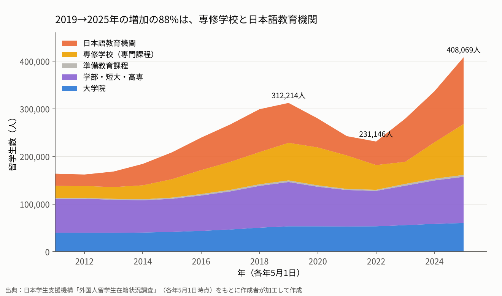
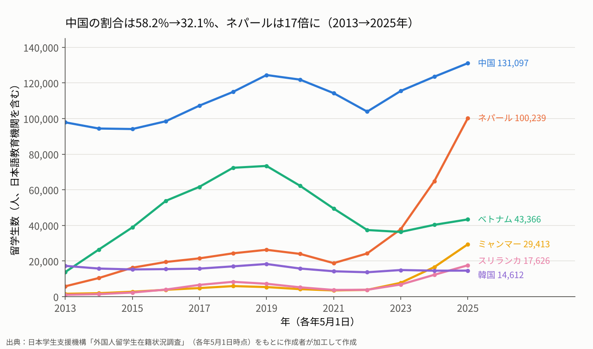
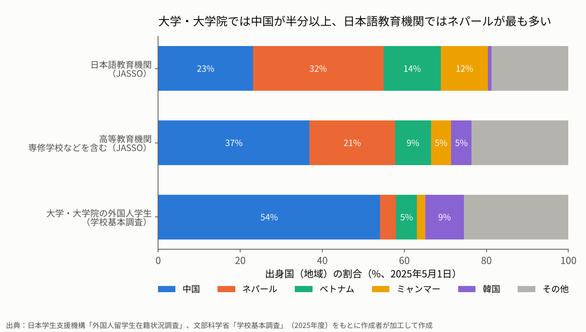
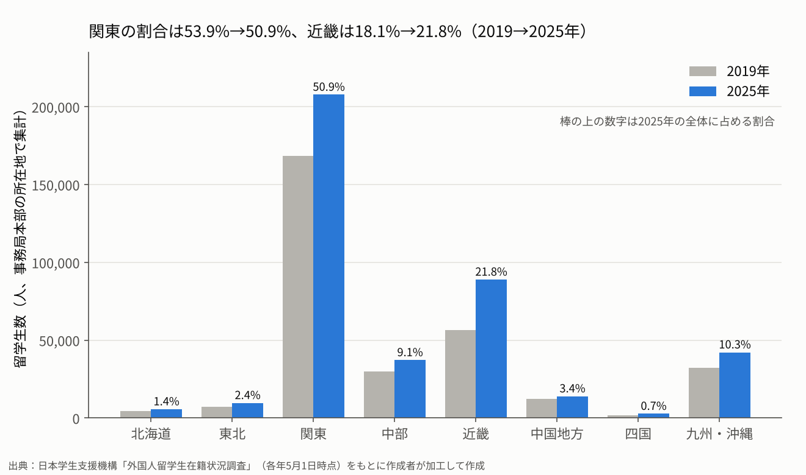

# F501 日本で学ぶ留学生は、どこから来て、どこで学んでいるのか？ 2025年は40.8万人で中国32.1%・ネパール24.6%。2019年からの増加の88%は専修学校と日本語教育機関

## 結論（先に）
- 留学生（在留資格「留学」で学ぶ外国人）は、2025年5月1日に408,069人でした。2013年（168,145人）の2.4倍、コロナ前の山の2019年（312,214人）より9.6万人多い数です。
- 出身国では、中国の割合が2013年の58.2%から2025年の32.1%に下がりました。2013→2025年の増加（+24.0万人）のうち74.6%は、ネパール・ベトナム・ミャンマー・スリランカ・バングラデシュの5か国で、ネパールだけで39.4%です。ネパールは5,807人から100,239人へ17倍になりました。
- 学ぶ場所では、2019→2025年の増加のうち88.0%が専修学校（専門課程）と日本語教育機関でした。2025年は日本語教育機関が34.4%、専修学校が26.2%、学部・短大・高専が23.8%、大学院が14.7%です。
- 国の構成は学ぶ場所で大きく違います。2025年、日本語教育機関ではネパールが31.8%で最も多く、中国は23.1%です。問い直しで学校基本調査の大学・大学院の外国人学生を見ると、中国が54.1%、ネパールは3.9%でした。
- 地方別（北から南）では関東が50.9%で、2019年の53.9%から下がりました。近畿は18.1%から21.8%に上がっています。

## 問い
日本学生支援機構（JASSO）の2025年度の調査で、留学生は過去最多になりました。では、増えたのはどこから来た人で、どの種類の学校で学んでいるのか。それは10年あまりでどう変わったのか。留学生を受け入れる学校や地域で働く人のために、公的な統計で確かめます。

## データ（出典）
- JASSO「外国人留学生在籍状況調査」（各年5月1日時点）の2014〜2025年度の結果（PDF）と、2025年度の「在学段階別の推移」（1983〜2025年）。
  - 国別の表は、高等教育機関＋日本語教育機関の表（2014年度から。前年の値も載るので2013年から使えます）、高等教育機関だけの表、日本語教育機関だけの表（上位10か国＋その他）の3つです。
  - 高等教育機関は大学院・大学（学部）・短大・高専・専修学校（専門課程）・準備教育課程。日本語教育機関は2011年度から対象です。
  - 地方別は、都道府県の値を JASSO と同じ8地方にまとめました（北海道・東北・関東・中部・近畿・中国地方・四国・九州・沖縄）。
- PDF の表は、src/01b_extract.py が pdftotext で文字にし、国名・都道府県名・「YYYY年」の文字で値を読み取って data/extract_*.csv に書きます。02 以降はこの CSV から流れます。
- 読み取りの照合：どの年も、国の値の和が表の「計」と一致し、表の「計」は在学段階別の推移の値とも一致しました。都道府県の和も総数と一致しました。2025年の地方の値（関東 207,745人など）は PDF の地方の欄と一致しています。中国・ベトナム・ネパールの値を何か所か、PDF の表と目で照らしました。
- 照合用に、文部科学省「学校基本調査」2025年度の国籍別 外国人学生数（大学・大学院。「留学」以外の在留資格も含む）。

## 事前の計画
[PLAN.md](PLAN.md)（2026-11-18 20:35、国別・機関別・地方別の集計の前に作成）。下見で2025年度の結果の表（総数、国別、在学段階別、都道府県別）を読んでいたので、H3 は事前の予想としての重みが小さいと計画に書いています。

| 仮説 | 外れの基準 | 結果 | 判定 |
|---|---|---|---|
| H1 中国の割合は2013→2025年に15ポイント以上下がった | 15ポイント未満 | 58.2%→32.1%（−26.1ポイント） | 支持 |
| H2 2013→2025年の増加の半分以上は5か国（ネパール・ベトナム・ミャンマー・スリランカ・バングラデシュ） | 半分未満 | 74.6% | 支持 |
| H3 2019→2025年の増加の半分以上は専修学校と日本語教育機関 | 半分未満 | 88.0%（確認として扱う） | 支持 |
| H4 2025年の中国の割合は、高等教育機関の方が日本語教育機関より高い | 日本語教育機関の方が高いか同じ | 36.9% と 23.1% | 支持 |
| H5 関東の割合は2019年より2025年の方が低い | 2025年の方が高いか同じ | 53.9%→50.9% | 支持 |

## やったこと
1. PDF 13本から表を読み取り、合計を照合しました（01b_extract.py、02_build.py）。
2. 主な10か国の人数と割合の推移を出し、期間の増加を国ごと・在学段階ごとに分けました（各国の増加÷全体の増加）。
3. 高等教育機関と日本語教育機関で、国の構成を比べました。
4. 都道府県を8地方にまとめ、2019年と2025年を比べました（03_analysis.py）。
5. 結果を見てから、大学・大学院に限った国の構成を学校基本調査で足しました（03b_requestion.py）。

## 分かったこと

### 1. 増えたのは専修学校と日本語教育機関（図1）

留学生は2019年の312,214人のあと、2022年に231,146人まで減り、2025年に408,069人になりました。2019→2025年の増加 +95,855人のうち、日本語教育機関が +56,363人（58.8%）、専修学校（専門課程）が +27,985人（29.2%）、大学院が +6,924人（7.2%）、学部・短大・高専が +4,155人（4.3%）です。2013年と比べると、日本語教育機関は32,626人から140,174人へ、専修学校は24,586人から106,829人へ、どちらも4.3倍になりました。

### 2. 中国の割合は下がり、ネパールが増えた（図2）

人数の多い順に、2025年は中国 131,097人（32.1%）、ネパール 100,239人（24.6%）、ベトナム 43,366人（10.6%）、ミャンマー 29,413人（7.2%）、スリランカ 17,626人（4.3%）、韓国 14,612人（3.6%）です。中国の人数は2013年の97,875人から増えていますが、割合は58.2%から32.1%に下がりました。ベトナムは2019年の73,389人が最も多く、2025年は43,366人です。2019→2025年の増加のうち77.1%がネパール、25.1%がミャンマーで、ベトナムは −30,023人でした。

### 3. 学ぶ場所によって、国の構成が違う（図3）

2025年、日本語教育機関（140,174人）ではネパール 31.8%、中国 23.1%、ベトナム 14.0%、ミャンマー 11.5%です。高等教育機関（267,895人）では中国 36.9%、ネパール 20.8%、ベトナム 8.8%、韓国 5.0%、ミャンマー 4.9%でした。2019年の日本語教育機関は、中国 36.3%、ベトナム 33.6%、ネパール 9.1%でした。

### 4. 関東の割合は下がり、近畿が上がった（図4）

北から南に、2025年は北海道 1.4%、東北 2.4%、関東 50.9%、中部 9.1%、近畿 21.8%、中国地方 3.4%、四国 0.7%、九州・沖縄 10.3%です。2019年からの増え方は近畿が +57.7%で、関東は +23.5%でした。東京都は116,094人（37.2%）から144,661人（35.5%）になりました。

## 問い直し（結果を見てから足した）

### 大学・大学院に限ると、国の構成はどう違うか
JASSO の国別の表は「高等教育機関」に専修学校を含むので、学校基本調査（2025年度）の国籍別の外国人学生（大学の学部など 107,206人＋大学院 65,237人）を並べました。中国が54.1%、韓国が9.4%、ベトナムが5.1%、ネパールは3.9%（6,764人）でした（学校基本調査の「韓国・朝鮮」を韓国として並べています）。JASSO の高等教育機関のネパール 55,607人のうち、大学・大学院にいるのは多くても6,764人程度で、残りの多くは専修学校などで学んでいると考えられます（学校基本調査は「留学」以外の在留資格も含み、数え方も同じではないので、目安です。推測を含みます）。

## 頑健性

| 確かめ方 | 期間 | 全体の増加 | 5か国の割合 | 中国の割合 | 専修＋日本語の割合 |
|---|---|---|---|---|---|
| 本線 | 2013→2025 | +239,924 | 74.6% | 13.8% | 79.1% |
| 起点をコロナ前の山に | 2019→2025 | +95,855 | 89.9% | 6.9% | 88.0% |
| 起点をコロナ後の底に | 2022→2025 | +176,923 | 73.1% | 15.4% | 82.3% |
| 各年の表の「前年の値」と前年の表の値 | 2013〜2024 | 643組を比べ、違いは0組 | — | — | — |
| 地方別を校舎の所在地で集計 | 2025 | 関東 本部 50.9%／校舎 51.1% | — | — | — |
| 別のデータ（学校基本調査、大学・大学院） | 2025 | 中国 54.1%、ネパール 3.9%（問い直し） | — | — | — |

どの起点でも、増加の7割以上は5か国、8割前後は専修学校と日本語教育機関でした。後からの数字の修正もありませんでした。

## 言えないこと
- 留学生が増えた理由（日本の制度、出身国の事情、学費や為替、就労との関係など）は、この統計からは分かりません。
- JASSO の公表表には国×在学段階の表がないので、「ネパールの専修学校の人数」などは直接は分かりません。問い直しの値は別の統計との差からの目安です。
- 「留学」の在留資格の人だけを数えています。日本の学校で学ぶほかの在留資格の外国人は入りません。
- 日本語教育機関の国別は上位10か国だけです。
- 卒業後に日本で働いたか、帰国したかは分かりません。

## 仕事で使うなら
- 「留学生が増えた」と書くときは、どの種類の学校で増えたのかを添えると誤解が減ります（2019→2025年の増加の88%は専修学校と日本語教育機関）。
- 国別・在学段階別・地方別の値は results/ の CSV にあります。

## 計画からの変更
- 問い直し（学校基本調査で大学・大学院に限った国の構成）は結果を見てから足しました。計画では「別のデータで照合」として予定していたものを、問いの形にしています。
- 国別の長い推移は、高等教育機関と日本語教育機関を合わせた表がある2013年からにしました（2011・2012年は表が分かれていて、日本語教育機関は上位の国だけのため）。

## 再現のしかた
```
sh src/run_all.sh            # オフライン。所要約4秒（読み取り済みの CSV から）
python3 src/01b_extract.py   # PDF から表を読み直すとき（pdftotext 24.02 を使う。ネットは使わない）
python3 src/01_fetch.py      # 元データを取り直すときだけ（ネットを使う）
```

| ファイル | 中身 |
|---|---|
| src/01_fetch.py | JASSO の PDF 13本と学校基本調査の Excel 2本を取る |
| src/01b_extract.py | PDF → data/extract_*.csv（国別3種、都道府県別、在学段階別） |
| src/02_build.py | 照合（data/build_checks.json、prev_value_check.csv）と分析用の表 |
| src/03_analysis.py | 推移・増加の内訳・機関別の構成・地方別・仮説・頑健性 → results/main.json など |
| src/03b_requestion.py | 問い直し → results/requestion.json・requestion_univ_grad.csv |
| src/04_figures.py | 図4枚 |

repro_check：/tmp/rep_F501 に写し、02 以降が作るファイルを消して流し直し、23ファイル（results 8、figures 4、data 11）がすべて cmp で一致、所要4秒。あわせて 01b_extract.py を流し直し、読み取りの CSV 5本も一致しました（results/repro_check.txt）。乱数は使っていません。

## レビューで直したこと

| # | 指摘 | 直し方 |
|---|---|---|
| 1 | 問い直しで並べた学校基本調査の「韓国・朝鮮」を、JASSO の「韓国」と同じものとして扱っていることが書かれていなかった（学校基本調査は在留資格を問わないので、韓国の値が JASSO の高等教育機関より多い） | 問い直しの段落に、韓国・朝鮮を韓国として並べたことを1文で足した（数字・図は変わらない） |

独立レビューで、数字の照合（題名・README・note と results）、再実行（/tmp で run_all.sh と 01b_extract.py を流し直し、すべて cmp で一致）、図4枚、PDF・Excel の読み取り（2014・2019・2025年度の国別・都道府県別・在学段階別の値と、学校基本調査の中国・ネパールの値を元のファイルと照合）を確かめました。

## 出典
- 独立行政法人日本学生支援機構「外国人留学生在籍状況調査」：https://www.studyinjapan.go.jp/ja/statistics/zaiseki/ （各年の PDF の URL は data/raw/SOURCES.md）
- 文部科学省「学校基本調査」2025年度 高等教育機関（e-Stat）：https://www.e-stat.go.jp/stat-search/files?toukei=00400001&tstat=000001011528

（いずれも 日本学生支援機構「外国人留学生在籍状況調査」、文部科学省「学校基本調査」をもとに作成者が加工して作成）
