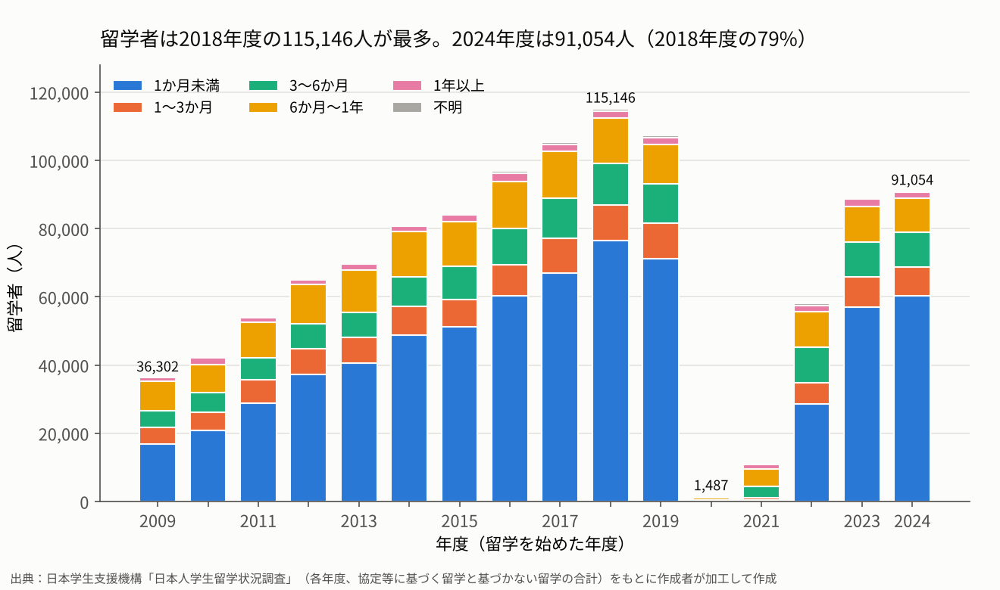
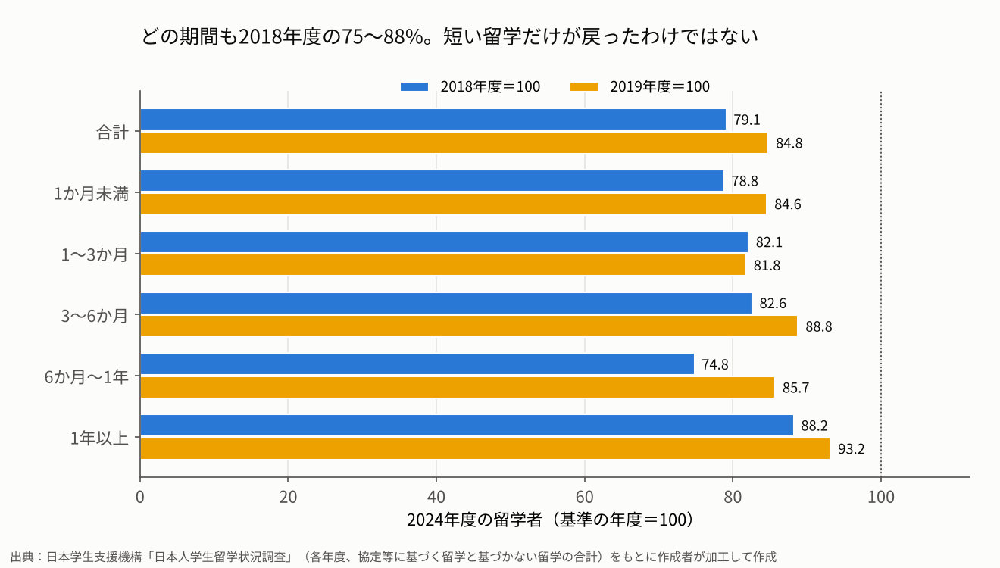
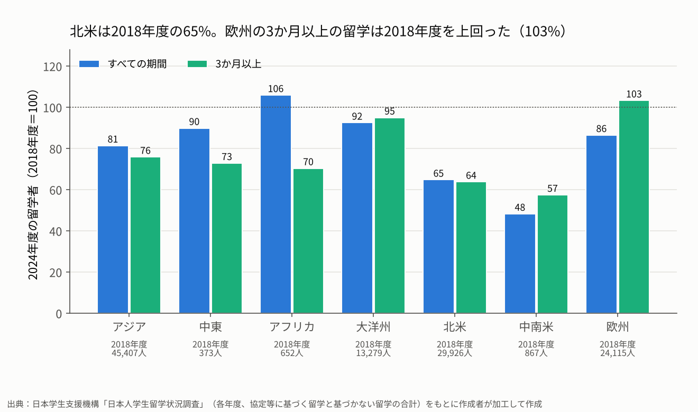
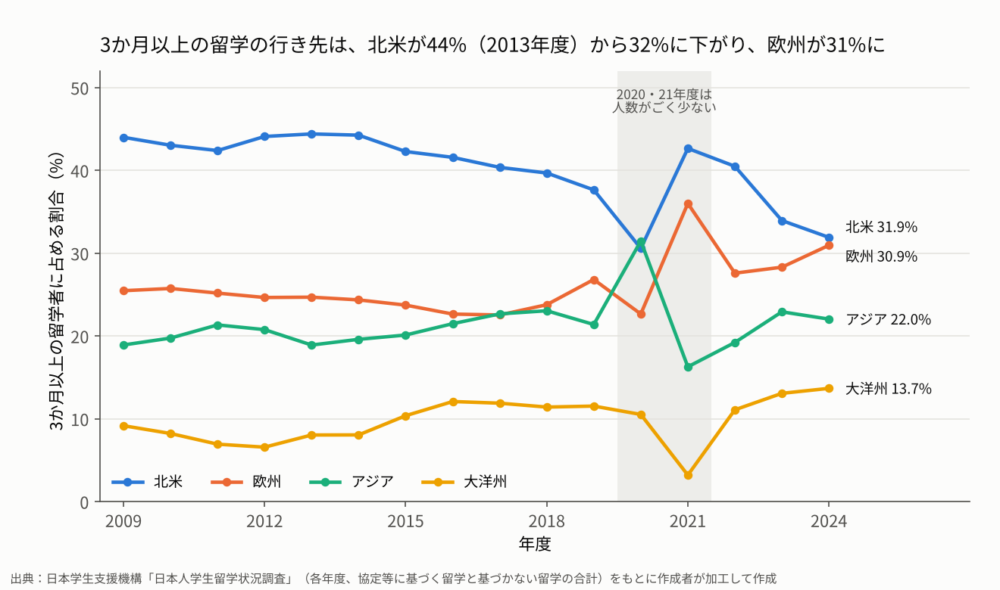

# F502 日本から海外へ留学する人は、減ったのか？ 2024年度は9.1万人で、山の2018年度の79%。1か月未満も3か月以上も約8割の戻りで、北米は65%

## 結論（先に）
- 日本の大学などが把握する日本人学生の留学者（その年度に海外で留学を始めた人）は、2009年度の36,302人から2018年度の115,146人まで増え、これが最多です。コロナの2020年度に1,487人まで減ったあと、2024年度は91,054人で、2018年度の79.1%（2019年度の84.8%）です。
- 戻り方は留学の長さでほとんど変わりません。2018年度と比べた2024年度は、1か月未満が78.8%、3か月以上（3か月以上の3区分の合計）が79.3%でした。「短い留学だけが戻り、長い留学は戻らない」という形ではありませんでした。
- 2009→2019年度の増加（+71,044人）の76.6%は1か月未満の留学の増加でした。留学者に占める1か月未満の割合は46.5%（2009年度）から66.2%（2024年度）に上がり、2018年度からは変わっていません。
- 地域で戻り方が違います。2018年度と比べた2024年度は、北米が64.7%、アジアが81.3%、欧州が86.4%、大洋州が92.4%でした。欧州の3か月以上の留学は103.2%で、2018年度を上回りました。
- 問い直しで3か月以上の留学の行き先を見ると、北米の割合は2013年度の44.4%から2024年度の31.9%に下がり、欧州（30.9%）とほぼ同じになりました。

## 問い
「日本の学生は内向きになり、留学しなくなった」という言い方があります。文部科学省の公表資料（2026年5月29日）では、日本学生支援機構（JASSO）の調査で2024年度の留学者は91,054人と前年度から増え、1か月未満以外の期間は前年度より減ったとされています。コロナ前の山と比べるとどこまで戻ったのか、戻っていないのは短い留学か長い留学か、行き先で違うのか。留学を考える学生と家族、大学の国際交流の担当、「留学離れ」の記事を読む人のために確かめます。

## データ（出典）
- 日本学生支援機構「日本人学生留学状況調査」（2017年度までは「協定等に基づく日本人学生留学状況調査」）、2009〜2024年度の各年度の結果（PDF）。日本の大学・大学院・短期大学・高等専門学校・専修学校（専門課程、2013年度から）が把握している、その年度に海外で留学を始めた日本人学生の延べ人数です。
  - 表「地域別・留学期間別日本人留学生数」を、協定等に基づく留学（以下、協定あり）と基づかない留学（協定なし、在籍校が把握している分、2009年度から）の2つ読み取り、足して合計にしました。期間は1か月未満、1か月以上3か月未満、3か月以上6か月未満、6か月以上1年未満、1年以上、不明の6区分です。
  - 地域の名前の変化（中近東→中東、オセアニア→大洋州、ヨーロッパ→欧州）は見出しの文字でそろえ、記入のない行は「その他・無記入」にまとめました。
- 文部科学省「日本人の海外留学者数」（ユネスコ統計局・米国 IIE などの統計を文部科学省が集計した、主に長期の留学）：公表資料の表の合計（2020〜2023年）。
- 文部科学省「学校基本調査」年次統計：大学・短大の在学者数（頑健性の分母）
- 読み取りの確かめ（data/build_checks.json）：期間の和＝計、地域の和＝計、協定あり＋なし＝各版の「合計」の表（2014年度以降）＝2024年度版の推移の表（16年度すべて）、翌年度の版の前年度の値との差（300行すべて0）。2018・2019・2024年度の期間別の値は、文部科学省の公表資料の図の数字とも目で照らしました。

## 事前の計画
[PLAN.md](PLAN.md)（2026-11-18 22:20、集計の前に作成）。下見で見たのは推移の表の合計と公表資料の本文の数字です。

| 仮説 | 外れの基準 | 結果 | 判定 |
|---|---|---|---|
| H1 2024年度の合計は2018年度を下回る | 2018年度以上 | 91,054人 ＜ 115,146人 | 支持 |
| H2 1か月未満は2018年度の90%以上に戻り、3か月以上は90%に届かない | 3か月以上も90%以上、または1か月未満が90%未満 | 1か月未満 78.8%、3か月以上 79.3% | 外れ |
| H3 2009→2019年度の増加の6割以上は1か月未満 | 6割未満 | 76.6% | 支持 |
| H4 北米は2018年度に届かず、アジアの戻りは北米より大きい | 北米の戻りがアジア以上 | 北米 64.7%、アジア 81.3% | 支持 |

## やったこと
1. 16年度分の PDF から表を読み取り（01b_extract.py。CSV を同梱）、協定あり＋なしの合計を作って照合しました（02_build.py）。
2. 期間別・地域別に、2018年度（最多の年）と2024年度を比べ、2009→2019年度の増加を期間別に分けました（03_analysis.py）。
3. 留学の長さの目安に、区分の中央の月数（1か月未満＝0.5〜1年以上＝12）を掛けた「留学の月数の合計」も出しました（置き方による目安で、推測を含みます）。
4. 結果を見てから、3か月以上の留学の行き先の割合を足しました（03b_requestion.py）。

## 分かったこと

### 1. 2018年度が山、2024年度は約8割（図1）

留学者は2009年度の36,302人から毎年増え、2018年度に115,146人になりました。2019年度は107,346人とすでに減り、2020年度は1,487人、2022年度 58,162人、2023年度 89,179人、2024年度 91,054人です。1人あたりの留学の月数の目安は、2009年度 3.58か月、2018年度 2.24か月、2024年度 2.23か月です。

### 2. 期間による戻り方の差は小さい（図2）

2018年度と比べた2024年度は、1か月未満 78.8%（76,545人→60,301人）、1か月以上3か月未満 82.1%、3か月以上6か月未満 82.6%、6か月以上1年未満 74.8%、1年以上 88.2%でした。3か月以上をまとめると27,542人から21,830人で79.3%です。2019年度と比べても、合計 84.8%、1か月未満 84.6%、3か月以上 87.7%で差は小さいままです。増えた時期は1か月未満が中心でしたが、減り方と戻り方はどの期間もおおむね同じでした。

### 3. 北米は65%、欧州の長い留学は2018年度を超えた（図3）

地域を表の順に見ると、アジア 81.3%（45,407人→36,904人）、中東 89.8%、アフリカ 105.8%、大洋州 92.4%、北米 64.7%（29,926人→19,363人）、中南米 48.2%、欧州 86.4%（24,115人→20,831人）でした。中東・アフリカ・中南米は人数が少なく（2018年度は373〜867人）、割合が動きやすい点に注意が要ります。3か月以上に絞ると、欧州は6,543人から6,752人（103.2%）に増え、北米は10,922人から6,962人（63.7%）に減りました。

## 問い直し（結果を見てから足した）

### 長い留学の行き先は、北米から欧州へ移ったのか（図4）

3か月以上の留学者に占める北米の割合は、2009年度の44.0%、2013年度の44.4%（最も高い年）から、2018年度 39.7%、2024年度 31.9%に下がりました。欧州は2018年度の23.8%から2024年度の30.9%に、大洋州は11.4%から13.7%に上がっています。2009〜2024年度で欧州が北米を上回った年はありませんが、差は1.0ポイントまで縮みました。北米の割合の低下はコロナの前（2014→2019年度）から続いています（2020・2021年度は人数が少なく、割合が揺れています）。

## 頑健性

| 確かめ方 | 合計の戻り | 1か月未満の戻り | 長い留学の戻り | 備考 |
|---|---|---|---|---|
| 本線（2018年度比、長い留学＝3か月以上） | 79.1% | 78.8% | 79.3% | |
| 基準を2019年度にする | 84.8% | 84.6% | 87.7% | |
| 協定ありだけ | 81.2% | 78.8% | 84.3% | |
| 長い留学を6か月以上にする | 79.1% | 78.8% | 76.6% | |
| 在学者1万人あたり | 79.1% | 78.8% | 79.3% | 大学＋短大の在学者は2018・2024年度でほぼ同じ（302.8万人） |
| 留学の月数の合計（中央の月数） | 78.9% | — | — | 置き方による目安 |
| 留学の月数の合計（1か月未満＝0.75、1年以上＝18か月） | 79.3% | — | — | 置き方による目安 |
| 別の統計：海外の機関が把握する留学者（主に長期、暦年） | — | — | — | 2020年 42,709人、2021年 41,612人、2022年 48,991人、2023年 50,139人 |

どの確かめ方でも「合計は2018年度の8割前後で、期間による差は小さい」は変わりませんでした。基準を2019年度にすると、長い留学（87.7%）が1か月未満（84.6%）をやや上回ります。別の統計（主に長期）は2020→2023年に17.4%増えていますが、数え方も年の区切りも違うので直接は比べられません。

## 言えないこと
- 調査は日本の大学などが把握している留学で、休学して個人で行く留学や、卒業後の留学は入りません。協定なしの人数は、在籍校がどこまで把握しているかでも変わります。
- 人数は延べ人数で、学生の何人に1人が留学したか（経験率）は出せません。
- 減った理由（円安・費用・日程など）や、北米の戻りが小さい理由は、この統計からは分かりません。
- 学位をとる長期の留学の長い推移は、2013年に定義が変わっていてつなげていません（2020〜2023年だけ参考に載せました）。
- 留学の月数の合計は、区分の中央の月数を置いた目安で、実際の期間の分布は分かりません。

## 仕事で使うなら
- 「留学が減った」「戻った」と書くときは、基準の年（2018年度か2019年度か）と、期間の区分を書き添えると読み違いが減ります（2024年度は2018年度の79.1%、2019年度の84.8%）。

## 計画からの変更
- 問い直し（3か月以上の留学の行き先の割合）は結果を見てから足しました。
- 地域の記入がない行（「その他」「無記入」「不明」）は、計画では触れていませんでしたが、計と合わせるために「その他・無記入」として残しました。

## 再現のしかた
```
sh src/run_all.sh          # オフライン。所要約3秒
python3 src/01_fetch.py    # 元データを取り直すときだけ（ネットを使う）
python3 src/01b_extract.py # PDF の表を CSV に読み取り直すときだけ（pdftotext が要る）
```

| ファイル | 中身 |
|---|---|
| src/01_fetch.py | PDF 19本と Excel 1本を取る（run_all.sh では呼ばない） |
| src/01b_extract.py | PDF → data/extract_*.csv（run_all.sh では呼ばない） |
| src/common.py | 年次統計の Excel を見出しの文字で読む関数 |
| src/02_build.py | 照合 → data/build_checks.json ほか分析用の CSV |
| src/03_analysis.py | 戻り・増加の分解・仮説・頑健性 → results/main.json ほか |
| src/03b_requestion.py | 問い直し → results/requestion.json・m3plus_by_region.csv |
| src/04_figures.py | 図4枚 |

repro_check：/tmp/rep_F502 に写して流し直し、16ファイル（results 7、figures 4、data 5）が cmp で一致、所要4秒。乱数なし。

## レビューで直したこと

独立レビューで、数字の照合（results・元の PDF／Excel）、再実行、図、書かないことを確かめました。直したのは次のとおりです。題名・数字・結論は変えていません。

| # | 指摘 | 直し方 |
|---|---|---|
| 1 | note の図4の節の見出し「北米一極から北米・欧州の二つへ」が、データ（2013年度の北米は44.4%で一極とまでは言えない、アジアも22%ある）より強い | 「北米の割合が下がり欧州と並んだ」に直した（README は元から問いの形で、直すところなし） |

## 出典
- 独立行政法人日本学生支援機構「日本人学生留学状況調査」（2009〜2024年度）：https://www.studyinjapan.go.jp/ja/statistics/japanese-students/ （各年度の PDF の URL は data/raw/SOURCES.md）
- 文部科学省「日本人の海外留学者数」及び「外国人留学生在籍状況調査」等について：https://www.mext.go.jp/a_menu/koutou/ryugaku/1412692_00003.htm
- 文部科学省「学校基本調査」年次統計（e-Stat）：https://www.e-stat.go.jp/stat-search/files?toukei=00400001&tstat=000001011528&tclass1=000001021812

（いずれも 日本学生支援機構「日本人学生留学状況調査」、文部科学省「日本人の海外留学者数」「学校基本調査」をもとに作成者が加工して作成）
