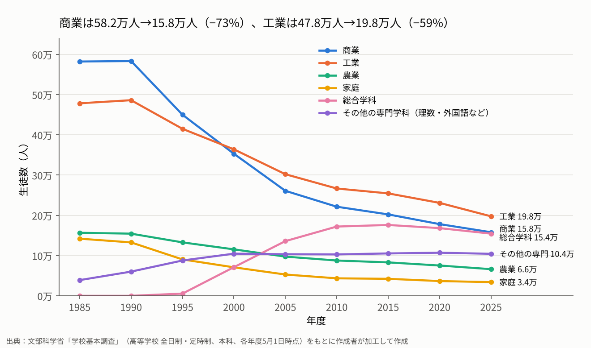
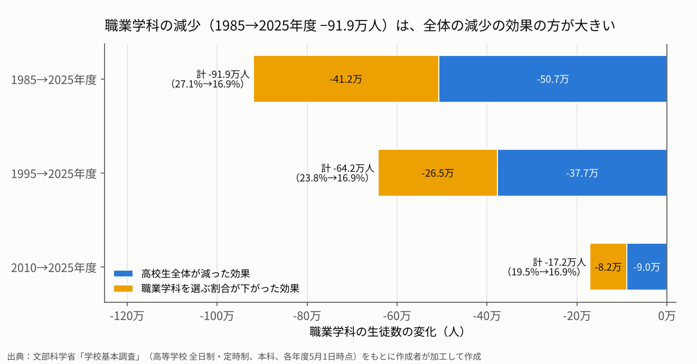
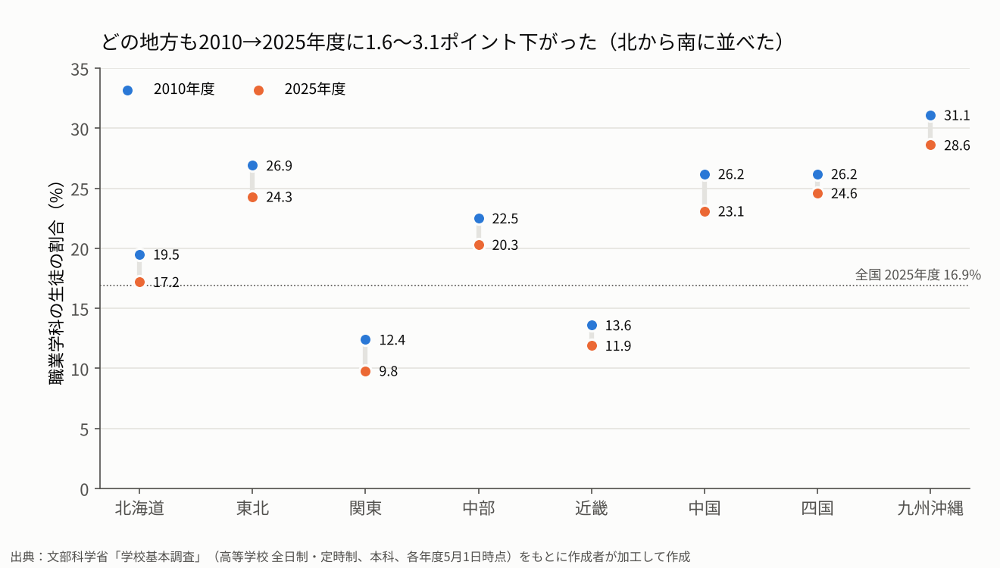
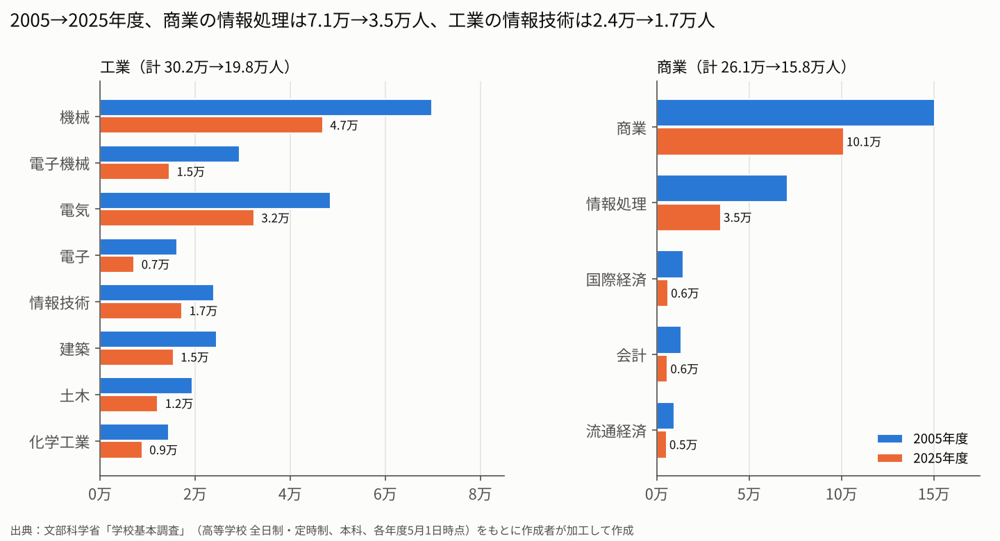

# F503 高校の専門学科（工業・商業・農業）に通う生徒は、どれだけ減ったのか？ 職業学科は1985→2025年度に140万人から48万人へ66%減。商業は73%減、工業は59%減

## 結論（先に）
- 高校（全日制・定時制）の職業学科（農業・工業・商業・水産・家庭・看護・情報・福祉）の生徒は、1985年度の140.2万人から2025年度の48.3万人へ、65.6%減りました。高校生全体（−44.6%）より速く減り、全体に占める割合は27.1%から16.9%に下がりました。
- 減った91.9万人を分けると、高校生全体が減った効果が50.7万人、職業学科を選ぶ割合が下がった効果が41.2万人で、全体の減少の効果の方が大きい結果でした（計画の仮説とは逆）。
- 学科別では、商業が58.2万人から15.8万人（−72.9%）、工業が47.8万人から19.8万人（−58.7%）、農業が15.7万人から6.6万人（−57.7%）、家庭が14.2万人から3.4万人（−76.1%）でした。1990年代の半ばまでは職業学科の中で商業が最も多い学科でしたが、2000年度以降は工業の方が多くなっています。
- 1994年度にできた総合学科は、1995→2025年度に14.9万人増えました。同じ期間の職業学科の減少（64.2万人）の23.2%にあたります。総合学科は2015年度の17.6万人が最多で、その後は減っています。
- 地方別（北から南）では、2010→2025年度にどの地方も職業学科の割合が1.6〜3.1ポイント下がりました。2025年度の割合は関東 9.8%、近畿 11.9%から、九州沖縄 28.6%まで幅があります。

## 問い
文部科学省のページ「高等学校学科別生徒数・学校数」には、職業学科（専門高校）の生徒の割合が、昭和30年（1955年）の40.1%から令和7年（2025年）の16.9%まで下がった表があります。割合が下がったことはよく知られていますが、人数ではどれだけ減ったのか、それは高校生が減ったからか、選ぶ人の割合が下がったからか、学科や地方でどう違うのかは、割合の表だけでは分かりません。専門高校を考える中学生と家族、高校や教育委員会の人、地元の高校の卒業生を採用する企業の人のために、人数で確かめます。

## データ（出典）
- 文部科学省「学校基本調査」（e-Stat）高等学校（全日制・定時制）の表「小学科別生徒数（本科）」：1985・1990・1995・2000・2005・2010・2015・2020・2025年度。大学科の計の行を、行の見出しの文字（「工業に関する学科」「専門｜工業｜計」など）で読みました。年度で表の形が違い、1985年度の商業は「計」の行が大学科の名前の行より前にあるので、その形も見出しで判定しています。
- 同「都道府県別 学科別学年別生徒数（本科）」：2010年度（国立・公立・私立の表を足す）と2025年度（「計 全日制＋定時制」のシート）。都道府県の名前は行の見出しの文字で付け、地方にまとめました。
- 照合：文部科学省のページ「高等学校学科別生徒数・学校数」の構成比の表。自分で集計した割合（普通科・職業学科・その他の専門学科・総合学科）は、9年度すべてで差が0.1ポイント以内でした（results/check_vs_mext.csv）。
- 読み取りの確かめ（data/build_checks.json）：各年度で大学科の和＝計（9年度すべて）、都道府県の和＝全国の値（2010・2025年度、全学科）。2025年度の北海道（105,383人）・沖縄県（42,544人）の計は元の表と目で照らしました。
- 用語：この記事の「職業学科」は、文部科学省のページと同じく、農業・工業・商業・水産・家庭・看護・情報・福祉の8学科の合計です。理数・外国語・体育などの「その他の専門学科」と総合学科は含みません。普通科には、2022年度からの普通教育を主とする学科（学際領域・地域社会など）を含めます。

## 事前の計画
[PLAN.md](PLAN.md)（2026-11-18 22:30、集計の前に作成）。下見では、文部科学省のページの構成比の表と2025年度の学科別生徒数を見ていました。

| 仮説 | 外れの基準 | 結果 | 判定 |
|---|---|---|---|
| H1 職業学科は1985→2025年度に半分以下 | 減少が50%未満 | −65.6% | 支持 |
| H2 割合の低下の効果が、全体の減少の効果より大きい | 全体の効果の方が大きい | 割合 −41.2万、全体 −50.7万 | 外れ |
| H3 商業の減少率は工業より大きい | 工業の減少率が商業以上 | 商業 −72.9%、工業 −58.7% | 支持 |
| H4 総合学科の増加は職業学科の減少の半分に届かない | 半分以上 | 23.2% | 支持 |
| H5 どの地方も2010→2025年度に割合が下がった | どこかで上がった | 8地方すべて −1.6〜−3.1ポイント | 支持 |

## やったこと
1. 9年度分の全国の表と、2年度分の都道府県の表から、年度×大学科の生徒数を作りました（02_build.py）。
2. 大学科ごとの人数・割合・1985年度比を出し、職業学科の人数の変化を「全体の人数の効果」と「割合の効果」に分けました（2つの年の平均を重みにする対称な形、03_analysis.py）。
3. 都道府県を8地方（北海道・東北・関東・中部・近畿・中国・四国・九州沖縄）にまとめて割合を出しました。
4. 結果を見てから、工業と商業の中の小学科を足しました（03b_requestion.py）。

## 分かったこと

### 1. 商業が最も大きく減り、2000年度以降は工業が上回る（図1）

商業は1990年度まで58万人台で最も多い学科でしたが、2025年度は15.8万人です。工業は2000年度に36.4万人で商業（35.3万人）を上回り、2025年度は19.8万人です。家庭は14.2万人から3.4万人（−76.1%）と、減少率では最も大きくなりました。一方、理数・外国語などの「その他の専門学科」は3.9万人から10.4万人に増え、総合学科は2015年度の17.6万人をピークに2025年度は15.4万人です。

### 2. 減った分の55%は高校生全体の減少（図2）

高校生全体は1985年度の517.2万人から2025年度の286.5万人に減りました（−44.6%）。職業学科の減少91.9万人のうち、全体の減少の効果は50.7万人（55%）、割合の低下（27.1%→16.9%）の効果は41.2万人です。期間を1995→2025年度にしても（全体 −37.7万、割合 −26.5万）、2010→2025年度にしても（全体 −9.0万、割合 −8.2万）、全体の効果の方が大きい結果でした。

### 3. どの地方も割合が下がった（図3）

2010→2025年度の職業学科の割合は、北海道 19.5%→17.2%、東北 26.9%→24.3%、関東 12.4%→9.8%、中部 22.5%→20.3%、近畿 13.6%→11.9%、中国 26.2%→23.1%、四国 26.2%→24.6%、九州沖縄 31.1%→28.6%でした。人数では、どの地方も22〜36%減っています。大都市を含む関東・近畿は割合がもともと低く、地方の差は15年間で縮まっていません。

## 問い直し（結果を見てから足した）

### 工業と商業の中では、どの小学科が減ったのか（図4）

小学科の分類は1990年度と2005年度の間で変わっている（電子機械などが分かれた）ので、2005→2025年度で比べました。商業では、商業関係が15.0万人から10.1万人、情報処理関係が7.1万人から3.5万人に減り、情報処理の商業に占める割合は27.2%から21.9%に下がりました。工業では、機械関係が7.0万人から4.7万人、電気関係が4.9万人から3.2万人に減りました。情報技術関係は2.4万人から1.7万人に減ったものの、工業に占める割合は7.9%から8.8%に上がっています。どの小学科でも、各年度の小学科の和は大学科の計と一致しました。

## 頑健性

| 確かめ方 | 職業学科などの変化 | 全体の効果 | 割合の効果 | 割合 |
|---|---|---|---|---|
| 本線：職業学科（8学科）1985→2025年度 | −91.9万人（−65.6%） | −50.7万 | −41.2万 | 27.1%→16.9% |
| 期間を変える：1995→2025年度 | −64.2万人（−57.1%） | −37.7万 | −26.5万 | 23.8%→16.9% |
| 期間を変える：2010→2025年度 | −17.2万人（−26.2%） | −9.0万 | −8.2万 | 19.5%→16.9% |
| 農業・工業・商業の3学科だけ、1985→2025年度 | −79.6万人（−65.4%） | −44.1万 | −35.4万 | 23.5%→14.7% |
| 普通科以外（その他の専門・総合学科を含む） | −69.9万人（−48.5%） | −62.0万 | −8.0万 | 27.9%→25.9% |
| 文部科学省の構成比との照合 | — | — | — | 9年度すべて差 0.1ポイント以内 |
| 地方別を都道府県の単純平均で | — | — | — | 8地方すべてで2025年度が2010年度より低い |

どの期間・定義でも、職業学科は全体より速く減り、全体の減少の効果の方が大きい結果でした。普通科以外をまとめると、割合はほとんど下がっておらず（27.9%→25.9%）、職業学科の割合の低下の多くは、その他の専門学科と総合学科への移り変わりと時期が重なります（同じ生徒の選び方の変化かどうかは確かめられません）。

## 言えないこと
- 職業学科を選ぶ人が減った理由（大学への進学の増加、学校の統合や学科の改編、定員の設定）は、この統計からは分かりません。
- 学科の名前の付け替えや改編があっても、統計の大学科・小学科の分類に従っているので、教える中身の変化は追えません。
- 割合の効果には、生徒が選んだ結果だけでなく、学校側の定員（募集の枠）の変化も含まれます。両者は分けられません。
- 卒業後の進路（就職・進学）や、地域の産業との関係は扱っていません。
- 地方別は2010・2025年度の2時点だけです。

## 仕事で使うなら
- 「専門高校の生徒が減った」と言うときは、割合（27.1%→16.9%）と人数（140.2万→48.3万人）のどちらかを明記し、人数の減少の半分以上は高校生全体の減少によることを添えると、誤解が減ります。
- 年度×学科の値は results/by_year.csv、地方別は results/by_region.csv にあります。

## 計画からの変更
- 問い直し（工業・商業の小学科）は結果を見てから足しました。小学科の分類が変わるので、2005→2025年度に絞りました。
- 頑健性の「都道府県の単純平均」は、地方ごとの割合の上下だけを確かめました（値は by_region.csv）。

## 再現のしかた
```
sh src/run_all.sh        # オフライン。所要約6秒
python3 src/01_fetch.py  # 元データを取り直すときだけ（ネットを使う）
```

| ファイル | 中身 |
|---|---|
| src/01_fetch.py | e-Stat の Excel 11本と文部科学省のページを取る（run_all.sh では呼ばない） |
| src/common.py | Excel（.xls・.xlsx）を読み、見出しの文字と最初の数を返す関数 |
| src/02_build.py | 全国・都道府県の学科別生徒数と照合 → data/national_by_course.csv・pref_by_course.csv・mext_share_table.csv・build_checks.json |
| src/03_analysis.py | 割合・分解・地方別・仮説・頑健性 → results/main.json ほか |
| src/03b_requestion.py | 問い直し → results/requestion.json・requestion_subcourses.csv |
| src/04_figures.py | 図4枚 |

repro_check：/tmp/rep_F503 に写して流し直し、15ファイル（results 7、figures 4、data 4）が cmp で一致、所要6秒。乱数なし。

## レビューで直したこと

独立レビューで、数字の照合（results・元の PDF／Excel）、再実行、図、書かないことを確かめました。直したのは次のとおりです。題名・数字・結論は変えていません。

| # | 指摘 | 直し方 |
|---|---|---|
| 1 | 「1990年代の半ばまでは商業が最も多い学科」は、普通科を含めると読み違えられる | 「職業学科の中で商業が最も多い学科」に直した（README と note） |

## 出典
- 文部科学省「学校基本調査」（e-Stat）：https://www.e-stat.go.jp/stat-search/files?toukei=00400001&tstat=000001011528 （各表の URL は data/raw/SOURCES.md）
- 文部科学省「高等学校学科別生徒数・学校数」：https://www.mext.go.jp/a_menu/shotou/shinkou/genjyo/021201.htm

（いずれも 文部科学省「学校基本調査」をもとに作成者が加工して作成）
