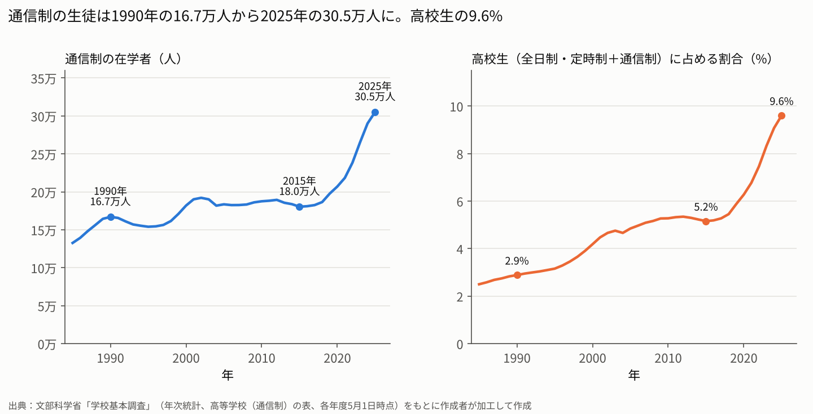
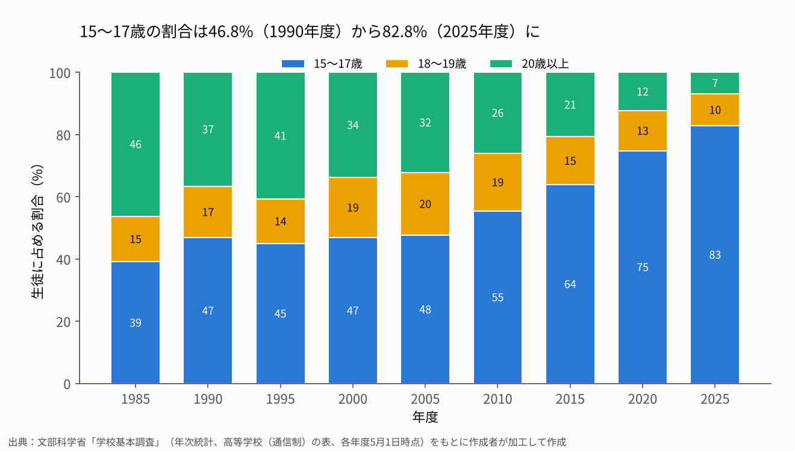
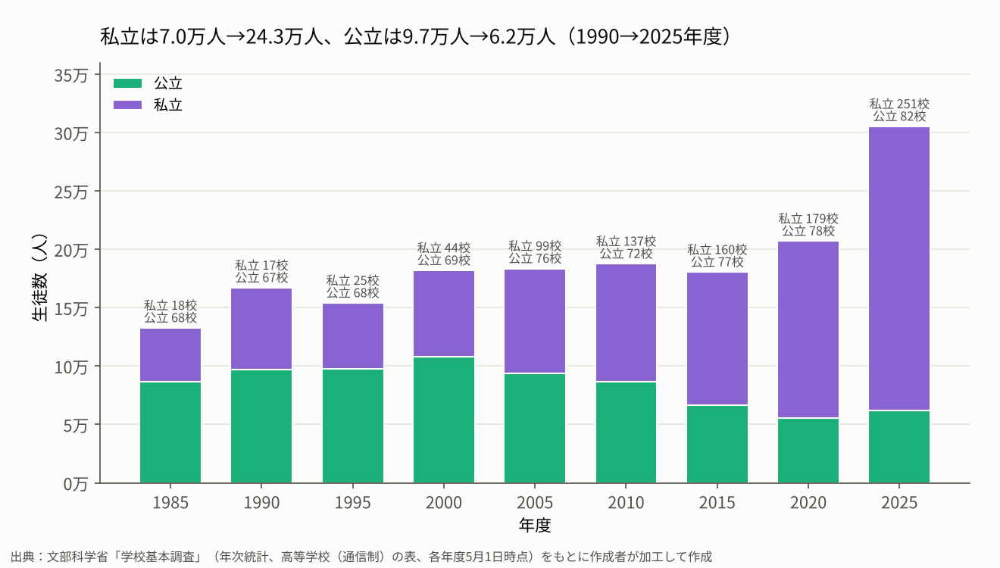
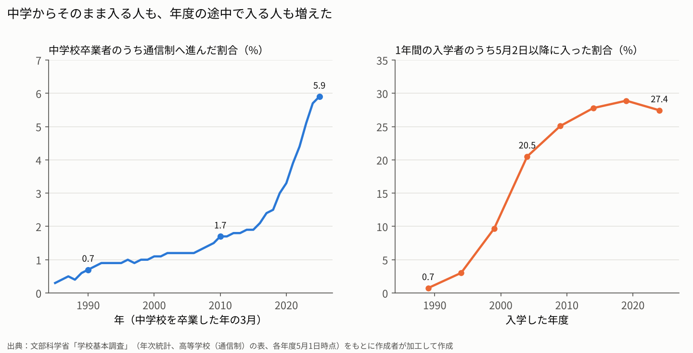

# F504 通信制高校に通う生徒は、どこで増えたのか？ 1990→2025年に16.7万人から30.5万人へ83%増。15〜17歳が8割を超え、私立が8割

## 結論（先に）
- 通信制の高校の生徒は、1990年の16.7万人から2025年の30.5万人へ、82.8%増えました。同じ間に全日制・定時制は562.3万人から287.4万人へ48.9%減り、高校生全体に占める通信制の割合は2.9%から9.6%になりました。増え方が速いのは2015年以降で、2015→2025年だけで69.2%増えています。
- 生徒の年齢が若くなりました。15〜17歳の割合は1990年度の46.8%から2025年度の82.8%に上がり、20歳以上は36.6%から6.9%に下がりました。1990→2025年度の生徒の増加（13.8万人）は、15〜17歳の増加（17.4万人）より小さく、20歳以上は4.0万人減っています。
- 増えたのは私立です。私立の生徒は7.0万人から24.3万人に増え、公立は9.7万人から6.2万人に減りました。私立の割合は41.7%から79.7%です。通信制だけを置く学校（独立校）は12校から143校になり、そのうち私立が137校です。
- 入る経路も変わりました。中学校の卒業者のうち、通信制にそのまま進んだ人の割合（進学率の差）は、1990年の0.7%、2000年の1.1%から、2025年の5.9%に上がりました。また、1年間の入学者のうち5月2日以降に入った人の割合は、1989年度の0.7%から2024年度の27.4%になりました。

## 問い
高校生が減る中で、通信制の高校の生徒は増えています。たたき台の問いは「なぜ増えたのか」でしたが、一人ひとりがなぜ選んだのかは統計からは分かりません。この記事では、統計で見える範囲に絞り、「どこで増えたのか」を確かめます。どの年齢の生徒が増えたのか、公立か私立か、通信制だけの学校か全日制などに併せて置かれた課程か、中学からそのまま入るのか年度の途中から入るのか、です。高校の進路を考える中学生と家族、高校や教育委員会の人、「通信制高校が増えている」という報道を読む人のための記事です。生徒個人の事情にかかわる話題は扱いません。

## データ（出典）
- 文部科学省「学校基本調査」年次統計（e-Stat）
  - 総括表2「在学者数」：高等学校（全日制・定時制）と高等学校（通信制）の在学者（毎年）。
  - 総括表1「学校数」：高等学校の「通信教育のみを行う学校数（別掲）」。
  - 総括表4「進学率」：高等学校等への進学率（計）と、通信制課程（本科）への進学者を除いた進学率。差を「中学校卒業者のうち通信制にそのまま進んだ人の割合」の目安にしました。
- 同 高等学校（通信制）の表（1985〜2025年度、5年ごと）：「年齢別生徒数」（公立・私立別）、「学校数・学科数」（独立校・併置校、公立・私立別）、「入学者数・退学者数及び単位修得者数」（1990年度から。入学者だけを使用）。
- 読み取りの確かめ（data/build_checks.json）：年齢の行は見出しの文字（「15歳」「20～24〃」「60歳以上」など）で付け、年齢の和＝計、公立＋私立＝計を確かめました。年齢別の表の計は年次統計の通信制の在学者と9年度すべて一致し、学校数の表の独立校の計は年次統計の「通信教育のみを行う学校数」と9年度すべて一致しました。入学者の列は見出しの文字（「当該年度」「前年度間」）で選びました。1985年度の表は60〜64歳と65歳以上に分かれているので、足して60歳以上にしました。

## 事前の計画
[PLAN.md](PLAN.md)（2026-11-18 22:35、集計の前に作成）。下見で見たのは、年次統計の在学者・学校数・進学率の3年分と、表の先頭の数行です。

| 仮説 | 外れの基準 | 結果 | 判定 |
|---|---|---|---|
| H1 通信制は1990→2025年に50%以上増え、全日制・定時制は減った | 増加が50%未満、または全日制・定時制が増加 | +82.8%、全日制・定時制 −48.9% | 支持 |
| H2 15〜17歳の割合が1990年度に50%未満、2025年度に70%以上 | どちらかを満たさない | 46.8% → 82.8% | 支持 |
| H3 1990→2025年度の増加の8割以上が私立 | 8割未満 | 私立の増加は全体の増加の125.5%（公立は減少） | 支持 |
| H4 中学校から通信制にそのまま進んだ割合が2000→2025年に+4ポイント以上 | +4ポイント未満 | 1.1% → 5.9%（+4.8） | 支持 |
| H5 2024年度の入学者のうち5月2日以降が25%以上 | 25%未満 | 27.4% | 支持 |

## やったこと
1. 年次統計3表と、通信制の表（9年度分の年齢・学校数、8年度分の入学者）から、分析用の表を作りました（02_build.py）。
2. 在学者と高校生全体に占める割合、年齢の構成（15〜17歳・18〜19歳・20歳以上）、公立・私立、独立校・併置校を年ごとに並べました（03_analysis.py）。
3. 入学者の表には、前年度の「当該年度の入学者（5月1日まで）」と、今年度の「前年度間の入学者（4月〜翌3月の1年間）」が載っています。同じ年度どうしを比べ、5月2日以降に入った人の割合＝1−（5月1日までの入学者÷1年間の入学者）を出しました。
4. 結果を見てから、私立の増加を「学校の数」と「1校あたりの生徒」に分けました（03b_requestion.py）。

## 分かったこと

### 1. 2015年以降に急に増えた（図1）

通信制の生徒は、1990年代の半ばに一度減り（1995年 15.4万人）、2000〜2015年は18万人前後でした。2015年の18.0万人から2025年の30.5万人へ、10年で69.2%増えています。高校生全体に占める割合は、1990年 2.9%、2000年 4.2%、2015年 5.2%、2025年 9.6%です。

### 2. 生徒の8割以上が15〜17歳に（図2）

15〜17歳の生徒は1990年度の7.8万人から2025年度の25.3万人に増え、20歳以上は6.1万人から2.1万人に減りました。15〜18歳で区切っても、58.3%から90.5%に上がります。公立でも15〜17歳の割合は23.6%から48.6%に上がり、私立は79.2%から91.5%です。公立では2025年度も20歳以上が27.7%を占めます。

### 3. 私立が生徒の8割、学校の4分の3（図3）

私立の学校（独立校と併置校の合計）は1990年度の17校から2025年度の251校に、公立は67校から82校になりました。独立校は公立が5校から6校、私立が7校から137校です。生徒に占める私立の割合は、2005年度に48.9%、2010年度に53.7%と半分を超え、2025年度は79.7%です。

### 4. 中学からそのまま、そして年度の途中から（図4）

中学校の卒業者のうち通信制にそのまま進んだ割合は、2010年に1.7%、2020年に3.3%、2025年に5.9%でした。1年間の入学者は、1989年度の4.3万人から2024年度の12.0万人に180.8%増え、そのうち5月1日までの入学者は4.2万人から8.7万人（+105.3%）、5月2日以降の入学者は317人から3.3万人になりました。5月2日以降の割合は2004年度に20.5%で、2009年度以降は25〜29%で推移しています（5年ごとの値）。

## 問い直し（結果を見てから足した）

### 私立が増えたのは、学校の数か、1校あたりの生徒か
私立の1校あたりの生徒は、1990年度 4,101人、2010年度 735人、2025年度 969人でした。1990年代から2010年度までは学校の数が先に増え（17校→137校）、1校あたりは小さくなりました。2010→2025年度は、生徒が2.42倍、学校の数が1.83倍、1校あたりが1.32倍で、増えた分（対数で見た伸び）の68.7%が学校の数の増加によるものでした（2015→2025年度は59.2%）。2025年度の私立の学校は、面接指導や学習の支援をする「通信教育連携協力施設」を計3,594か所（1校あたり14.3か所）置いています（公立は136か所）。

## 頑健性

| 確かめ方 | 結果 |
|---|---|
| 期間を変える：在学者の変化 1990→2025年 | 通信制 +82.8%、全日制・定時制 −48.9%、割合 2.88%→9.60% |
| 同 2000→2025年 | 通信制 +67.8%、全日制・定時制 −31.0%、割合 4.18%→9.60% |
| 同 2015→2025年 | 通信制 +69.2%、全日制・定時制 −13.4%、割合 5.16%→9.60% |
| 年齢の区切りを15〜18歳にする | 58.3%→90.5% |
| 15歳だけ | 16.3%→21.7% |
| 年齢別の表の計と年次統計の在学者 | 9年度すべて一致 |
| 独立校の計と年次統計の通信教育のみの学校数 | 9年度すべて一致（12校→143校など） |

期間・年齢の区切りを変えても、「全日制・定時制が減る中で通信制が増え、若い年齢が中心になった」は変わりませんでした。

## 言えないこと
- 一人ひとりが通信制を選んだ理由は、この統計からは分かりません（この記事では扱っていません）。
- 5月2日以降の入学が、ほかの高校からの転校（転入学）か、いったん高校を離れた人の入学（編入学）か、秋に入学を受け付ける学校の入学かは、この表では分けられません。表に入学者の数え方の注がなく、1990年代から2000年代に割合が大きく上がった分には、学校の報告のしかたの変化が混ざっている可能性もあります（推測）。
- 生徒がどこに住んでいるかは分かりません（広い地域から生徒を受け入れる学校があります）。
- 学校での学び方（登校の日数、連携協力施設の使い方）は、統計の項目にありません。
- 進学率の差は、中学校を卒業してすぐに通信制に進んだ人の目安で、1年以上たってから入った人は含みません。

## 仕事で使うなら
- 「通信制の生徒が増えた」と言うときは、増えたのが15〜17歳と私立であること、公立は減っていることを添えると、実態に近く伝わります。
- 年ごとの値は results/by_year_nenji.csv（毎年）、by_year_age.csv・by_year_schools.csv・by_year_entrants.csv（5年ごと）にあります。

## 計画からの変更
- 問いを「なぜ増えたのか」から「どこで増えたのか」に直しました（PLAN.md に書いたとおり。予備への差し替えではありません）。
- 問い直し（私立の学校数と1校あたりの生徒）は結果を見てから足しました。
- PLAN.md の「扱わない話題」の書き方を、集計のあとに二か所言い換えました（分析の中身は変えていません）。

## 再現のしかた
```
sh src/run_all.sh        # オフライン。所要約5秒
python3 src/01_fetch.py  # 元データを取り直すときだけ（ネットを使う）
```

| ファイル | 中身 |
|---|---|
| src/01_fetch.py | e-Stat の Excel 29本を取る（run_all.sh では呼ばない） |
| src/common.py | Excel を見出しの文字で読む関数 |
| src/02_build.py | 年次統計・年齢・学校数・入学者の表と照合 → data/*.csv・build_checks.json |
| src/03_analysis.py | 推移・仮説・頑健性 → results/main.json ほか |
| src/03b_requestion.py | 問い直し → results/requestion.json・requestion_per_school.csv |
| src/04_figures.py | 図4枚 |

repro_check：/tmp/rep_F504 に写して流し直し、17ファイル（results 8、figures 4、data 5）が cmp で一致、所要4秒。乱数なし。

## レビューで直したこと

独立レビューで、数字の照合（results・元の PDF／Excel）、再実行、図、書かないことを確かめました。直したのは次のとおりです。題名・数字・結論は変えていません。

| # | 指摘 | 直し方 |
|---|---|---|
| 1 | note の「1995年の15.4万人から2015年の18.0万人まで、ほぼ横ばい」は、その間に17%増えていて README（2000〜2015年は18万人前後）と言い方がずれる | 「1995年の15.4万人のあと、2000〜2015年は18万人前後でほぼ横ばい」に直した |
| 2 | 「2009年度以降は25〜29%で推移」は5年ごとの4点からの言い方 | README と note に「（5年ごとの値）」を足した |

## 出典
- 文部科学省「学校基本調査」（e-Stat）：https://www.e-stat.go.jp/stat-search/files?toukei=00400001&tstat=000001011528 （各表の URL は data/raw/SOURCES.md）

（いずれも 文部科学省「学校基本調査」をもとに作成者が加工して作成）
