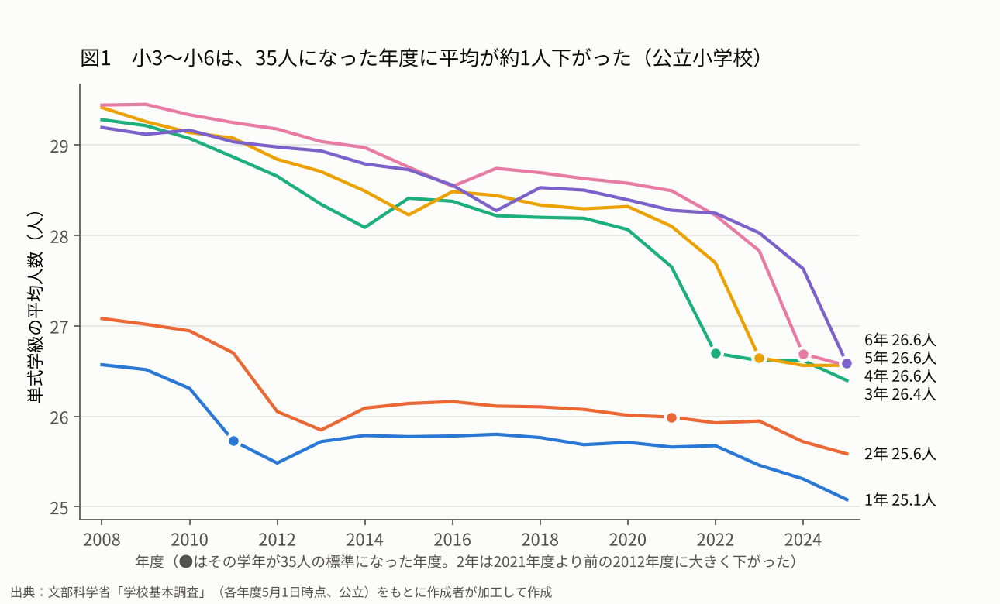
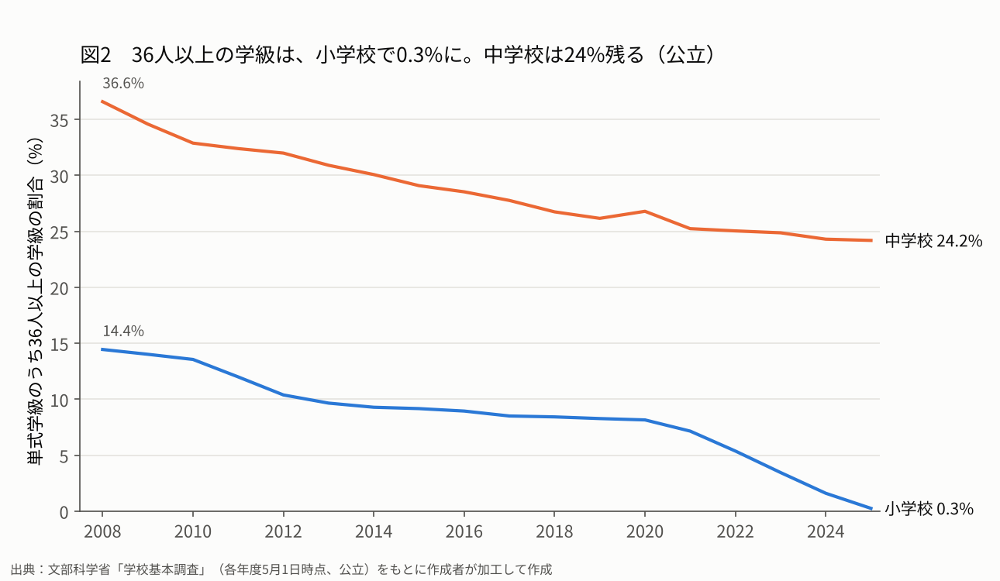
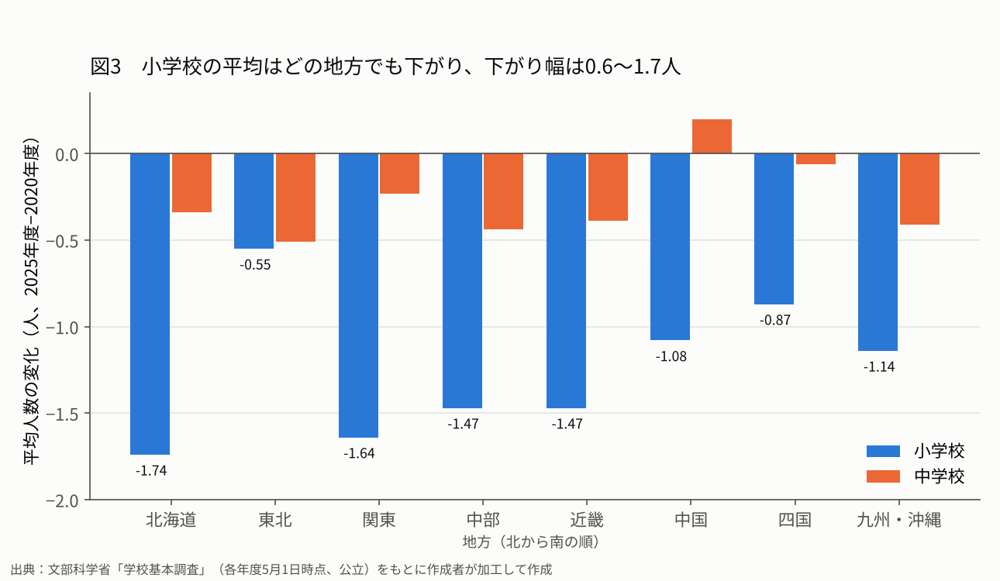
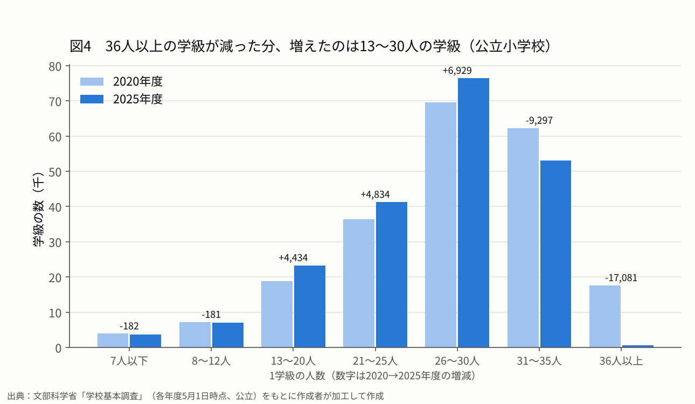

# F505 1学級の人数は、35人学級でどれだけ減ったのか？ 公立小の平均は2020→2025年度に27.5人から26.1人へ1.3人減、36人以上の学級は8.2%から0.3%に。中学校は0.3人減

## 結論（先に）
- 公立小学校の単式学級（同じ学年だけの学級）の平均人数は、2020年度の27.48人から2025年度の26.14人へ、1.34人下がりました。その前の5年（2015→2020年度）は0.14人しか下がっていません。
- 学年ごとに見ると、小3〜小6は、それぞれ35人の標準になった年度（2022〜2025年度）に、前の年より0.96〜1.14人下がり、2009〜2025年度で最も大きい下がりでした。同じ年のまだ35人でない学年の下がりを引いた「差の差」は、4学年の平均で −0.80人です。
- 小2は、標準が変わった2021年度にはほとんど下がらず（−0.02人）、最も大きく下がったのは2012年度（−0.65人）でした。小1は2011年度に −0.58人です。
- 36人以上の学級は、公立小の単式学級の8.16%（2020年度、17,624学級）から0.26%（2025年度、543学級）になりました。減った分、増えたのは13〜30人の学級で、上限のすぐ下の31〜35人の学級はかえって9,297減りました。
- 40人の標準のままの公立中学校は、同じ5年で31.90人から31.60人へ0.29人下がっただけで、36人以上の学級は24.19%残っています。

## 問い
公立小学校の学級編制の標準は、2021年度の小2から1学年ずつ40人から35人に下がり、2025年度の小6で全学年がそろいました（文部科学省『教育委員会月報』2021年6月号の説明）。1年生はそれより前から35人です。ただ、もともと多くの学級は35人以下なので、「35人学級」で実際の学級の人数がどれだけ変わったのかは別に確かめる必要があります。小学校の子どもがいる家族、学校や教育委員会で働く人、教員や教室の数の話を読む人のために、学校基本調査で確かめます。

## データ（出典）
- 文部科学省「学校基本調査」（e-Stat、各年度5月1日時点）、2008〜2025年度の18年分。小学校と中学校それぞれ3つの表です。
  - 「編制方式別学級数」：単式学級の学年別の数（国立・公立・私立、公立は都道府県別）。
  - 「学級編制方式別児童数（生徒数）」：同じ区分の児童生徒数。
  - 「収容人員別学級数」：学級の人数の幅（7人以下、8〜12人、13〜20人、21〜25人、26〜30人、31〜35人、36〜40人、41〜45人…）ごとの数。公立は単式・複式・特別支援の別があります。
- 平均人数は「単式学級の児童生徒数 ÷ 単式学級の数」です。主に公立を見ます。
- 108ファイルは年によって形（.xls と .xlsx、見出しの並び）が違うので、行は「公立」「公立の内訳｜北海道」などの区分の文字で、列は「単式学級｜3学年」などの見出しの文字で選びました。国立＋公立＋私立＝計、都道府県の和＝公立、人数の幅の和＝計、公立の単式学級の幅の計＝編制方式別の単式学級数を、全年度で照合し、すべて一致しました（data/build_checks.json、2,964件）。いくつかの値（2008年度の公立の小1の学級 42,614、2008年度の高知の小1 322、2022年度の埼玉の児童 347,992、2025年度の北海道の学級 7,649 と児童 189,801、2022年度の宮城の中学校の学級 1,802）は元の表と目で照らしました。
- 1か所だけ合わないところがあります。2024年度の表にある「2023年度」の行の単式学級の数は、2023年度の表より各学年33ずつ（計198）多い値です。後から直された値と思われます（推測）。分析では各年度の表の値を使いました（影響は「頑健性」）。

## 事前の計画
[PLAN.md](PLAN.md)（2026-11-18 22:25、平均を集計する前に作成）。下見では、2025年度の表の先頭の行（36〜40人の学級が2024年度 3,916 → 2025年度 1,081 など）を目にしていました。

| 仮説 | 外れの基準 | 結果 | 判定 |
|---|---|---|---|
| H1 公立小の平均は2020→2025年度に下がり、2015→2020年度より大きく下がる | 下がり幅が2015→2020年度以下 | −1.34人（2015→2020年度は −0.14人） | 支持 |
| H2 小2〜小6で、35人になった年度の下がりが最も大きい | 2学年以上で別の年度 | 小3〜小6は一致、小2だけ2012年度 | 支持（4/5） |
| H3 36人以上の割合は2020年度に10%以上、2025年度に1%以下 | どちらかを満たさない | 8.16% → 0.26% | 外れ（2020年度はすでに10%未満） |
| H4 中学校の平均の下がりは小学校より小さい | 中学校の下がりが小学校以上 | 中 −0.29人、小 −1.34人 | 支持 |
| H5 学級の数の減り（%）は児童数の減り（%）より小さい | 学級の減りの方が大きい | 学級 −4.88%、児童 −9.53% | 支持 |

## やったこと
1. 108本の Excel から、学校種・年度・区分・学年ごとの単式学級の数と児童生徒数（data/grade_panel.csv）と、人数の幅ごとの学級の数（data/sizebins.csv）を作りました（02_build.py）。
2. 学年別・年度別の平均と、前の年からの差を出しました。
3. その学年が35人になった年度の下がりから、同じ年度のまだ35人でない上の学年の下がりの平均を引きました（差の差。子どもの数の減りなど、その年に共通の動きをおおまかに除く目安です）。小6は上の学年がないので、中学校1〜3年で代えました。
4. 平均＝児童数÷学級数なので、平均の変化（対数）を「児童数の変化」と「学級の数の変化」の差に分けました。
5. 都道府県別（公立）の2020→2025年度の変化を、北から南の順と地方別に並べました（03_analysis.py）。
6. 結果を見てから、人数の幅ごとの学級の数の動きを足しました（03b_requestion.py）。

## 分かったこと

### 1. 小3〜小6は、35人になった年度に約1人下がった（図1）

前の年からの下がりは、小3が2022年度に −0.96人、小4が2023年度に −1.05人、小5が2024年度に −1.14人、小6が2025年度に −1.05人です。同じ年度のまだ35人でない学年の下がりは −0.07〜−0.40人だったので、差の差は −0.72〜−0.98人（平均 −0.80人）です。小2は2021年度に −0.02人で、2012年度に −0.65人下がっていました。小2は2012年度から国の加配（教員を上乗せして配る措置）で35人以下にする運用が始まったと説明されることが多いですが、この記事では資料で確かめていません（推測）。小1は2011年度に −0.58人です。2025年度の平均は、小1 25.08人、小2 25.59人、小3〜小6 26.40〜26.58人です。

### 2. 36人以上の学級は、ほぼなくなった（図2）

公立小の単式学級のうち36人以上の割合は、2008年度 14.45%、2020年度 8.16%、2025年度 0.26%です。2010→2012年度にも下がっています（13.56% → 10.39%）。2025年度でも543学級が36人以上です（理由はこの統計では分かりません）。公立中学校は2008年度 36.58%、2025年度 24.19%です。

### 3. どの地方でも下がった（図3）

2020→2025年度の公立小の平均の変化は、地方別で北海道 −1.74、東北 −0.55、関東 −1.64、中部 −1.47、近畿 −1.47、中国 −1.08、四国 −0.87、九州・沖縄 −1.14人です。47都道府県では44で下がり、3（岩手 +0.11、福島 +0.92、高知 +0.02）で少し上がりました。真ん中の値は −1.15人です。2020年度に36人以上の学級が10%以上あった都道府県は10、2025年度は47すべてで1%以下（最大 0.79%）です。もともと36人以上の学級が少なかった地域では、下がる余地が小さかったと考えられます（推測。都道府県の独自の少人数学級の取り組みは分けていません）。都道府県ごとの値は results/by_pref.csv にあります（北から南の順）。

### 4. 平均が下がったのは、学級が子どもほど減らなかったから
2020→2025年度に、公立小の単式学級の児童数は 5,932,459人 → 5,366,900人（−9.53%）、学級の数は 215,871 → 205,327（−4.88%）でした。2015→2020年度は児童数 −5.02%、学級 −4.54%で、ほぼ同じ割合で減っていました。中学校の2020→2025年度は生徒 −5.13%、学級 −4.25%です。

## 問い直し（結果を見てから足した）

### 36人以上の学級は、何人の学級になったのか（図4）

上限を下げると「35人ぎりぎりの学級」が増えそうに思えますが、そうではありませんでした。2020→2025年度に、36人以上は −17,081、31〜35人も −9,297学級です。増えたのは26〜30人（+6,929）、21〜25人（+4,834）、13〜20人（+4,434）です。たとえば38人の学年は、35人の上限では19人ずつ2学級になります。25人以下の学級の割合は30.77%から36.69%になりました。中学校は36人以上が −3,255、26〜30人が +762 でした。

## 頑健性

| 確かめ方 | 期間 | 小学校の平均 | 小学校の変化 | 中学校の変化 |
|---|---|---|---|---|
| 本線（公立・単式学級） | 2020→2025 | 27.48→26.14 | −1.34 | −0.29 |
| 全学級（複式・特別支援を含む） | 2020→2025 | 22.99→21.25 | −1.74 | −1.15 |
| 国立・私立を含む計 | 2020→2025 | 27.51→26.18 | −1.33 | −0.23 |
| 比べる年を変える | 2019→2025 | 27.53→26.14 | −1.39 | −0.25 |
| 比べる年を変える | 2020→2024 | 27.48→26.42 | −1.06 | −0.23 |
| 以前の5年（比べる相手） | 2015→2020 | 27.62→27.48 | −0.14 | −0.31 |
| 差の差の相手を1つ上の学年に（小3〜小6の平均） | 各学年の年度 | — | −0.72 | — |
| 差の差の相手を中学校に（小3〜小6の平均） | 各学年の年度 | — | −1.00 | — |
| 2023年度の学級の数を直された値に | 2023 | 26.79→26.76（計） | — | — |

どの確かめ方でも、小学校は2020→2025年度に1人以上下がり、中学校の下がりより大きいという結論は変わりませんでした。全学級で見ると中学校も −1.15人と大きくなりますが、これは人数の少ない特別支援学級が増えた分を含むためです（単式学級だけでは −0.29人）。

## 言えないこと
- 学級の人数が減ったことで、学力や子どもの様子、先生の忙しさがどう変わったかは、この統計からは分かりません。
- 国の標準の引き下げの影響と、都道府県や市町村が独自に行ってきた少人数学級の影響は、合計の数字からは分けられません。差の差は、同じ年度の他の学年との比べにすぎず、因果の大きさを示すものではありません。
- 平均には学校の大きさのちがいが入ります。小さな学校が多い地域は、もともと平均が小さくなります。
- 5月1日時点の数で、年度の途中の転入・転出は入っていません。2025年度でも36人以上の学級が543ある理由（教室の不足などの例外か、5月1日時点の人数の動きか）は分かりません。
- 先生の数（加配を含む）や教室の数は扱っていません。小2の2012年度の下がりの理由は推測です。

## 仕事で使うなら
- 「35人学級で何人減ったか」を示すときは、全体の平均（2020→2025年度 −1.34人）と、学年ごとの切り替えの年度の下がり（約1人）を分けて書くと誤解が減ります。
- 学級の人数の分布は results/bins_2020_2025.csv、学年別の平均は results/by_year.csv、都道府県別は results/by_pref.csv（北から南の順）にあります。

## 計画からの変更
- 問い直し（人数の幅ごとの学級の数の動き）は結果を見てから足しました。
- 差の差の小6の比べる相手は、計画では「上の学年」としていましたが、小6には上の学年がないので中学校1〜3年で代えました（03_analysis.py に明記）。
- H3 の「2020年度に10%以上」は、2011〜2012年度の下がりを見込んでいなかったため外れました。

## 再現のしかた
```
sh src/run_all.sh        # オフライン。所要約6秒
python3 src/01_fetch.py  # 元データを取り直すときだけ（ネットを使う）
```

| ファイル | 中身 |
|---|---|
| src/01_fetch.py | e-Stat から Excel 108本を取る（run_all.sh では呼ばない） |
| src/common.py | 年によって形の違う表を、区分と見出しの文字で読む関数。都道府県（北から南）と地方 |
| src/02_build.py | Excel → data/grade_panel.csv、data/sizebins.csv、data/build_checks.json |
| src/03_analysis.py | 平均・36人以上の割合・差の差・分解・都道府県・仮説・頑健性 → results/main.json ほか |
| src/03b_requestion.py | 問い直し → results/requestion.json、bins_2020_2025.csv |
| src/04_figures.py | 図4枚 |

repro_check：/tmp/rep_F505 に写し、02 以降が作るファイルを消して流し直し、16ファイル（results 9、figures 4、data 3）がすべて cmp で一致、所要6秒（results/repro_check.txt）。乱数は使っていません。

## レビューで直したこと

独立レビューで数字の照合（題名・README・note と results）、元の Excel との照合（2025年度の公立・福島・沖縄の学年別の学級と児童、2020年度の福島、2012年度の公立の小2、2020年度の収容人員別の36人以上）、再実行（16ファイル一致）、図4枚を確かめ、直すところはなかった。

## 出典
- 文部科学省「学校基本調査」（e-Stat）：https://www.e-stat.go.jp/stat-search/files?toukei=00400001&tstat=000001011528 （各表の URL は data/raw/SOURCES.md）
- 文部科学省「義務標準法の一部改正等について―小学校35人学級の計画的な整備―」（教育委員会月報 2021年6月号）：https://www.mext.go.jp/content/20210630-mxt_syoto01-000016518_4.pdf

（いずれも 文部科学省「学校基本調査」をもとに作成者が加工して作成）
