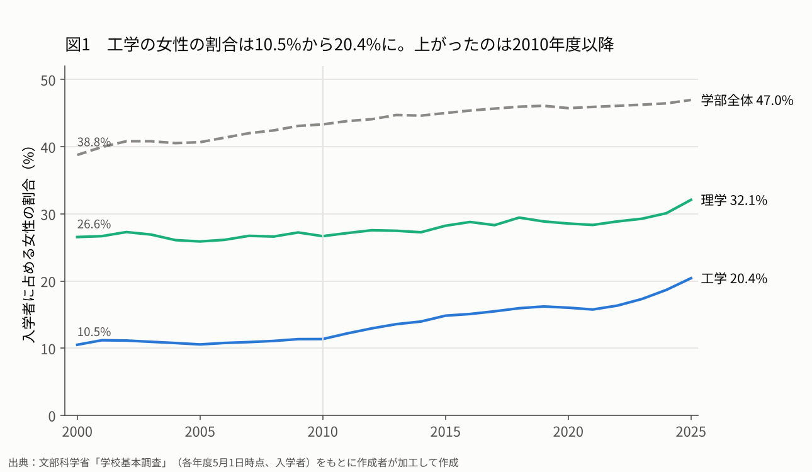
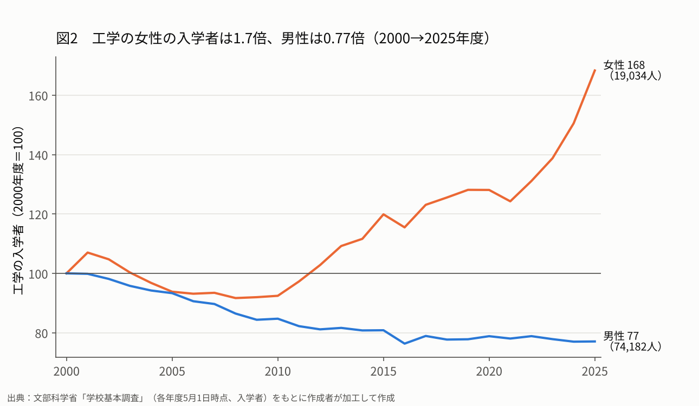
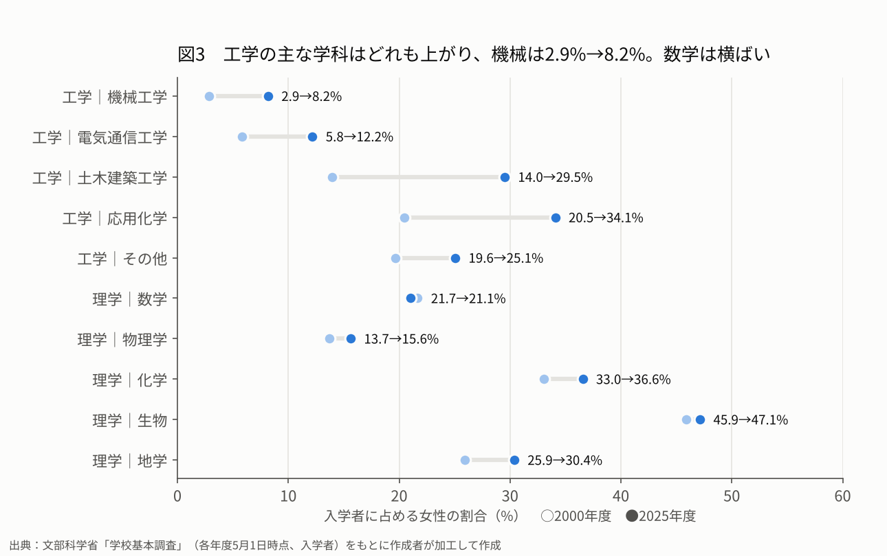
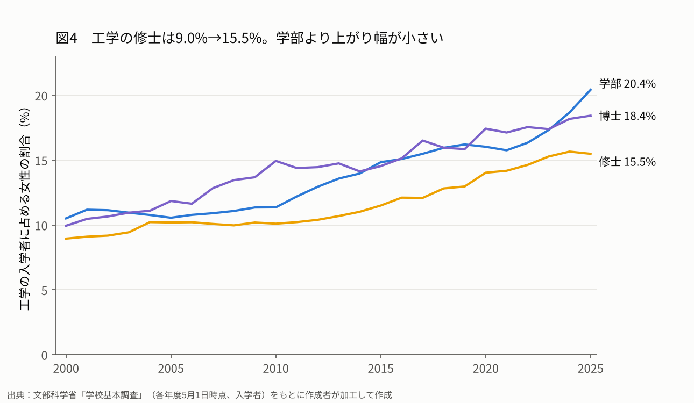

# F506 理工系に進む女性は、増えたのか？ 工学の女性の入学者は2000→2025年度に1.7倍の1.9万人、割合は10.5%から20.4%に。上がったのは2010年度以降で、工学の修士は15.5%

## 結論（先に）
- 大学（学部）の工学の入学者に占める女性の割合は、2000年度の10.51%から2025年度の20.42%に上がりました。人数は11,309人から19,034人へ1.68倍です。理学は26.55%から32.08%（5,521人→6,258人）です。
- 上がったのは2010年度以降です。工学は2000→2010年度に1年あたり0.09ポイント、2010→2025年度に0.60ポイントでした。理学は0.01ポイントと0.36ポイントです。2024→2025年度は工学 +1.74ポイント、理学 +1.98ポイントと、とくに大きく上がりました。
- 工学の女性の割合の上がり（+9.91ポイント）を分けると、女性の入学者が増えた分が +6.59ポイント、男性の入学者が減った分（96,257人→74,182人）が +3.31ポイントです。理学は男性の減りの分（+2.94）が女性の増えた分（+2.59）よりやや大きくなりました。
- 女性の学部入学者のうち理学・工学に入る人は、2000年度 7.24%、2010年度 5.76%、2025年度 8.35%です（男性は30.38%→25.53%）。
- 大学院では、工学の修士の女性の割合は8.95%→15.49%、博士は9.94%→18.43%で、上がり幅は学部（+9.91ポイント）より小さくなりました。

## 問い
『男女共同参画白書』（令和8年版）は、大学・大学院で女子学生の割合が低い分野は工学と理学だと書いています。では、学部の入学者で見ると、理学・工学の女性の割合はどれだけ、いつ上がったのか。割合が上がったのは女性が増えたからか、男性が減ったからか。学科や大学院ではどうか。理系に進むかどうかを考える高校生とその家族、大学の入試や企業の採用で理工系の人材を見ている人のために、学校基本調査で確かめます。どれだけの割合が望ましいかは扱いません。

## データ（出典）
- 文部科学省「学校基本調査」（e-Stat、各年度5月1日時点）、2000〜2025年度の26年分。
  - 「関係学科別 入学者数」（2015年度からは「関係学科別 大学入学状況」）：大学（学部）の入学者の男女別、関係学科（人文科学、社会科学、理学、工学、農学、保健、商船、家政、教育、芸術、その他と、その内訳の学科）別。主に最初の表（計）を使い、「計のうち昼間」「計のうち修業年限4年」の表は確かめに使いました。
  - 「専攻分野別 大学院入学状況」：修士課程・博士課程の入学者の男女別。
- 52本の表は年によって形が違うので、列は見出しの文字（入学者・計・男・女）で、行は分野・学科の文字で選びました。2021年度だけ学科名に「関係」が付いている（「機械工学関係」など）ので、そろえました。分野の和＝計、学科の和＝分野、男＋女＝計を全年度で照合し、15,046件すべて一致しました（data/build_checks.json）。いくつかの値（2000年度・2015年度・2025年度の学部の工学と理学、2010年度・2025年度の修士・博士の工学）は元の表と目で照らしました。修士の入学者の計（2010年度 82,310人、2025年度 80,452人）は、既存の看板記事 F350 の値とも一致します。
- 入学者（その年に入った人の流れ）で見ています。在学者は使っていません。

## 事前の計画
[PLAN.md](PLAN.md)（2026-11-18 22:30、割合を集計する前に作成）。下見で、学部の工学・理学の2000年度と2025年度の入学者の男女別の数字が目に入っていたので、「上がったか」ではなく「いつ上がったか」を仮説にしました。

| 仮説 | 外れの基準 | 結果 | 判定 |
|---|---|---|---|
| H1 工学の上がり方（1年あたり）は2010→2025年度の方が大きい。理学も | 2000→2010年度の方が大きい | 工学 0.09→0.60、理学 0.01→0.36 ポイント/年 | 支持（工学・理学とも） |
| H2 工学の上がりは、女性が増えた分の方が男性が減った分より大きい | 男性の減りの分の方が大きい | 女性 +6.59、男性 +3.31 ポイント | 支持 |
| H3 修士・博士の工学の上がり幅は学部より小さい | 大学院の上がり幅が学部以上 | 学部 +9.91、修士 +6.54、博士 +8.49 | 支持 |
| H4 女性のうち理学・工学に入る割合は上がったが、2ポイント未満 | 2ポイント以上上がった、または下がった | 7.24%→8.35%（+1.11） | 支持 |

## やったこと
1. 52本の Excel から、課程・年度・分野・学科ごとの入学者（計・男・女）の表（data/entrants.csv）を作りました（02_build.py）。
2. 分野ごとの女性の割合と、時期ごとの1年あたりの上がり方を出しました。
3. 女性の割合＝女性÷（女性＋男性）の変化を、女性の人数だけを変えた分と男性の人数だけを変えた分に分けました（2つの順の平均をとる対称な分け方）。
4. 女性の学部入学者のうち理学・工学に入る人の割合と、学科別・大学院の女性の割合を出しました（03_analysis.py）。
5. 結果を見てから、工学で女性が増えた分がどの学科で増えたかを足しました（03b_requestion.py）。

## 分かったこと

### 1. 工学はほぼ2倍の20.4%に、上がったのは2010年度以降（図1）

工学の女性の割合は、2000年度 10.51%、2010年度 11.36%、2015年度 14.84%、2020年度 16.03%、2025年度 20.42%です。2021年度に一度下がり（15.76%）、2023年度 17.32%、2024年度 18.68% と上がり方が速くなりました。理学は2010年度まで26%台で、2025年度は32.08%です。学部の入学者全体の女性の割合は38.77%から46.95%なので、工学・理学はまだ全体より低い水準です。2023〜2025年度に大きく上がった理由（入試の制度、学部の新設など）は、この統計からは分かりません。

### 2. 女性は1.7倍、男性は0.77倍（図2）

工学の入学者は、女性が11,309人から19,034人（+68.3%）、男性が96,257人から74,182人（−22.9%）です。2000→2010年度は女性も減っていて（−7.6%）、割合が少し上がったのは男性がもっと減った（−15.3%）からでした。2010→2025年度は、女性が +82.1%、男性が −9.0%で、割合の上がり（+9.06ポイント）のうち +7.81ポイントが女性の増えた分です。理学の2000→2025年度は、女性 +13.4%、男性 −13.3%でした。

### 3. 工学の主な学科はどれも上がった。数学は横ばい（図3）

工学では、機械工学が2.86%→8.18%、電気通信工学が5.81%→12.18%、土木建築工学が13.97%→29.52%、応用化学が20.49%→34.08%です。機械・電気通信は2倍以上になりましたが、2025年度も工学の中で低い水準です。理学では、数学が21.67%→21.05%とほぼ同じで、物理学は13.73%→15.63%、化学は33.04%→36.56%、生物は45.87%→47.14%です。

### 4. 女性のうち理工に入る人の割合は、一度下がってから戻った
女性の学部入学者のうち理学・工学に入る人は、2000年度 7.24%、2010年度 5.76%、2020年度 6.80%、2025年度 8.35%です。工学だけでは 4.86%→6.28%です。男性は30.38%→25.53%に下がりました。女性の入学者全体が23.3万人から30.3万人に増えたので、割合の上がりは人数の増え方より小さく見えます。

### 5. 大学院は学部より上がり幅が小さい（図4）

工学の修士の女性の割合は、2000年度 8.95%、2010年度 10.10%、2020年度 14.03%、2025年度 15.49%です。学部の4年前の値と並べると、2025年度の修士 15.49% に対し2021年度の学部 15.76%、2020年度の修士 14.03% に対し2016年度の学部 15.09% です。博士は9.94%→18.43%です。理学の修士は21.61%→23.16%、博士は15.65%→16.78%で、学部（+5.53ポイント）より小さな上がりでした。学部から大学院に進む人の割合の男女差は、この表だけでは分かりません。

## 問い直し（結果を見てから足した）

### 工学で女性が増えた分は、どの学科か
工学の女性の入学者の増え方を学科に分けました（results/eng_female_by_subfield.csv）。

| 期間 | 女性の増加 | その他 | 土木建築 | 電気通信 | 応用化学 | 機械 |
|---|---|---|---|---|---|---|
| 2010→2025 | +8,580 | +3,754（43.8%） | +1,920（22.4%） | +1,305（15.2%） | +658（7.7%） | +569（6.6%） |
| 2020→2025 | +4,549 | +2,051（45.1%） | +937（20.6%） | +807（17.7%） | +402（8.8%） | +166（3.6%） |
| 2024→2025 | +2,012 | +736（36.6%） | +461（22.9%） | +351（17.4%） | +264（13.1%） | +68（3.4%） |

増えた分の4割余りは、工学の中の「その他」の学科でした。「その他」は2010→2025年度に入学者全体も +9,236人増えています。ここには情報系や学際的な新しい学科が入ると思われますが、学科の中身はこの表からは分かりません（推測）。

## 頑健性

| 確かめ方 | 分野 | 女性の割合 | 変化（ポイント） |
|---|---|---|---|
| 本線（学部・計の表、2000→2025） | 工学 | 10.51→20.42 | +9.91 |
| 昼間の表 | 工学 | 10.65→20.44 | +9.79 |
| 修業年限4年の表 | 工学 | 10.56→20.42 | +9.86 |
| 年をずらす（2001→2024） | 工学 | 11.18→18.68 | +7.50 |
| 3年の平均どうし（2000〜02→2023〜25） | 工学 | 10.95→18.82 | +7.87 |
| 本線 | 理学 | 26.55→32.08 | +5.53 |
| 昼間の表 | 理学 | 26.67→32.24 | +5.57 |
| 修業年限4年の表 | 理学 | 26.57→32.08 | +5.52 |
| 年をずらす（2001→2024） | 理学 | 26.68→30.10 | +3.42 |
| 3年の平均どうし | 理学 | 26.84→30.48 | +3.64 |
| 理工系＝理学＋工学 | 理工 | 13.11→22.44 | +9.33 |
| 理学＋工学＋農学 | 理工農 | 16.28→26.10 | +9.82 |
| さらに「その他」（学際など）を足す | 理工農その他 | 20.15→32.00 | +11.85 |

どの表・定義でも上がったという結論は変わりません。ただ、2025年度の上がりが大きいため、2001→2024年度で比べたり3年の平均にしたりすると、上がり幅は工学で7.5〜7.9ポイント、理学で3.4〜3.6ポイントに小さくなります。

## 言えないこと
- 女性が理工系を選ぶ（選ばない）理由（高校での文理の選択、家族、入試の制度、職業のイメージなど）は、この統計からは分かりません。2023〜2025年度に上がり方が速くなった理由も分かりません。
- 学科の分類は大学の届け出にもとづくもので、情報系の学部が「工学」の「その他」と、分野の「その他」のどちらに入るかは学部ごとに違い、分けられません。
- 入学者は「その年に入った人」で、中退・卒業・就職の先は扱っていません。大学院の比べは同じ人を追ったものではありません。
- 留学生を含む数で、日本の高校を出た人だけには分けられません。
- 女性の割合がどれだけになるのが望ましいかは扱いません。

## 仕事で使うなら
- 「理工系の女性が増えた」と書くときは、割合（工学 10.5%→20.4%）と人数（1.7倍）を並べ、2000→2010年度はほぼ動いていなかったこと、2025年度の上がりが大きく比べる年で幅が変わることを添えると誤解が減ります。
- 分野別・年度別の値は results/share_by_year.csv、学科別は results/subfield_share.csv にあります。

## 計画からの変更
- 問い直し（工学で女性が増えた学科）は結果を見てから足しました。
- 計画では理学・工学の内訳として「機械、電気通信、土木建築、応用化学」を挙げていましたが、工学の「その他」の学科の増え方が大きかったので、図3と問い直しに加えました。
- 計画どおり、学部の4年前の値と修士を並べる目安は「分かったこと 5」に書きました。

## 再現のしかた
```
sh src/run_all.sh        # オフライン。所要約6秒
python3 src/01_fetch.py  # 元データを取り直すときだけ（ネットを使う）
```

| ファイル | 中身 |
|---|---|
| src/01_fetch.py | e-Stat から Excel 52本を取る（run_all.sh では呼ばない） |
| src/common.py | 年によって形の違う表を、見出し（入学者・計・男・女）と分野の文字で読む関数 |
| src/02_build.py | Excel → data/entrants.csv、data/build_checks.json |
| src/03_analysis.py | 女性の割合・上がり方・分解・進む先・学科別・大学院・仮説・頑健性 → results/main.json ほか |
| src/03b_requestion.py | 問い直し → results/requestion.json、eng_female_by_subfield.csv |
| src/04_figures.py | 図4枚 |

repro_check：/tmp/rep_F506 に写し、02 以降が作るファイルを消して流し直し、12ファイル（results 6、figures 4、data 2）がすべて cmp で一致、所要6秒（results/repro_check.txt）。乱数は使っていません。

## レビューで直したこと

| # | 指摘 | 直し方 |
|---|---|---|
| 1 | 「分かったこと 1」の見出しの「2倍」は、10.51%→20.42%（1.94倍）なので少し強い | 「ほぼ2倍」に直した |

ほかは、独立レビューで数字の照合（題名・README・note と results）、元の Excel との照合（2000・2021・2025年度の学部の工学・理学、2025年度の修士の工学）、再実行（12ファイル一致）、図4枚を確かめ、直すところはなかった。

## 出典
- 文部科学省「学校基本調査」（e-Stat）：https://www.e-stat.go.jp/stat-search/files?toukei=00400001&tstat=000001011528 （各表の URL は data/raw/SOURCES.md）
- 内閣府男女共同参画局『男女共同参画白書』令和8年版 第4章「科学技術・学術における男女共同参画の推進」：https://www.gender.go.jp/about_danjo/whitepaper/r08/zentai/html/honpen/b1_s04_00.html

（いずれも 文部科学省「学校基本調査」をもとに作成者が加工して作成）
