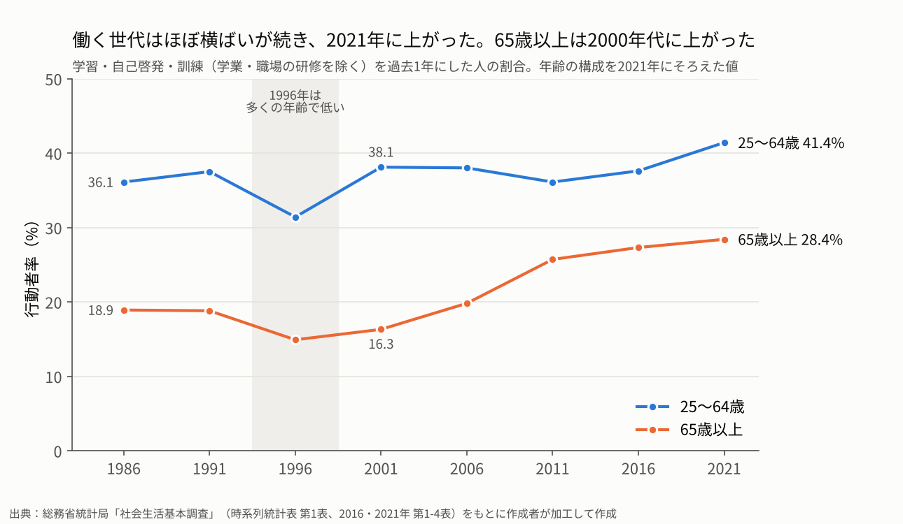
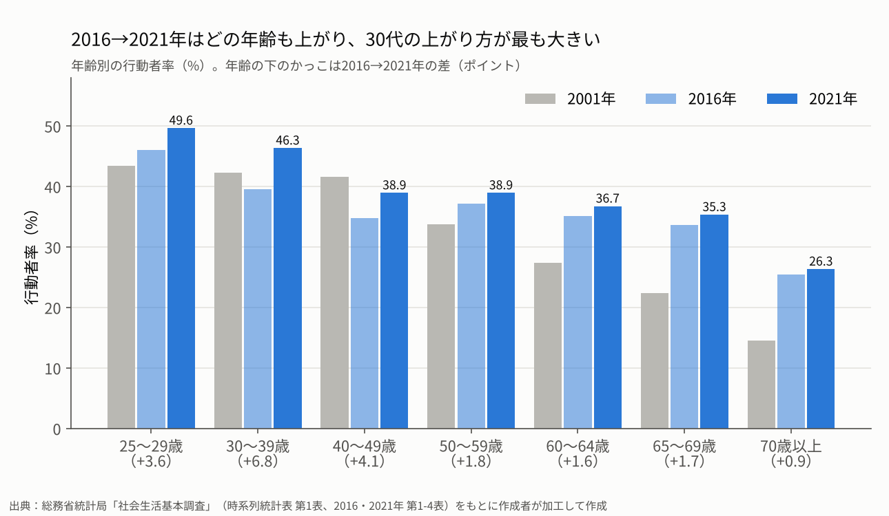
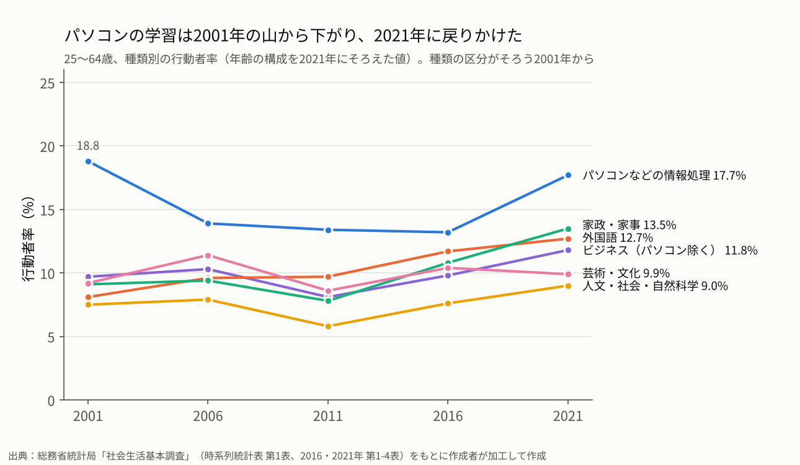
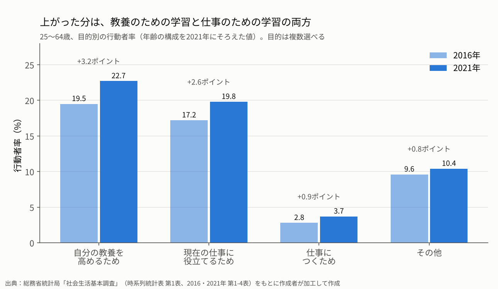

# F507 大人の学び直しは、増えているのか？ 25〜64歳は2001年38.1%・2016年37.6%と横ばいのあと、2021年は41.4%。65歳以上は16.3%から28.4%へ

## 結論（先に）
- 仕事や学校の授業とは別に、自分の時間で学習・自己啓発・訓練をした25〜64歳の割合（過去1年に1回でもした人。年齢の構成を2021年にそろえた値）は、2001年38.1%、2006年38.0%、2011年36.1%、2016年37.6%と、20年近く横ばいでした。2021年は41.4%で、2016年より3.7ポイント高くなりました。
- 1996年を起点にすると+10.0ポイントですが、1996年は多くの年齢で前後より低い年です。2001年からは+3.3、1986年からは+5.3ポイントです。
- はっきり増えたのは65歳以上です。年齢をそろえた値で2001年16.3%から2021年28.4%へ、+12.1ポイントでした。大きく上がったのは2006→2011年です。
- 2016→2021年はすべての年齢区分で上がり、30〜39歳（+6.8ポイント）が最大でした。種類別では、パソコンなどの情報処理（13.2%→17.7%）が外国語（+1.0）より大きく上がりました。
- 結果を見てから足した問いでは、上がった分は「自分の教養を高めるため」（+3.2ポイント）と「現在の仕事に役立てるため」（+2.6ポイント）の両方にありました。パソコンの学習に限ると、仕事のための学習の上昇（+3.1）が大きくなりました。

## 問い
総務省統計局の「令和3年社会生活基本調査 生活行動に関する結果 結果の要約」は、学習・自己啓発・訓練の行動者率が10歳以上で39.6%、5年前より2.7ポイント上がり、70〜74歳を除くすべての年齢階級で上がったと示しています。

ただ、この数字には10〜24歳の学生も入り、高齢化の影響も混ざっています。社会人向けの講座を作る人、人事・研修や生涯学習の担当の人、学び直しを考えている人のために、25歳以上の大人で、年齢の構成をそろえても増えているのか、どの年齢・種類の学習かを、1986年からの8回の調査で確かめます。

## データ（出典）
- 総務省統計局「社会生活基本調査」時系列統計表 第1表「男女、年齢、学習・自己啓発・訓練の種類別行動者率の推移（10歳以上）（昭和61年～令和３年）」（e-Stat、Excel）。1986・1991・1996・2001・2006・2011・2016・2021年の8回。25歳以上は7つの年齢区分です。
- 同 2016年・2021年の生活行動編 第1-4表（男女・目的・年齢・学習の種類別の行動者率。表の正式な名前は data/raw/SOURCES.md）：年齢5歳階級の推定人口（年齢をそろえる重み）と、目的別の行動者率。表のそのほかの区分は「総数」の行だけを使いました。
- 用語：「行動者率」は、過去1年間（2021年調査なら2020年10月20日〜2021年10月19日）に、その活動を1回以上した人の割合です。「学習・自己啓発・訓練」は個人の自由時間に行うもので、職場で命じられた研修や、学生が学業として行うものは含みません。
- 年齢をそろえた値：年齢区分ごとの行動者率を、2021年の推定人口の年齢構成で重みをつけて平均した値です（直接法）。高齢化の影響を取り除いて比べるためです。
- 読み取りの確かめ（data/build_checks.json）：列・行は見出しの文字で選びました。時系列表の2016・2021年の値は、第1-4表の同じ区分の値と240か所すべてで一致し、5歳階級からまとめた値も10歳区分の値と0.06ポイント以内でした。39.6%と+2.7ポイントは結果の要約（PDF）と一致しました。
- 種類の区分は2001年に変わり（パソコンなどの情報処理が分かれた）、1996年以前の「商業実務・ビジネス関係」は2001年以降と比べられません。種類別の比較は2001年からにしました。

## 事前の計画
[PLAN.md](PLAN.md)（2026-11-19 05:42、年齢をそろえる集計の前に作成）。下見では、時系列表の総数の行の一部（10歳以上 1996年30.6%・2021年39.6%など）と、1991→1996年に多くの年齢で下がっていることを見ていました。

| 仮説 | 外れの基準 | 結果 | 判定 |
|---|---|---|---|
| H1 25〜64歳は1996→2021年に5ポイント以上上昇 | 上昇が5ポイント未満 | +10.0ポイント（31.4%→41.4%） | 支持（ただし起点の1996年が低い。2001年からは+3.3） |
| H2 そのままの値は年齢をそろえた値より上がり方が小さい | そのままの値の上昇が同じか大きい | 15歳以上1996→2021年：そのまま+8.3、そろえた値+11.6。25歳以上2016→2021年：そのまま+2.43、そろえた値+2.81 | 支持 |
| H3 2016→2021年は商業実務・ビジネス（パソコンを含む）の上昇が外国語より大きい | 外国語の上昇が同じか大きい | +4.7対+1.0 | 支持 |
| H4 1996→2021年の上昇は65歳以上が25〜64歳より大きい | 65歳以上の上昇が同じか小さい | +13.5対+10.0 | 支持 |

## やったこと
1. 時系列表と第1-4表から、行動者率・目的別の率・推定人口を抜き出しました（02_build.py）。
2. 25〜64歳・65歳以上・25歳以上の年齢をそろえた率を出し、25歳以上の2016→2021年の変化を「年齢ごとの率の効果」と「年齢構成の効果」に分けました（2つの年の平均を重みにする対称な形、03_analysis.py）。
3. 種類別・男女別にも計算し、重み・期間・年齢の範囲を替えて確かめました。結果を見てから目的別の問いを足しました（03b_requestion.py）。

## 分かったこと

### 1. 働く世代は横ばいが続き、2021年に上がった（図1）

25〜64歳の年齢をそろえた行動者率は、1996年（31.4%）を除くと1986〜2016年は36〜38%の幅に収まり、2021年（41.4%）だけがその上に出ています。65歳以上は、1986年18.9%、2001年16.3%から、2011年25.7%、2021年28.4%へと上がりました。

25歳以上の2016→2021年を分けると、そのままの値の+2.43ポイント（34.41%→36.84%）は、年齢ごとの率の効果+2.87と、65歳以上が増えた（33.4%→34.9%）効果−0.44の和でした。全体の数字は高齢化で少し低く見えています。

### 2. 2016→2021年はどの年齢も上がった（図2）

2016→2021年の上昇は、25〜29歳+3.6、30〜39歳+6.8、40〜49歳+4.1、50〜59歳+1.8、60〜64歳+1.6、65〜69歳+1.7、70歳以上+0.9ポイントでした。ただし40〜49歳は2001年（41.6%）より低く、2001年から大きく上がったのは60歳以上の区分です。

### 3. パソコンの学習は2001年の山から下がり、2021年に戻りかけた（図3）

25〜64歳の種類別では、パソコンなどの情報処理が2001年18.8%から2016年13.2%に下がり、2021年は17.7%でした。外国語は8.1%から12.7%へ、家政・家事は9.1%から13.5%へ、ゆっくり上がっています。2016→2021年は、パソコン+4.5、家政・家事+2.8、ビジネス（パソコン除く）+2.0、外国語+1.0、芸術・文化−0.5ポイントでした。

## 問い直し（結果を見てから足した）

### 上がった分は、仕事のための学習か、教養のための学習か（図4）

2016→2021年の25〜64歳の上昇（+3.7ポイント）が、仕事のための学び直しなのかを、第1-4表の目的別で見ました（目的は複数選べるので、目的別の率の和は総数より大きくなります）。「自分の教養を高めるため」は19.5%から22.7%（+3.2）、「現在の仕事に役立てるため」は17.2%から19.8%（+2.6）、「仕事につくため」は2.8%から3.7%（+0.9）でした。上がった分は教養と仕事の両方にあり、仕事のためだけの動きではありませんでした。パソコンなどの情報処理に限ると、「現在の仕事に役立てるため」が7.6%から10.7%（+3.1）で、教養のため（+1.8）より大きく上がりました。男は教養のため（+3.6）、女は仕事（+2.9）と教養（+2.8）がほぼ同じでした。

## 頑健性

| 確かめ方 | 起点 | 2021年 | 差（ポイント） |
|---|---|---|---|
| 本線：25〜64歳、2021年の人口の重み、1996→2021年 | 31.4% | 41.4% | +10.0 |
| 重み：2016年の人口 | 31.5% | 41.5% | +9.9 |
| 重み：年齢区分の幅（年数）だけ | 31.8% | 41.8% | +10.1 |
| 期間：2001→2021年 | 38.1% | 41.4% | +3.3 |
| 期間：2016→2021年 | 37.6% | 41.4% | +3.7 |
| 参考：1986→2021年 | 36.1% | 41.4% | +5.3 |
| 年齢：30〜64歳（学生が多い25〜29歳を外す） | 30.6% | 40.4% | +9.8 |
| 男だけ | 31.6% | 40.4% | +8.9 |
| 女だけ | 31.2% | 42.3% | +11.1 |
| 65歳以上 | 14.9% | 28.4% | +13.5 |

重み・年齢の範囲・男女を替えても、2021年が8回でいちばん高いことは変わりません。一方、上昇の大きさは起点の年で大きく変わります。「25年で10ポイント増えた」より、「長く横ばいで、2021年に上がった」がデータに近い読み方です。

## 言えないこと
- 行動者率は「過去1年に1回でもした人の割合」です。学んだ時間の長さや中身の深さは分かりません。
- 職場で命じられた研修は含まれないので、会社の研修が増えた・減ったは分かりません。
- 2021年の調査の期間（2020年10月〜2021年10月）は、外出を控える動きが広がっていた時期と重なります。家にいる時間が増えた影響があるかもしれませんが（推測）、分けられません。上昇が続くかは次の調査（2026年）を待つ必要があります。
- 同じ人を追った調査ではないので、「ある人が学び直しを始めた」とは言えません。年齢ごとの割合を、調査の年どうしで比べたものです。
- 1991→1996年の低下と1996→2001年の上昇が、調べ方の違いによるものか、実際の変化かは確かめられません。
- 70歳以上は1つの区分なので、その中で80歳以上の人が増えた影響は取り除けていません。

## 仕事で使うなら
- 「学び直しが増えた」と言うときは、全体（10歳以上）の数字か、25〜64歳の数字かを分け、起点の年を書くと誤解が減ります。25〜64歳は2001年からで+3.3ポイント、2016年からで+3.7ポイントです。
- 年ごとの値は results/by_year.csv にあります。

## 計画からの変更
- 種類の区分が2001年に変わっていたので、種類別の比較（図3）は2001年からにしました。仮説 H3 は計画どおり2016→2021年で判定しています。
- H2 は計画どおり、25歳以上の2016→2021年と15歳以上の1996→2021年の両方で判定しました（同じ向き）。
- 問い直し（目的別）は結果を見てから足しました。

## 再現のしかた
```
sh src/run_all.sh        # オフライン。所要約5秒
python3 src/01_fetch.py  # 元データを取り直すときだけ（ネットを使う）
```

| ファイル | 中身 |
|---|---|
| src/01_fetch.py | e-Stat の Excel 3本と結果の要約（PDF）を取る（run_all.sh では呼ばない） |
| src/02_build.py | 時系列表と第1-4表から値を抜き出す → data/ts_rates.csv・purpose_2016_2021.csv・pop_weights.csv・build_checks.json |
| src/03_analysis.py | 年齢をそろえた率・分解・種類別・男女別・仮説・頑健性 → results/main.json・by_year.csv・robustness.csv |
| src/03b_requestion.py | 問い直し（目的別） → results/requestion.json・requestion_purpose.csv |
| src/04_figures.py | 図4枚 |

repro_check：/tmp/rep_F507 に写して流し直し、13ファイル（results 5、figures 4、data 4）が cmp で一致、所要12秒。乱数なし。

## レビューで直したこと

| # | 指摘 | 直し方 |
|---|---|---|
| 1 | データの節で、第1-4表の正式な名前に入っている健康にかかわる区分の名前を2回書いていた（このシリーズで扱わない話題の語） | 表の中身（男女・目的・年齢・学習の種類別）で言い換え、正式な名前は data/raw/SOURCES.md に任せた。使う行（総数）は変えていない |
| 2 | 言えないことで、2021年の調査の期間を感染症の語で説明していた | 「外出を控える動きが広がっていた時期」と言い換えた（note も同じ）。推測の扱いは変えていない |

数字（題名・結論・本文・note）を results と照合し、年齢別の行動者率（25〜29歳〜70歳以上の8回分）を時系列表の見出しの文字で照らして一致を確かめた。再実行で13ファイルが一致した。題名は変えていない。

## 出典
- 総務省統計局「社会生活基本調査」（e-Stat）：https://www.e-stat.go.jp/stat-search/files?toukei=00200533 （各表の URL は data/raw/SOURCES.md）
- 総務省統計局「令和3年社会生活基本調査 結果の概要」：https://www.stat.go.jp/data/shakai/2021/kekka.html

（いずれも 総務省統計局「社会生活基本調査」をもとに作成者が加工して作成）
