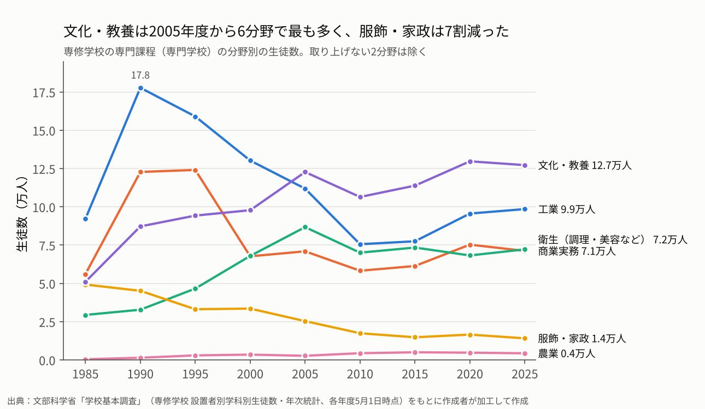
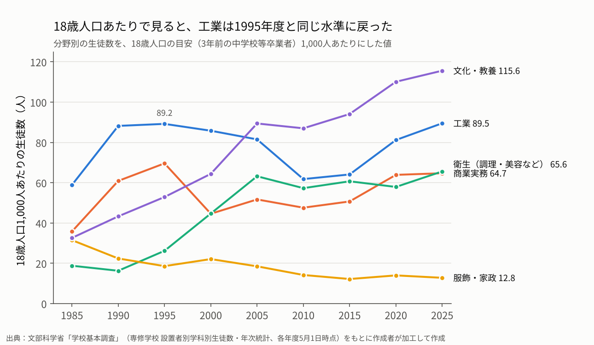
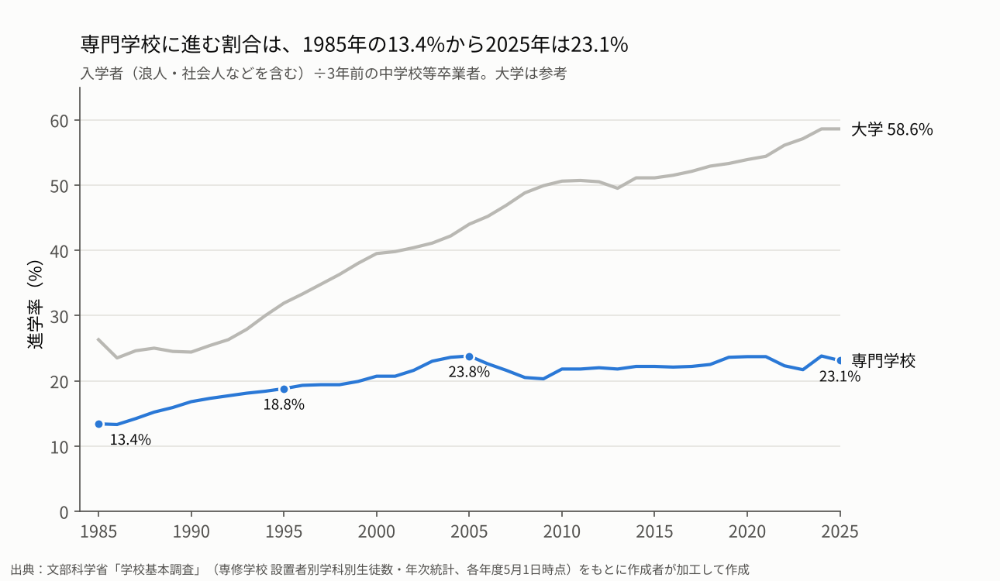
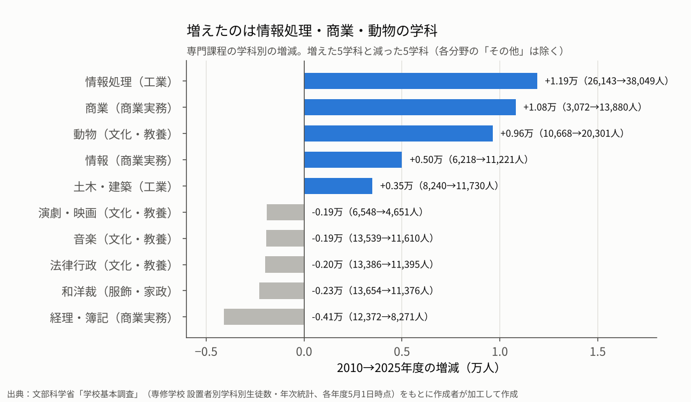

# F508 専門学校に進む人は、分野ごとにどう変わったのか？ 1985→2025年度に服飾・家政は71%減、文化・教養は2.5倍。工業は18歳人口あたりで1995年度の水準に戻った

## 結論（先に）
- 専門学校（専修学校の専門課程）の生徒は、1985年度の39.9万人から2025年度の56.9万人に増えました（+42.7%）。最も多かったのは2005年度の69.6万人です。
- この記事で取り上げる6分野では、服飾・家政が4.9万人から1.4万人へ71.4%減り、減り方が最も大きい分野でした。文化・教養は5.1万人から12.7万人へ2.5倍になり、2005年度からは6分野で最も多い分野です。
- 工業は1990年度の17.8万人が山で、2025年度は9.9万人（山より44.6%少ない）でした。ただ、18歳人口の目安1,000人あたりで見ると、1995年度89.2人、2010年度61.8人、2025年度89.5人で、1995年度の水準に戻っています。人数の減少の多くは、18歳人口の減少と重なります。
- 18歳人口あたりの専門学校への進学率は、1985年13.4%、1995年18.8%、2025年23.1%でした。2000年代半ばからは、20〜24%の幅で横ばいです。
- 結果を見てから足した問いでは、2010→2025年度に増えた学科は、工業の情報処理（+1.19万人）、商業実務の商業（+1.08万人）、文化・教養の動物（+0.96万人）などでした。

## 問い
専門学校は、高校卒業後の進学先として、大学に次いで多くの人が選ぶ学校です。学校基本調査では、専門学校の学科を8つの分野に分けて、生徒の数を数えています。専門学校を考える高校生と家族、高校の進路指導の教員、卒業生を採用する企業の人のために、40年で分野の構成がどう入れ替わったか、18歳人口が減るなかで進む人の割合はどう動いたかを、5年ごとの表で確かめます。

### 扱う範囲
8分野のうち、医療関係と教育・社会福祉関係の2分野は、この記事のシリーズで扱わない話題に関わるため、内訳を取り上げません。合計（専門課程の計）には含めたままにし、図では除いています。取り上げるのは、工業・農業・衛生（調理・理容・美容・製菓など）・商業実務・服飾家政・文化教養の6分野です。6分野は専門課程の生徒の68.1%（2025年度）にあたります。

## データ（出典）
- 文部科学省「学校基本調査」（e-Stat）専修学校の表「設置者別学科別生徒数」の「専門課程」と「計」のシート：1985・1990・…・2025年度（5年ごと、9年分）。各年度5月1日時点。
- 同 年次統計「高等教育機関への入学状況（過年度高卒者等を含む）の推移」：専修学校（専門課程）への進学率、3年前の中学校等卒業者数（この記事では「18歳人口の目安」と呼びます）。大学（学部）への進学率は参考。
- 同 年次統計「専修学校の学校数，在籍者数，教職員数」：照合用。
- 読み取りの確かめ（data/build_checks.json）：分野は行の見出しの文字（「工業関係」「工業関係計」などの「関係」のすぐ前後の文字）で判定しました。年度によって表の形が違い、1985・1990年度は分野の計の行と名前の行が別、2025年度は年度と分野の名前が同じ行にあります。9年度すべてで、8分野の和＝専門課程の計、学科（小区分）の和＝分野の計でした。「計」のシートの合計は、年次統計の在籍者数と9年度すべてで一致しました。年次統計の進学率は、入学者÷3年前の卒業者で計算し直した値と0.05ポイント以内でした。

## 事前の計画
[PLAN.md](PLAN.md)（2026-11-19 05:50、分野別の集計の前に作成）。下見では、1985年度の専門課程の分野の計と、2025年度の全課程の分野の計、進学率の一部（1985・2010・2015・2020年）を見ていました。

| 仮説 | 外れの基準 | 結果 | 判定 |
|---|---|---|---|
| H1 減少率が最大は服飾・家政で、半分以下 | 減少が50%未満か、他の分野の方が減少率が大きい | −71.4%、6分野で最大の減少 | 支持 |
| H2 増加率が最大は文化・教養で、2025年度に6分野で最多 | どちらかが成り立たない | 最多は文化・教養。増加率の最大は農業（431人→4,323人、小さい分野） | 一部外れ（農業を除くと文化・教養が最大の+149.4%、衛生は+145.8%） |
| H3 工業の山は1990年代で、2025年度は山より30%以上少ない | 山が1990年代でないか、減少が30%未満 | 山は1990年度、−44.6% | 支持 |
| H4 進学率は2025年が1995年より高い | 同じか低い | 18.8%→23.1% | 支持 |

## やったこと
1. 9年度分の学科別生徒数の表から、課程（専門課程・全課程）×分野×年度の生徒数と、学科（小区分）別の生徒数を抜き出しました（02_build.py）。
2. 分野ごとの人数・割合・1985年度比、18歳人口の目安1,000人あたりの人数、山の年を出しました（03_analysis.py）。
3. 結果を見てから、2010→2025年度の学科別の増減を足しました（03b_requestion.py）。

## 分かったこと

### 1. 取り上げた6分野では文化・教養が最も多くなり、服飾・家政は7割減（図1）

1985年度に6分野で最も多かったのは工業（9.2万人）で、商業実務（5.6万人）、文化・教養（5.1万人）、服飾・家政（4.9万人）が続いていました。2025年度は、文化・教養12.7万人、工業9.9万人、衛生7.2万人、商業実務7.1万人、服飾・家政1.4万人です。専門課程の計に占める割合は、文化・教養が12.8%から22.4%に上がり、服飾・家政は12.3%から2.5%に下がりました。商業実務は1995年度の12.4万人が山で、2000年度に6.8万人へ大きく減っています。

### 2. 18歳人口あたりでは、工業は1995年度の水準（図2）

18歳人口の目安は、1995年の178万人から2025年の110万人へ38.2%減りました。人数を18歳人口1,000人あたりにすると、工業は1995年度89.2人、2010年度61.8人、2025年度89.5人です。工業の人数が山から44.6%減った大きさは、18歳人口の減少とほぼ同じです（18歳人口1,000人あたりは山の1990年度88.2人、2025年度89.5人）。割合では2010年度の谷から戻っています。文化・教養は1985年度32.6人から2025年度115.6人へ、衛生は18.8人から65.6人へ上がり続けました。服飾・家政は31.5人から12.8人に下がりました。

### 3. 専門学校に進む割合は、2000年代半ばから横ばい（図3）

専門学校への進学率（入学者÷3年前の中学校等卒業者）は、1985年13.4%、1995年18.8%、2005年23.8%と上がり、その後は20〜24%の幅で動いて、2025年は23.1%でした。同じ期間に大学（学部）への進学率は26.3%から58.6%に上がっています。入学者には、浪人した人や社会人、大学を出た人も含まれます。

## 問い直し（結果を見てから足した）

### 2010年度から工業・商業実務・文化教養が増えたのは、どの学科か（図4）

2010→2025年度に、工業は+2.29万人、文化・教養は+2.08万人、商業実務は+1.29万人増えました（18歳人口は同じ期間に減っています）。学科の分類は2005年度以降そろっているので、2010・2025年度の学科別で比べました。増えたのは、工業の情報処理（26,143→38,049人）、商業実務の商業（3,072→13,880人）、文化・教養の動物（10,668→20,301人）、商業実務の情報（6,218→11,221人）、工業の土木・建築（8,240→11,730人）でした。減ったのは、商業実務の経理・簿記（12,372→8,271人）、服飾・家政の和洋裁、文化・教養の法律行政・音楽・演劇映画などでした。商業実務の「商業」の学科が4.5倍になった理由は、この表からは分かりません（留学生向けの学科が含まれている可能性がありますが、推測です）。

## 頑健性

| 分野 | 専門課程 1985→2025年度 | 1995→2025年度 | 2010→2025年度 | 全課程 1985→2025年度 | 18歳人口1,000人あたり 1985→2025年度 |
|---|---|---|---|---|---|
| 工業 | +6.9% | −38.0% | +30.4% | +2.5% | +51.9% |
| 農業 | +903.0% | +46.1% | −1.5% | +667.6% | +1325.2% |
| 衛生 | +145.8% | +54.9% | +3.1% | +53.3% | +249.2% |
| 商業実務 | +27.0% | −42.6% | +22.2% | +17.6% | +80.5% |
| 服飾・家政 | −71.4% | −57.4% | −19.1% | −79.6% | −59.3% |
| 文化・教養 | +149.4% | +35.0% | +19.6% | +67.7% | +254.4% |

1985→2025年度の増減の向きは、専門課程・全課程・18歳人口あたりのどれでも6分野すべてで同じでした。服飾・家政の減少と文化・教養の増加は、どの期間・どの数え方でも変わりません。一方、工業と商業実務は、期間の取り方で向きが変わります（1995年度からは減少、2010年度からは増加）。全課程で見ても、2025年度に6分野で最も多いのは文化・教養、減少率が最大は服飾・家政でした。

## 言えないこと
- 分野を選ぶ理由（就職の見通し、資格、学費など）は、この統計からは分かりません。
- 学科の名前の付け替えや分類の変更は、統計の分類に従っているので、教える中身の変化は追えません。1985年度と2025年度の「同じ名前の分野」が同じ中身とは限りません。
- 生徒の中の留学生・社会人・大学を出た人の割合は、この表では分かりません。
- 18歳人口あたりの値は、2〜4学年分の生徒数を1学年分の人口で割った目安で、進学率そのものではありません。
- 取り上げない2分野の内訳は示していません（合計には含めています）。
- 卒業後の進路や就職は扱っていません。

## 仕事で使うなら
- 「専門学校の工業系が減った」と言うときは、人数（1990年度の山から−44.6%）と18歳人口あたり（1995年度と同じ水準）のどちらかを分けて書くと、話がかみ合いやすくなります。
- 年度×分野の値は results/by_year.csv、学科別は results/requestion_subfields.csv にあります。

## 計画からの変更
- 仮説 H2 は、増加率の最大が人数の小さい農業になり「一部外れ」としました。農業を除いた比較も表に書きました。
- 問い直し（学科別）は結果を見てから足しました。学科の分類がそろう2005年度以降のうち、工業と商業実務の谷の2010年度を起点にしました。

## 再現のしかた
```
sh src/run_all.sh        # オフライン。所要約3秒
python3 src/01_fetch.py  # 元データを取り直すときだけ（ネットを使う）
```

| ファイル | 中身 |
|---|---|
| src/01_fetch.py | e-Stat の Excel 11本を取る（run_all.sh では呼ばない） |
| src/02_build.py | 分野・学科の生徒数と、進学率を抜き出す → data/fields_by_year.csv・subfields_by_year.csv・entry_rate.csv・build_checks.json |
| src/03_analysis.py | 割合・指数・18歳人口あたり・仮説・頑健性 → results/main.json・by_year.csv・robustness.csv |
| src/03b_requestion.py | 問い直し → results/requestion.json・requestion_subfields.csv |
| src/04_figures.py | 図4枚 |

repro_check：/tmp/rep_F508 に写して流し直し、13ファイル（results 5、figures 4、data 4）が cmp で一致、所要3秒。乱数なし。

## レビューで直したこと

| # | 指摘 | 直し方 |
|---|---|---|
| 1 | 図1の節の見出し「文化・教養が最も多い分野に」は、8分野全体では成り立たない（2025年度は取り上げない分野の方が多い） | 見出しを「取り上げた6分野では文化・教養が最も多くなり」に直した（note も同じ） |
| 2 | 「工業の人数の減少は、多くが18歳人口の減少によるもの」は原因の言い方が強い | 「減った大きさは18歳人口の減少とほぼ同じ（1,000人あたりは山の1990年度88.2人、2025年度89.5人）」と、数字の並びの言い方にした（note も同じ） |
| 3 | note の書き出しでは、6分野だけを扱うことが「使ったデータ」まで出てこない | 背景の段落に「8分野のうち6分野（専門課程の生徒の約7割）を取り上げる」を足した |

数字を results と照合し、1985年度（昭和60年度の行）と2025年度の専門課程・全課程の分野の計（工業・服飾家政・文化教養ほか）を元の表の見出しの文字で照らして一致を確かめた。学科別の問い直しに取り上げない2分野の学科が入っていないことも確かめた。再実行で13ファイルが一致した。題名は変えていない。

## 出典
- 文部科学省「学校基本調査」（e-Stat）：https://www.e-stat.go.jp/stat-search/files?toukei=00400001&tstat=000001011528 （各表の URL は data/raw/SOURCES.md）

（いずれも 文部科学省「学校基本調査」をもとに作成者が加工して作成）
