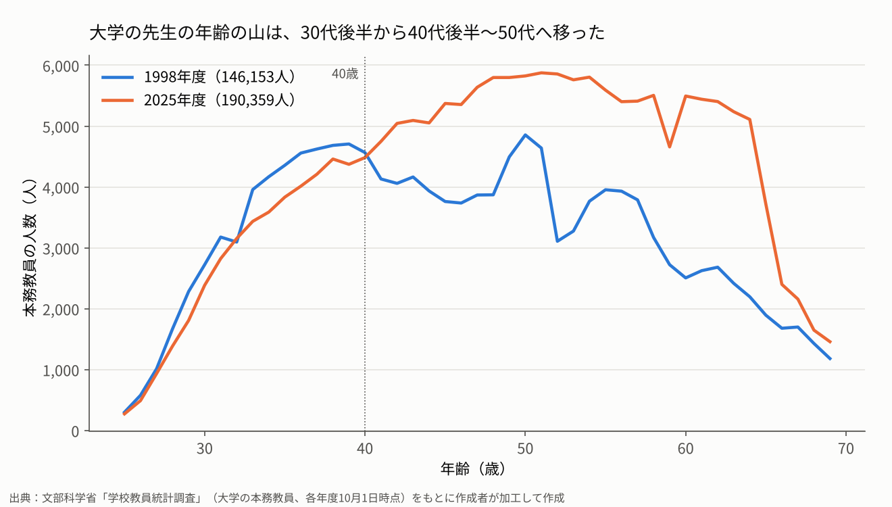
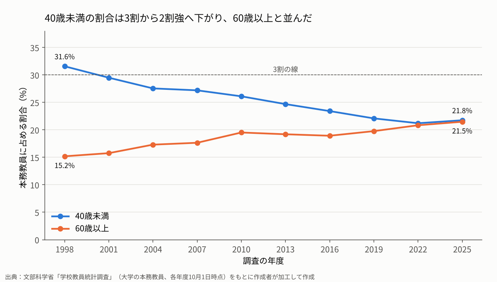
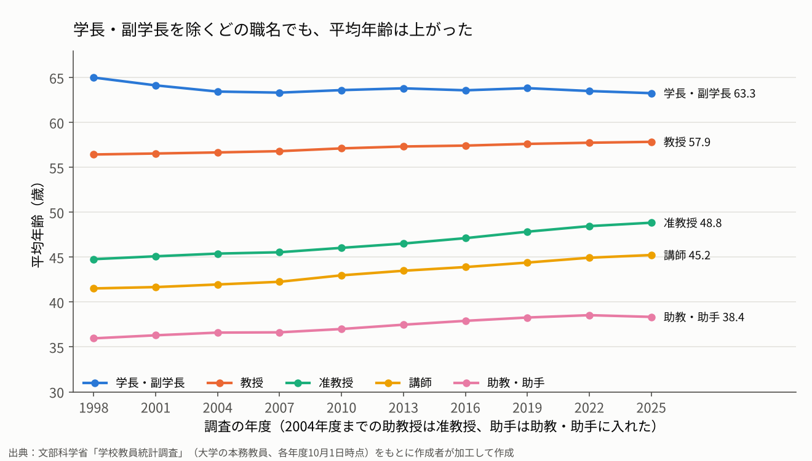
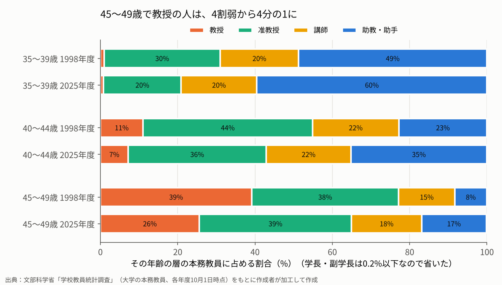

# F509 大学の先生は、年をとったのか？ 平均年齢は1998年度の47.2歳から2025年度は49.9歳に、40歳未満の割合は31.6%から21.8%に。上がった分の約95%は同じ職名の中での高齢化

## 結論（先に）
- 大学の本務教員（その大学に籍のある常勤の教員。大学院・附属病院なども含む）の平均年齢は、公表値で1998年度 47.2歳から2025年度 49.9歳へ、2.7歳上がりました。年次統計をさかのぼると1977年度は43.1歳です。
- 40歳未満の割合は31.6%（1998年度）から21.8%（2025年度）へ下がり、60歳以上の割合（15.2%→21.5%）とほぼ並びました。内閣府の基本計画専門調査会の資料にある「将来は3割以上」という目標の水準には、2025年度で約1.6万人届いていない計算です。
- 平均年齢の上がり方（各歳の人数からの計算で +2.68歳）を分けると、約95%（+2.53歳）は同じ職名の中で年齢が上がった分でした。職名の割合はほぼ変わっていません。
- 問い直しで、同じ年齢の層の職名の内訳を見ると、45〜49歳で教授の人は39.2%（1998年度）から25.6%（2025年度）に減りました。職名に就く年齢が後ろにずれた形です。
- 私立の平均年齢は国立より高い状態が続いていますが、差は3.5歳（1998年度）から2.2歳（2025年度）に縮みました。

## 問い
大学の先生の「高齢化」や「若手の減少」は、研究の担い手の話としてよく取り上げられます。内閣府の基本計画専門調査会の資料（2019年10月）には、40歳未満の大学本務教員を将来は全体の3割以上にする目標が示されています。年齢の構成は実際にどう動いたのか。年をとったのなら、それは「教授が増えた」からか、「同じ職名の中で年齢が上がった」からか。大学で働く人や研究の人材の話を読む人のために確かめます。

## データ（出典）
- 文部科学省「学校教員統計調査」（3年ごと、10月1日時点）の大学の「年齢別 職名別 性別 本務教員数」。1998・2001・2004・2007・2010・2013・2016・2019・2022・2025年度の10回。各歳（25〜69歳）と25歳未満・70歳以上の人数が、職名別・設置者別（国立・公立・私立）にあります。
- 同じ調査の年次統計「学校種別 本務教員の平均年齢」（1977〜2025年度）。
- 2007年度に職名が変わりました（助教授→准教授、助手の一部→助教）。比べるときは、2004年度までの助教授を准教授に、助手を「助教・助手」に入れました。学長・副学長は表によって列の形が違うため、全体から教授〜助手を引いた差で出しました。

## 事前の計画
[PLAN.md](PLAN.md)（2026-11-16 12:36、集計の前に作成）。下見では、年次統計の平均年齢（1977・1998・2025年度）と表の先頭の総数だけを見ていました。

| 仮説 | 外れの基準 | 結果 | 判定 |
|---|---|---|---|
| H1 40歳未満の割合は1998年度より下がり、2025年度でも3割未満 | 2025年度が1998年度以上か30%以上 | 31.6%→21.8% | 支持 |
| H2 平均年齢の上がり方の半分以上は職名内の効果 | 構成の効果が半分以上 | 職名内 +2.53歳（94.7%）、構成 +0.14歳 | 支持 |
| H3 60歳以上の割合が5ポイント以上上がった | 5ポイント未満 | 15.2%→21.5%（+6.3ポイント） | 支持 |
| H4 私立の平均年齢は国立より2歳以上高い（2025年度） | 2歳未満か国立の方が高い | 私立 50.1歳、国立 47.9歳（差2.16歳。公表値でも2.2歳） | 支持（ただし差は縮小） |

## やったこと
1. 10回分の Excel から、年度×設置者×職名×年齢の人数の表を作りました。職名ごとに各歳の和が「本務教員の計」と一致することを確かめています（02_build.py）。
2. 各歳の人数から平均年齢を計算しました（25歳未満は24歳、70歳以上は71歳とみなす）。公表値より毎回約0.5歳（平均0.53歳）低く、年齢の数え方の違いと思われます（推測）。差はほぼ一定なので、変化の比較には影響しません。
3. 平均年齢の変化を、職名の割合の変化（構成の効果）と職名の中の平均年齢の変化（職名内の効果）に分けました。二つの年の平均を重みにする対称な形のシフト・シェア分解です（03_analysis.py）。
4. 結果を見てから、40歳未満の人数そのものと、同じ年齢の層の職名の内訳を足しました（03b_requestion.py）。

## 分かったこと

### 1. 年齢の山が右へ移った（図1）

1998年度は38〜39歳（約4,700人）と50歳に山がありました。2025年度は45〜58歳が各年5,000人を超える平らな高台になり、60〜64歳も各年5,000人を超えています。総数は30.2%増えましたが、増えた分は40歳以上に集まりました。

### 2. 40歳未満は3割から2割強へ（図2）

40歳未満の割合は1998年度 31.6%、2001年度 29.5%と3割を切り、2022年度 21.2%まで下がり続けました。2025年度は21.8%で、わずかに戻っています。60歳以上は15.2%から21.5%へ上がり、40歳未満とほぼ並びました。

### 3. どの職名でも年齢が上がった（図3）

職名別の平均年齢（計算値）は、1998年度→2025年度で、教授 56.4→57.9歳、准教授 44.8→48.8歳、講師 41.5→45.2歳、助教・助手 36.0→38.4歳です。上がり方は准教授（+4.1歳）と講師（+3.7歳）で大きく、教授は+1.4歳でした。学長・副学長だけは65.0→63.3歳と下がりました。一方、職名の割合は、教授 38.2%→38.1%、准教授 22.9%→23.4%、講師 12.6%→12.3%、助教・助手 25.8%→25.2%と、ほとんど動いていません。このため、平均年齢の変化 +2.68歳のうち +2.53歳（94.7%）が職名内の効果、+0.14歳が構成の効果になりました。

### 4. 設置者で見ると
平均年齢は、国立 44.8→47.9歳、公立 45.3→50.0歳、私立 48.3→50.1歳です。私立と国立の差は3.5歳から2.2歳に縮みました。2025年度の40歳未満の割合は国立 23.5%、私立 21.4%、公立 16.3%です。

## 問い直し（結果を見てから足した）

### 若手の人数は減ったのか、職名に就く年齢が遅れたのか（図4）
割合が下がった理由が「若手の人数が減った」のか「全体が増えた」のかを確かめるため、40歳未満の人数を数えました。46,162人（1998年度）から41,404人（2025年度）へ10.3%減っています（総数は30.2%増）。最も少なかったのは2022年度の40,060人で、2025年度は1,344人増えました。設置者別では、国立が21,235人→15,377人と減り、私立は21,669人→23,860人と増えています。2025年度の総数の3割は57,108人で、実際との差は15,704人です。


次に、同じ年齢の層で職名の内訳がどう変わったかを見ました。45〜49歳で教授の人は39.2%から25.6%に減り、助教・助手は8.2%から16.7%に増えました。40〜44歳では准教授が43.9%から35.7%に、助教・助手が22.8%から35.1%に。35〜39歳では助教・助手が48.7%から59.5%になりました。職名の割合は全体では変わらないまま、同じ職名に就く年齢が後ろにずれたことが、職名内の高齢化として表れています。

## 頑健性

| 確かめ方 | 期間 | 平均年齢 | 変化 | 職名内の効果の割合 | 若手の割合 |
|---|---|---|---|---|---|
| 本線（全教員、70歳以上＝71歳） | 1998→2025 | 46.66→49.34 | +2.68 | 94.7% | 40歳未満 31.6%→21.8% |
| 学長・副学長を除く | 1998→2025 | 46.55→49.19 | +2.64 | 97.5% | 31.8%→22.0% |
| 職名の改正後に限る | 2007→2025 | 47.79→49.34 | +1.54 | 126.8%（構成は −0.41） | 27.2%→21.8% |
| 70歳以上＝70歳とみなす | 1998→2025 | 46.65→49.32 | +2.67 | 94.7% | 同じ |
| 70歳以上＝73歳とみなす | 1998→2025 | 46.69→49.37 | +2.68 | 94.6% | 同じ |
| 若手の境目＝35歳未満 | 1998→2025 | — | — | — | 15.9%→10.8% |
| 若手の境目＝45歳未満 | 1998→2025 | — | — | — | 45.9%→34.6% |
| 国立だけ | 1998→2025 | 44.77→47.93 | +3.16 | 102.8% | 35.4%→23.5% |
| 公立だけ | 1998→2025 | 45.28→49.96 | +4.68 | 72.0% | 34.3%→16.3% |
| 私立だけ | 1998→2025 | 48.31→50.09 | +1.78 | 100.6% | 28.3%→21.4% |
| 公表の平均年齢（表の値） | 1998→2025 | 47.2→49.9 | +2.7 | — | — |

どの確かめ方でも結論は変わりませんでした。2007年度以降に限ると構成の効果はむしろマイナスで、職名内の効果が上がり方の全部を説明しています。

## 言えないこと
- 本務教員だけを見ています。非常勤の教員や、任期付きの研究員・ポスドクの年齢は分かりません。若手が本務教員でない形で大学にいる場合、この表には出てきません。
- 年をとった理由（定年の延長、採用の数、博士課程を終える年齢、任期付きのポストの増え方など）は、この表からは分けられません。
- 毎回の断面の比較なので、同じ人が何歳で昇進したかは分かりません。図4の「職名に就く年齢が遅れた」は、断面から見た形です。
- 分野（理学・工学・保健・人文など）による違いは見ていません。附属病院の教員の増減が全体に影響している可能性もあります（推測）。
- 計算した平均年齢が公表値より約0.5歳低い理由は、表からは確かめられません。

## 仕事で使うなら
- 「大学の先生の高齢化」を数字で示すときは、平均年齢だけでなく、40歳未満と60歳以上の割合を並べると形がつかみやすいです（2025年度はどちらも約21%）。
- 職名別の比較では、2007年度の職名の変更（助教授→准教授、助手→助教・助手）をまとめてから比べる必要があります。年度ごとの表は results/by_position.csv、設置者別は results/by_setter.csv にあります。

## 計画からの変更
- 設置者別のシフト・シェア分解を頑健性に足しました。問い直しは結果を見てから足しました。分野別の分析は行っていません。

## 再現のしかた
```
sh src/run_all.sh        # オフライン。所要約5秒
python3 src/01_fetch.py  # 元データを取り直すときだけ（ネットを使う）
```

| ファイル | 中身 |
|---|---|
| src/01_fetch.py | e-Stat から Excel 11本を取る（run_all.sh では呼ばない） |
| src/02_build.py | Excel → data/faculty_age.csv（年度×設置者×職名×年齢）、data/official_mean_age.csv、data/ts_mean_age.csv |
| src/03_analysis.py | 平均年齢・割合・シフトシェア分解・仮説・頑健性 → results/main.json・by_year.csv・by_setter.csv・by_position.csv・robustness.csv |
| src/03b_requestion.py | 問い直し → results/requestion.json・u40_counts.csv・position_mix_by_age.csv |
| src/04_figures.py | 図4枚 |

repro_check：/tmp/rep_F509 に写し、02 以降が作るファイルを消してから流し、15ファイル（results 8、figures 4、data の CSV 3）がすべて cmp で一致（results/repro_check.txt）。乱数は使っていません。

## レビューで直したこと

独立レビューで数字の照合・再実行・図を確かめ、直すところはなかった。

## 出典
- 文部科学省「学校教員統計調査」（e-Stat）：https://www.e-stat.go.jp/stat-search/files?toukei=00400003&tstat=000001016172 （各表の URL は data/raw/SOURCES.md）
- 内閣府 総合科学技術・イノベーション会議 基本計画専門調査会（第2回）資料2（2019年10月）：https://www8.cao.go.jp/cstp/tyousakai/kihon6/2kai/siryo2.pdf

（いずれも 文部科学省「学校教員統計調査」をもとに作成者が加工して作成）
