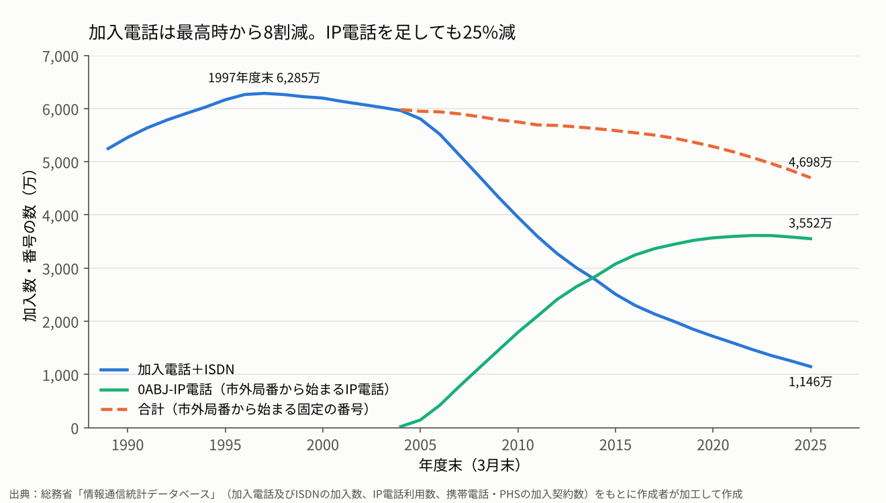
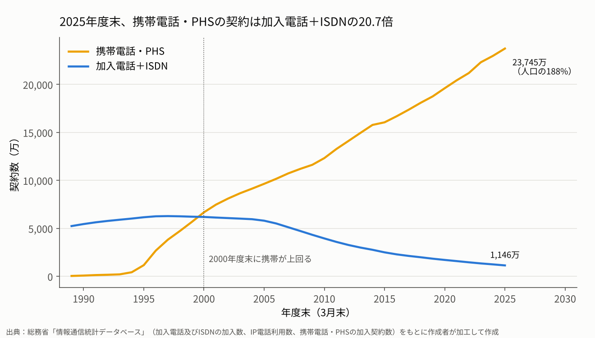
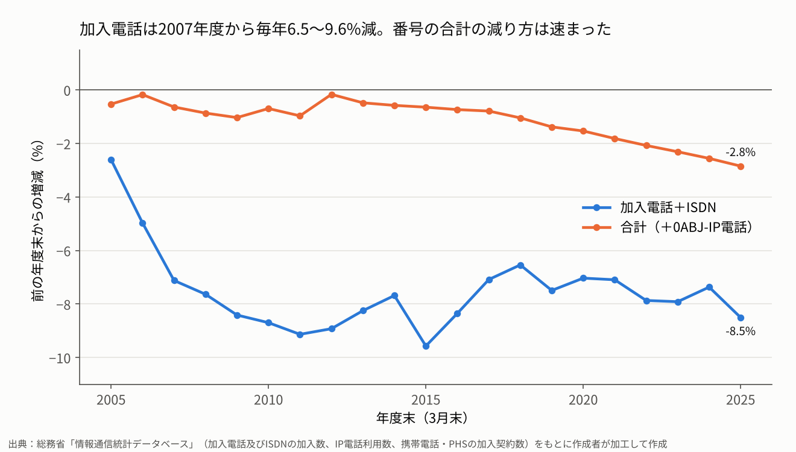
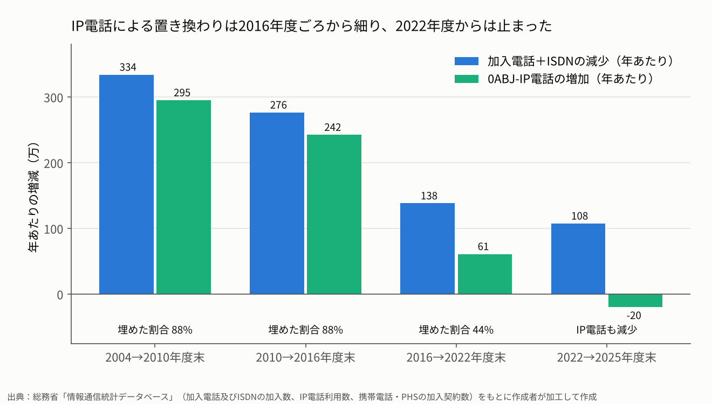

# F510 固定電話は、どれだけ減ったのか？ 加入電話＋ISDNは1997年度末の6,285万から2025年度末は1,146万へ81.8%減。IP電話を足した固定の番号でも25.2%減

## 結論（先に）
- 加入電話とISDN（NTT東西のほか、直収電話・CATV電話を含む）の加入数は、1997年度末の6,284.9万が最高でした。2025年度末（2026年3月末）は1,146.3万で、最高時から81.8%減っています。半分を割ったのは2013年度末、4分の1を割ったのは2022年度末です。
- 2007年度以降は、毎年6.5〜9.6%のほぼ一定の率で減ってきました（2008〜2025年度の当てはめで年 −7.9%）。
- 市外局番から始まる IP 電話（0ABJ-IP 電話）は、2004年度末の18.7万から2022年度末の3,611.5万まで増えました。2004→2025年度末で見ると、0ABJ-IP 電話の増加（3,533.0万）は、同じ期間の加入電話＋ISDN の減少（4,814.5万）の73.4%に当たります。
- ただし置き換わりは細っています。0ABJ-IP 電話は2022年度末をピークに減り始め、両方を足した「固定の番号」は2025年度末で4,698.0万、1997年度末から25.2%減です。前年比の減り方は −0.7%（2016年度）から −2.8%（2025年度）へ速まりました。
- 携帯電話・PHS は2000年度末に加入電話＋ISDN を上回り、2025年度末は23,745万で、加入電話＋ISDN の20.7倍です。

## 問い
「固定電話はもう使われていない」とよく言われます。では、どれだけ減ったのか。減った分は、同じ市外局番の番号を使う IP 電話（光回線の電話など）に置き換わったのか、それとも番号そのものが消えたのか。家や事業所の電話の今を数字で知りたい人、通信の統計を読む人のために確かめます。

## データ（出典）
- 総務省「情報通信統計データベース」の契約数の表
  - 加入電話及びISDNの加入数（1989年度末〜2026年6月末。全体とNTT東西。万加入）
  - IP電話利用数（050-IP と 0ABJ-IP。2003年12月末〜2026年6月末。万件）。番号の数で、厳密な契約数ではありません
  - 携帯電話・PHSの加入契約数（単純合算、普及率つき）
- 令和8年版情報通信白書の図表のCSV（2016〜2025年）。データベースの値との照合に使いました。
- 毎年の年度末（3月末）で比べました。2025年度末は2026年3月末です。

## 事前の計画
[PLAN.md](PLAN.md)（2026-11-16 12:45、集計の前に作成）。加入電話の表は形を確かめるために全部の行を見ていたので、H1 と H4 は確認のための仮説と明記しています。

| 仮説 | 外れの基準 | 結果 | 判定 |
|---|---|---|---|
| H1（確認）加入電話＋ISDN は最高時から8割以上減った | 8割未満 | −81.8% | 支持 |
| H2 0ABJ-IP の増加が加入電話＋ISDN の減少（2004→2025年度末）の半分以上を埋めた | 半分未満 | 73.4% | 支持 |
| H3 加入電話＋ISDN＋0ABJ-IP の合計は、最高時から2割以上減った | 2割未満 | −25.2%（0ABJ-IP が出てからの最高 2004年度末比では −21.4%） | 支持 |
| H4（確認）2008〜2025年度の前年比はすべて −5〜−10% | 1年でも範囲外 | −6.54%〜−9.57% | 支持 |

## やったこと
1. 3つの表の「年度末」「○月末」の行を年月に直し、年月×系列の表を作りました（02_build.py）。
2. 年度末の値で、最高時からの減少、半分・4分の1を割った年度、前年比、一定の率で減るとみなした当てはめ（対数の直線）を出しました。0ABJ-IP による置き換わりの割合（0ABJ-IP の増加 ÷ 加入電話＋ISDN の減少）を出しました（03_analysis.py）。当てはめは過去の減り方の要約で、将来の予測ではありません。
3. 結果を見てから、置き換わりが期間でどう変わったかを足しました（03b_requestion.py）。

## 分かったこと

### 1. 加入電話は8割減、番号の合計は25%減（図1）

加入電話＋ISDN は1997年度末の6,284.9万から減り続け、2025年度末は1,146.3万です。内訳は加入電話1,013.7万、ISDN 132.6万。0ABJ-IP 電話は2014年度末に加入電話＋ISDN を上回り、2025年度末は3,551.7万です。両方を足した「市外局番から始まる固定の番号」は4,698.0万で、1997年度末から25.2%減りました。

### 2. 携帯は固定の20.7倍（図2）

携帯電話・PHS の契約は2000年度末に加入電話＋ISDN を上回りました。2025年度末は23,745万で、人口の188%（表の普及率）、加入電話＋ISDN の20.7倍です。1人で複数の契約や、機械どうしの通信の回線も含むため、人の数とは一致しません。

### 3. 減り方はほぼ一定、番号の合計は加速（図3）

加入電話＋ISDN の前年比は、2007〜2025年度のすべての年で −6.5〜−9.6% でした。一方、0ABJ-IP を足した合計の前年比は、2016年度の −0.7% から2025年度の −2.8% へ、ほぼ毎年大きくなっています。

## 問い直し（結果を見てから足した）

### 置き換わりは、いつ止まったのか（図4）

番号の合計の減り方が速まったので、期間ごとの置き換わりを見ました。2004→2010年度末は、加入電話＋ISDN が年334万減り、0ABJ-IP が年295万増えて、減少の88%を埋めました。2010→2016年度末も88%です。2016→2022年度末は44%に下がり、2022→2025年度末は 0ABJ-IP 自体が年20万減りました。四半期で見ると 0ABJ-IP の最大は2023年12月末の3,614.1万で、2026年6月末は3,539.4万です。加入電話の減少が IP 電話の番号に移る流れは、2010年代後半から細り、今は番号そのものが減っています。

あわせて、NTT東西以外の加入電話＋ISDN（直収電話・CATV電話など）を全体からNTT東西を引いて出すと、2003年度末の66.9万から2007年度末に569.0万まで増え、2025年度末は95.5万でした。

## 頑健性

| 確かめ方 | 最高の年度末 | 最高→2025年度末 | 減少 | 年率（2008〜16年度） | 年率（2016〜25年度） |
|---|---|---|---|---|---|
| 加入電話＋ISDN（本線） | 1997 | 6,284.9→1,146.3万 | −81.8% | −8.6% | −7.4% |
| 加入電話だけ | 1996 | 6,152.6→1,013.7万 | −83.5% | −8.8% | −7.2% |
| ISDN だけ | 2001 | 1,032.7→132.6万 | −87.2% | −7.7% | −9.0% |
| NTT東西だけ（2003年度末から） | 2003 | 5,955.0→1,050.8万 | −82.4% | −8.3% | −7.5% |
| NTT東西以外（2003年度末から） | 2007 | 569.0→95.5万 | −83.2% | −11.8% | −6.6% |
| 12月末で比べる（2007年12月末から） | — | 5,234.6→1,176.8万 | −77.5% | −8.7% | −7.3% |
| 白書の値との照合（2016〜2025年） | — | 差は最大0.4万（0ABJ-IP は0.5万） | — | — | — |

どの区切り方でも、最高時から8割前後減り、年率7〜9%で減っているという結論は変わりませんでした。

## 言えないこと
- 契約数（回線や番号の数）であって、通話の回数や時間は分かりません。
- 世帯と事業所が混ざっていて、世帯が固定電話を持つ割合はこの表からは分かりません。
- 0ABJ-IP 電話は番号の数で、契約数と同じではありません。NTT東西の加入電話の設備を IP 網へ移す工事の影響が数え方に出ているかどうかも、この表からは確かめられません。
- 減った理由（携帯への置き換え、料金、世帯の構成の変化）は、このデータでは分けられません。
- 携帯の契約数は機械どうしの通信なども含むので、人が使う回線の数とは違います。

## 仕事で使うなら
- 「固定電話の契約数」を引くときは、加入電話＋ISDN だけか、0ABJ-IP を含めるかで、2025年度末で1,146万と4,698万の違いになります。どちらを指すかを書くと読み違えが減ります。
- 年度ごとの値は results/by_fiscal_year.csv、期間ごとの置き換わりは results/replacement_by_period.csv にあります。

## 計画からの変更
- 計画の頑健性3（白書の「固定通信」で比べる）は、白書の値がデータベースの加入電話＋ISDN の全体と同じ定義だったため、定義を変えた比較ではなく「値の照合」にしました。代わりに NTT東西以外と ISDN だけの行を足しました。
- 問い直しは結果を見てから足しました。

## 再現のしかた
```
sh src/run_all.sh        # オフライン。所要約3秒
python3 src/01_fetch.py  # 元データを取り直すときだけ（ネットを使う）
```

| ファイル | 中身 |
|---|---|
| src/02_build.py | 表 → data/series.csv（年月×系列、万）、data/whitepaper.csv |
| src/03_analysis.py | 減り方・置き換わり・仮説・頑健性・白書との照合 → results/main.json・by_fiscal_year.csv・robustness.csv・whitepaper_check.csv |
| src/03b_requestion.py | 問い直し → results/requestion.json・replacement_by_period.csv |
| src/04_figures.py | 図4枚 |

repro_check：/tmp/rep_F510 に写し、02 以降が作るファイルを消してから流し、12ファイル（results 6、figures 4、data の CSV 2）がすべて cmp で一致（results/repro_check.txt）。乱数は使っていません。

## レビューで直したこと

| # | 指摘 | 直し方 |
|---|---|---|
| 1 | 結論の「2022年度末まで増え、減少の73.4%を埋めた」と note の「その減少の73.4%」は、期間がずれていた（73.4%は2004→2025年度末の値。1997年度末からの減少ではない） | README と note を「2004→2025年度末で見ると」と期間を明記する書き方に直した |

直したあと、/tmp で流し直して results・figures が元と一致することを確かめました。

## 出典
- 総務省「情報通信統計データベース」契約数：https://www.soumu.go.jp/johotsusintokei/field/tsuushin02.html （各表の URL は data/raw/SOURCES.md）
- 総務省「令和8年版 情報通信白書」音声通信サービスの加入契約数の状況：https://www.soumu.go.jp/johotsusintokei/whitepaper/ja/r08/html/nd212270.html

（いずれも 総務省「情報通信統計データベース」「情報通信白書」をもとに作成者が加工して作成）
