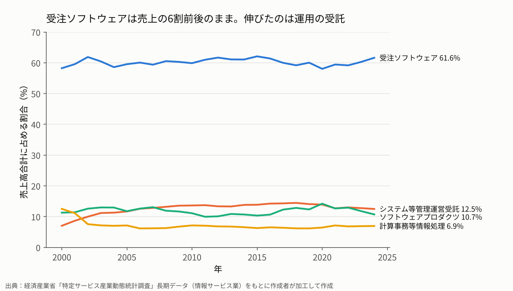
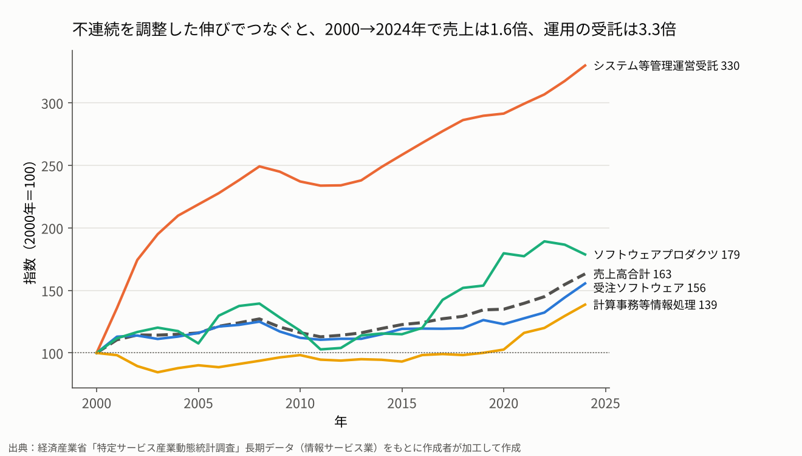
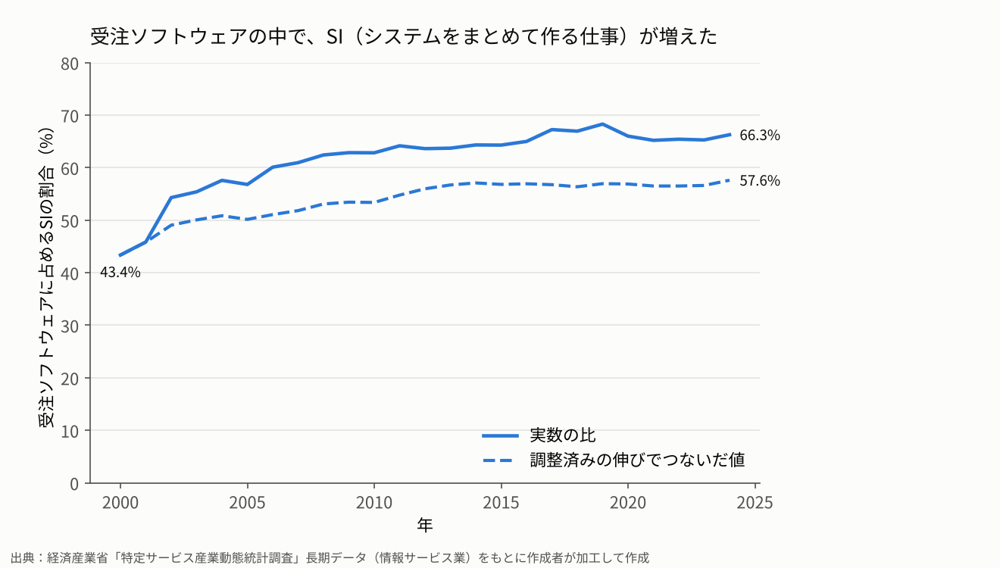
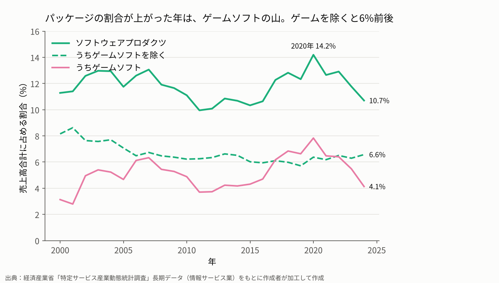

# F511 ソフトウェアの仕事は、受託開発からパッケージ・クラウドへ移ったのか？ 受注ソフトウェアは売上の58.2%から61.6%でほぼ横ばい、パッケージは11.3%から10.7%。伸びたのは運用の受託（7.0%→12.5%）

## 結論（先に）
- 情報サービス業の売上高に占める受注ソフトウェア（注文を受けて作るソフト）の割合は、2000年 58.2%、2024年 61.6%でした。2000年以降は58〜62%の間を動いただけで、受託開発から離れた形は見えません。
- ソフトウェアプロダクツ（パッケージ）の割合は11.3%から10.7%で、上がっていません。割合が高かった2020年（14.2%）はゲームソフトの山で、ゲームを除くと8.2%から6.6%へ少し下がっています。
- 伸びたのはシステム等管理運営受託（システムの運用を引き受ける仕事）で、7.0%から12.5%へ。不連続を調整した伸びでつなぐと、2000年から2024年で3.3倍になり、売上全体（1.6倍）より速く伸びました。ただし伸びの大半は2008年までで、2009年以降の割合は12〜14%で横ばいです。
- 受注ソフトウェアの中では、SI（システムをまとめて作る仕事）の割合が43.4%から66.3%に上がりました。受託の中身が、大きなシステムをまとめて請け負う形へ移っています。
- 統計に「クラウド」の区分はないため、クラウドへの移り方そのものは、この表からは測れません。

## 問い
「日本の IT は受託開発が中心で変わらない」とも、「パッケージやクラウドの時代になった」とも言われます。情報サービスの会社の売上の中身は、実際にどう動いたのでしょうか。IT の会社で働く人、これから働く人、業界の話を読む人のために、経済産業省の統計で確かめます。

## データ（出典）
- 経済産業省「特定サービス産業動態統計調査」長期データ 表2 情報サービス業（1988〜2024年、e-Stat の Excel、2025年3月公開）。年と年度の売上高（百万円）と、不連続を調整した前年比。
- 業務の種類は、受注ソフトウェア（うち SI）、ソフトウェアプロダクツ（うちゲームソフト）、計算事務等情報処理、キーパンチ等、システム等管理運営受託、情報提供・各種調査ほか。受注とプロダクツの区分は1994年から、SI とゲームの内訳は2000年からです。
- 調査の対象は途中で何度も追加されています（2008年7月の業種の拡充、2020年7月の対象の追加など）。そこで、同じ年の中の比（割合）と、調整済みの前年比をつないだ指数（2000年＝100）の二つで見ました。

## 事前の計画
[PLAN.md](PLAN.md)（2026-11-16 12:51、集計の前に作成）。表の形を確かめるため、実数の列の値は下見で目にしていましたが、割合と指数は計算していませんでした。

| 仮説 | 外れの基準 | 結果 | 判定 |
|---|---|---|---|
| H1 受注ソフトウェアの割合は2000年より2024年の方が低い | 高いか同じ | 58.2%→61.6%（指数でつなぐと55.5%） | 外れ（計算の仕方で向きが変わる。大きな変化はない） |
| H2 プロダクツの割合は2000年より2024年の方が高い | 低いか同じ | 11.3%→10.7%（指数でつなぐと12.3%） | 外れ（同上） |
| H3 システム等管理運営受託の割合は2000年より2024年の方が高い | 低いか同じ | 7.0%→12.5%（指数でつなぐと14.2%） | 支持 |
| H4 2014〜2024年の年平均の伸びは、受注ソフトウェアが売上合計より低い | 高いか同じ | 3.08% 対 3.16% | 支持（差は0.08ポイントと小さい） |

## やったこと
1. Excel の「年・実数」「年・伸び率」「年度・実数」「年度・伸び率」から、業務の種類×年の表を作りました（02_build.py）。
2. 業務の種類ごとに、売上高合計に対する割合を出しました。調整済みの前年比を掛け合わせて2000年＝100の指数を作り、2000年の割合×指数の比で「調査対象の追加の影響を除いた割合」も計算しました（03_analysis.py）。
3. 結果を見てから、受注ソフトウェアの中の SI の割合と、プロダクツの中のゲームソフトを足しました（03b_requestion.py）。

## 分かったこと

### 1. 受注ソフトウェアは6割前後のまま（図1）

2024年の売上高合計は17.92兆円で、受注ソフトウェア11.04兆円（61.6%）、システム等管理運営受託2.24兆円（12.5%）、プロダクツ1.92兆円（10.7%）、計算事務等情報処理6.9%です。受注ソフトウェアの割合は2000年以降、最低が2020年の58.0%、最高が2015年の62.1%でした。1994年は53.6%で、長い目で見るとむしろ少し上がっています。計算事務等情報処理（データの処理を引き受ける仕事）は12.5%から6.9%に下がりました。

### 2. 伸びたのは運用の受託（図2）

調整済みの伸びでつなぐと、2000→2024年の年平均の伸びは、売上合計 2.06%、受注ソフトウェア 1.86%、プロダクツ 2.45%、システム等管理運営受託 5.10%、計算事務等 1.37%でした。運用の受託は2008年までに2.5倍になり、その後は売上全体と同じくらいの速さです。2014〜2024年に限ると、プロダクツ（4.46%）と計算事務等（3.91%）が速く、受注ソフトウェア（3.08%）は合計（3.16%）とほぼ同じでした。

## 問い直し（結果を見てから足した）

### 受託の中身は SI へ（図3）
受注ソフトウェアの割合がほぼ変わらないので、その中身を見ました。受注ソフトウェアに占める SI の割合は、2000年 43.4%から2024年 66.3%に上がりました。調整済みの伸びでつないだ値でも57.6%で、向きは同じです。SI を除いた受注ソフトウェアの売上全体に対する割合は33.0%から20.8%に下がりました。


### パッケージの山はゲーム（図4）
プロダクツの割合が最も高かったのは2020年の14.2%で、そのうち7.8%がゲームソフトでした。ゲームを除いたプロダクツは2000年以降5.7〜8.6%の幅で、2024年は6.6%です。


## 頑健性

| 業務の種類 | 年（本線）2000→2024 | 年度 2000→2023 | 2009→2024年 | 指数でつないだ2024年の割合 | 年平均の伸び 2000→24 / 2009→24 |
|---|---|---|---|---|---|
| 受注ソフトウェア | 58.2→61.6% | 58.8→60.5% | 60.3→61.6% | 55.5% | 1.86% / 1.91% |
| ソフトウェアプロダクツ | 11.3→10.7% | 11.3→11.7% | 11.7→10.7% | 12.3% | 2.45% / 2.23% |
| システム等管理運営受託 | 7.0→12.5% | 7.5→12.7% | 13.5→12.5% | 14.2% | 5.10% / 2.00% |
| 受注ソフト（SIを除く） | 33.0→20.8% | 32.3→20.7% | 22.4→20.8% | — | — |
| プロダクツ（ゲームを除く） | 8.2→6.6% | 8.1→6.3% | 6.4→6.6% | — | — |
| 計算事務等情報処理 | 12.5→6.9% | 11.9→6.9% | 6.7→6.9% | 10.6% | 1.37% / 2.45% |

受注ソフトウェアとプロダクツは、計算の仕方で上下が入れ替わる程度の小さな動きでした。「受託開発からパッケージへ大きく移った」とはどの方法でも言えません。運用の受託の割合が2000年より高いこと、SI の比重が増えたことは、どの方法でも同じです。

## 言えないこと
- クラウド（SaaS など）の売上は区分がなく、取り出せません。どの区分に入るかも企業の回答しだいです。
- 調査の対象は一定の規模以上の企業で、途中で追加もされています。実数の割合と指数でつないだ割合が違うのはこのためで、本当の割合がどちらに近いかは分かりません。
- 物価（単価）の動きは除いていません。
- ユーザ企業が社内で作るソフト（内製）や、海外のクラウドの会社の売上は、この統計に入らない可能性があります（推測）。

## 仕事で使うなら
- 「受託開発の比率」を示すときは、売上全体に対する受注ソフトウェアの割合（2024年 61.6%）と、その中の SI の割合（66.3%）を分けて書くと誤解が減ります。
- 年をまたぐ伸びは、実数ではなく調整済みの伸び率（results/index_2000_100.csv）で比べるのが安全です。

## 計画からの変更
- 問い直し（SI とゲームソフト）は結果を見てから足しました。それ以外は計画どおりです。

## 再現のしかた
```
sh src/run_all.sh        # オフライン。所要約3秒
python3 src/01_fetch.py  # 元データを取り直すときだけ（ネットを使う）
```

| ファイル | 中身 |
|---|---|
| src/02_build.py | Excel → data/annual.csv（年・年度×業務の種類、実数と調整済み前年比） |
| src/03_analysis.py | 割合・指数・仮説・頑健性 → results/main.json・share_by_year.csv・index_2000_100.csv・robustness.csv |
| src/03b_requestion.py | 問い直し → results/requestion.json・requestion_table.csv |
| src/04_figures.py | 図4枚 |

repro_check：/tmp/rep_F511 に写し、02 以降が作るファイルを消してから流し、11ファイル（results 6、figures 4、data の CSV 1）がすべて cmp で一致（results/repro_check.txt）。乱数は使っていません。

## レビューで直したこと

独立レビューで数字の照合・再実行・図を確かめ、直すところはなかった。

## 出典
- 経済産業省「特定サービス産業動態統計調査」長期データ 情報サービス業（e-Stat）：https://www.e-stat.go.jp/stat-search/files?toukei=00550050&tstat=000001014007 （URL は data/raw/SOURCES.md）

（いずれも 経済産業省「特定サービス産業動態統計調査」をもとに作成者が加工して作成）
