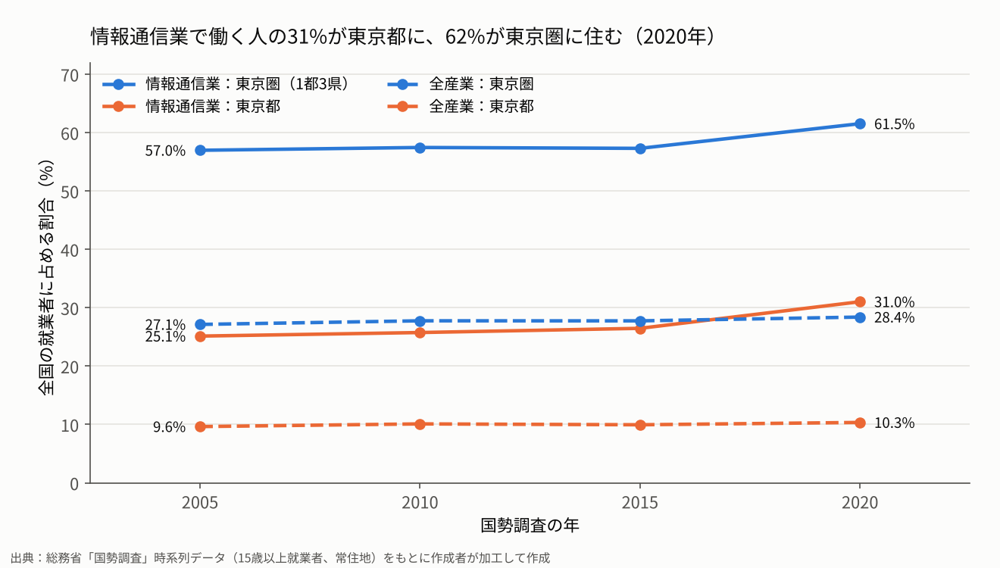
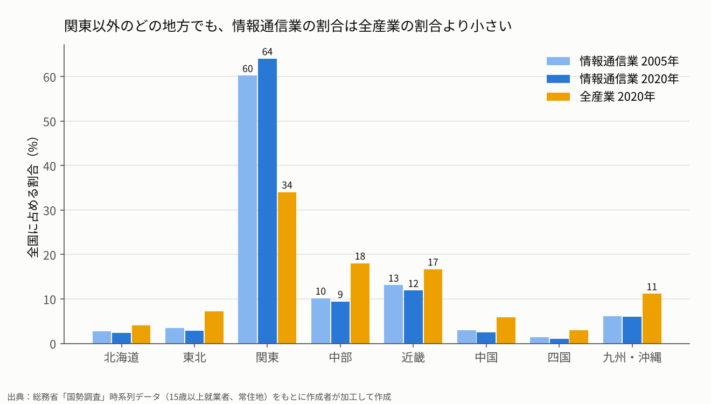
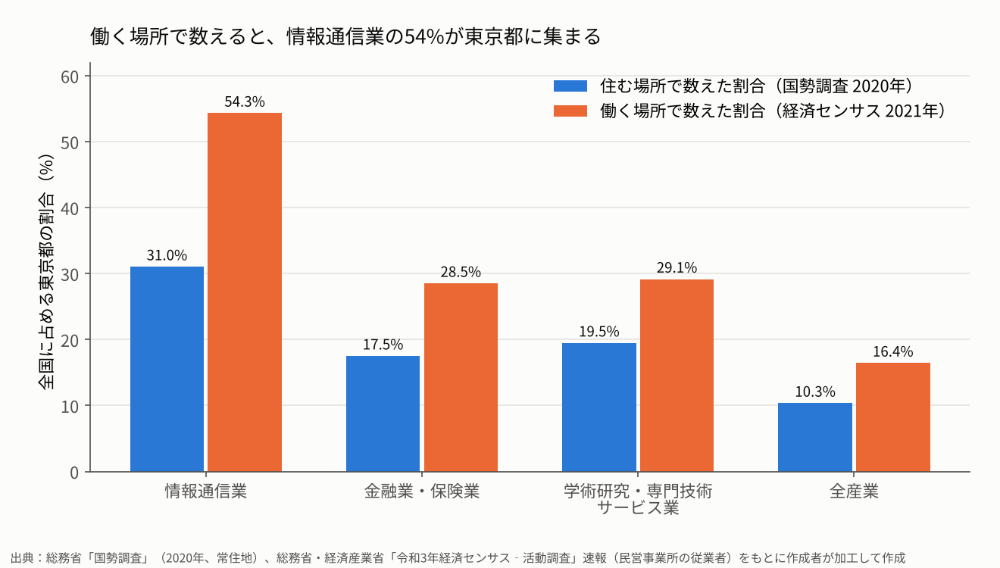
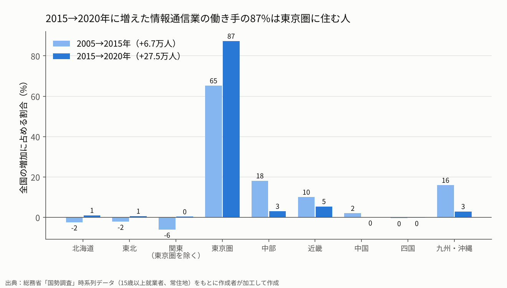

# F512 情報通信業で働く人は、東京にどれだけ集中しているのか？ 住む場所で数えると東京都に31.0%（全産業は10.3%）、東京圏に61.5%。働く場所で数えると東京都に54.3%

## 結論（先に）
- 国勢調査（住む場所で数える）で、2020年に情報通信業で働く人195.6万人のうち31.0%が東京都に、61.5%が東京圏（埼玉・千葉・東京・神奈川）に住んでいました。全産業では東京都10.3%、東京圏28.4%なので、東京都への集まり方は全産業の約3.0倍です。
- 東京都の割合は2005年25.1%、2010年25.7%、2015年26.5%と少しずつ上がり、2020年に31.0%へ大きく上がりました。集中は弱まっていません。
- 2015→2020年に全国で増えた情報通信業の働き手27.5万人のうち、87.3%が東京圏に住む人でした（東京都だけで58.8%）。
- 働く場所で数える経済センサス（2021年）では、情報通信業の従業者の54.3%が東京都の事業所にいます。住む場所で数えた割合より23.3ポイント高く、金融業・保険業（28.5%）や学術研究・専門技術サービス業（29.1%）よりもずっと集まっています。
- 関東以外のどの地方も、情報通信業の割合は全産業の割合より小さいままです。

## 問い
テレワークが広がり、「IT の仕事はどこでもできる」とも言われます。それでも情報通信業（ソフトウェア、情報処理、通信、放送、出版など）で働く人は、東京に集まったままなのでしょうか。集中は強まったのか、弱まったのか。地方で IT の仕事をしたい人、地方で IT の会社を育てたい人、「東京一極集中」の話を読む人のために確かめます。

## データ（出典）
- 総務省「国勢調査」時系列データ 第5表：産業（大分類）×男女×都道府県の15歳以上就業者数（2005・2010・2015・2020年）。住んでいる場所（常住地）で数えた値です。2015・2020年は、回答のない項目を補った値（不詳補完値）もあります。
- 総務省・経済産業省「令和3年経済センサス‐活動調査」速報集計 第2-2表：産業大分類×都道府県の民営事業所の従業者数（2021年6月）。事業所のある場所で数えた値で、公務は含みません。
- 情報通信業（大分類 G）を、全産業、金融業・保険業（J）、学術研究・専門技術サービス業（L）と比べました。

## 事前の計画
[PLAN.md](PLAN.md)（2026-11-16 12:56、集計の前に作成）。下見では表の先頭の数行だけを見ていました。

| 仮説 | 外れの基準 | 結果 | 判定 |
|---|---|---|---|
| H1 2020年、東京都の割合は全産業の2倍以上（立地係数2以上） | 2倍未満 | 3.0倍（31.0% ÷ 10.3%） | 支持 |
| H2 東京都の割合は2005年より2020年の方が高い | 低いか同じ | 25.1%→31.0% | 支持 |
| H3 2020年、東京圏の割合は5割以上 | 5割未満 | 61.5% | 支持 |
| H4 働く場所で数えた東京都の割合は、住む場所より10ポイント以上高い | 10ポイント未満 | 54.3% 対 31.0%（+23.3） | 支持 |

## やったこと
1. 国勢調査の表から都道府県×男女×産業（総数・G・J・L）の就業者数、経済センサスの表から都道府県×産業の従業者数を取り出しました（02_build.py）。
2. 東京都・東京圏の割合、立地係数（東京都の情報通信業の割合 ÷ 全産業の割合）、ハーフィンダール指数（各県の割合の2乗の和。大きいほど一部に集中）、地方別の割合を出しました（03_analysis.py）。
3. 結果を見てから、増えた働き手がどこに住む人かを足しました（03b_requestion.py）。

## 分かったこと

### 1. 東京都に3割、東京圏に6割（図1）

情報通信業の東京都の割合は、2005年25.1%→2020年31.0%、東京圏は57.0%→61.5%でした。全産業の東京都の割合は9.6%→10.3%とほとんど動かないため、立地係数は2.61から3.00に上がりました。ハーフィンダール指数も1,109から1,399へ上がり（全産業は398→416）、集中は強まっています。2015→2020年の上がり方が特に大きく、この5年で東京都に住む情報通信業の働き手は44.5万人から60.7万人に増えました。

### 2. 関東以外の地方は、どこも全産業の割合より小さい（図2）

地方別に北から並べると、情報通信業の割合（2020年）は、北海道2.3%、東北2.8%、関東64.0%、中部9.4%、近畿11.9%、中国2.5%、四国1.1%、九州・沖縄6.0%でした。関東以外のすべての地方で、全産業の割合（北海道4.1%〜中部18.0%）より小さく、2005年と比べても関東以外はすべて下がりました。地方の中心になる道府県の立地係数（2020年、北から）も、北海道0.57、宮城県0.69、愛知県0.68、大阪府0.98、広島県0.53、福岡県0.80と、どこも1を下回ります。

### 3. 働く場所で数えると東京都に54%（図3）

国勢調査は住む場所で数えるので、東京の会社に通う人の多くは神奈川・埼玉・千葉で数えられます。働く場所で数える経済センサス（2021年）では、情報通信業の従業者の54.3%が東京都の事業所にいました（東京圏では63.9%）。全産業の東京都の割合は16.4%なので、立地係数は3.3です。金融業・保険業（1.7）、学術研究・専門技術サービス業（1.8）と比べても、情報通信業の集まり方は飛び抜けています。

## 問い直し（結果を見てから足した）

### 増えた働き手は、どこに住む人か（図4）
2015→2020年に東京都の割合が大きく上がったので、全国の増加の内訳を見ました。2015→2020年に全国で27.5万人増えたうち、東京圏が24.0万人（87.3%）、東京都だけで16.2万人（58.8%）でした。2005→2015年（全国で6.7万人増）は東京圏が65.2%で、北海道・東北・関東（東京圏を除く）は減っていました。不詳補完値で2015→2020年を見ても、全国の増加37.3万人のうち東京圏が82.4%です。増加が東京圏に偏る形は、むしろ強くなりました。


## 頑健性

| 確かめ方 | 期間 | 東京都の割合 | 東京圏の割合 | 立地係数（東京都） |
|---|---|---|---|---|
| 本線：情報通信業・総数（原数値） | 2005→2020 | 25.1→31.0% | 57.0→61.5% | 2.61→3.00 |
| 不詳補完値 | 2015→2020 | 31.9→35.3% | 61.4→64.5% | 2.75→2.90 |
| 原数値（同じ期間） | 2015→2020 | 26.5→31.0% | 57.3→61.5% | 2.66→3.00 |
| 男 | 2005→2020 | 24.4→29.6% | 58.3→61.8% | 2.51→2.89 |
| 女 | 2005→2020 | 27.2→34.4% | 53.2→60.8% | 2.85→3.29 |
| 金融業・保険業 | 2005→2020 | 14.1→17.5% | 35.4→38.5% | 1.47→1.69 |
| 学術研究・専門技術サービス業 | 2005→2020 | 17.1→19.5% | 39.2→41.4% | 1.77→1.88 |
| 働く場所（経済センサス、情報通信業） | 2021年 | 54.3% | 63.9% | 3.31 |

不詳補完値では東京都の割合が5ポイントほど高くなります（東京都は産業を答えない人が多いため、原数値では東京都が小さめに出ると考えられます。推測）。それでも「東京都の割合が2015→2020年に上がった」ことは同じです。男女どちらでも、比べたどの産業より集まり方が強いことも変わりません。

## 言えないこと
- 国勢調査は住む場所、経済センサスは事業所の場所で数えます。テレワークで実際にどこで仕事をしているかは、どちらからも分かりません。
- 経済センサスは本社などの事業所に人が登録されるため、地方で働く人が東京の事業所の人として数えられている場合があります（推測）。
- 情報通信業の中の内訳（ソフトウェア・情報処理と、通信・放送・出版）は分けていません。
- 2005年の値は一部の調査票から推計した集計で、他の年と作り方が違います。また2005年は派遣社員の数え方も違います。
- 2025年の国勢調査の産業別の結果は、まだこの表に入っていません。

## 仕事で使うなら
- 「IT の働き手の東京集中」を数字で示すときは、住む場所（31.0%）と働く場所（54.3%）のどちらで数えたかを書くと、読み違えが減ります。
- 都道府県別の割合は results/concentration.csv、地方別は results/region_share.csv、増加の内訳は results/increase_by_region.csv にあります。

## 計画からの変更
- 地方の中心になる道府県の立地係数と、増加の内訳（問い直し）は、結果を見てから足しました。

## 再現のしかた
```
sh src/run_all.sh        # オフライン。所要約3秒
python3 src/01_fetch.py  # 元データを取り直すときだけ（ネットを使う）
```

| ファイル | 中身 |
|---|---|
| src/02_build.py | Excel → data/census.csv（都道府県×男女×産業）、data/ecensus2021.csv |
| src/03_analysis.py | 割合・立地係数・集中度・地方別・仮説・頑健性 → results/main.json・concentration.csv・region_share.csv・ecensus2021_concentration.csv・robustness.csv |
| src/03b_requestion.py | 問い直し → results/requestion.json・increase_by_region.csv・hub_lq.csv |
| src/04_figures.py | 図4枚 |

repro_check：/tmp/rep_F512 に写し、02 以降が作るファイルを消してから流し、14ファイル（results 8、figures 4、data の CSV 2）がすべて cmp で一致（results/repro_check.txt）。乱数は使っていません。

## レビューで直したこと

独立レビューで数字の照合・再実行・図を確かめ、直すところはなかった。

## 出典
- 総務省「国勢調査」時系列データ：https://www.e-stat.go.jp/stat-search/files?toukei=00200521&tstat=000001011777
- 総務省・経済産業省「令和3年経済センサス‐活動調査」：https://www.e-stat.go.jp/stat-search/files?toukei=00200553&tstat=000001145590 （各表の URL は data/raw/SOURCES.md）

（いずれも 総務省「国勢調査」、総務省・経済産業省「経済センサス‐活動調査」をもとに作成者が加工して作成）
