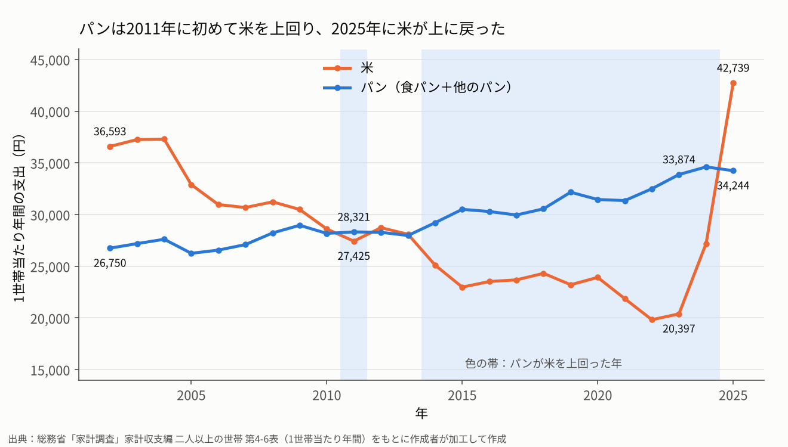
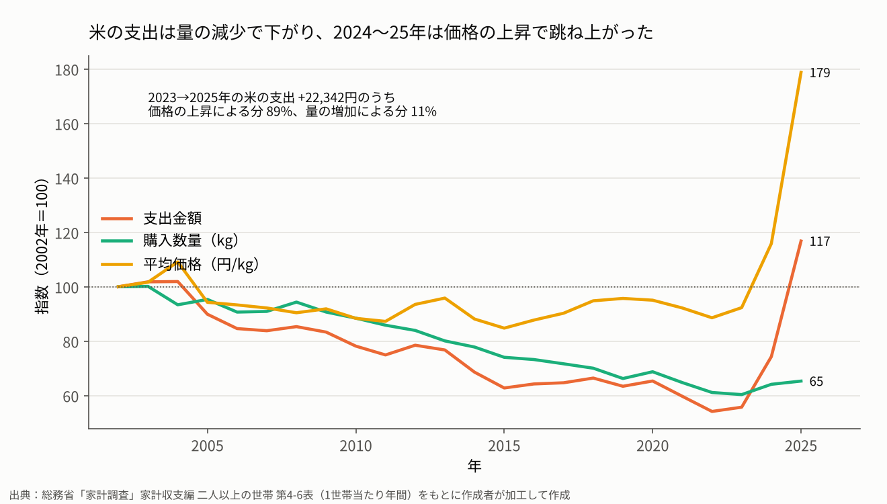
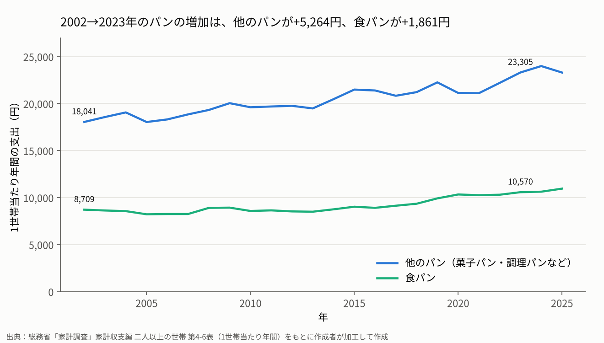
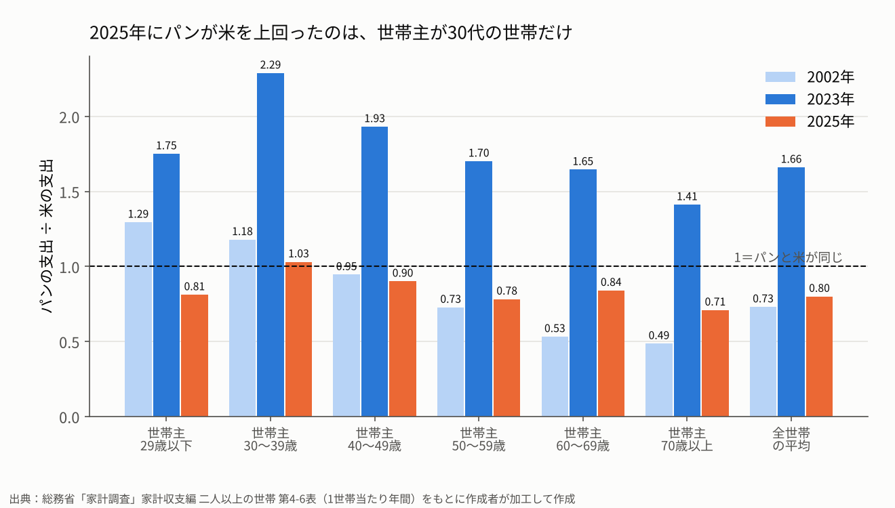

# F513 「パンの支出が米を上回った」は、その後も続いているのか？ パンは2011年に初めて米を上回り、2014〜2024年は上回り続けたが、2025年は米42,739円・パン34,244円で逆転が戻った。米の増加の89%は価格

（予備 R11 に替えた記事です。元の F513「マイナンバーカードの交付率は年齢でどれだけ違うのか」は、年齢別の表を機械で読める形で集められなかったため替えました。/home/claude/f3/REPLACED.md 参照）

## 結論（先に）
- 二人以上の世帯の1世帯当たり年間の支出で、パンが米を初めて上回ったのは2011年でした（パン28,321円、米27,425円）。2012・2013年は米がわずかに上に戻り、2014年から2024年までは11年続けてパンが上でした。
- 差が最も開いたのは2023年で、パンは米の1.66倍（パン33,874円、米20,397円）でした。
- 2025年は米42,739円、パン34,244円で、米がパンを上回りました。2023→2025年の米の支出の増加（+22,342円）のうち89%は平均価格の上昇（360円/kg→697円/kg）によるもので、購入数量の増加（56.65kg→61.31kg）による分は11%でした。
- パンの支出の伸び（2002→2023年）は、食パン（+1,861円）より菓子パン・調理パンなどの「他のパン」（+5,264円）が大きく、食パンの伸びのほとんどは値段の上昇でした。
- 問い直しで世帯主の年齢別に見ると、2025年にパンが米を上回ったままだったのは世帯主が30代の世帯（1.03倍）だけでした。

## 問い
総務省統計局の家計調査の解説（家計調査通信）では、食料の支出に占める割合で、米が1987年の7.9%から2017年の2.6%に下がり、パンが2.7%から3.4%に上がったとして、米からパンへの移り変わりが紹介されています。この「パン＞米」は、その後も続いたのでしょうか。米の値段が大きく上がった2024〜25年に、逆転は戻ったのか。差は値段と量のどちらで動いたのか。食品の販売や商品の企画に関わる人、食の消費の統計を読む人のために確かめます。

## データ（出典）
- 総務省「家計調査」家計収支編 二人以上の世帯 年次 第4-6表「世帯主の年齢階級別1世帯当たり支出金額、購入数量及び平均価格」（2002〜2025年、24年分）。
- 使った品目：米（支出金額・購入数量kg・平均価格円/kg）、パン（食パン＋他のパン）、食パン（数量g・価格円/100g）、他のパン、麺類、食料。
- 家で買った分で、外食は含みません。単身の世帯は含みません。
- 関連する記事：F307（米の購入数量を年齢・世代で分けた）、F266（米の値段の段階）。この記事は「米とパンの支出の差」と、それを値段と量に分けることを中心にしています。

## 事前の計画
[PLAN.md](PLAN.md)（2026-11-16 13:03、集計の前に作成）。下見では2002年と2025年の全世帯平均の穀類の行を見ていたので、2025年の米とパンの大小は集計の前から分かっていました（H2 の後半は確認）。

| 仮説 | 外れの基準 | 結果 | 判定 |
|---|---|---|---|
| H1 2002〜2025年にパンが米を上回った年がある | 1年もない | 2011年が最初。計12年 | 支持 |
| H2 上回った状態は2023年まで続き、2025年に米が上に戻った | 途中で米が上回る年がある、または2025年もパンが上 | 2012・2013年は米が上。2025年は米が上 | 外れ（前半が外れ） |
| H3 2023→2025年の米の支出の増加は、価格の寄与が8割以上 | 8割未満 | 89.3%（ラスパイレス型で92.5%） | 支持 |
| H4 2002〜2023年のパンの増加は、他のパンの方が食パンより大きい | 食パンの方が大きい | 他のパン +5,264円、食パン +1,861円 | 支持 |

## やったこと
1. 24年分の Excel から、全世帯平均と年齢階級別の穀類の品目の行を取り出しました（02_build.py）。
2. パン÷米の比、パンが米を上回った年を出しました。米と食パンの支出の変化を、購入数量の変化と平均価格の変化に分けました（対数の差の比で金額の差を分ける形）（03_analysis.py）。
3. 結果を見てから、年齢階級別の比を足しました（03b_requestion.py）。

## 分かったこと

### 1. 2011年に初めて逆転、2025年に戻る（図1）

米の支出は2002年36,593円から2022年19,825円（最低）まで下がり、パンは26,750円から2023年33,874円まで上がりました。パンが上だった年は2011年と2014〜2024年の計12年です。2024年はまだパンが上（パン34,609円、米27,196円）でしたが、2025年に米42,739円、パン34,244円となり、米が上に戻りました。

### 2. 米の支出は、量で下がり、値段で跳ねた（図2）

2002→2023年の米の支出の減少（−16,196円）は、購入数量の減少（93.84kg→56.65kg、−39.6%）による分が−13,986円で、平均価格（389.95円/kg→360.03円/kg）による分は−2,212円でした。逆に2023→2025年の増加（+22,342円）は、平均価格が93.6%上がったことによる分が+19,957円、購入数量が8.2%増えたことによる分が+2,388円です。2024年だけで見ると価格の寄与は78.9%、2025年だけでは96.0%でした。

### 3. パンの伸びは「他のパン」（図3）

2002→2023年に、他のパン（菓子パン・調理パンなど）は18,041円から23,305円へ、食パンは8,709円から10,570円へ増えました。食パンの増加（+1,861円）のうち9割（+1,678円）は100gあたりの値段の上昇（45.82円→54.56円）によるもので、量はほぼ横ばいでした。

## 問い直し（結果を見てから足した）

### 逆転が戻ったのは、どの年齢の世帯でもか（図4）

パン÷米の比を世帯主の年齢別に見ると、2023年はすべての年齢でパンが上でした（70歳以上1.41倍〜30代2.29倍）。2025年は、30代の世帯（1.03倍）を除くすべての年齢で米が上に戻りました。2002年にパンが上だったのは29歳以下と30代だけで、2023年にはすべての年齢に広がり、2025年に再び狭まった形です。

## 頑健性

| 確かめ方 | パンが米を上回った年 | 2023年の比 | 2025年の比 |
|---|---|---|---|
| 本線：パン全体と米（年ごと） | 2011、2014〜2024年 | 1.66 | 0.80 |
| 食パンだけと米 | なし | 0.52 | 0.26 |
| 3年平均（その年までの3年） | 2012〜2025年 | 1.57 | 1.14 |
| パン＋麺類（小麦の主食）と米 | 2002〜2025年のすべて | 2.67 | 1.32 |
| 麺類だけと米 | 2022・2023年 | 1.01 | 0.52 |
| 分け方をラスパイレス型に（2023→2025年の米） | 価格の寄与 92.5% | — | — |

「パンが米を上回った」は、パンに菓子パン・調理パンを含めたときの話で、食パンだけなら一度も米を上回っていません。3年平均では2025年もパンが上（1.14倍）で、2025年の逆転は1〜2年の値段の急な動きによるものです。小麦の主食（パン＋麺類）は、2002年からずっと米より多く使われていました。値段と量の分け方を変えても、2023→2025年の増加の大部分が価格によることは同じでした。

## 言えないこと
- 家で買った分だけで、外食・中食（弁当など）や給食で食べた分は入りません。
- 二人以上の世帯だけで、単身の世帯は入りません。
- パンの量は種類で単位が違うため、量の比較は食パンだけです。他のパンが値段と量のどちらで増えたかは分かりません。
- 米の値段が上がった理由や、2026年以降に比がどう動くかは、この統計からは分かりません。
- 年齢別の比は年ごとの振れが大きく、30代の1.03倍は「ほぼ同じ」と読むのが妥当です（推測）。

## 仕事で使うなら
- 「パンが米を上回った」と書くときは、パンに菓子パン・調理パンを含むこと、2011年と2014〜2024年の話であること、2025年に戻ったことを添えると誤解が減ります。
- 年ごとの値は results/by_year.csv、値段と量の分け方は results/decomposition.csv、年齢別は results/ratio_by_age.csv にあります。

## 計画からの変更
- 頑健性の「1人あたり」は、米とパンの比が世帯人員で割っても変わらないため、意味のある確かめにならず、「パン＋麺類」「麺類だけ」に替えました。
- 問い直し（年齢別）は結果を見てから足しました。

## 再現のしかた
```
sh src/run_all.sh        # オフライン。所要約6秒
python3 src/01_fetch.py  # 元データを取り直すときだけ（ネットを使う）
```

| ファイル | 中身 |
|---|---|
| src/02_build.py | Excel 24本 → data/grain.csv（年×年齢階級×品目）、data/household.csv |
| src/03_analysis.py | 比・逆転の年・値段と量の分け方・仮説・頑健性 → results/main.json・by_year.csv・decomposition.csv・decomposition_laspeyres.json・robustness.csv |
| src/03b_requestion.py | 問い直し → results/requestion.json・ratio_by_age.csv |
| src/04_figures.py | 図4枚 |

repro_check：/tmp/rep_F513 に写し、02 以降が作るファイルを消してから流し、13ファイル（results 7、figures 4、data の CSV 2）がすべて cmp で一致（results/repro_check.txt）。乱数は使っていません。

## レビューで直したこと

独立レビューで数字の照合・再実行・図を確かめ、直すところはなかった。

## 出典
- 総務省「家計調査」家計収支編 二人以上の世帯 第4-6表（e-Stat）：https://www.e-stat.go.jp/stat-search/files?toukei=00200561&tstat=000000330001 （各年の URL は data/raw/SOURCES.md）
- 総務省統計局「家計調査通信」（米とパンの構成比の解説）：https://www.stat.go.jp/data/kakei/tsushin/pdf/30_5.pdf

（いずれも 総務省「家計調査」をもとに作成者が加工して作成）
