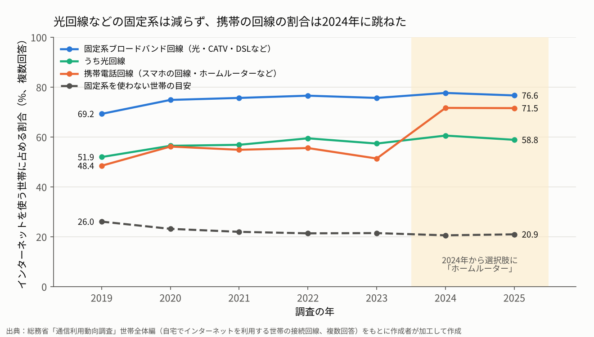
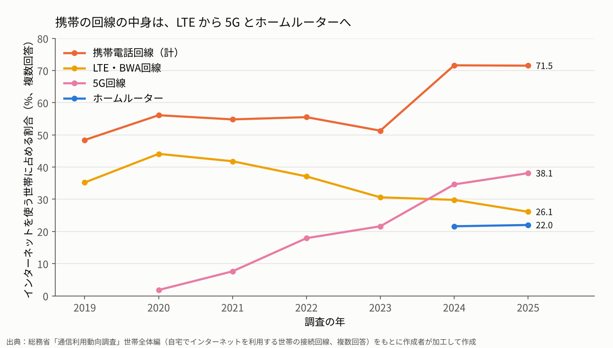
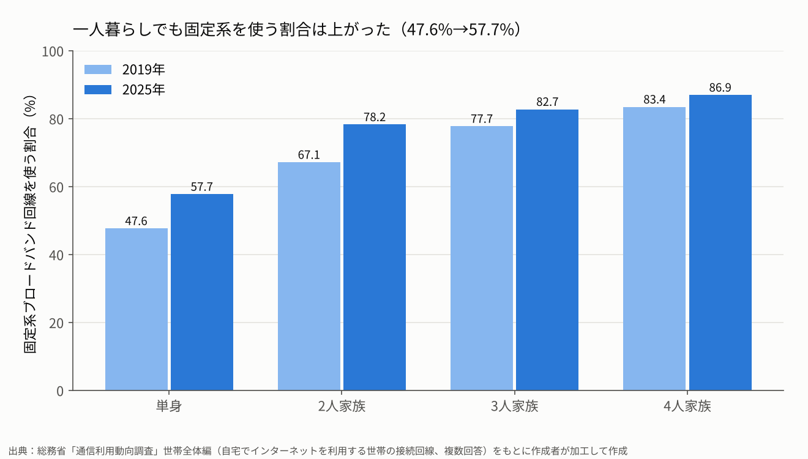
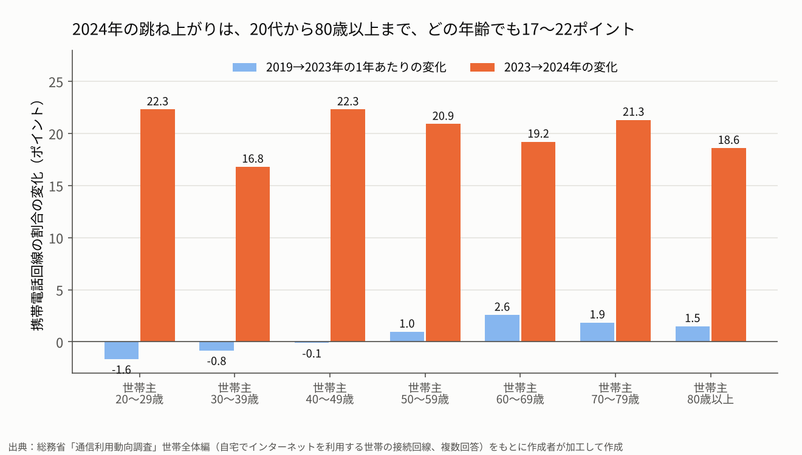

# F514 家のネットは、光回線と携帯の回線のどちらに移ったのか？ 固定系は2019年69.2%→2025年76.6%で減らず、光回線も51.9%→58.8%。携帯回線の48.4%→71.5%の伸びの大半は2024年の1年で、選択肢の追加と重なる

## 結論（先に）
- 自宅でインターネットを使う世帯のうち、光回線・ケーブルテレビ・DSLなど固定系ブロードバンド回線を使う割合は、2019年69.2%から2025年76.6%に上がりました。光回線だけでも51.9%から58.8%です。「固定から携帯へ移った」形は見えません。
- 携帯電話回線（スマホの回線・ホームルーターなど）の割合は48.4%から71.5%に上がりました。ただし2019〜2023年は48〜56%の間を上下しただけで、伸びのほとんどは2023→2024年の+20.3ポイントです。この年に選択肢に「ホームルーター」が加わりました。
- 2024年の跳ね上がりは、世帯主が20代の世帯から80歳以上の世帯まで、どの年齢でも17〜22ポイントでした。使い方が急に変わったというより、選択肢が増えて答え方が変わった影響が大きいと考えられます（推測）。
- 固定系を使わない世帯の目安（100−固定系−無回答）は26.0%から20.9%に下がりました。一人暮らしでも固定系を使う割合は47.6%から57.7%に上がりましたが、2人以上の世帯（78〜87%）よりは低いままです。
- 事業者の報告でも、光回線（FTTH）の契約数は2023年6月末3,990万から2026年6月末4,167万へ4.4%増えていました。

## 問い
「スマホがあれば家に光回線はいらない」「若い人や一人暮らしは固定回線を引かない」という話をよく聞きます。家のインターネットは、本当に固定の回線から携帯の回線へ移ったのでしょうか。どんな世帯で違うのでしょうか。家のネットの契約を考える人、通信の商品やサービスを企画する人のために、総務省の調査で確かめます。

## データ（出典）
- 総務省「通信利用動向調査」世帯全体編「問２ 自宅でインターネットを利用する世帯の接続回線」（2019〜2025年の7回、e-Stat の CSV）。対象は過去1年にインターネットを使った世帯で、回線の種類ごとの割合（複数回答、%）です。世帯主の年齢・世帯人員・世帯類型・世帯年収・都市区分・地方別があります。
- 2018年以前は問いの文が「パソコン等から」で違うため使っていません。2020年に「5G回線」、2024年に「ホームルーター」が選択肢に加わりました。
- 総務省「情報通信統計データベース」ブロードバンドサービス等の契約数の推移（2023年6月末〜2026年6月末の四半期）。

## 事前の計画
[PLAN.md](PLAN.md)（2026-11-16 13:10、集計の前に作成）。表の形を確かめるため、2019年と2025年の全体・年齢・性別の行と、2025年の属性別の行を下見で見ていました。仮説は、見ていない2020〜2024年の動きと2019年の属性別の値について立てました。

| 仮説 | 外れの基準 | 結果 | 判定 |
|---|---|---|---|
| H1 携帯電話回線の割合は2020〜2025年の毎年、前年より高い | 1年でも前年以下 | 2021・2023・2025年は前年以下 | 外れ |
| H2 単身世帯の固定系の割合は2019年より2025年の方が低い | 高いか同じ | 47.6%→57.7% | 外れ |
| H3 固定系の割合の、年収200万円未満と1000〜1500万円未満の差は2019年より2025年が小さい | 同じか大きい | 42.8→37.2ポイント | 支持 |
| H4 2024年に携帯電話回線の割合は2023年より5ポイント以上上がった | 5ポイント未満 | +20.3ポイント | 支持 |

## やったこと
1. 7年分の CSV から、年×属性×回線の種類の割合の表を作りました（02_build.py）。
2. 回線ごとの割合の推移、固定系を使わない世帯の目安、属性別の比較を出しました（03_analysis.py）。
3. 結果を見てから、2024年の跳ね上がりを年齢別に確かめました（03b_requestion.py）。

## 分かったこと

### 1. 固定系は減っていない（図1）

固定系の割合は、2019年69.2%、2020年74.8%と上がり、その後は75〜78%で横ばいです。光回線は51.9%から58.8%、ケーブルテレビは15.6%から16.4%、DSLは3.0%から1.9%でした。回線を契約していない世帯は7.7%から3.4%に減りました。

### 2. 携帯の回線の中身は 5G とホームルーターへ（図2）

LTE・BWA回線は2020年44.1%をピークに2025年26.1%へ下がり、5G回線は2020年1.8%から2025年38.1%に増えました。ホームルーターは2024年21.6%、2025年22.0%です。携帯電話回線（計）は2023年51.3%から2024年71.6%に跳ねました。

### 3. 一人暮らしも固定系が増えた（図3）

世帯人員別の固定系の割合（2019→2025年）は、単身47.6→57.7%、2人67.1→78.2%、3人77.7→82.7%、4人83.4→86.9%でした。世帯年収別では、200万円未満40.9→53.9%、1000〜1500万円未満83.7→91.1%で、差は42.8から37.2ポイントに縮みました。都市区分別では、特別区・政令市・県庁所在地77.3%、その他の市76.4%、町・村75.3%（2025年）で、ほとんど差がありません。

## 問い直し（結果を見てから足した）

### 2024年の跳ね上がりは、どの年齢でも同じか（図4）

携帯電話回線の割合の2023→2024年の変化は、世帯主20代+22.3、30代+16.8、40代+22.3、50代+20.9、60代+19.2、70代+21.3、80歳以上+18.6ポイントでした。2019→2023年の1年あたりの変化（−1.6〜+2.6ポイント）と比べて、どの年齢でもずっと大きな変化です。2024年のホームルーターの割合も年齢で16.6〜24.0%と大きな差はありません。年齢に関係なくそろって跳ねたことから、選択肢の追加で「ホームルーター」や「5G」を選ぶ人が増えた影響が大きいと考えられます（推測。調査からは答え方の変化と使い方の変化を分けられません）。
固定系を使わない世帯の目安を年齢別に見ると、2019→2025年で20代40.5→34.7%、30代31.6→22.8%、80歳以上38.7→24.9%などと、すべての年齢で下がっていました。

## 頑健性

| 確かめ方 | 期間 | 固定系 | 光回線 | 携帯電話回線 | 固定系を使わない目安 |
|---|---|---|---|---|---|
| 本線：全体（無回答を含む） | 2019→2025 | 69.2→76.6 | 51.9→58.8 | 48.4→71.5 | 26.0→20.9 |
| 選択肢がほぼ同じ期間 | 2019→2023 | 69.2→75.6 | 51.9→57.3 | 48.4→51.3 | 26.0→21.4 |
| 無回答を除いて割り戻す | 2019→2025 | 72.7→78.6 | — | 50.8→73.3 | — |
| 世帯主 20〜29歳 | 2019→2025 | 58.4→64.1 | 47.3→50.1 | 71.2→80.0 | 40.5→34.7 |
| 世帯主 70〜79歳 | 2019→2025 | 63.3→73.3 | 40.0→50.7 | 27.9→60.4 | 26.3→21.7 |
| 単独世帯（非高齢者） | 2019→2025 | 53.5→60.9 | 41.3→46.0 | 63.6→79.0 | 44.3→37.9 |
| FTTH の契約数（事業者の報告） | 2023年6月→2026年6月 | — | 3,990万→4,167万（+4.4%） | — | — |

選択肢がほぼ同じ2019〜2023年に限ると、携帯電話回線の伸びは+2.9ポイントだけでした。固定系が減っていないことは、どの属性でも、事業者の契約数でも同じです。

## 言えないこと
- 複数回答なので、「携帯の回線だけ」の世帯の割合は直接は分かりません。「固定系を使わない世帯の目安」には、回線を契約していない世帯なども含まれます。
- 回答者が回線の種類（光回線とホームルーター、LTEと5Gなど）を正しく区別しているかは分かりません。
- 2024年の跳ね上がりのうち、選択肢の追加の影響と、実際の使い方の変化を分けることはできません。
- 抽出調査なので、標本の少ない属性（年収の高い層、6人以上の世帯など）は年ごとに振れます。
- 料金や速度は比べていません。どの回線がよいかは扱いません。

## 仕事で使うなら
- この調査の「携帯電話回線」の割合を年をまたいで比べるときは、2024年の選択肢の追加をまたぐかどうかを確かめると、伸びを大きく読みすぎずにすみます。
- 属性別の値は results/by_attribute.csv、年齢別の跳ね上がりは results/requestion_by_age.csv にあります。

## 計画からの変更
- 問い直し（年齢別の跳ね上がり）は結果を見てから足しました。それ以外は計画どおりです。

## 再現のしかた
```
sh src/run_all.sh        # オフライン。所要約2秒
python3 src/01_fetch.py  # 元データを取り直すときだけ（ネットを使う）
```

| ファイル | 中身 |
|---|---|
| src/02_build.py | CSV 7本・xls 1本 → data/lines.csv（年×属性×回線）、data/bb_contracts.csv |
| src/03_analysis.py | 推移・属性別・仮説・頑健性 → results/main.json・overall_by_year.csv・by_attribute.csv・robustness.csv |
| src/03b_requestion.py | 問い直し → results/requestion.json・requestion_by_age.csv |
| src/04_figures.py | 図4枚 |

repro_check：/tmp/rep_F514 に写し、02 以降が作るファイルを消してから流し、12ファイル（results 6、figures 4、data の CSV 2）がすべて cmp で一致（results/repro_check.txt）。乱数は使っていません。

## レビューで直したこと

独立レビューで数字の照合・再実行・図を確かめ、直すところはなかった。

## 出典
- 総務省「通信利用動向調査」（e-Stat）：https://www.e-stat.go.jp/stat-search/files?toukei=00200356 （各年の URL は data/raw/SOURCES.md）
- 総務省「情報通信統計データベース」ブロードバンドサービス等の契約数：https://www.soumu.go.jp/johotsusintokei/field/tsuushin02.html

（いずれも 総務省「通信利用動向調査」「情報通信統計データベース」をもとに作成者が加工して作成）
