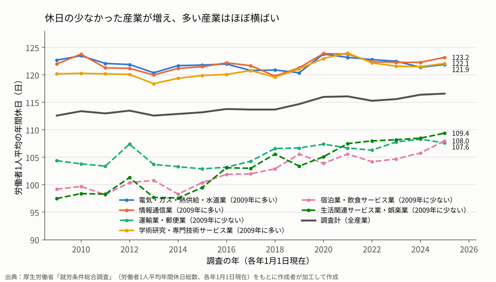
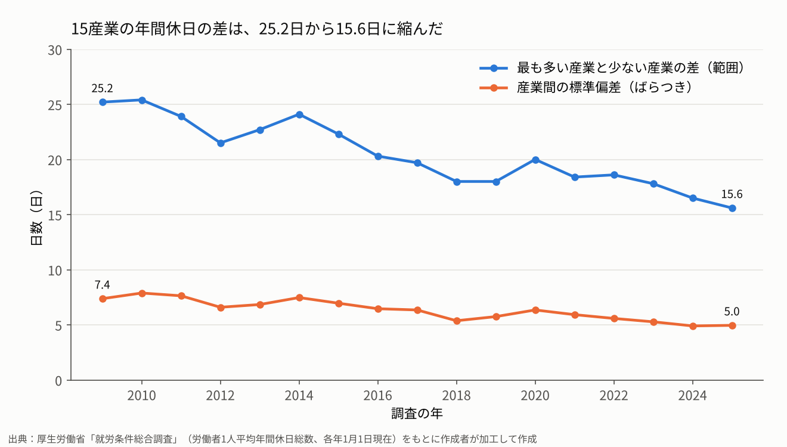
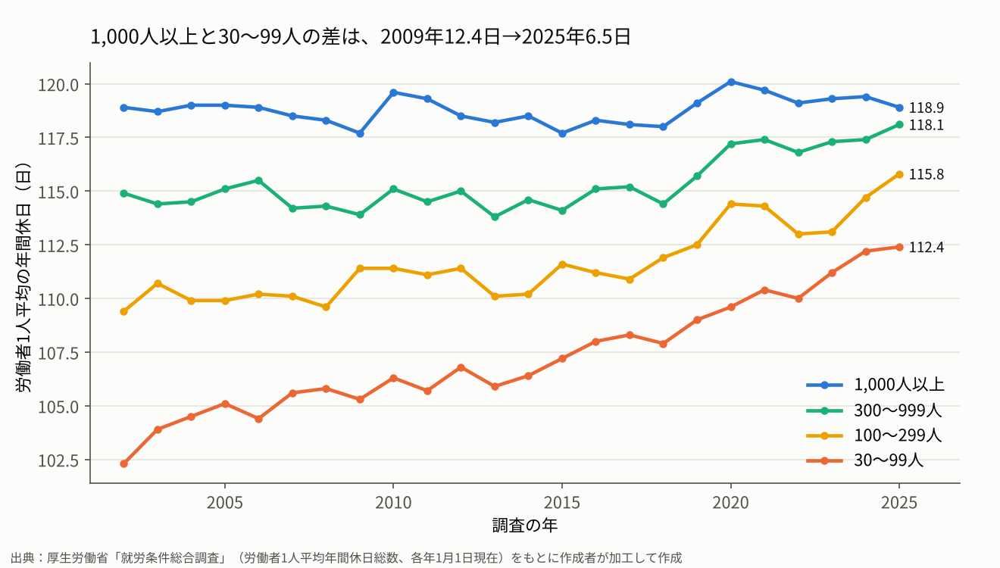
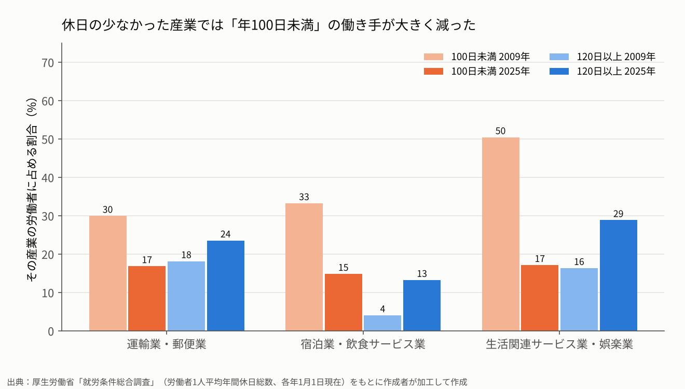

# F515 年間休日の多い産業と少ない産業の差は、縮まったのか？ 15産業の最大と最小の差は2009年25.2日から2025年15.6日に。少なかった3産業が平均8.0日増え、多い3産業は0.8日

（予備 R14 に替えた記事です。元の F515「携帯の契約数が人口を大きく超えて増えるのは、機械どうしの通信のせいか」は、通信モジュールの契約数が PDF のグラフの中にしかなく、長い期間の表をそろえられなかったため替えました。/home/claude/f3/REPLACED.md 参照）

## 結論（先に）
- 厚生労働省の就労条件総合調査で、労働者1人平均の年間休日（会社の決まりの休日）を産業大分類15産業で比べると、最も多い産業と最も少ない産業の差は、2009年調査の25.2日（電気・ガス・熱供給・水道業122.7日、生活関連サービス業・娯楽業97.5日）から、2025年調査の15.6日（情報通信業123.2日、運輸業・郵便業107.6日）に縮みました。
- 産業間の標準偏差（ばらつき）も7.37日から4.95日に小さくなりました。2009→2017年、2017→2025年のどちらの期間でも縮んでいます。
- 縮んだのは、休日の少なかった産業が増えたためです。2009年に少なかった3産業（生活関連サービス業・娯楽業、宿泊業・飲食サービス業、運輸業・郵便業）は平均8.0日増え、多かった3産業（電気・ガス・熱供給・水道業、情報通信業、学術研究・専門技術サービス業）は平均0.8日でした。
- 問い直しで中身を見ると、少なかった3産業では「年100日未満」の働き手の割合が平均21.6ポイント減り、「120日以上」は平均9.0ポイント増えました。
- 企業規模の差（1,000人以上と30〜99人）も、2009年の12.4日から2025年の6.5日に縮みました。

## 問い
「休みの少ない業界」として、宿泊・飲食や運輸がよく挙げられます。人手不足の中で、こうした産業の休日は増えたのでしょうか。休日の多い産業との差は縮まったのでしょうか。働き方や人手不足の話を読む人のために、厚生労働省の調査で確かめます。

## データ（出典）
- 厚生労働省「就労条件総合調査」各年の「産業・企業規模、年間休日総数階級別適用労働者割合及び労働者１人平均年間休日総数」（2002〜2025年の調査、各年1月1日現在、e-Stat の Excel）。
- 「労働者1人平均年間休日総数」は、企業で最も多くの労働者に適用される年間休日を、労働者数で重みをつけて平均した値です。常用労働者30人以上の民間企業が対象です。
- 産業大分類が今の形になった2009年調査からを中心にしました。2009年から毎年ある15産業で比べ、2015年から加わった複合サービス事業は頑健性で入れました。
- 関連する記事：F363（同じ調査の「週休制」を企業規模別に見た）。この記事は年間休日の日数を産業別に見ています。

## 事前の計画
[PLAN.md](PLAN.md)（2026-11-16 13:17、集計の前に作成）。表の形を確かめるため、2002・2009・2015・2025年の表を下見で見ていたので、H1 は確認のための仮説です。

| 仮説 | 外れの基準 | 結果 | 判定 |
|---|---|---|---|
| H1（確認）最大と最小の差は2009年より2025年が小さい | 同じか大きい | 25.2日→15.6日 | 支持 |
| H2 標準偏差は2009→2017年、2017→2025年の両方で縮んだ | どちらかで広がった | 7.37→6.35→4.95日 | 支持 |
| H3 多い3産業の増え方は少ない3産業の半分以下 | 半分より大きい | 0.8日 対 8.0日 | 支持 |
| H4 1,000人以上と30〜99人の差は2009年より2025年が小さい | 同じか大きい | 12.4日→6.5日 | 支持 |

## やったこと
1. 24年分の Excel から、産業大分類・企業規模ごとの労働者1人平均年間休日と、「100日未満」「120日以上」の働き手の割合を取り出しました。2022年の表は記号と名前が1つの欄に入っていたので、分けて読みました（02_build.py）。
2. 産業間の範囲と標準偏差、2009年の値で決めた多い3産業・少ない3産業の変化、企業規模の差を出しました（03_analysis.py）。
3. 結果を見てから、少ない3産業で休日の階級がどう動いたかを足しました（03b_requestion.py）。

## 分かったこと

### 1. 少なかった産業が増えた（図1）

2009→2025年に、生活関連サービス業・娯楽業は97.5→109.4日（+11.9）、宿泊業・飲食サービス業は99.2→108.0日（+8.8）、運輸業・郵便業は104.4→107.6日（+3.2）でした。電気・ガス・熱供給・水道業は122.7→121.9日、情報通信業は122.0→123.2日、学術研究・専門技術サービス業は120.2→122.1日です。全体（調査計）は112.6日から116.6日に増えました。ほかにも、金融業・保険業（+13.1日）、教育・学習支援業（+10.0日）、鉱業（+8.5日）が大きく増えています。

### 2. 差は25.2日から15.6日に（図2）

範囲は2009・2010年の25日台から、2018年18.0日、2025年15.6日へ、途中で上下しながら縮みました。標準偏差は7.37日から4.95日です。

### 3. 企業規模の差も縮んだ（図3）

1,000人以上は117.7→118.9日とほぼ横ばいで、30〜99人は105.3→112.4日、100〜299人は111.4→115.8日に増えました。2002年からの長い流れで見ても、小さい企業ほど増えています。

## 問い直し（結果を見てから足した）

### 「100日未満」が減った（図4）

平均の増え方が、休日のとても少ない働き手が減ったためか、多い働き手が増えたためかを見ました。年100日未満の働き手の割合は、生活関連サービス業・娯楽業で50.4%→17.1%、宿泊業・飲食サービス業で33.2%→14.8%、運輸業・郵便業で29.9%→16.8%と、どの産業でも大きく減りました（3産業の平均で−21.6ポイント）。120日以上は平均+9.0ポイントでした。底上げが中心だったと言えます。

## 頑健性

| 確かめ方 | 期間 | 範囲（日） | 標準偏差（日） |
|---|---|---|---|
| 本線：15産業 | 2009→2025 | 25.2→15.6 | 7.37→4.95 |
| 鉱業を除く14産業 | 2009→2025 | 25.2→15.6 | 7.46→5.06 |
| 2025年を除く | 2009→2024 | 25.2→16.5 | 7.37→4.90 |
| 3年平均（2009〜11年→2023〜25年） | — | 24.7→16.4 | 7.48→4.97 |
| 120日以上の働き手の割合（%）で比べる | 2009→2025 | 90.0→85.5ポイント | 27.47→26.00ポイント |
| 複合サービス事業を含む16産業 | 2015→2025 | 22.3→15.6 | 6.77→5.13 |

日数で見る限り、どの確かめ方でも差は縮んでいました。一方、「120日以上の働き手の割合」で見ると、範囲も標準偏差もあまり縮んでいません。少ない産業の変化は「100日未満が減る」形が中心で、「120日以上が当たり前」の産業との違いは、割合で見るとまだ大きく残っています。全体の値は2024→2025年に0.2日しか動いておらず、2025年だけが特別な年ではありませんでした。

## 言えないこと
- 年間休日は会社の決まり（所定）の日数で、有給休暇の取得や実際に休んだ日数ではありません。
- 常用労働者30人以上の企業だけで、もっと小さい企業は入りません。
- 産業の中の職種や雇用形態（パート・アルバイトなど）の違いは分かりません。
- 休日が増えた理由（人手不足への対応、法律や制度の変化など）は、この表からは分けられません。
- 抽出調査なので、規模の小さい産業（鉱業など）は年ごとの振れが大きいです。金融業・保険業の2009年（108.6日）は翌2010年（122.2日）よりずっと低く、この産業の+13.1日は割り引いて読む必要があります。
- 2009年の値で多い・少ないを決めているため、平均への回帰（たまたま低かった年のあとに戻る動き）も含まれている可能性があります（推測）。

## 仕事で使うなら
- 産業の休日を比べるときは、平均の日数だけでなく「100日未満」「120日以上」の割合も見ると、差の残り方が分かります。
- 産業別の推移は results/industry_mean_days.csv、規模別は results/size_mean_days.csv にあります。

## 計画からの変更
- 計画では「2025年は全体が大きく上がった可能性」を理由に2025年を除く確かめを入れましたが、実際には2024→2025年の変化は0.2日で、特別な年ではありませんでした（確かめは残しました）。
- 問い直し（階級の割合）は結果を見てから足しました。

## 再現のしかた
```
sh src/run_all.sh        # オフライン。所要約3秒
python3 src/01_fetch.py  # 元データを取り直すときだけ（ネットを使う）
```

| ファイル | 中身 |
|---|---|
| src/02_build.py | Excel 24本 → data/holidays.csv（年×産業・規模） |
| src/03_analysis.py | 推移・差・仮説・頑健性 → results/main.json・industry_mean_days.csv・spread_by_year.csv・size_mean_days.csv・robustness.csv |
| src/03b_requestion.py | 問い直し → results/requestion.json・requestion_classes.csv |
| src/04_figures.py | 図4枚 |

repro_check：/tmp/rep_F515 に写し、02 以降が作るファイルを消してから流し、12ファイル（results 7、figures 4、data の CSV 1）がすべて cmp で一致（results/repro_check.txt）。乱数は使っていません。

## レビューで直したこと

| # | 指摘 | 直し方 |
|---|---|---|
| 1 | 問いの「仕事を選ぶ人…のために」が、職探し（転職活動）に向けた書き方に読める | 「働き方や人手不足の話を読む人のために」に直した |

直したあと、/tmp で流し直して results・figures が元と一致することを確かめました。

## 出典
- 厚生労働省「就労条件総合調査」（e-Stat）：https://www.e-stat.go.jp/stat-search/files?toukei=00450099&tstat=000001014004 （各年の URL は data/raw/SOURCES.md）

（いずれも 厚生労働省「就労条件総合調査」をもとに作成者が加工して作成）
