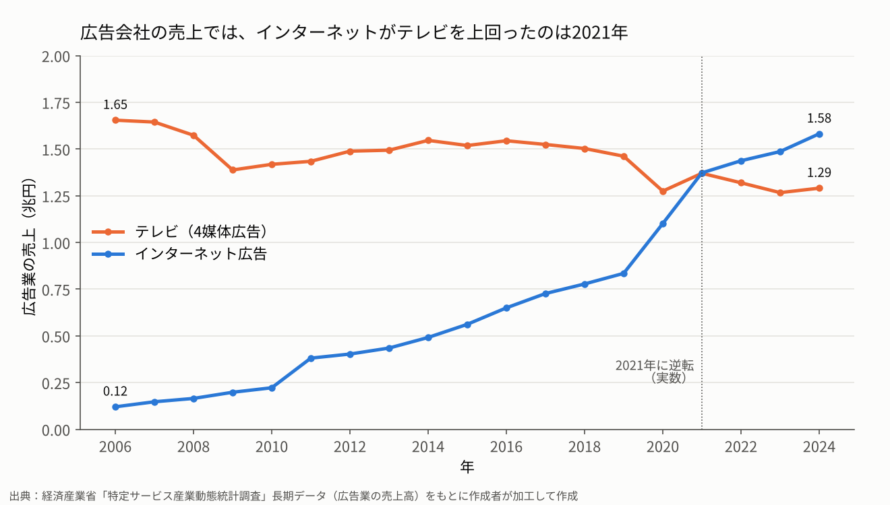
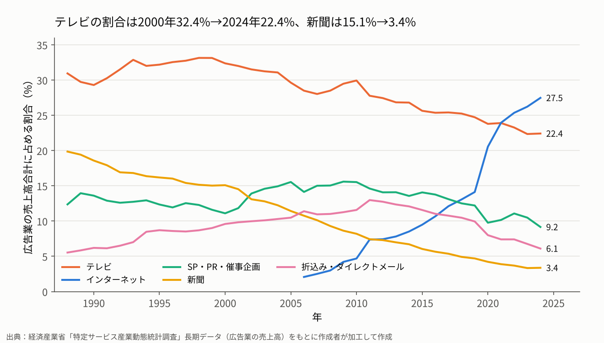
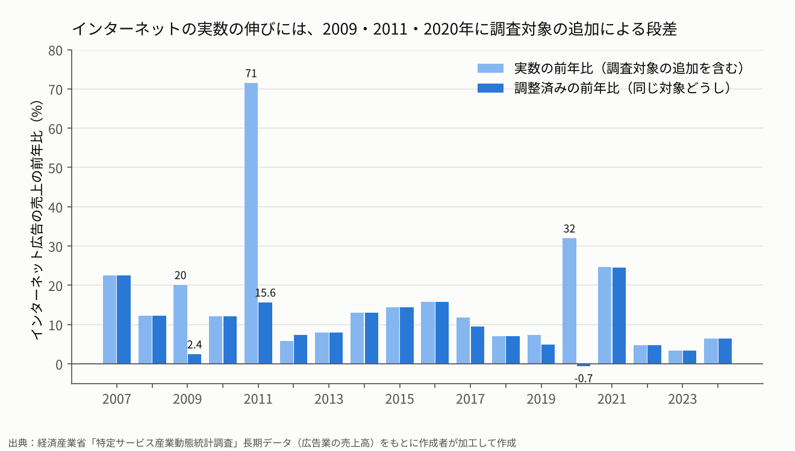
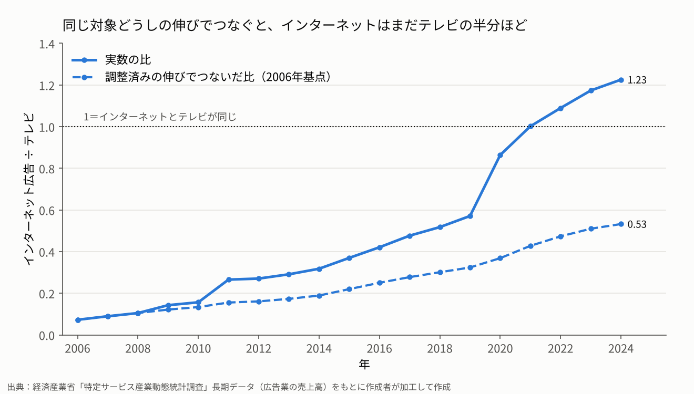

# F516 広告の売上は、テレビからネットへいつ逆転したのか？ 広告会社の売上では2021年（インターネット1.372兆円、テレビ1.370兆円）。ただし同じ対象どうしの伸びでつなぐと、2024年もネットはテレビの0.53倍

## 結論（先に）
- 経済産業省の特定サービス産業動態統計調査で、広告業（広告会社）の売上を見ると、インターネット広告がテレビを初めて上回ったのは2021年でした（インターネット1.372兆円、テレビ1.370兆円）。電通の推計（「日本の広告費」）で逆転したとされる2019年より2年遅い年です。
- 2024年は、インターネット1.581兆円、テレビ1.290兆円で、売上高合計（5.756兆円）に占める割合はインターネット27.5%、テレビ22.4%でした。テレビの割合は2000年の32.4%から下がりましたが、半分以下にはなっていません。
- ただし、この統計は途中で調査対象の会社が追加されていて、インターネット広告の実数の伸びには、2009年・2011年・2020年に大きな段差があります（例：2020年の実数の伸び+31.9%に対し、同じ対象どうしの伸びは−0.7%）。
- 同じ対象どうしの伸び（調整済み前年比）でつなぐと、インターネット÷テレビの比は2024年でも0.53で、逆転していません。どちらで読むかで「逆転したか」の答えが変わります。
- 景気の悪かった2009年と2020年に、テレビは−11.8%、−12.8%落ちましたが、インターネットは+2.4%、−0.7%で、ほとんど落ちませんでした。

## 問い
「ネット広告がテレビを抜いた」は、電通の推計（2019年）として広く報じられました（nippon.com のまとめなど）。では、国の統計で広告会社の売上を見ても、同じ時期に逆転しているのでしょうか。景気の悪い年に振れやすいのはどの媒体でしょうか。広告やメディアの仕事をする人のために確かめます。

## データ（出典）
- 経済産業省「特定サービス産業動態統計調査」長期データ 広告業（1988〜2024年、e-Stat の Excel、2025年3月公開）。年と年度の売上高（百万円）を、媒体別（新聞・雑誌・テレビ・ラジオ、屋外、交通、折込み・ダイレクトメール、海外、SP・PR・催事企画、インターネット広告、その他）に。不連続を調整した前年比もあります。インターネット広告は2006年から。
- これは広告会社の売上（取扱い）で、広告主が使った広告費の全体ではありません。電通の推計とは数え方が違います。

## 事前の計画
[PLAN.md](PLAN.md)（2026-11-16 13:27、集計の前に作成）。下見では列の見出しと1990年の数字だけを見ていました。

| 仮説 | 外れの基準 | 結果 | 判定 |
|---|---|---|---|
| H1 インターネットがテレビを上回った年がある | 一度もない | 2021年（実数） | 支持（調整済みの伸びでは上回らない） |
| H2 逆転の年は電通の推計の前後1年以内（2018〜2020年） | 2017年以前か2021年以降 | 2021年 | 外れ |
| H3 2009年・2020年の落ち込みはテレビよりインターネットが小さい | どちらかで大きい | 2009年 +2.4%対−11.8%、2020年 −0.7%対−12.8% | 支持 |
| H4 2024年のテレビの割合は2000年の半分以下 | 半分より大きい | 32.4%→22.4% | 外れ |

## やったこと
1. Excel の年・年度の実数と伸び率から、媒体×年の表を作りました（02_build.py）。
2. 媒体の割合、インターネット÷テレビの比、逆転の年を出しました。調整済み前年比を掛け合わせた指数（2006年＝100）で比をつなぎ直しました（03_analysis.py）。
3. 結果を見てから、実数の伸びと調整済みの伸びの差がどの年に生まれたかを足しました（03b_requestion.py）。

## 分かったこと

### 1. 実数では2021年に逆転（図1）

インターネット広告の売上は2006年0.12兆円から2019年0.834兆円、2020年1.101兆円、2021年1.372兆円と増えました。テレビは2006年1.654兆円から2020年1.274兆円に下がり、2021年に1.370兆円へ戻りました。2021年の比は1.002倍で、ほぼ同じ水準での逆転です。2024年は1.226倍です。

### 2. 媒体の割合（図2）

2024年の割合は、インターネット27.5%、テレビ22.4%、SP・PR・催事企画9.2%、折込み・ダイレクトメール6.1%、新聞3.4%でした。新聞は2000年15.1%から大きく下がっています。売上高合計は2019年5.911兆円、2024年5.756兆円です。

### 3. 景気の悪い年はテレビが大きく落ちる
調整済み前年比で、2009年はテレビ−11.8%、インターネット+2.4%、合計−15.4%。2020年はテレビ−12.8%、インターネット−0.7%、合計−14.1%でした。2021年はインターネット+24.5%、テレビ+7.3%です。

## 問い直し（結果を見てから足した）

### 実数と調整済みの伸びの差は、どの年に生まれたか（図3・図4）

インターネット広告の実数の前年比と調整済み前年比の差が5ポイント以上だった年は、2009年（+17.7）、2011年（+55.9）、2020年（+32.6）の3つでした。統計の注には、2011年1月分などに「調査対象の追加等」、2009年1月分・2020年1月分などに「数値の変更」による不連続があると書かれています。この3年に、インターネット広告を多く扱う会社の分が加わったり数値が変わったりしたと考えられます（推測）。テレビでは、この差は最大でも1.8ポイントでした。2006→2024年で、インターネットの実数は13.2倍、調整済みの伸びでは5.5倍です。


2006年の実数の比（0.073）から調整済みの伸びでつなぐと、インターネット÷テレビは2019年0.32、2021年0.43、2024年0.53でした。実数の逆転は、調査対象が増えた分を含んだ比べ方です。一方で、新しく加わった会社の売上も実際の取扱いなので、どちらが正しいとは言えません。「同じ会社どうしで見るとまだ逆転していない」「業界全体の取扱いとしては逆転した可能性が高い」の両方を書くのが正確です。

## 頑健性

| 確かめ方 | インターネットがテレビを上回った最初の年 | 最新の比 |
|---|---|---|
| 本線：年（実数の比） | 2021年 | 1.226（2024年） |
| 年度（4月〜3月、実数の比） | 2021年度 | 1.184（2023年度） |
| 調整済みの伸びでつないだ比（2006年基点） | なし | 0.532（2024年） |
| インターネット ÷ 4媒体合計が0.5を超えた年 | 2020年 | 1.011（2024年） |
| 前年比の標準偏差（2007〜2024年） | — | テレビ5.1・インターネット6.7・新聞6.2・合計5.8ポイント |

逆転の年は、年でも年度でも2021年でした。調整済みでつなぐと逆転は起きていません。前年比のばらつきはインターネットが最も大きいものの、景気の悪い年の落ち込みはテレビの方が大きく、インターネットのばらつきは高い伸びの年が混ざっているためです。

## 言えないこと
- 広告会社を通さない広告（広告主がネットの広告を直接出す分など）は、この統計に入らない可能性があります。電通の推計の方が早く逆転したのは、この違いによるのかもしれません（推測）。
- 調査の対象は一定の規模以上の広告会社で、途中で追加されています。実数の比と調整済みの比のどちらが業界全体に近いかは分かりません。
- 広告の効果や、どの媒体を使うべきかは扱いません。
- 広告の単価（物価）の動きは除いていません。

## 仕事で使うなら
- 「ネットがテレビを抜いた年」は、どの統計で、どの数え方かで2019年とも2021年とも、まだとも言えます。数字を引くときは出典と数え方を添えると誤解が減ります。
- 年をまたぐ伸びは、実数ではなく調整済みの伸び率（results/index_2006_100.csv）でも確かめると安全です。

## 計画からの変更
- 問い直し（実数と調整済みの伸びの差）は結果を見てから足しました。それ以外は計画どおりです。

## 再現のしかた
```
sh src/run_all.sh        # オフライン。所要約3秒
python3 src/01_fetch.py  # 元データを取り直すときだけ（ネットを使う）
```

| ファイル | 中身 |
|---|---|
| src/02_build.py | Excel → data/annual.csv（年・年度×媒体、実数と調整済み前年比） |
| src/03_analysis.py | 割合・比・逆転の年・指数・仮説・頑健性 → results/main.json・share_by_year.csv・tv_internet.csv・index_2006_100.csv・robustness.csv |
| src/03b_requestion.py | 問い直し → results/requestion.json・raw_vs_adjusted.csv |
| src/04_figures.py | 図4枚 |

repro_check：/tmp/rep_F516 に写し、02 以降が作るファイルを消してから流し、12ファイル（results 7、figures 4、data の CSV 1）がすべて cmp で一致（results/repro_check.txt）。乱数は使っていません。

## レビューで直したこと

独立レビューで数字の照合・再実行・図を確かめ、直すところはなかった。

## 出典
- 経済産業省「特定サービス産業動態統計調査」長期データ 広告業（e-Stat）：https://www.e-stat.go.jp/stat-search/files?toukei=00550050&tstat=000001014007 （URL は data/raw/SOURCES.md）
- 電通の推計の報道のまとめ（nippon.com「ネット広告費、初のテレビ超え」）：https://www.nippon.com/ja/japan-data/h00674/

（いずれも 経済産業省「特定サービス産業動態統計調査」をもとに作成者が加工して作成）
