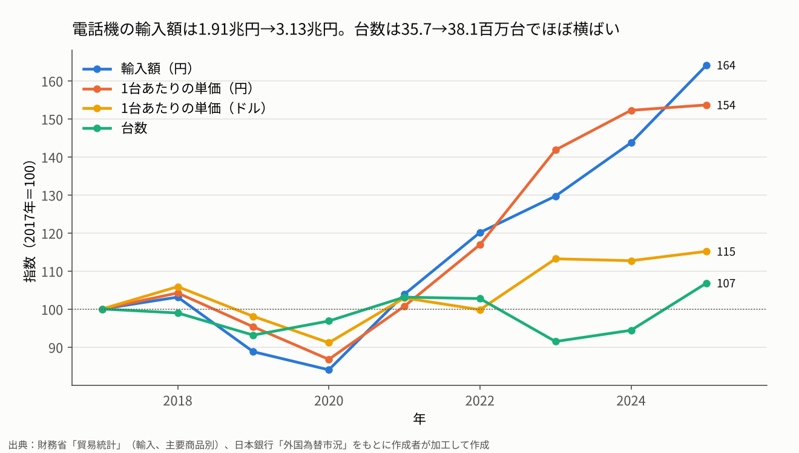
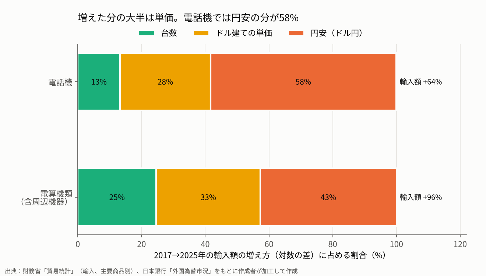
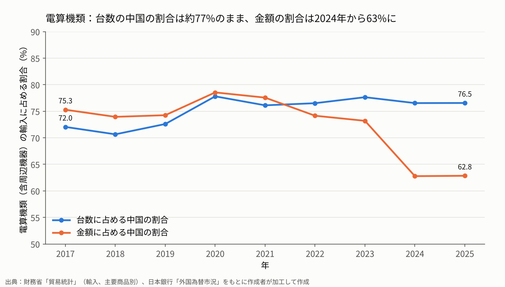
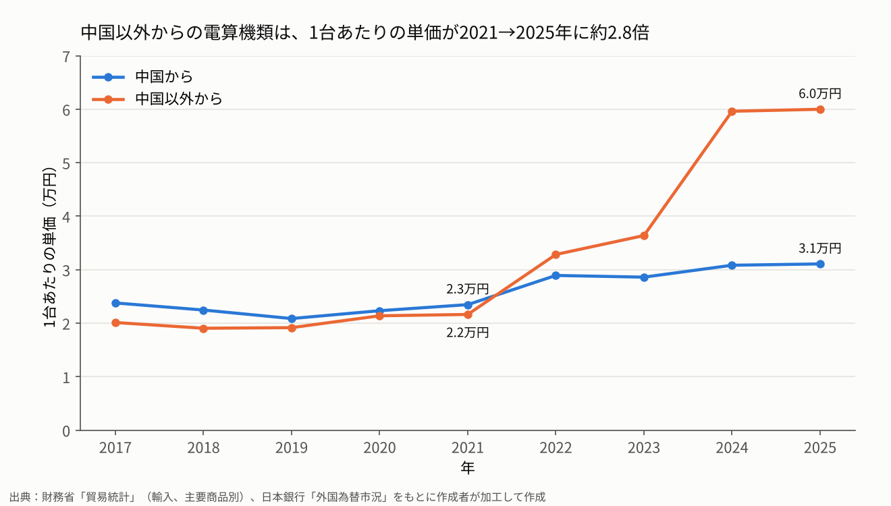

# F517 スマホやパソコンの輸入額が増えたのは、台数のせいか、単価のせいか？ 電話機の輸入額は2017→2025年に+64%、台数は+6.8%。増えた分の58%は円安、28%はドル建ての単価の上昇

## 結論（先に）
- 財務省の貿易統計で「電話機」（スマートフォンを含む）の輸入は、2017年の3,566万台・1.91兆円から、2025年の3,809万台・3.13兆円になりました。輸入額は+64.1%、台数は+6.8%で、増えたのはほとんどが1台あたりの単価（53,523円→82,230円、+53.6%）でした。
- 輸入額の増え方（対数の差）を分けると、台数13%、ドル建ての単価28%、円安（ドル円112.16円→149.65円）58%でした。円建ての単価の上昇のうち67%が円安の分です。ただしドル建ての単価も477ドルから549ドルへ15.1%上がっています。
- 「電算機類（含周辺機器）」は、2017年8,642万台・1.97兆円から2025年1億206万台・3.86兆円へ。輸入額+96.5%のうち、台数25%、ドル建ての単価33%、円安43%でした。
- 電話機の輸入額の88.4%（2025年）は中国からで、2017年（85.7%）より少し上がりました。
- 問い直しで電算機類の輸入先を見ると、台数に占める中国の割合は約77%のままなのに、金額の割合は2021年77.6%から2025年62.8%に下がりました。中国以外からの1台あたりの単価が2.2万円から6.0万円に上がったためです。

## 問い
円安が進んだ2022年以降、スマホやパソコンの値段が上がったと感じる人は多いでしょう。輸入の統計で見ると、輸入額が増えたのは台数が増えたからなのか、1台あたりの値段が上がったからなのか。値段の上昇は円安でどこまで説明できるのか。電機や小売の仕事をする人、輸入物価の話を読む人のために確かめます。

## データ（出典）
- 財務省「貿易統計」輸出入額の推移（主要商品別、年別、輸入）。「電算機類（含周辺機器）」（数量は台、1988年〜）、「電話機」（数量は台、2017年〜）の金額と数量。世界・中国・ASEAN・米国からの輸入。
- 日本銀行「外国為替市況」ドル・円（東京市場17時、月中平均）を年平均にしました。
- 「電話機」にはスマートフォン以外の電話機も、「電算機類（含周辺機器）」にはキーボードなどの周辺機器も入ります。単価はその中の平均です。

## 事前の計画
[PLAN.md](PLAN.md)（2026-11-16 13:31、集計の前に作成）。列の位置を確かめるため、世界からの電算機類と電話機の金額・数量は下見で見ていたので、H4 は確認のための仮説です。

| 仮説 | 外れの基準 | 結果 | 判定 |
|---|---|---|---|
| H1 電話機の円建て単価の上昇の半分以上は円安 | 半分未満 | 67.2% | 支持 |
| H2 電話機のドル建て単価も上がった | 下がったか同じ | +15.1%（477→549ドル） | 支持 |
| H3 電話機の輸入額に占める中国の割合は2017年より2025年が低い | 高いか同じ | 85.7%→88.4% | 外れ |
| H4（確認）電算機類の輸入額の増加の半分以上は単価 | 半分未満 | 75.4% | 支持 |

## やったこと
1. 貿易統計の CSV から、電算機類と電話機の年別の金額・数量を、世界・中国・ASEAN・米国について取り出しました。日銀のドル円を年平均にしました（02_build.py）。
2. 金額＝台数×円建て単価、円建て単価＝ドル建て単価×ドル円として、対数の差で増え方を分けました（03_analysis.py）。
3. 結果を見てから、電算機類の中国と中国以外を比べました（03b_requestion.py）。

## 分かったこと

### 1. 電話機は台数がほぼ横ばいで単価が上がった（図1）

2017年を100とすると、2025年は輸入額164、円建ての単価154、ドル建ての単価115、台数107でした。2017→2021年は輸入額がほぼ横ばい（+3.9%）で、増えたのは2021→2025年（+58.0%）です。

### 2. 増えた分の分け方（図2）

2017→2025年の輸入額の増え方を分けると、電話機は台数13%・ドル建ての単価28%・円安58%、電算機類は台数25%・ドル建ての単価33%・円安43%でした。どちらも、増えた分の大半は単価（円安を含む）です。

### 3. 電話機は中国から9割
電話機の輸入額に占める割合は、中国が85.7%（2017年）→88.6%（2021年）→88.4%（2025年）、ASEANが13.6%→9.5%→9.7%でした。

## 問い直し（結果を見てから足した）

### 電算機類は「中国以外から高いもの」が増えた（図3・図4）

電算機類の輸入に占める中国の割合は、台数では2021年76.1%、2025年76.5%と変わらないのに、金額では77.6%から62.8%に下がりました。2024年に大きく下がっています。


中国以外からの輸入は、台数が2,483万台（2021年）から2,393万台（2025年）とほぼ同じで、金額が0.54兆円から1.44兆円に増えました。1台あたりの単価は2.2万円から6.0万円です。中国からは2.3万円から3.1万円でした。中国以外から、サーバーなどの高い機器の輸入が増えた可能性があります（推測。主要商品別の表では機種は分かりません）。

## 頑健性

| 確かめ方 | 輸入額 | 台数 | 円建て単価 | ドル円 | ドル建て単価 | 台数の割合 | 単価の割合 | 単価の中の円安の割合 |
|---|---|---|---|---|---|---|---|---|
| 電話機 2017→2025（本線） | +64.1% | +6.8% | +53.6% | +33.4% | +15.1% | 13% | 87% | 67% |
| 電話機 2017→2021 | +3.9% | +3.1% | +0.7% | −2.1% | +2.9% | 81% | 19% | — |
| 電話機 2021→2025 | +58.0% | +3.6% | +52.5% | +36.3% | +11.9% | 8% | 92% | 73% |
| 電話機 ドル円は12月の値 | +64.1% | +6.8% | +53.6% | +38.0% | +11.4% | 13% | 87% | 75% |
| 電算機類 2017→2025（本線） | +96.5% | +18.1% | +66.4% | +33.4% | +24.7% | 25% | 75% | 57% |
| 電算機類 2000→2025 | +105.2% | +0.3% | +104.6% | +38.9% | +47.3% | 0% | 100% | 46% |
| 電話機 中国から 2017→2025 | +69.2% | +4.9% | +61.3% | +33.4% | +20.9% | 9% | 91% | 60% |

期間・ドル円の取り方・輸入先を変えても、増えた分の大半が単価で、その中で円安の分が半分以上という結果は、電算機類の長い期間（2000→2025年、46%）を除いて同じでした。

## 言えないこと
- 「電話機」「電算機類（含周辺機器）」の中の機種の内訳は分かりません。単価の上昇が、同じ製品の値上がりなのか、高い機種への移り変わりなのかは分けられません。
- 円安の分は「ドル建ての単価が同じなら」という見方で分けたもので、実際の値段の決まり方（契約の通貨など）は分かりません。
- 部品の輸入や、海外で作られて日本に入らない分は入りません。
- 輸入の金額で、小売の値段ではありません。

## 仕事で使うなら
- 輸入額の増減を説明するときは、台数・ドル建ての単価・ドル円の3つに分けて示すと、円安の分とそれ以外が区別できます。
- 年ごとの値は results/world_series.csv、分け方は results/robustness.csv にあります。

## 計画からの変更
- 問い直し（電算機類の中国と中国以外）は結果を見てから足しました。それ以外は計画どおりです。

## 再現のしかた
```
sh src/run_all.sh        # オフライン。所要約2秒
python3 src/01_fetch.py  # 元データを取り直すときだけ（ネットを使う）
```

| ファイル | 中身 |
|---|---|
| src/02_build.py | 貿易統計の CSV 4本・日銀の CSV → data/imports.csv、data/usdjpy.csv |
| src/03_analysis.py | 台数・単価・円安への分け方、国別の割合、仮説、頑健性 → results/main.json・world_series.csv・country_shares.csv・robustness.csv |
| src/03b_requestion.py | 問い直し → results/requestion.json・computers_china_vs_other.csv |
| src/04_figures.py | 図4枚 |

repro_check：/tmp/rep_F517 に写し、02 以降が作るファイルを消してから流し、12ファイル（results 6、figures 4、data の CSV 2）がすべて cmp で一致（results/repro_check.txt）。乱数は使っていません。

## レビューで直したこと

独立レビューで数字の照合・再実行・図を確かめ、直すところはなかった。

## 出典
- 財務省「貿易統計」輸出入額の推移（主要商品別）：https://www.customs.go.jp/toukei/suii/html/time.htm
- 日本銀行 時系列統計データ検索サイト「外国為替市況」：https://www.stat-search.boj.or.jp/ （URL は data/raw/SOURCES.md）

（いずれも 財務省「貿易統計」、日本銀行「外国為替市況」をもとに作成者が加工して作成）
