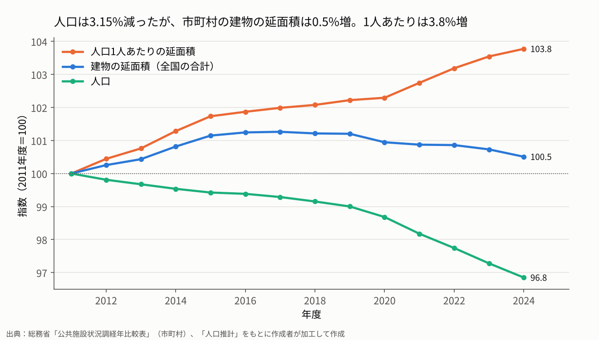
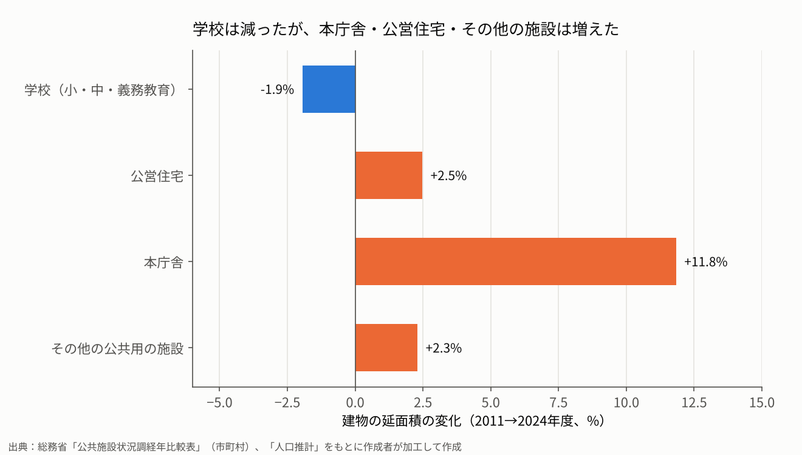
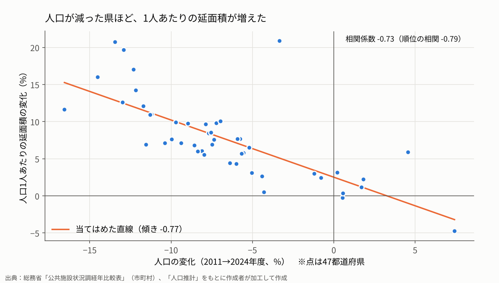
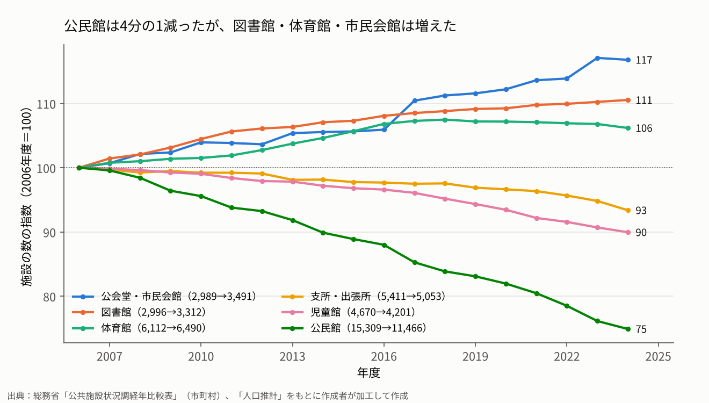

# F518 人口が減っても、公共施設は減っていないのか？ 2011→2024年度に人口は3.15%減、市町村の建物の延面積は0.51%増で、1人あたりは3.78%増。人口が1割以上減った12県でも延面積は平均0.96%減にとどまった

## 結論（先に）
- 総務省の公共施設状況調で、市町村（特別区を含む）が持つ行政財産の建物の延面積（床の広さの合計）は、2011年度の4億6,082万㎡から2024年度の4億6,316万㎡へ、0.51%増えました。2017年度の4億6,664万㎡が最大で、その後は少しずつ減っています。
- 同じ期間に人口は3.15%減ったので、人口1人あたりの延面積は3.61㎡から3.74㎡へ3.78%増えました。
- 都道府県ごとに見ると、人口が減った県ほど1人あたりの延面積が増えていました（相関係数−0.73）。人口が1割以上減った12県では、人口が平均12.6%減ったのに、延面積は平均0.96%しか減っていません。
- 用途別では、学校（小・中・義務教育学校）の延面積は1.95%減りましたが、本庁舎は11.84%、公営住宅は2.48%、その他の公共用の施設は2.30%増えました。
- 施設の数（2006→2024年度）は、公民館が15,309から11,466へ25.1%減った一方、図書館は10.6%、体育館は6.2%、公会堂・市民会館は16.8%増えました。

## 問い
人口が減る中で、自治体の公共施設を減らす（統廃合する）話がよく出ます。総務省は自治体に「公共施設等総合管理計画」をつくるよう求めています。では、市町村の施設の総量は実際に減ってきたのでしょうか。人口と比べてどう動いたのでしょうか。施設の話を読む人、住む地域の施設の今を知りたい人のために、公的な統計で確かめます。

## データ（出典）
- 総務省「公共施設状況調経年比較表」市町村経年比較表（平成18年度〜令和6年度）。市町村ごとに、公有財産のうち行政財産の建物の延面積（本庁舎、消防、小学校、中学校、義務教育学校、公営住宅、公園、その他の施設など）と、公民館・図書館・体育館・支所などの施設の数があります。公有財産の値は2011年度から入っています。
- 元の Excel は約45MBあるので、使う列だけを抜き出した CSV（data/raw/municipal_extract.csv、約4MB）を同梱しました。抜き出しは src/01b_extract.py です。
- 総務省「人口推計」都道府県別人口（各年10月1日現在）。
- 平成の合併で市町村の数が1,827（2006年度）から1,741（2024年度）に変わったので、市町村を都道府県ごとに合計して比べました。

## 事前の計画
[PLAN.md](PLAN.md)（2026-11-16 13:38、集計の前に作成）。下見では列の見出しと2024年度の2市の行だけを見ていました。

| 仮説 | 外れの基準 | 結果 | 判定 |
|---|---|---|---|
| H1 延面積（全国の合計）は減っていない | 減った | +0.51% | 支持 |
| H2 1人あたりの延面積は5%以上増えた | 5%未満 | +3.78% | 外れ |
| H3 県ごとの人口の変化と1人あたりの変化は負の相関（−0.5以下） | −0.5より大きい | −0.73 | 支持 |
| H4 学校は5%以上減り、学校以外は増えた | 学校の減少が5%未満など | 学校−1.95%、学校以外+2.02% | 外れ（学校の減り方が小さい） |

## やったこと
1. 抜き出した CSV を都道府県×年度に合計し、全国の合計の行と一致することを確かめました。人口推計の都道府県別人口と合わせました（02_build.py）。
2. 全国と都道府県の延面積、1人あたり、用途別、施設の数の推移を出しました（03_analysis.py）。
3. 結果を見てから、延面積そのものが人口とどれだけ連動しているかを足しました（03b_requestion.py）。

## 分かったこと

### 1. 人口は減り、延面積はほぼ横ばい（図1）

2011年度を100とすると、2024年度は延面積100.5、人口96.8、1人あたり103.8でした。延面積は2017年度まで増え、その後は減っていますが、減り方（2017→2024年度で−0.75%）は人口の減り方（−2.46%）より小さいです。

### 2. 学校は減り、ほかは増えた（図2）

2024年度の延面積は、学校1億7,167万㎡、その他の公共用の施設1億4,130万㎡、公営住宅9,311万㎡、本庁舎1,877万㎡です。2011→2024年度の変化は、学校−1.95%、公営住宅+2.48%、本庁舎+11.84%、その他の公共用の施設+2.30%でした。本庁舎の増加は、建て替えで広くなった庁舎があるためかもしれません（推測）。

### 3. 人口が減った県ほど1人あたりが増えた（図3）

47都道府県の人口の変化は−16.6%〜+7.4%、1人あたりの延面積の変化は−4.7%〜+20.9%でした。1人あたりが増えた県は45、延面積そのものが減った県は25です。人口が1%減るごとに、1人あたりの延面積はおよそ0.77%増える関係でした。

### 4. 施設の数（図4）

2006→2024年度に、公民館は25.1%、児童館は10.0%、支所・出張所は6.6%減りました。図書館は2,996から3,312へ、体育館は6,112から6,490へ、公会堂・市民会館は2,989から3,491へ増えています。

## 問い直し（結果を見てから足した）

### 延面積そのものは人口とどれだけ連動しているか
1人あたりの増加が「延面積が減らないこと」から来ているのかを確かめるため、県ごとの延面積の変化率を人口の変化率で直線に当てはめました。傾きは0.34で、人口が10%減っても延面積は3.4%ほどしか減らない関係です（相関係数0.45）。人口が1割以上減った12県では、人口が平均12.6%減ったのに対し、延面積は平均0.96%の減少でした。人口が増えた7県では延面積が平均3.53%増えています。延面積は人口の増加には合わせて増えるが、減少には合わせて減りにくい形です。

## 頑健性

| 確かめ方 | 延面積の変化 | 人口の変化 | 1人あたりの変化 |
|---|---|---|---|
| 本線：行政財産の建物 2011→2024年度 | +0.51% | −3.15% | +3.78% |
| 2011→2017年度 | +1.26% | −0.71% | +1.99% |
| 2017→2024年度 | −0.75% | −2.46% | +1.75% |
| 公営住宅を除く | +0.03% | −3.15% | +3.28% |
| 普通財産の建物も含む | +1.85% | −3.15% | +5.16% |

| 県別の相関（人口の変化と1人あたりの変化） | 相関係数 | 順位の相関 |
|---|---|---|
| 本線 | −0.73 | −0.79 |
| 公営住宅を除く | −0.78 | −0.79 |
| 普通財産も含む | −0.77 | −0.79 |

どの確かめ方でも、延面積は人口ほど減らず、1人あたりは増えていました。2017年度以降は延面積も減り始めていますが、人口の減り方の3分の1ほどです。

## 言えないこと
- 延面積は床の広さで、建物の古さ、使われ方（利用者の数）、維持の費用は分かりません。
- 都道府県や国が持つ施設、一部事務組合の施設は入っていません。
- 延面積が減らない理由（統廃合の難しさ、合併前の施設の残り、建て替えで広くなることなど）は、この表からは分かりません。
- 年度末の値と10月1日の人口なので、時点が少しずれます。
- 1人あたりの値は人口で割っているので、延面積が同じでも人口が減れば増えます。H3 の相関 −0.73 の多くはこの計算の仕組みによるもので、延面積そのものと人口の関係は問い直しの傾き0.34（相関0.45）の方が実態に近い見方です。
- 施設を減らすべきかどうかは扱いません。

## 仕事で使うなら
- 施設の量を人口と比べるときは、総量と1人あたりの両方を示すと、「減っていない」と「1人あたりが増えた」を区別できます。
- 都道府県ごとの変化は results/pref_change_2011_2024.csv、全国の推移は results/national_by_year.csv にあります。

## 計画からの変更
- 計画では2006年度から比べる予定でしたが、公有財産（延面積）の値は2011年度からしか入っていなかったため、延面積は2011→2024年度で比べました。施設の数は2006年度から比べています。
- 問い直しは結果を見てから足しました。

## 再現のしかた
```
sh src/run_all.sh          # オフライン。所要約4秒
python3 src/01_fetch.py    # 元データを取り直すときだけ（ネットを使う。45MBの Excel は data/download/ に置く）
python3 src/01b_extract.py # 45MBの Excel から使う列を data/raw/municipal_extract.csv に抜き出す（約1分）
```

| ファイル | 中身 |
|---|---|
| src/01b_extract.py | 市町村経年比較表（同梱しない）→ data/raw/municipal_extract.csv（同梱） |
| src/02_build.py | → data/pref_facilities.csv（都道府県×年度）、data/pref_population.csv |
| src/03_analysis.py | 全国・県別・用途別・施設の数・仮説・頑健性 → results/main.json・national_by_year.csv・pref_change_2011_2024.csv・robustness.csv |
| src/03b_requestion.py | 問い直し → results/requestion.json |
| src/04_figures.py | 図4枚 |

repro_check：/tmp/rep_F518 に写し、02 以降が作るファイルを消してから流し、11ファイル（results 5、figures 4、data の CSV 2）がすべて cmp で一致（results/repro_check.txt）。乱数は使っていません。

## 関連する記事
- F453「人口が減っても、道路は延び続けているのか？」：人口が減る中での道路の延長を見た記事。本記事は市町村の建物の延面積と施設の数を見ました。

## レビューで直したこと

| # | 指摘 | 直し方 |
|---|---|---|
| 1 | H3 の「人口が減った県ほど1人あたりが増えた（相関−0.73）」は、1人あたり＝延面積÷人口なので、人口が減れば機械的に増える関係で、その注意がなかった | README・note の言えないことに、割り算の仕組みによる相関であり、延面積そのものの関係は傾き0.34（相関0.45）の方が実態に近いと書き足した |
| 2 | 同じ切り口の既存の記事（F453 道路の延長）への言及がなかった | README に「関連する記事」として F453 と違いを1文で足した |

直したあと、/tmp で流し直して results・figures が元と一致することを確かめました。

## 出典
- 総務省「公共施設状況調経年比較表」：https://www.soumu.go.jp/iken/shisetsu/index.html
- 総務省「人口推計」：https://www.e-stat.go.jp/stat-search/files?toukei=00200524&tstat=000000090001 （URL は data/raw/SOURCES.md）

（いずれも 総務省「公共施設状況調経年比較表」「人口推計」をもとに作成者が加工して作成）
