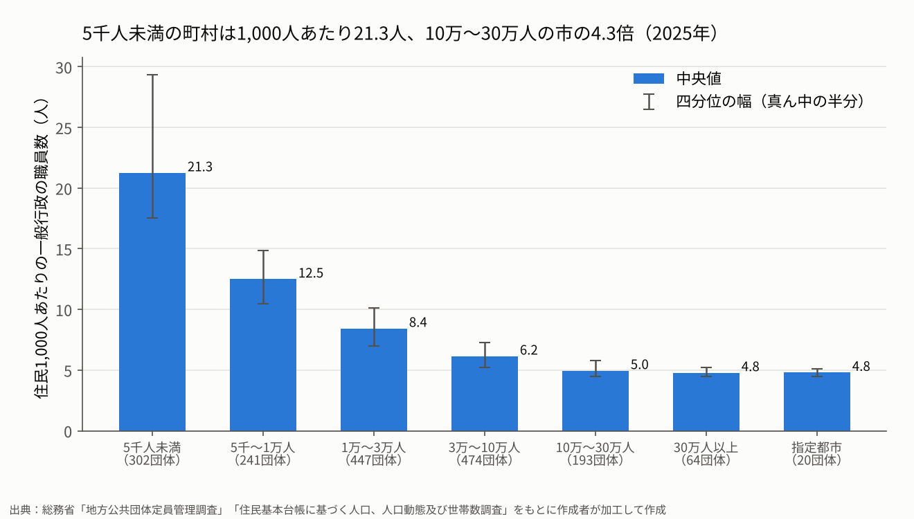
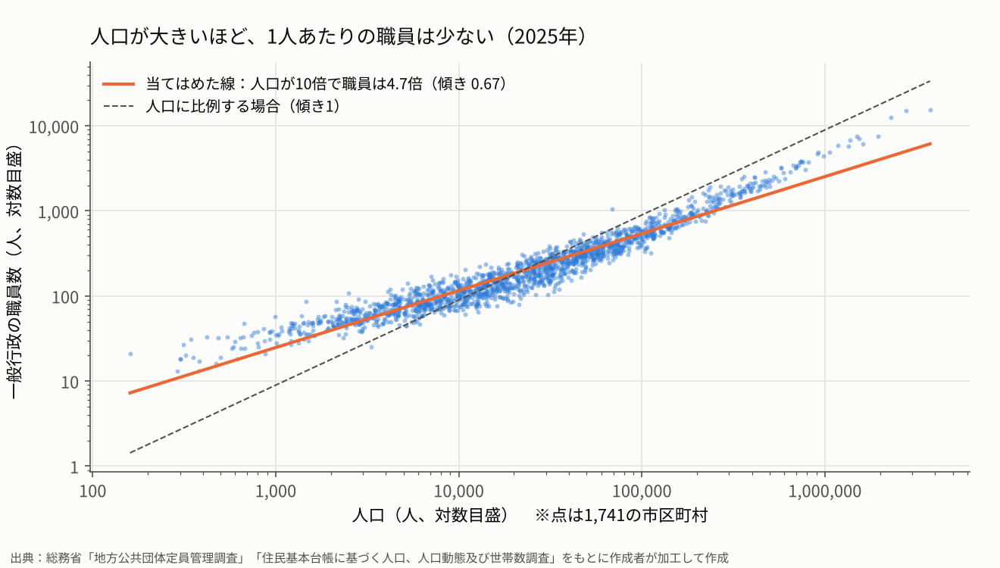
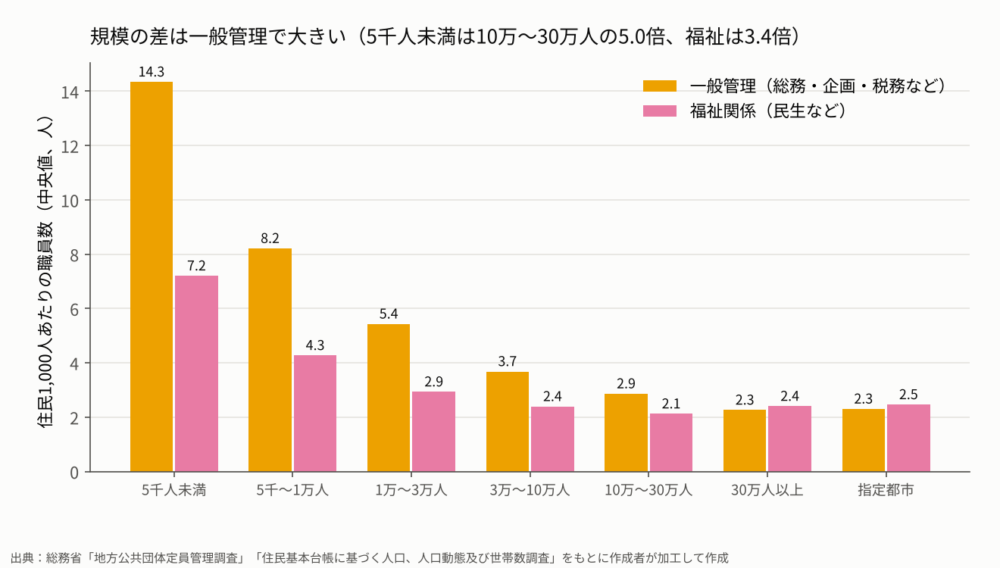
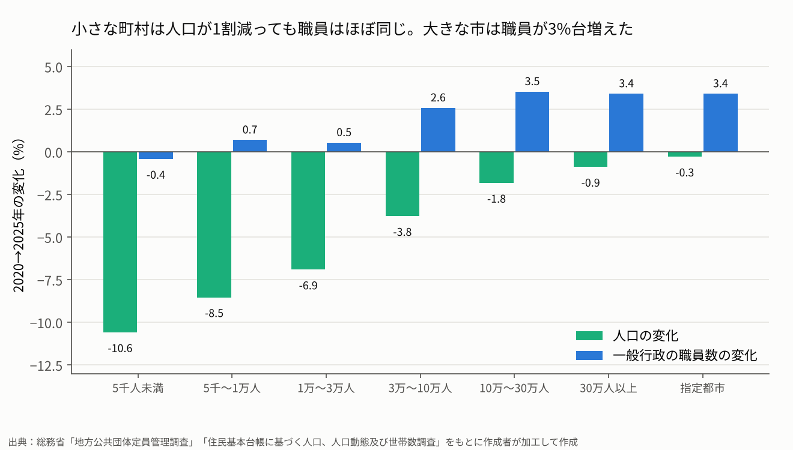

# F519 人口あたりの自治体の職員数は、人口の規模でどう違うのか？ 住民1,000人あたりの一般行政の職員は、5千人未満の町村で21.3人、10万〜30万人の市で5.0人（4.3倍）。人口が10倍でも職員は4.7倍

（予備 R48 に替えた記事です。元の F519「地方の役所の職員は、どの部門で減ったのか」は、部門別の長い推移が PDF のグラフの中にしかなく、機械で読める形でそろえられなかったため替えました。/home/claude/f3/REPLACED.md 参照）

## 結論（先に）
- 2025年4月の市区町村1,741団体で、住民1,000人あたりの一般行政部門の職員数（中央値）は、人口5千人未満の町村で21.3人、5千〜1万人で12.5人、1万〜3万人で8.4人、3万〜10万人で6.2人、10万〜30万人で5.0人、30万人以上と指定都市で4.8人でした。5千人未満は10万〜30万人の4.3倍です。
- 人口と職員数を対数で当てはめると傾きは0.67で、人口が10倍になっても一般行政の職員は4.7倍にしかなりません。小さい自治体ほど、住民1人あたりの職員が多い形です。
- 差は一般管理（総務・企画・税務など）で大きく（5千人未満は10万〜30万人の5.0倍）、福祉関係では3.4倍でした。人口が少なくても、役場として必要な仕事の量は人口ほど減らないためと考えられます（推測）。
- 2020→2025年に、5千人未満の町村では人口が10.6%減った一方、一般行政の職員はほぼ同じ（−0.4%）でした。1,000人あたりの増加（+11.4%）は、ほぼすべて人口の減少によるものです。大きな市では、職員が3%台増えたことが主な理由でした。

## 問い
小さな町村の役場は、住民の数に比べて職員が多いのか、少ないのか。人口が減る中で、その差は広がっているのか。自治体の仕事や行政の効率の話を読む人のために、総務省の統計で確かめます。職員が多いか少ないかの良し悪しや、適正な人数は扱いません。

## データ（出典）
- 総務省「地方公共団体定員管理調査」団体別の部門別職員数（市区町村・指定都市、2020年・2025年の4月1日）。一般行政（一般管理・福祉関係）、教育、消防、普通会計計、公営企業等会計。
- 総務省「住民基本台帳に基づく人口、人口動態及び世帯数調査」市区町村別人口（2020年・2025年の1月1日）。
- 市区町村は団体コードで、指定都市は名前でつなぎました。職員数の合計の人口は、住民基本台帳の全国の人口（2025年1億2,433万人）と一致します。
- 人口の規模で7つに分けました（5千人未満、5千〜1万人、1万〜3万人、3万〜10万人、10万〜30万人、30万人以上、指定都市）。

## 事前の計画
[PLAN.md](PLAN.md)（2026-11-16 13:45、集計の前に作成）。下見では各ファイルの見出しと最初の数行だけを見ていました。

| 仮説 | 外れの基準 | 結果 | 判定 |
|---|---|---|---|
| H1 5千人未満の中央値は10万〜30万人の3倍以上（2025年） | 3倍未満 | 21.26 ÷ 4.96 ＝ 4.29倍 | 支持 |
| H2 対数の傾きは0.8未満 | 0.8以上 | 0.670 | 支持 |
| H3 2020→2025年に5千人未満の中央値が増え、10万〜30万人より増え方が大きい | 増えていないなど | +2.21人 対 +0.34人 | 支持 |
| H4 規模の差は福祉関係の方が一般管理より小さい | 同じか大きい | 3.40倍 対 5.01倍 | 支持 |

## やったこと
1. 定員管理調査と住民基本台帳人口を団体ごとにつなぎました（02_build.py）。
2. 1,000人あたりの職員数を規模別に、中央値・四分位・加重平均で出しました。対数の回帰と、2020→2025年の変化も出しました（03_analysis.py）。
3. 結果を見てから、1,000人あたりの変化を職員数の変化と人口の変化に分けました（03b_requestion.py）。

## 分かったこと

### 1. 小さな町村ほど1,000人あたりの職員が多い（図1）

5千人未満の302団体の真ん中の半分は、1,000人あたり17.5〜29.3人でした。10万〜30万人の193団体は4.5〜5.8人で、規模が大きいほどばらつきも小さくなります。全国の合計では、住民1,000人あたり5.63人（2025年）です。

### 2. 人口が10倍でも職員は4.7倍（図2）

人口160人の村から370万人の市まで、一般行政の職員数は人口の0.67乗に比例するような関係でした。人口に比例する場合（点線、傾き1）と比べると、小さな町村は線より上、大きな市は線より下にあります。ただし関係はまっすぐではありません。人口10万人を超えるあたりからは点が当てはめた線より上に並び、職員はほぼ人口に比例して増えます（1,000人あたりは10万〜30万人5.0人、30万人以上4.8人とほぼ同じ）。傾き0.67は、小さな町村から大きな市までをならした値です。

### 3. 規模の差は一般管理で大きい（図4）

1,000人あたりの一般管理の職員（中央値）は、5千人未満14.3人、10万〜30万人2.9人で5.0倍。福祉関係は7.2人と2.1人で3.4倍でした。30万人以上の市や指定都市では、福祉関係（2.4〜2.5人）が一般管理（2.3人）を上回ります。

## 問い直し（結果を見てから足した）

### 1,000人あたりの増加は、人口が減ったからか（図3）

2020→2025年の1,000人あたり（加重）の増加を、職員数の変化と人口の変化に分けました。5千人未満では+11.4%の増加のほぼすべて（104%）が人口の減少によるもので、職員はわずかに減っていました。5千〜1万人、1万〜3万人でも9割以上が人口の減少です。一方、10万〜30万人では増加（+5.5%）の65%、指定都市では92%が職員の増加によるものでした。小さな町村では「人口が減っても職員はほぼ同じ」、大きな市では「職員が増えた」という、違う理由で同じように1,000人あたりが増えています。

## 頑健性

| 確かめ方 | 値 |
|---|---|
| 本線：一般行政、中央値の比（5千人未満÷10万〜30万人）2025年 | 4.29倍 |
| 加重（職員の合計÷人口の合計）の比 | 4.00倍 |
| 普通会計計（教育・消防を含む）の中央値の比 | 3.71倍 |
| 2020年の中央値の比 | 4.28倍 |
| 対数の傾き：本線（2025年、全団体） | 0.670 |
| 対数の傾き：指定都市を除く | 0.655 |
| 対数の傾き：人口1千人未満の37団体を除く | 0.688 |
| 対数の傾き：2020年 | 0.677 |
| 対数の傾き：普通会計計 | 0.706 |

比の求め方、部門の範囲、年を変えても、5千人未満は10万〜30万人の3.7〜4.3倍、傾きは0.66〜0.71でした。

## 言えないこと
- 職員数は正規の職員で、会計年度任用職員（非常勤）や外部への委託は入りません。
- ごみ処理や消防を一部事務組合（複数の自治体で共同の組織）で行っている町村は、その分の職員が入らないので少なく見えます。
- 職員が多いか少ないかの良し悪しや、適正な人数は、この統計からは分かりません。
- 面積、離島、雪の多さなど、地理の条件の違いは除いていません。
- 職員数は4月1日、人口は1月1日で、時点が3か月ずれます。
- 対数の傾き0.67は全体をならした値で、人口10万人を超える市では職員はほぼ人口に比例します。「10倍で4.7倍」はどの規模にも同じように当てはまるわけではありません。

## 仕事で使うなら
- 自治体の職員数を比べるときは、人口の規模をそろえて比べないと、小さな町村が「多い」ように見えます。規模別の中央値は results/by_size.csv にあります。
- 団体ごとの1,000人あたりの値は results/per1000_by_municipality.csv にあります（順位は作っていません）。

## 計画からの変更
- 問い直し（変化の分け方）は結果を見てから足しました。それ以外は計画どおりです。

## 再現のしかた
```
sh src/run_all.sh        # オフライン。所要約4秒
python3 src/01_fetch.py  # 元データを取り直すときだけ（ネットを使う）
```

| ファイル | 中身 |
|---|---|
| src/02_build.py | Excel 6本 → data/staff_pop.csv（年×団体） |
| src/03_analysis.py | 規模別・回帰・変化・仮説・頑健性 → results/main.json・per1000_by_municipality.csv・by_size.csv・change_2020_2025.csv・robustness.csv |
| src/03b_requestion.py | 問い直し → results/requestion.json・requestion_decomposition.csv |
| src/04_figures.py | 図4枚 |

repro_check：/tmp/rep_F519 に写し、02 以降が作るファイルを消してから流し、12ファイル（results 7、figures 4、data の CSV 1）がすべて cmp で一致（results/repro_check.txt）。乱数は使っていません。

## レビューで直したこと

| # | 指摘 | 直し方 |
|---|---|---|
| 1 | 図2で人口10万人を超える市は当てはめた線より上に並び、職員はほぼ人口に比例している。傾き0.67が全体に当てはまるように読めた | README の「分かったこと2」と言えないこと、note の図2の節と言えないことに、関係が曲がっていて傾き0.67は全体をならした値であると書き足した |
| 2 | 問い直しの「人口が減っても職員を減らせない」は、良し悪しの判断に読める書き方だった | 「人口が減っても職員はほぼ同じ」に直した |

直したあと、/tmp で流し直して results・figures が元と一致することを確かめました。

## 出典
- 総務省「地方公共団体定員管理調査」（e-Stat）：https://www.e-stat.go.jp/stat-search/files?toukei=00200216
- 総務省「住民基本台帳に基づく人口、人口動態及び世帯数調査」（e-Stat）：https://www.e-stat.go.jp/stat-search/files?toukei=00200241&tstat=000001039591 （各表の URL は data/raw/SOURCES.md）

（いずれも 総務省「地方公共団体定員管理調査」「住民基本台帳に基づく人口、人口動態及び世帯数調査」をもとに作成者が加工して作成）
