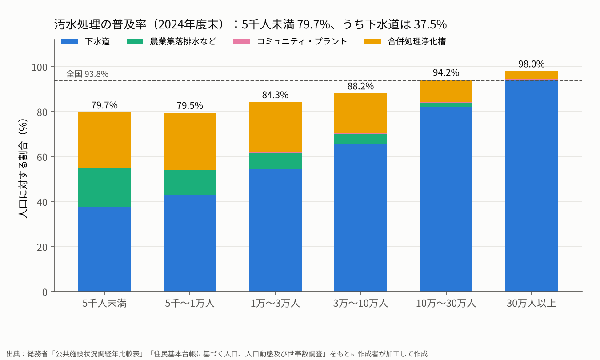
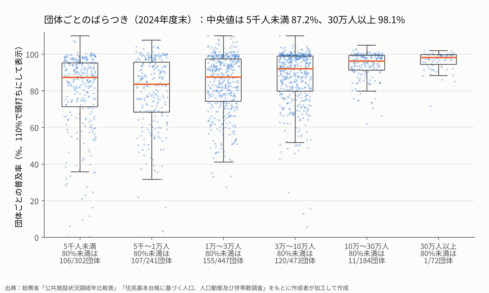
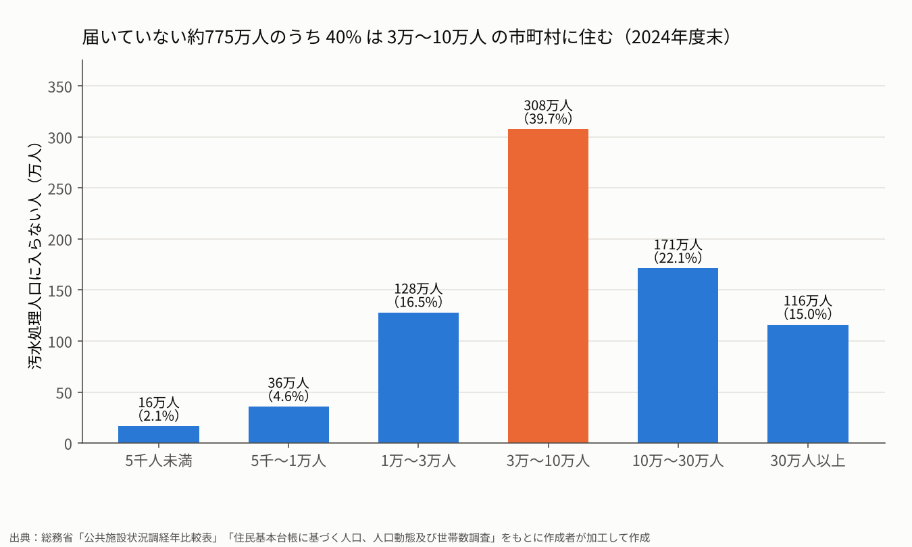
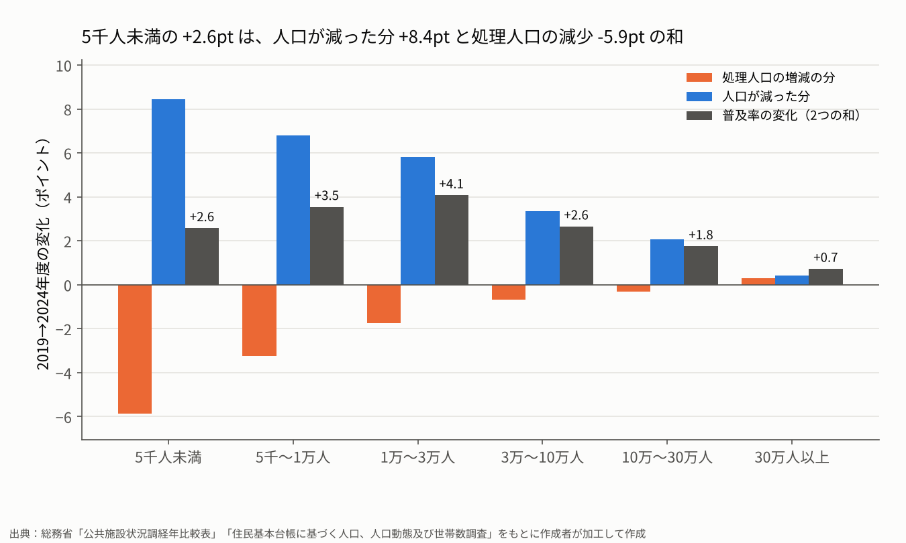

# F520 下水道などが届いていない人は、どんな町に多いのか？ 汚水処理の普及率は人口5千人未満の町村で79.7%、30万人以上の市で98.0%。ただ届いていない人の4割は3万〜10万人の市に住む

## 結論（先に）
- 2024年度末の汚水処理人口（下水道・農業集落排水など・コミュニティ・プラント・合併処理浄化槽で処理できる人）を、市区町村ごとに住民基本台帳の人口で割りました。全国では93.77%で、国の発表（93.7%）とほぼ一致します。
- 人口の規模別では、5千人未満の町村79.7%、5千〜1万人79.5%、1万〜3万人84.3%、3万〜10万人88.2%、10万〜30万人94.2%、30万人以上98.0%でした。小さな町ほど低く、5千人未満は全国より14.1ポイント低い値です。
- 小さな町では下水道以外の方式が多く、5千人未満の汚水処理人口の52.9%は下水道以外（合併処理浄化槽24.7%、農業集落排水など17.2%、人口に対する割合）でした。30万人以上では4.1%です。
- 一方、届いていない人の数で見ると、約775万人のうち39.7%（308万人）は3万〜10万人の市町村に住んでいます。5千人未満の町村は16万人（2.1%）です。率が低いのは小さな町、人数が多いのは中くらいの市です。
- 2019→2024年度に5千人未満の普及率は2.6ポイント上がりましたが、処理人口そのものは7.6%減りました。上昇は人口（分母）が10.6%減ったことによるもので、届く人が増えたからではありません。

## 問い
下水道などの汚水処理施設が届いていない人は、どんな町に多いのか。国土交通省・農林水産省・環境省は毎年、全国と人口規模別の普及率を発表しています。この記事では市区町村ごとのデータを自分で積み上げて、その数字を確かめ、方式の内訳と、届いていない人の数を規模別に見ます。どの方式で整備すべきかや、費用の良し悪しは扱いません。

## データ（出典）
- 総務省「公共施設状況調経年比較表」市町村経年比較表の「下水道等」：公共下水道・農業集落排水・漁業集落排水・林業集落排水・簡易排水・小規模集合排水の現在処理区域内人口、コミュニティ・プラント処理人口、合併処理浄化槽処理人口（2019・2024年度末）。元のファイルは約45MBのため、使う列だけを抜き出して同梱しました（src/01b_extract.py、data/raw/sewage_extract.csv）。
- 総務省「住民基本台帳に基づく人口、人口動態及び世帯数調査」市区町村別人口（2020年・2025年1月1日）。年度末の処理人口に、その直前の1月1日の人口を合わせました。
- 東京23区の下水道は東京都が一つで運営しており、処理人口は表の千代田区の行にまとめて載っています。そのため23区は1つの単位にまとめ（人口約973万人、30万人以上に入る）、1,719の単位で集計しました。
- 人口の規模は6つに分けました（5千人未満、5千〜1万人、1万〜3万人、3万〜10万人、10万〜30万人、30万人以上。政令市は30万人以上）。

## 事前の計画
[PLAN.md](PLAN.md)（2026-11-16 13:49、集計の前に作成）。下見では国の発表資料の本文だけを見ていました。

| 仮説 | 外れの基準 | 結果 | 判定 |
|---|---|---|---|
| H1 計算した全国の普及率は国の発表（93.7%）と±1ポイント以内 | 1ポイントより大きいずれ | 93.77%（2019年度は92.00%、発表91.7%） | 支持 |
| H2 5千人未満の普及率（加重）は全国より15ポイント以上低い | 15ポイント未満 | 79.69%、差14.08ポイント | 外れ |
| H3 5千人未満の汚水処理人口の半分以上は下水道以外 | 半分未満 | 52.91% | 支持 |
| H4 2019→2024年度の上がり方は5千人未満の方が大きい | 同じか小さい | +2.57ポイント 対 30万人以上 +0.72ポイント | 支持 |

H2は差が15ポイントにわずかに届かず、外れとしました。H4は支持ですが、問い直し（下）のとおり、その上昇は人口の減少によるものでした。

## やったこと
1. 市町村経年比較表から下水道等の列を抜き出し、住民基本台帳の人口と団体コードでつなぎました（02_build.py）。町村名は郡名の有無と字体（ケ/ヶなど）をそろえて照合しました。
2. 規模別に、加重の普及率（処理人口の合計÷人口の合計）、団体の中央値と四分位、方式別の内訳、届いていない人の数を出しました（03_analysis.py）。
3. 結果を見てから、普及率の変化を「処理人口の増減の分」と「人口が減った分」に分けました（03b_requestion.py）。

## 分かったこと

### 1. 小さな町ほど普及率が低く、下水道以外の割合が大きい（図1）

人口に対する下水道の割合は、5千人未満で37.5%、30万人以上で94.0%でした。小さな町では合併処理浄化槽（24.7%）と農業集落排水など（17.2%）が大きな役割を持っています。浄化槽を除いた集合処理だけで見ると、5千人未満は55.0%、全国は84.0%です。

### 2. 同じ規模の中でもばらつきが大きい（図2）

5千人未満の302団体の真ん中の半分は71.3〜95.2%で、中央値は87.2%でした。加重の値（79.7%）より中央値が高いのは、普及率がかなり低い団体が下に長く散らばっているためです（団体の単純平均も79.2%）。普及率80%未満の団体は、5千人未満で106、30万人以上で1でした。

### 3. 届いていない人の4割は3万〜10万人の市町村に（図4）

率で見ると小さな町が低いのですが、人口が少ないため、届いていない人の数は5千人未満で16万人にとどまります。人口の多い3万〜10万人の市町村では、普及率88.2%でも届いていない人は308万人で、全体の約4割を占めました。

## 問い直し（結果を見てから足した）

### 小さな町の普及率の上昇は、届く人が増えたからか（図3）

5千人未満の+2.57ポイントを分けると、人口が減った分が+8.44ポイント、処理人口の減少が−5.86ポイントでした。処理人口の内訳では、下水道−3.03、農業集落排水など−1.72、浄化槽−1.10ポイントで、どの方式も減っています。人口の減少だけで上昇の3倍以上を説明します。処理人口が増えたのは30万人以上だけ（+0.29ポイント分）でした。

## 頑健性

| 確かめたこと | 値 |
|---|---|
| 本線：5千人未満の普及率（加重）2024年度 | 79.69% |
| 団体の中央値 | 87.24% |
| 100%を超える団体を除く（加重） | 79.01% |
| 浄化槽を除いた集合処理だけ | 54.96%（全国83.97%） |
| 全国との差：中央値どうし | 3.56ポイント |
| 全国との差：2019年度（加重） | 13.92ポイント |
| 普及率が100%を超える団体の数 | 146 |

加重の値では全国との差は14ポイントほどで、2019年度もほぼ同じです。ただ団体の中央値どうしでは差は3.6ポイントで、どちらで見るかで印象が大きく変わります。全国の中央値は小さな町村が多く含まれた値なので、加重と並べて読む必要があります。

## 言えないこと
- 普及率は処理できる区域にいる人の割合で、実際に家がつながっている（水洗化している）かどうかとは違います。
- 届いていない人が、単独処理浄化槽を使っているのか、くみ取りなのかは、この表では分かりません。
- 処理区域内人口の数え方と住基人口の違いで、146団体は普及率が100%を超えます。規模別の合計では差し引きされるため、届いていない人の数は概数です。普及率が10%未満の団体も13あり、表の値の背景（集計のしかた）は確かめていません。
- 年度末の処理人口と1月1日の人口で、3か月の時点のずれがあります。
- どの方式で整備するのがよいか、整備の費用や使用料の負担は扱いません。

## 仕事で使うなら
「小さな町ほど普及率が低い」と「届いていない人が多いのは中くらいの市」は、どちらも同じデータから言えます。率と人数のどちらを示すかで、話の向きが変わる点に注意が要ります。

## 計画からの変更
- 東京23区を1つの単位にまとめました（下水道の処理人口が千代田区の行に一括で載っていたため）。
- 届いていない人の数（図4）と、変化の分解（図3）を、結果を見てから足しました。

## 再現のしかた
```
sh src/run_all.sh
```
ネットにはつながず、data/raw だけから data/sewage_pop.csv、results、figures を作ります（約4秒）。元データを取り直すときは `python3 src/01_fetch.py` のあと `python3 src/01b_extract.py` を流し、data/download を消します。Python 3.13、requirements.txt の版で確かめました。

repro_check：独立レビューで /tmp/rvD_F520 に写し、02 以降が作るファイル（results・figures・data の中間ファイル）を消してから流し直し、11ファイルがすべて cmp で一致しました（results/repro_check.txt）。

## レビューで直したこと

| # | 指摘 | 直し方 |
|---|---|---|
| 1 | 出典の節にリンクがなかった | 出典をリンクつきの箇条書きにし、最後に「（いずれも…加工して作成）」を足した |
| 2 | 再現のしかたに repro_check の結果がなかった | 独立レビューでの再実行の結果（11ファイル一致）を書き足した |

直したあと、/tmp で流し直して results・figures が元と一致することを確かめました。

## 出典
- 総務省「公共施設状況調経年比較表」：https://www.soumu.go.jp/iken/shisetsu/index.html
- 総務省「住民基本台帳に基づく人口、人口動態及び世帯数調査」（e-Stat）：https://www.e-stat.go.jp/stat-search/file-download?statInfId=000040306653&fileKind=0 ほか
- 国土交通省・農林水産省・環境省「令和6年度末の汚水処理人口普及状況」：https://www.mlit.go.jp/report/press/mizukokudo13_hh_000669.html
- 各ファイルの URL は data/raw/SOURCES.md

（いずれも 総務省「公共施設状況調経年比較表」「住民基本台帳に基づく人口、人口動態及び世帯数調査」をもとに作成者が加工して作成）
