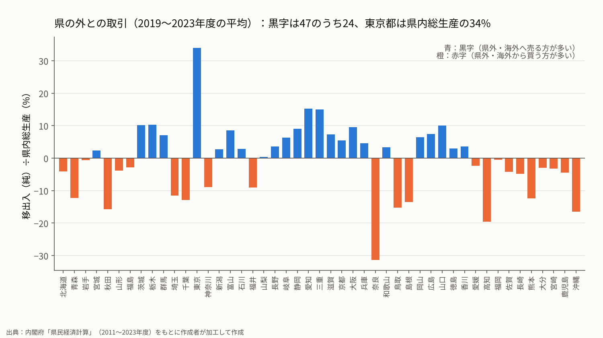
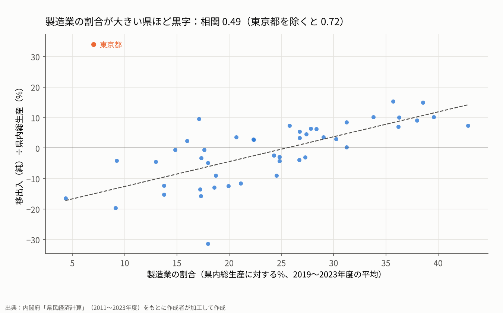
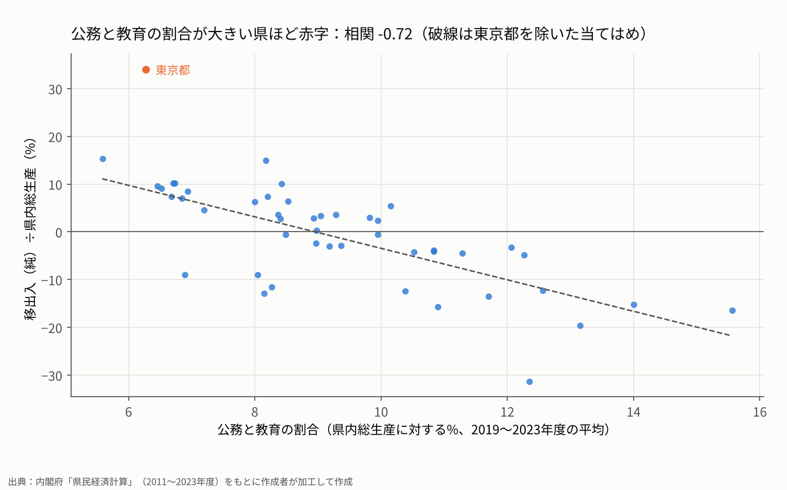
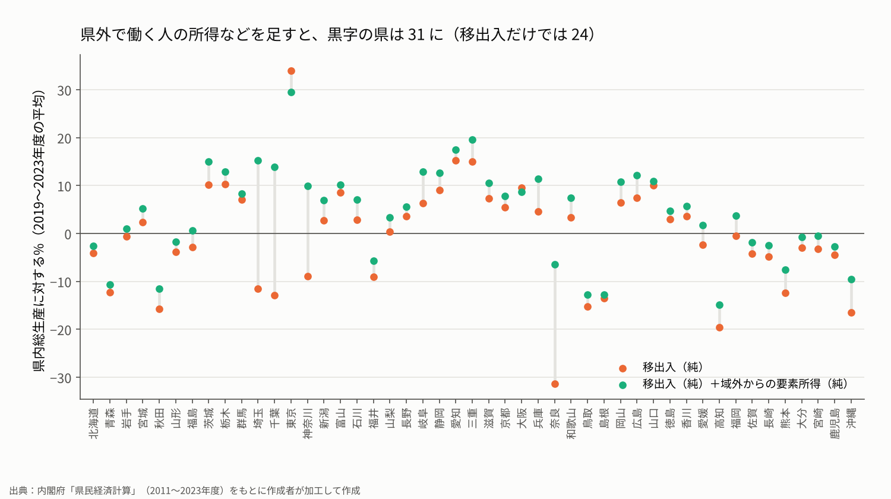

# F521 県の外から稼いでいる県は、どんな産業を持っているのか？ 移出入が黒字の県は47のうち24。製造業の割合が大きい県ほど黒字。大きく赤字の12県はどれも県外で働く人の所得などが入り、赤字の一部を補っている

## 結論（先に）
- 内閣府「県民経済計算」で、財貨・サービスの移出入（純）を県内総生産で割りました。2019〜2023年度の平均で黒字の県は47のうち24、東京都は県内総生産の34%と飛び抜けています。東京都を除くと、−31.3%から+15.3%まで散らばります。
- 製造業の割合が大きい県ほど黒字でした。相関は0.49ですが、製造業の割合が7%と小さいのに大きく黒字の東京都を除くと0.72になります。黒字の県の製造業の割合（中央値）は28.7%、赤字の県は18.0%です。
- 公務と教育の割合が大きい県ほど赤字で、相関は −0.72 でした。
- 大きく赤字の12県（−5%より下）は、どれも「域外からの要素所得」（県外で働く人の給与や、県外の資産から入る所得の純額）が黒字でした。これを足すと、埼玉・千葉・神奈川の3県は赤字から黒字に変わり、黒字の県は24から31に増えます。それでも赤字が残る16県は、北海道・東北、山陰、四国、九州・沖縄の県が多くを占めます。
- 2011〜2013年度と2021〜2023年度で、黒字の県は20から24に増えました。県ごとの値の相関は0.93で、形はほとんど変わっていません。

## 問い
「地方は外から稼ぐ力が弱い」と言われます。県の外（他県と海外）との取引で黒字の県はどこに、どれだけあり、どんな産業を持っているのか。県民経済計算の数字で確かめます。黒字が良い、赤字が悪いという評価や、地域の政策の良し悪しは扱いません。

## データ（出典）
- 内閣府「県民経済計算」（2011〜2023年度、2015年基準）の主要系列表。
  - 4. 県内総生産（支出側、名目）：財貨・サービスの移出入（純）、統計上の不突合、県内総生産（支出側）、域外からの要素所得（純）。
  - 1. 経済活動別県内総生産（名目）：製造業、公務、教育などの産業別の県内総生産。
- 移出入（純）は、県外・海外へ売った財貨・サービス（移出・輸出）から、県外・海外から買ったもの（移入・輸入）を引いた額です。県ごとの名目値を、その県の県内総生産で割りました。
- 年による揺れをならすため、主に2019〜2023年度の5年の平均を使いました。

## 事前の計画
[PLAN.md](PLAN.md)（2026-11-16 13:57、集計の前に作成）。下見で、2023年度のシートの見出しと表の下の地域ブロックの行（関東・中部が黒字など）は目に入っていました。

| 仮説 | 外れの基準 | 結果 | 判定 |
|---|---|---|---|
| H1 黒字の県は47のうち半分未満 | 24以上 | 24 | 外れ |
| H2 製造業の割合と移出入比の相関は0.5以上 | 0.5未満 | 0.488 | 外れ |
| H3 公務・教育の割合と移出入比の相関は −0.3 以下 | −0.3 より大きい | −0.724 | 支持 |
| H4 2011〜2013年度から2021〜2023年度に黒字の県は3以上増えていない | 3以上増えた | 20 → 24 | 外れ |

H2はわずかに届きませんでした。ただ、それは東京都という外れた1点によるもので、東京都を除くと0.719です（頑健性の表）。

## やったこと
1. 主要系列表の2つのファイル（年度ごとに13のシート）から、都道府県の行を読み出しました。列の見出しの文字を毎回確かめています（02_build.py）。
2. 移出入比と産業の割合を県ごとに出し、相関と当てはめの直線を出しました（03_analysis.py）。
3. 結果を見てから、域外からの要素所得を足した値を出しました（03b_requestion.py）。

## 分かったこと

### 1. 黒字の県は関東の北から中部・近畿・中国に（図1）

北から南の順に並べました。地方のまとまりで見ると（県内総生産で重みをつけた比）、北海道・東北 −3.9%、関東 +14.7%、中部 +9.1%、近畿 +6.5%、中国 +4.5%、四国 −2.4%、九州・沖縄 −4.7% です。関東は東京都が大きく黒字の一方、埼玉・千葉・神奈川は赤字です。

### 2. 製造業の割合が大きい県ほど黒字（図2）

東京都を除いた当てはめでは、製造業の割合が1ポイント大きいと、移出入比は0.82ポイント大きくなります。東京都は、本社の機能や卸売・金融・情報通信などのサービスを県外に売っていると考えられます（推測）。

### 3. 公務と教育の割合が大きい県ほど赤字（図3）

公務と教育の割合の中央値は、黒字の県で8.2%、赤字の県で10.8%でした。ただ、これは「民間の産業が小さい県では、公的な部門の割合が相対的に大きく見える」という形の関係でもあり、公務や教育が赤字の理由だとは言えません。

## 問い直し（結果を見てから足した）

### 赤字の県は、外から稼いでいないのか（図4）

移出入は財貨・サービスの取引だけで、県外で働いて得る給与は入りません。そこで「域外からの要素所得（純）」を足しました。移出入比が −5% より下の12県は、どれも要素所得が黒字です。要素所得が県内総生産の5%を超える7県（埼玉・千葉・神奈川・岐阜・兵庫・奈良・沖縄）では、移出入比の平均は −10.0% ですが、要素所得を足すと +6.8% になります。移出入と要素所得の相関は −0.51 で、東京や大阪の近くの県では、県外で稼いで県内で使う形が見えます。

一方で、要素所得を足しても赤字が残る16県は、北海道・東北、山陰、四国、九州・沖縄の県が多くを占めました。この差を埋めているのは、ここでは見ていない国からの財政の移転などだと考えられます（推測）。

## 頑健性

| 確かめたこと | 値 |
|---|---|
| 本線：製造業の割合との相関（2019〜2023年度、47県） | 0.488 |
| 東京都を除く（46県） | 0.719 |
| 移出入＋統計上の不突合で | 0.518 |
| 2023年度だけ | 0.483 |
| 2011〜2013年度の平均 | 0.442 |
| 順位の相関（スピアマン） | 0.654 |
| 公務＋教育との相関：本線／東京都を除く／不突合を足す | −0.724／−0.727／−0.775 |
| 黒字の県の数：移出入＋不突合で／2023年度だけ | 17／24 |

関係の向きはどれでも変わりません。ただ、黒字の県の数は「統計上の不突合」を足すと24から17に減り、数え方に敏感です。

## 言えないこと
- 移出入は、多くの県で他の項目からの差し引きなどで推計され、誤差が大きい値です。不突合を足すかどうかで、黒字の県の数が7つも変わります。
- 黒字であることが、県に住む人の暮らしの豊かさを表すわけではありません。国からの財政の移転や年金などの移転は、ここに入っていません。
- 本社がある県に売上が集まるなど、県の境目で生まれる計算上の偏りがあります。
- 相関だけで、産業の形が黒字・赤字の原因だとは言えません。
- 2011年度より前は基準が違うため、つないでいません。

## 仕事で使うなら
「外から稼ぐ力」を県で比べるときは、移出入だけでなく、要素所得を足した値も並べると、大都市の近くの県の見え方が大きく変わります。

## 計画からの変更
- 域外からの要素所得の列を、結果を見てから読み込みに足しました（問い直しのため）。

## 再現のしかた
```
sh src/run_all.sh
```
ネットにはつながず、data/raw の2つの Excel から data/pref_year.csv、results、figures を作ります（約5秒）。元データを取り直すときは `python3 src/01_fetch.py`。Python 3.13、requirements.txt の版で確かめました。

repro_check：独立レビューで /tmp/rvD_F521 に写し、02 以降が作るファイル（results・figures・data の中間ファイル）を消してから流し直し、12ファイルがすべて cmp で一致しました（results/repro_check.txt）。

## レビューで直したこと

| # | 指摘 | 直し方 |
|---|---|---|
| 1 | 題名の「大きく赤字の県の多くは県外で働く人の所得で補っている」は、要素所得を足して黒字になるのは3県だけで、言い過ぎだった | 「大きく赤字の12県はどれも県外で働く人の所得などが入り、赤字の一部を補っている」に直した。status・note の1行目もそろえた |
| 2 | 出典の節にリンクがなく、再現の結果もなかった | リンクと再実行の結果（12ファイル一致）を書き足した |

直したあと、/tmp で流し直して results・figures が元と一致することを確かめました。

## 出典
- 内閣府「県民経済計算」（2011〜2023年度）：https://www.esri.cao.go.jp/jp/sna/data/data_list/kenmin/files/contents/main_2023.html （各ファイルの URL は data/raw/SOURCES.md）

（いずれも 内閣府「県民経済計算」をもとに作成者が加工して作成）
