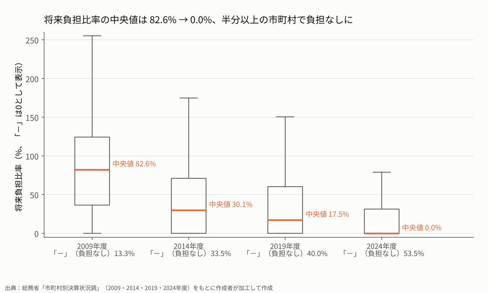
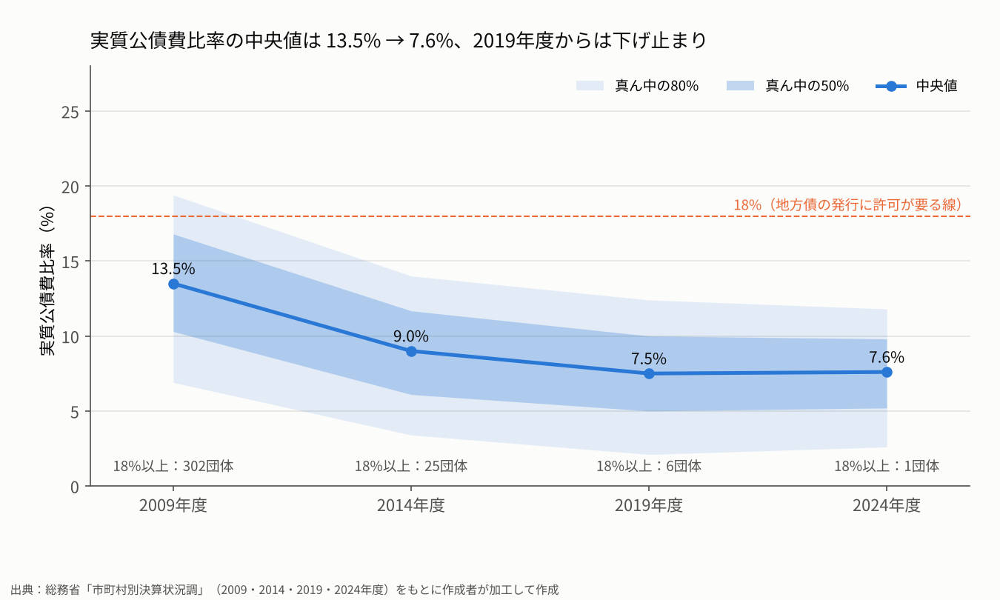
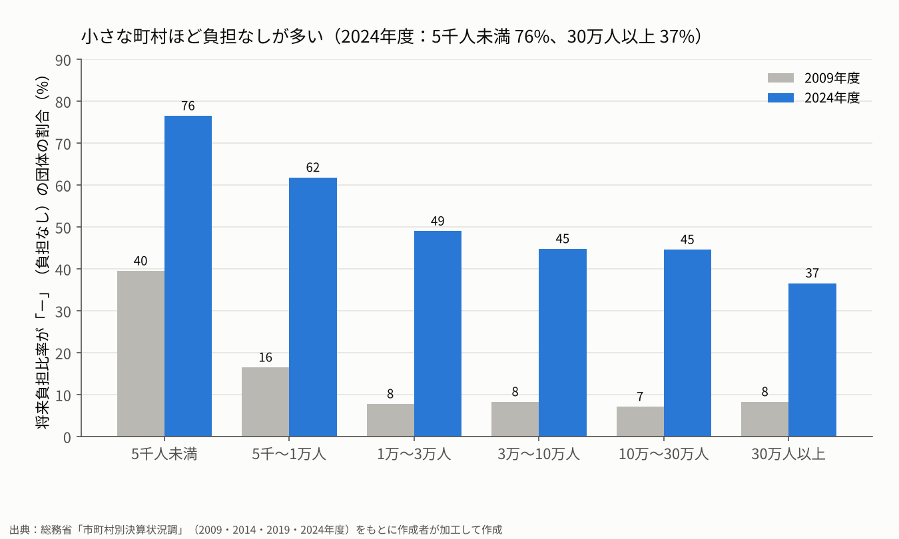
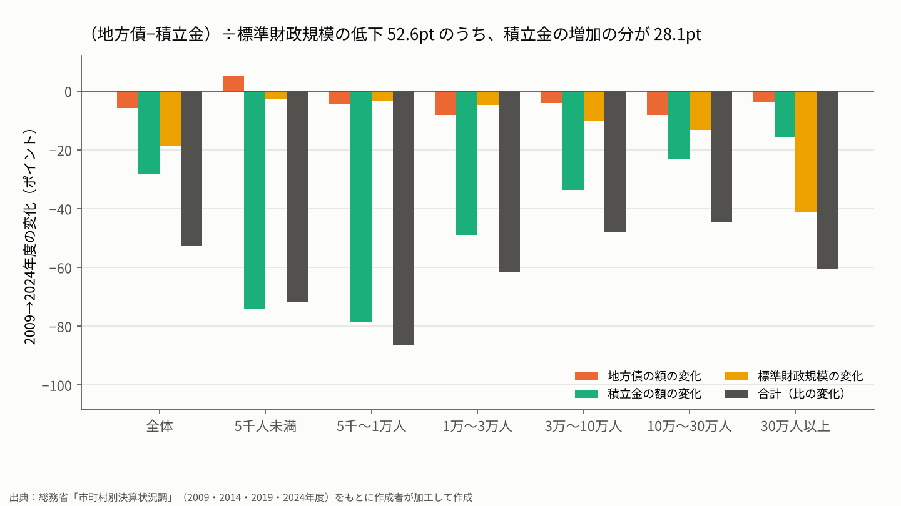

# F522 自治体の将来の借金の重さは、この15年で軽くなったのか？ 市町村の将来負担比率の中央値は82.6%から0%に下がり、半分以上が「負担なし」に。主な理由は借金の減少より、基金（貯金）が2倍になったこと

## 結論（先に）
- 総務省「市町村別決算状況調」で、市町村（東京23区を除く）の将来負担比率を2009・2014・2019・2024年度で比べました。中央値は82.6% → 30.1% → 17.5% → 0.0% と下がり、2024年度は53.5%の市町村が「－」（将来負担額を基金などの財源が上回り、比率が出ない状態）でした。2009年度は13.3%でした。
- 実質公債費比率（毎年の返済の重さ）の中央値は13.5% → 7.6%に下がりました。ただ2019年度（7.5%）からは下げ止まっています。地方債の発行に許可が要る18%以上の団体は、302から1に減りました。
- 小さな町村ほど「負担なし」が多く、2024年度は5千人未満で76.5%、30万人以上で36.6%です。
- 軽くなった理由を額で分けると、地方債の残高は15年で3.0%しか減っていません（54.4兆円 → 52.7兆円）。一方、積立金（基金）は7.8兆円から15.6兆円に2倍になり、標準財政規模（分母）も16.1%大きくなりました。（地方債−積立金）÷標準財政規模の低下52.6ポイントのうち、積立金の増加の分が28.1、分母の拡大の分が18.6、地方債の減少の分は5.9ポイントでした。

## 問い
自治体の財政は「借金で苦しい」と言われてきました。2007年度に財政健全化法ができ、市町村は毎年、将来負担比率と実質公債費比率を公表しています。この15年で、借金の重さは本当に軽くなったのか。どの規模の市町村で、何によって軽くなったのかを確かめます。どの団体の財政が危ないかや、財政運営の良し悪しは扱いません（団体の名前は挙げません）。

## データ（出典）
- 総務省「市町村別決算状況調」2009（平成21）・2014（平成26）・2019（令和元）・2024（令和6）年度。都市別と町村別の「(1) 概況」（住民基本台帳人口、標準財政規模、実質公債費比率、将来負担比率）と「(5) 地方債現在高等」（地方債現在高、積立金現在高）。
- 対象は市町村（2009年度1,727団体、2014年度以降1,718団体）。東京23区は標準財政規模などが出ないため除きました。表の下の「(うち政令指定都市)」などの内訳の行も除いています。
- 将来負担比率が「－」の団体は0として中央値などを出し、「－」の割合も別に出しました。

## 事前の計画
[PLAN.md](PLAN.md)（2026-11-16 14:04、集計の前に作成）。下見では見出しの行と、別のファイルの最初の数行だけを見ていました。

| 仮説 | 外れの基準 | 結果 | 判定 |
|---|---|---|---|
| H1 将来負担比率の中央値は2009→2024年度で半分以下 | 半分より大きい | 82.6% → 0.0% | 支持 |
| H2 2024年度に「－」の団体は半分以上 | 半分未満 | 53.5% | 支持 |
| H3 実質公債費比率の中央値は3ポイント以上下がった | 3ポイント未満 | 13.5% → 7.6%（−5.9） | 支持 |
| H4 標準財政規模に対する比で、積立金の増加は地方債の減少より大きい | 地方債の減少の方が大きい | 積立金 +20.3、地方債 −32.3 ポイント | 外れ |

H4は計画どおりの比で見ると外れでした。ただ、地方債の比が下がったのは、地方債の額ではなく分母が大きくなったためでした（問い直しの節）。

## やったこと
1. 16のファイルから市町村の行を読み出しました。列は見出しの文字で探し、都道府県の見出しの行で県を付けました（02_build.py）。
2. 年度ごと・人口の規模ごとに、比率の中央値・四分位・「－」の割合を出しました（03_analysis.py）。
3. 結果を見てから、（地方債−積立金）÷標準財政規模の変化を、地方債の額・積立金の額・分母の3つに分けました（03b_requestion.py）。

## 分かったこと

### 1. 将来負担比率は大きく下がった（図1）

上から4分の1の値（第3四分位）は124.5% → 31.7%、上から1割の値は167.5% → 67.0%に下がりました。200%以上の団体は75から1に減っています。標準財政規模で重みをつけた平均も113.6% → 35.5%です。

### 2. 返済の重さは2019年度から下げ止まり（図2）

実質公債費比率の中央値は、2009→2014年度に4.5ポイント下がった後、2019年度7.5%、2024年度7.6%とほぼ横ばいです。

### 3. 小さな町村ほど「負担なし」が多い（図3）

2024年度の「－」の割合は、5千人未満76.5%、5千〜1万人61.8%、1万〜3万人49.0%、3万〜10万人44.8%、10万〜30万人44.6%、30万人以上36.6%でした。積立金÷標準財政規模の中央値も、5千人未満の124.5%に対して30万人以上は27.3%で、小さな町村ほど基金を厚く持っています。

## 問い直し（結果を見てから足した）

### 軽くなったのは、借金が減ったからか（図4）

地方債現在高の合計は15年で3.0%減っただけでした。（地方債−積立金）÷標準財政規模 の低下52.6ポイントを分けると、積立金の額の増加が28.1、標準財政規模の拡大が18.6、地方債の額の減少が5.9ポイントです。規模別では、5千人未満と5千〜1万人では積立金の増加の分が74〜79ポイントと大半で、30万人以上では分母の拡大の分（41.1ポイント）が最も大きくなりました。大きな市で分母が25.1%増えたのは、政令市に県から仕事が移った分などがあると考えられます（推測）。

## 頑健性

| 確かめたこと | 2009年度 | 2024年度 |
|---|---|---|
| 本線：将来負担比率の中央値（「－」は0） | 82.6 | 0.0 |
| 比率が出ている団体だけの中央値 | 94.8 | 35.5 |
| 標準財政規模で重みをつけた平均 | 113.6 | 35.5 |
| 4つの年度すべてにある1,708団体の中央値 | 83.0 | 0.0 |
| 政令市を除いた中央値 | 81.9 | 0.0 |
| 本線：実質公債費比率の中央値 | 13.5 | 7.6 |
| 実質公債費比率：重みつき平均 | 12.3 | 6.3 |
| 実質公債費比率：1,708団体／政令市を除く | 13.5／13.5 | 7.6／7.6 |
| （地方債−積立金）÷標準財政規模の中央値 | 126.5 | 74.6 |

「－」を0とするかどうかで2024年度の中央値は0%と35.5%に分かれますが、どの見方でも大きく下がっています。

## 言えないこと
- 地方債には、返済の分を国が後で交付税で手当てする臨時財政対策債などが含まれ、地方債の額がそのまま自治体の負担ではありません。
- 公営企業や第三セクターの借金は、将来負担比率に一部しか入りません。
- 基金が増えた理由（将来の施設の更新に備えたのか、使い道が決まっていないのか）は、この表からは分かりません。
- 人口が減ると、同じ借金でも1人あたりの重さは増えます。将来の人口の変化は入っていません。
- 問い直しの分け方は「（地方債−積立金）÷標準財政規模」という近い形の比で行ったもので、将来負担比率そのものの計算（退職手当の見込みや、国が交付税で手当てする分を差し引くことなど）とは同じではありません。
- 財政が良いか悪いかの評価や、どの団体が危ないかは扱いません。

## 仕事で使うなら
将来負担比率の「－」は、借金がないという意味ではなく、借金より基金などの財源が多いという意味です。中央値の0%だけを示すと誤解を招くので、比率が出ている団体の値（35.5%）も並べるのが安全です。

## 計画からの変更
- 3つに分ける分解（図4）を、結果を見てから足しました。

## 再現のしかた
```
sh src/run_all.sh
```
ネットにはつながず、data/raw の16の Excel から data/muni_year.csv、results、figures を作ります（約6秒）。元データを取り直すときは `python3 src/01_fetch.py`。Python 3.13、requirements.txt の版で確かめました。

repro_check：独立レビューで /tmp/rvD_F522 に写し、02 以降が作るファイル（results・figures・data の中間ファイル）を消してから流し直し、12ファイルがすべて cmp で一致しました（results/repro_check.txt）。

## レビューで直したこと

| # | 指摘 | 直し方 |
|---|---|---|
| 1 | 問い直しの分け方は（地方債−積立金）÷標準財政規模という近い形の比で、将来負担比率そのものの計算とは違うことが書かれていなかった | README・note の言えないことに1行足した |
| 2 | 出典の節にリンクがなく、再現の結果もなかった | リンクと再実行の結果（12ファイル一致）を書き足した |

直したあと、/tmp で流し直して results・figures が元と一致することを確かめました。

## 出典
- 総務省「市町村別決算状況調」：https://www.soumu.go.jp/iken/kessan_jokyo_2.html （各年度のファイルの URL は data/raw/SOURCES.md）

（いずれも 総務省「市町村別決算状況調」をもとに作成者が加工して作成）
