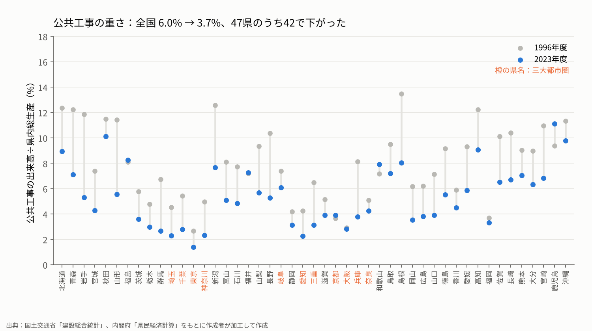
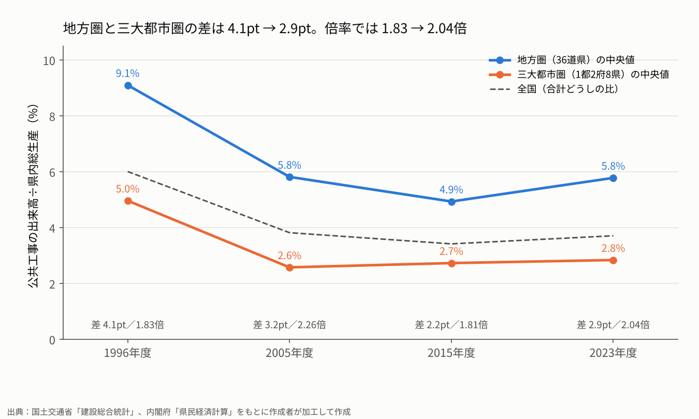
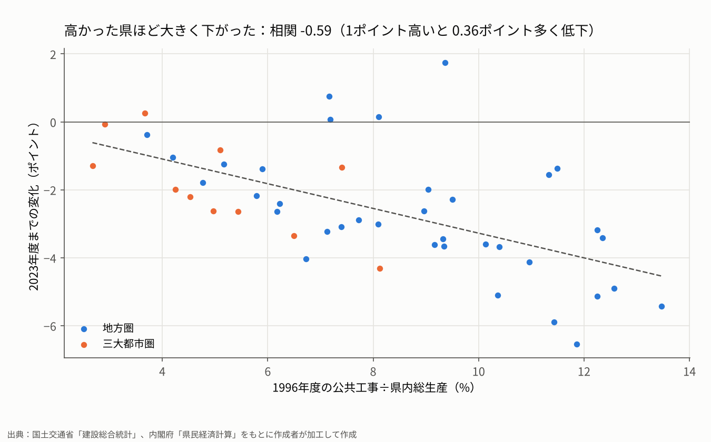
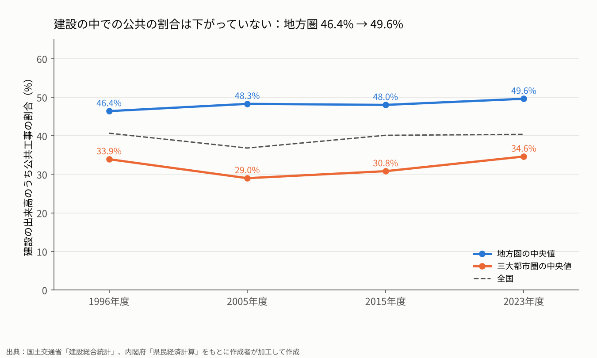

# F523 公共工事への依存は、地方でどれだけ下がったのか？ 県内総生産に対する公共工事の割合は、地方圏の中央値で9.1%から5.8%に下がった。ただ建設の仕事の半分が公共工事という形は変わらない

## 結論（先に）
- 国土交通省「建設総合統計」の公共工事の出来高を、内閣府「県民経済計算」の県内総生産で割りました。全国では1996年度6.0% → 2005年度3.8% → 2015年度3.4% → 2023年度3.7%で、1996年度から38%下がりました。47県のうち42で下がっています。
- 地方圏（三大都市圏の1都2府8県を除く36道県）の中央値は9.1% → 5.8%、三大都市圏は5.0% → 2.8%でした。差は4.1ポイントから2.9ポイントに縮みましたが（29%）、倍率では1.83倍から2.04倍に広がっています。
- 1996年度に割合が高かった県ほど、大きく下がりました（相関 −0.59）。
- 一方、建設の出来高の中で公共工事が占める割合は下がっていません。地方圏の中央値は46.4% → 49.6%で、建設の仕事の約半分が公共工事という形は変わっていません。下がったのは、建設全体が経済の中で小さくなったためです。

## 問い
「地方は公共事業に頼っている」と言われてきました。1990年代の後半から公共事業は大きく減らされましたが、地方の経済に占める公共工事の重さは、どれだけ下がったのか。大都市との差は縮まったのか。災害復旧の工事はどれだけを占めるのか。県ごとの数字で確かめます。公共事業の良し悪しは扱いません。

## データ（出典）
- 国土交通省「建設総合統計」年度報の1996・2005・2015・2023年度。表2（都道府県別・種類別の出来高：総計・民間・公共）と表4（公共工事の都道府県別・工事種類別の出来高：災害復旧）。出来高は工事が行われた場所で数えた、その年度に進んだ工事の額です。2015年度は、2013年4月〜2022年5月の値を見直した推計値の年度報、2023年度は2025年度に遡って直した値です。
- 内閣府「県民経済計算」の県内総生産（名目）。1996・2005年度は1993SNA・平成12年基準、2015・2023年度は2008SNA・2015年基準の総括表です。
- 三大都市圏は、埼玉・千葉・東京・神奈川・岐阜・愛知・三重・京都・大阪・兵庫・奈良としました。

## 事前の計画
[PLAN.md](PLAN.md)（2026-11-16 14:11、集計の前に作成）。下見では年度報の表の題名と、表2・表4の最初の20行ほどを見ていました。

| 仮説 | 外れの基準 | 結果 | 判定 |
|---|---|---|---|
| H1 全国の割合は1996→2023年度に3分の1以上下がった | 3分の1未満 | 6.01% → 3.71%（−38.2%） | 支持 |
| H2 地方圏と三大都市圏の中央値の差は30%以上縮まった | 30%未満 | 4.14 → 2.94ポイント（−28.9%） | 外れ |
| H3 1996年度の水準と変化の相関は −0.5 以下 | −0.5 より大きい | −0.590 | 支持 |
| H4 災害復旧の割合は1996年度より2023年度が大きい | 同じか小さい | 1.93% → 2.58% | 支持 |

## やったこと
1. 4つの年度報の表2と表4から、県ごとの年度計を読み出し、県内総生産とつなぎました。民間＋公共＝総計になることを県ごとに確かめています（02_build.py）。
2. 県ごとの割合、地方圏と三大都市圏の中央値、水準と変化の相関、災害復旧の割合を出しました（03_analysis.py）。
3. 結果を見てから、倍率での差と、建設の中での公共の割合を見ました（03b_requestion.py）。

## 分かったこと

### 1. ほとんどの県で下がった（図1）

県を北から南の順に並べました。1996年度は2.7%〜13.5%、2023年度は1.4%〜11.1%に散らばります。上がったのは5県（福島・福井・京都・和歌山・鹿児島）でした。2015年度には、岩手16.8%・宮城12.6%・福島11.4%と、震災からの復旧・復興の工事で一時的に高くなっています。

### 2. 差はポイントで縮み、倍率で広がった（図2）

地方圏と三大都市圏の中央値は、どちらも2005年度までに大きく下がりました。その後、三大都市圏は2.6〜2.8%で横ばい、地方圏は2015年度4.9%から2023年度5.8%に戻っています。2015→2023年度に全国の公共工事の額は19.8%増え、県内総生産の伸び（10.3%）を上回りました。資材や人件費の上昇も含まれると考えられます（推測）。

### 3. 高かった県ほど大きく下がった（図3）

1996年度の割合が1ポイント高いと、2023年度までの低下は0.36ポイント大きい関係です。県ごとのばらつき（標準偏差）も2.91から2.35ポイントに小さくなりました。

## 問い直し（結果を見てから足した）

### 建設の中で、公共の割合は下がったのか（図4）

建設の出来高の総計に対する公共工事の割合は、全国で40.7%（1996年度）と40.4%（2023年度）でほとんど同じでした。地方圏の中央値は46.4%から49.6%に、三大都市圏は33.9%から34.6%です。公共工事が減ったのと同じくらい民間の建設も減っており、「建設の仕事のうち公共が半分」という地方の形はむしろ強まっています。

## 頑健性

| 確かめたこと | 起点 | 2023年度 |
|---|---|---|
| 本線：地方圏−三大都市圏の中央値の差（pt、1996年度起点） | 4.14 | 2.94 |
| 建設の出来高に占める公共の割合での差（pt） | 12.47 | 14.98 |
| 災害復旧を除いた差（pt） | 4.03 | 2.68 |
| 2005年度を起点にした差（pt） | 3.24 | 2.94 |
| 水準と変化の相関：本線／岩手・宮城・福島を除く／順位 | −0.590／−0.587／−0.623 | － |
| 県ごとの割合の標準偏差（pt） | 2.91 | 2.35 |

県内総生産に対する割合では差は縮みましたが、建設の中での割合で見ると差は広がっています。どちらで見るかで答えが変わります。

## 言えないこと
- 県内総生産の基準が、2005年度と2015年度の間で変わっています（1993SNA から 2008SNA）。2008SNA では研究開発などが加わり、県内総生産が大きく出るため、割合は少し小さく出ます。
- 出来高は工事の場所で数えた額で、受注した企業の所在地や、その県の人の所得とは違います。
- 建設総合統計は、2013年度以降の値が見直されており、2005年度以前とは推計の方法が違います。
- 公共工事の多さの良し悪しや、どの県が公共事業に「頼りすぎ」かは扱いません。
- 4つの年度だけを見ていて、年ごとの揺れは見ていません。
- 「高かった県ほど大きく下がった」（相関 −0.59）には、たまたま高かった年のあとに平均へ戻る動き（平均への回帰）も含まれている可能性があります。1996年度という1つの年で水準を決めているためです。

## 仕事で使うなら
「地方の公共事業依存は下がった」は、経済全体に対する割合では正しいですが、建設業の中では公共の割合はむしろ上がっています。どちらの分母かをはっきりさせて使う必要があります。

## 計画からの変更
- 倍率での差と、建設の中での公共の割合（図4）を、結果を見てから足しました。

## 再現のしかた
```
sh src/run_all.sh
```
ネットにはつながず、data/raw の6つの Excel から data/pref_year.csv、results、figures を作ります（約4秒）。元データを取り直すときは `python3 src/01_fetch.py`。Python 3.13、requirements.txt の版で確かめました。

repro_check：独立レビューで /tmp/rvD_F523 に写し、02 以降が作るファイル（results・figures・data の中間ファイル）を消してから流し直し、12ファイルがすべて cmp で一致しました（results/repro_check.txt）。

## レビューで直したこと

| # | 指摘 | 直し方 |
|---|---|---|
| 1 | note に「## 言えないこと」の見出しがなく、箇条書きだけが残っていた | 見出しを足した |
| 2 | 「高かった県ほど大きく下がった」（相関−0.59）に、平均への回帰の注意がなかった | README・note の言えないことに書き足した |
| 3 | 出典の節にリンクがなく、再現の結果もなかった | リンクと再実行の結果（12ファイル一致）を書き足した |

直したあと、/tmp で流し直して results・figures が元と一致することを確かめました。

## 出典
- 国土交通省「建設総合統計」年度報（e-Stat）：2023年度 https://www.e-stat.go.jp/stat-search/file-download?statInfId=000040286446&fileKind=4 ほか（各年度の URL は data/raw/SOURCES.md）
- 内閣府「県民経済計算」：https://www.esri.cao.go.jp/jp/sna/data/data_list/kenmin/files/contents/main_2023.html

（いずれも 国土交通省「建設総合統計」、内閣府「県民経済計算」をもとに作成者が加工して作成）
