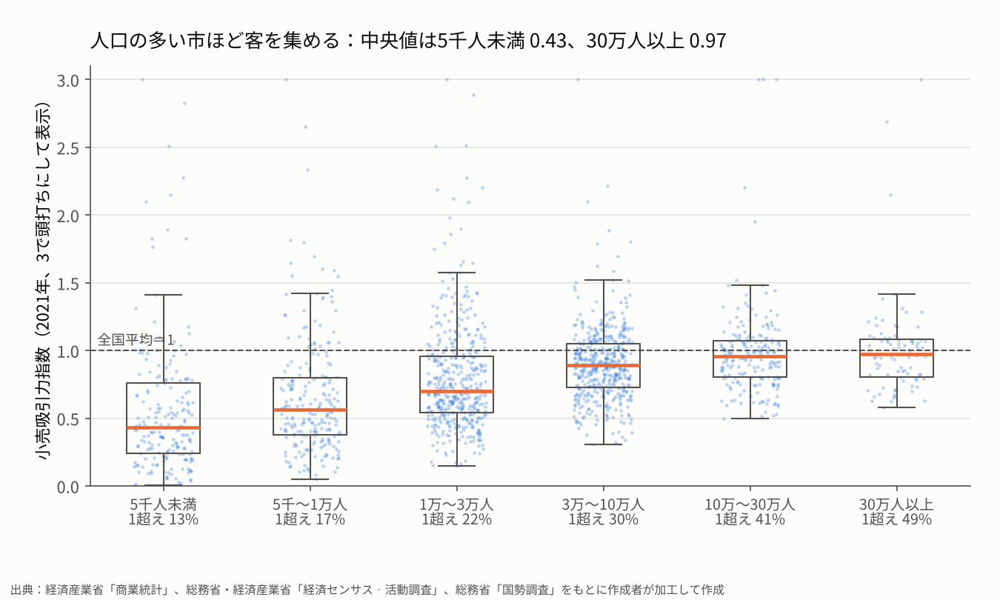
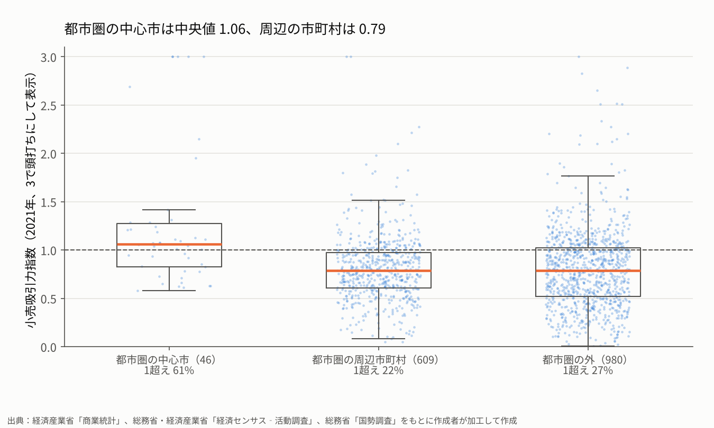
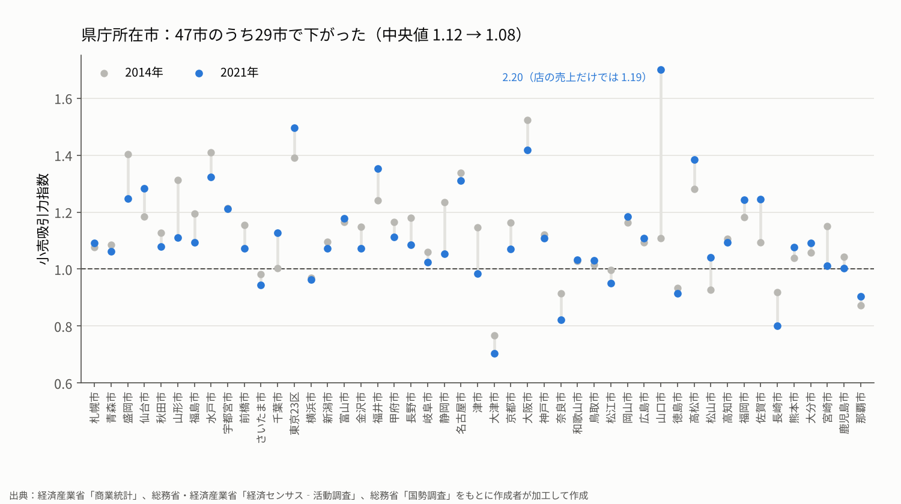
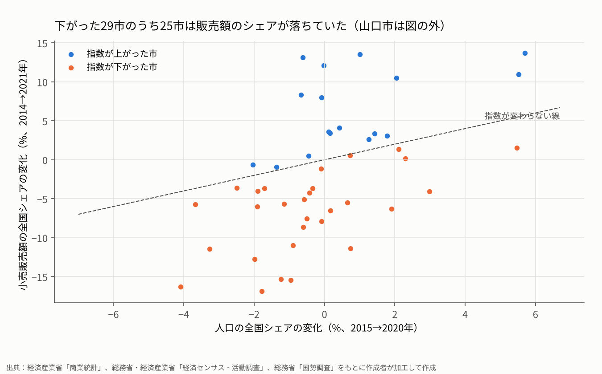

# F524 買い物の客を周りから集めている市は、どんな市か？ 人口1人あたりの小売販売額が全国平均を超える市区町村は26%。都市圏の中心市では61%、人口5千人未満の町村では13%。県庁所在市で下がったのは29市（店の売上だけなら22市）

## 結論（先に）
- 2021年の小売業の年間商品販売額を2020年の人口で割り、全国平均との比（小売吸引力指数）を出しました。値がわかる1,635の市区町村のうち、1を超える（全国平均より多く売れている）のは431（26.4%）で、中央値は0.79でした。
- 人口が多い市ほど指数が高く、中央値は5千人未満の町村で0.43、30万人以上の市で0.97です。1を超える割合は5千人未満で13%、30万人以上で49%でした。
- 国勢調査の大都市圏・都市圏の「中心市」では、中央値1.06、1を超える割合は61%でした。周辺の市町村は中央値0.79、22%です。
- 県庁所在市（東京は23区をまとめて1つ）の中央値は1.12（2014年）から1.08（2021年）に下がり、47市のうち29市で指数が下がりました。下がった29市のうち25市では、販売額の全国シェアそのものが落ちていました。ただ、通信販売などの店ではない売上（無店舗小売業）を除くと、下がったのは22市で、半分を下回ります。

## 問い
県庁所在地のような中心の市は、周りの町から買い物の客を集めているのか。郊外の大型店や通信販売が広がる中で、その力は弱まっているのか。「小売吸引力指数」（人口1人あたりの小売販売額が全国平均の何倍か）を市区町村ごとに出して確かめます。商店街やまちづくりの良し悪しは扱いません。

## データ（出典）
- 経済産業省「商業統計」2014年 第3巻 産業編（市区町村表）：第1表（区市郡別）・第2表（町村別）の小売業の年間商品販売額と、そのうち無店舗小売業の販売額。
- 総務省・経済産業省「令和3年経済センサス‐活動調査」卸売業，小売業 産業編（市区町村表）：市区別（DB1）と町村別（DB2）の小売業計と無店舗小売業の年間商品販売額。
- 総務省「令和2年国勢調査」人口等基本集計：第1-1表（2020年の人口と、2020年の境界に組み替えた2015年の人口）、第1-3表・第1-4表（大都市圏・都市圏の中心市と周辺市町村）。
- 政令市は市全体の値を使い、東京23区はそれぞれを1つの単位としました。秘匿（X）などで販売額が出ない町村（2021年106、2014年109）は除いています。2014年から市になって番号が変わった2団体（富谷・那珂川）はつなぎ直しました。
- 指数＝（その市区町村の販売額÷人口）÷（全国の販売額÷人口）。2014年は2015年の人口、2021年は2020年の人口で割りました。全国の1人あたりの販売額は2014年96.2万円、2021年105.8万円です。

## 事前の計画
[PLAN.md](PLAN.md)（2026-11-16 14:17、集計の前に作成）。下見では各ファイルの見出しと最初の10〜20行を見ていました。

| 仮説 | 外れの基準 | 結果 | 判定 |
|---|---|---|---|
| H1 県庁所在市の中央値は1.2以上（2021年） | 1.2未満 | 1.085 | 外れ |
| H2 指数が1を超える市区町村は40%未満（2021年） | 40%以上 | 26.4% | 支持 |
| H3 県庁所在市の半分より多くで2014→2021年に指数が下がった | 半分以下 | 29市 | 支持（店の売上だけでは22市で外れ） |
| H4 5千人未満の町村の中央値は0.6未満（2021年） | 0.6以上 | 0.435 | 支持 |

H1は外れました。県庁所在市の中央値は1を超えますが、1.2には届きません。人口で重みをつけると1.21で、大きな県庁所在市ほど指数が高い形です。

## やったこと
1. 商業統計・経済センサスの市区町村表と国勢調査の人口を、市区町村コードでつなぎました（02_build.py）。
2. 指数を出し、人口規模別・都市圏の中心と周辺別・県庁所在市で比べました（03_analysis.py）。
3. 結果を見てから、県庁所在市の指数の変化を「販売額のシェアの変化」と「人口のシェアの変化」に分けました（03b_requestion.py）。

## 分かったこと

### 1. 人口の多い市ほど指数が高い（図1）

中央値は、5千人未満0.43、5千〜1万人0.56、1万〜3万人0.70、3万〜10万人0.89、10万〜30万人0.96、30万人以上0.97でした。ただ、どの規模にも1を大きく超える団体があります。小さな町でも、大きな店がある町は周りから客を集めていると考えられます（推測）。

### 2. 都市圏の中心市は客を集め、周辺は集められていない（図2）

都市圏の中心市（46）の中央値は1.06で、1を超えるのは61%でした。周辺の市町村（609）は中央値0.79で22%、都市圏の外の市町村（980）は中央値0.79で27%です。中心市の値は、東京23区のうち都心の区が非常に高いことにも引っ張られています。

### 3. 県庁所在市の多くで指数が下がった（図3）

北から南の順に並べました。2021年に1を超えたのは47市のうち38市です。29市で指数が下がり、中央値は1.12から1.08になりました。山口市は2014年の1.11から2021年に2.20に上がっていますが、店の売上だけで見ると1.19で、無店舗小売業の販売額が大きく入ったためです。

## 問い直し（結果を見てから足した）

### 下がったのは、売上が減ったからか、人口が増えたからか（図4）

指数は「販売額の全国シェア÷人口の全国シェア」です。指数が下がった29市のうち25市で、販売額の全国シェアが下がっていました。人口のシェアが上がっていたのは9市です。47市全体では、販売額のシェアの変化の中央値は−3.6%、人口のシェアは−0.3%でした。県庁所在市の指数の低下は、主に販売額の側から来ています。

## 頑健性

| 確かめたこと | 値 |
|---|---|
| 本線：指数が1を超える市区町村の割合（2021年） | 26.4% |
| 東京23区を1つにまとめた場合 | 26.2% |
| 2021年の販売額を2015年の人口で割った場合 | 23.4% |
| 2014年・2021年の両方にある団体だけ | 26.8% |
| 2014年（同じ定義） | 28.9% |
| 店の売上だけ（無店舗小売業を除く） | 31.6% |
| 県庁所在市の中央値：2014年／2021年／店の売上だけ（2021年） | 1.120／1.085／1.116 |
| 県庁所在市の人口で重みをつけた値（2021年） | 1.210 |
| 県庁所在市で指数が下がった数：本線／店の売上だけ | 29／22 |

1を超える団体の割合は、どの見方でも23〜32%です。一方、「県庁所在市の多くで吸引力が下がった」は、店の売上だけで見ると22市（半分未満）になり、無店舗小売業の扱いに左右されます。

## 言えないこと
- 販売額は事業所の場所で数えるため、通信販売などの売上は本社などのある市に入ります。指数が高いことが、周りの住民が買い物に来ていることを必ずしも意味しません。
- 商業統計（2014年）と経済センサス（2021年）では調べ方が違います。全国比の指数にして比べましたが、違いが残ります。
- 観光客の買い物と、周りの住民の買い物を分けられません。
- 販売額が秘匿されている小さな町村（約100）は入っていません。
- 商店街の良し悪しや、まちづくりの助言はしません。

## 仕事で使うなら
指数の変化を見るときは、無店舗小売業を含めるかどうかで結論が変わることがあります。両方を並べて見るのが安全です。

## 計画からの変更
- 都市圏の中心市・周辺市町村に、大都市圏（第1-3表）だけでなく都市圏（第1-4表）も使いました（第1-3表だけでは地方の県庁所在市の多くが入らないため）。
- 無店舗小売業を除いた「店の売上だけ」の指数を、結果を見てから足しました（山口市の値が大きく動いたため）。

## 再現のしかた
```
sh src/run_all.sh
```
ネットにはつながず、data/raw の6つの Excel から data/muni.csv、results、figures を作ります（約7秒）。元データを取り直すときは `python3 src/01_fetch.py`。Python 3.13、requirements.txt の版で確かめました。

repro_check：独立レビューで /tmp/rvD_F524 に写し、02 以降が作るファイル（results・figures・data の中間ファイル）を消してから流し直し、12ファイルがすべて cmp で一致しました（results/repro_check.txt）。

## レビューで直したこと

| # | 指摘 | 直し方 |
|---|---|---|
| 1 | 題名の「県庁所在市は47市のうち29市で吸引力が下がった」は、店の売上だけで見ると22市（半分未満）で、言い切れない | 「県庁所在市で下がったのは29市（店の売上だけなら22市）」に直した。status・note の1行目もそろえた |
| 2 | 出典の節にリンクがなく、再現の結果もなかった | リンクと再実行の結果（12ファイル一致）を書き足した |

直したあと、/tmp で流し直して results・figures が元と一致することを確かめました。

## 出典
- 経済産業省「商業統計」2014年 市区町村表（e-Stat）：https://www.e-stat.go.jp/stat-search/file-download?statInfId=000031357335&fileKind=0
- 総務省・経済産業省「令和3年経済センサス‐活動調査」卸売業，小売業 産業編（市区町村表）（e-Stat）：https://www.e-stat.go.jp/stat-search/file-download?statInfId=000040032863&fileKind=0 ほか
- 総務省「令和2年国勢調査」人口等基本集計（e-Stat）：https://www.e-stat.go.jp/stat-search/file-download?statInfId=000040317616&fileKind=0 ほか
- 各ファイルの URL は data/raw/SOURCES.md

（いずれも 経済産業省「商業統計」、総務省・経済産業省「経済センサス‐活動調査」、総務省「国勢調査」をもとに作成者が加工して作成）
