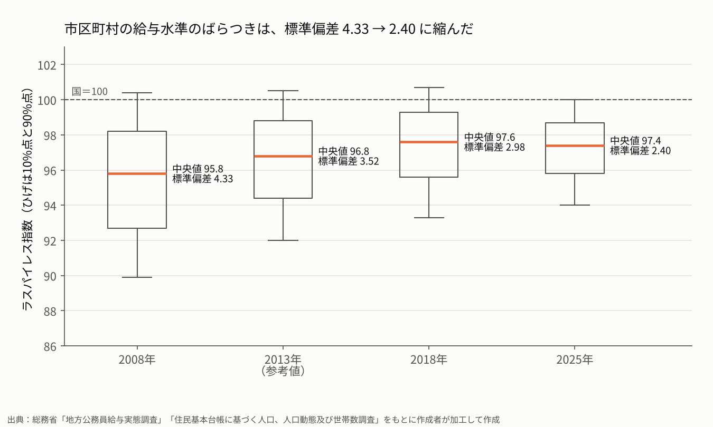
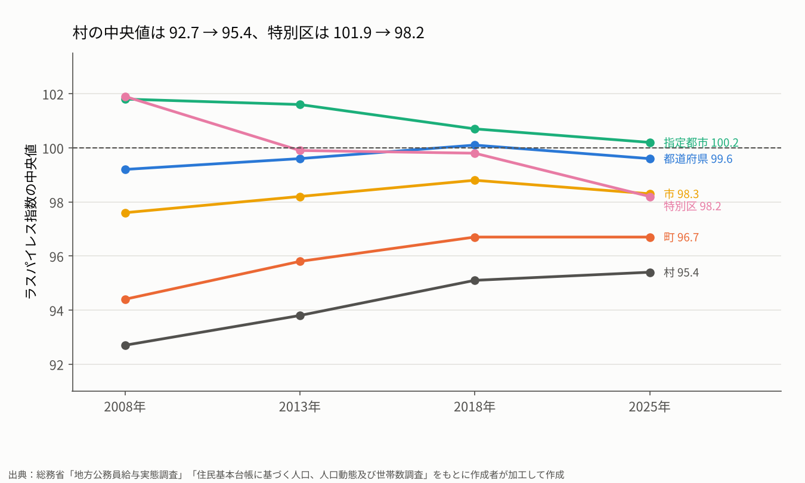
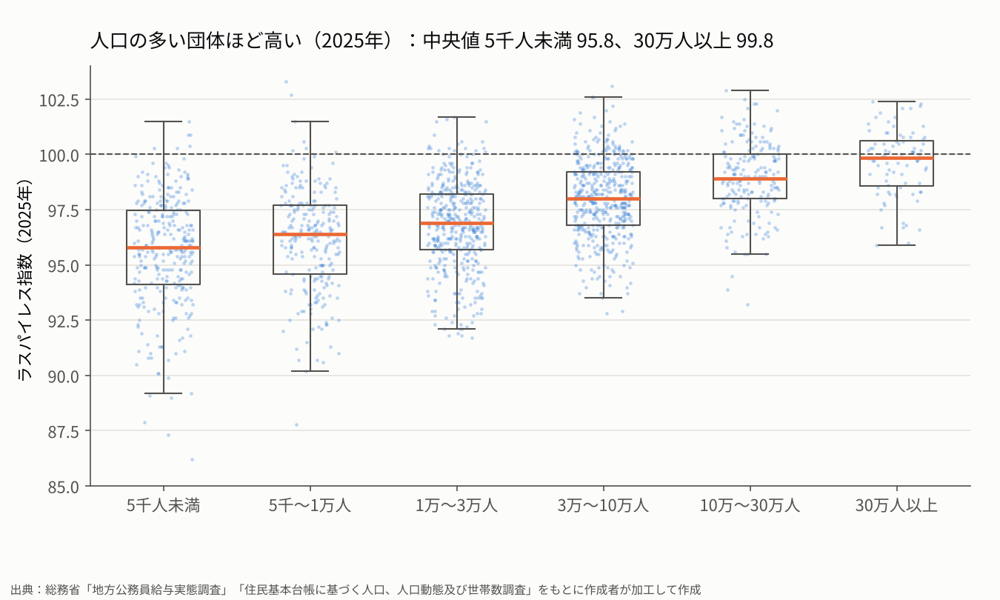
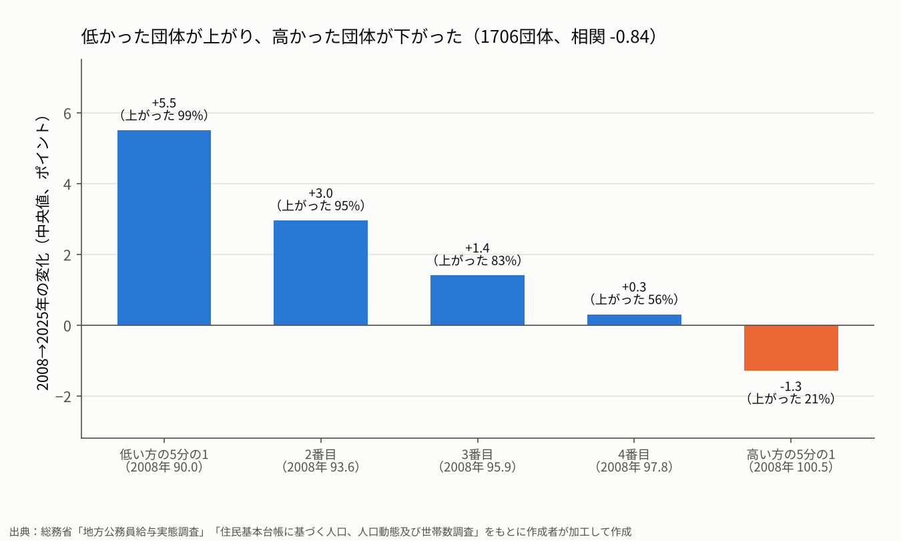

# F525 自治体の職員の給与の差（ラスパイレス指数）は、縮まったのか？ 市区町村のばらつきは2008年から2025年に標準偏差4.33から2.40へ4割あまり縮んだ。低かった町村が上がり、高かった特別区などが下がった

## 結論（先に）
- 総務省「地方公務員給与実態調査」のラスパイレス指数（一般行政職の給与水準を、国家公務員を100として比べた値）を、2008・2013・2018・2025年で比べました。2013年は、国家公務員の給与が特例で減らされていたため、その減額がなかったとした参考値を使っています。
- 市区町村（指定都市を除く）の指数の標準偏差は、2008年4.33 → 2013年3.52 → 2018年2.98 → 2025年2.40 と縮み、2008年から44.6%小さくなりました。10%点と90%点の幅も10.5から6.0ポイントになっています。中央値は95.8から97.4に上がりました。
- 団体の種類別の中央値は、村が92.7 → 95.4、町が94.4 → 96.7と上がり、特別区は101.9 → 98.2、指定都市は101.8 → 100.2と下がりました。
- 2025年でも、人口の多い団体ほど指数は高く、中央値は5千人未満95.8、30万人以上99.8でした（人口の対数との相関0.53）。
- 2008年と2025年の両方にある1,706団体で見ると、2008年に低かった5分の1は中央値で+5.5ポイント上がり、高かった5分の1は−1.3ポイント下がりました。差は、低い団体が上がり、高い団体が下がって縮んでいます。

## 問い
自治体の職員の給与水準には、団体によって差があります。この差は、この17年で縮まったのか。どんな種類・規模の団体で高く、どこで低いのか。ラスパイレス指数で確かめます。給与が高い・低いことの良し悪しや、どの団体が高すぎるかは扱いません（団体の名前を順位で挙げません）。

## データ（出典）
- 総務省「地方公務員給与実態調査」地方公共団体別給与等の比較 (1) ラスパイレス指数（一般行政職、各年4月1日）。2008・2013・2018・2025年の、都道府県・指定都市・市区町村の3つのファイル（e-Stat）。
- 2013年は、国家公務員の給与の特例減額（2012〜2013年度）で指数が高く出ています（市区町村の中央値104.8）。本線には、減額がなかったとした参考値（同96.8）を使いました。
- 人口の規模は、総務省「住民基本台帳に基づく人口」2025年1月1日の人口で分けました。
- 団体の数は、2008年は市区町村1,794、2013年以降は1,721〜1,722です（合併のため）。

## 事前の計画
[PLAN.md](PLAN.md)（2026-11-16 14:24、集計の前に作成）。下見では市区町村ファイルの見出しと最初の数行だけを見ていました。

| 仮説 | 外れの基準 | 結果 | 判定 |
|---|---|---|---|
| H1 市区町村の標準偏差は2008→2025年に30%以上縮んだ | 30%未満 | 4.33 → 2.40（−44.6%） | 支持 |
| H2 2025年の町村の中央値は市より2ポイント以上低い | 2ポイント未満 | 町村96.5、市98.3（差1.8） | 外れ |
| H3 指数100以上の市区町村の割合は2008年より2025年が小さい | 同じか大きい | 12.4% → 10.2% | 支持 |
| H4 2025年に人口（対数）と指数の相関は0.3以上 | 0.3未満 | 0.534 | 支持 |

## やったこと
1. 12のファイル（4つの年×3種類）から、団体区分・団体コード・指数を見出しの文字で探して読み出しました。2025年の人口を団体コードでつなぎました（02_build.py）。
2. 年ごと・団体の種類ごと・人口規模ごとの中央値とばらつきを出しました（03_analysis.py）。
3. 結果を見てから、2008年の水準で団体を5つに分け、2025年までの変化を見ました（03b_requestion.py）。

## 分かったこと

### 1. ばらつきは年を追って縮んだ（図1）

四分位の幅は5.5から2.9ポイントに、最も低い値は68.6から79.4に上がりました。指数100以上の団体の割合は、2008年12.4%、2018年17.2%、2025年10.2%です。

### 2. 町村は上がり、特別区・指定都市は下がった（図2）

2025年の中央値は、指定都市100.2、都道府県99.6、市98.3、特別区98.2、町96.7、村95.4でした。種類の間の差も、2008年の最大9.2ポイント（特別区と村）から、2025年は4.8ポイント（指定都市と村）に縮みました。種類の中のばらつき（標準偏差）も、特別区（0.48 → 1.16）を除くどの種類でも小さくなりました（村は4.76 → 3.17）。

### 3. 人口の多い団体ほど高い（図3）

2025年の中央値は、5千人未満95.8、5千〜1万人96.4、1万〜3万人96.9、3万〜10万人98.0、10万〜30万人98.9、30万人以上99.8です。ばらつきは小さな団体ほど大きく、標準偏差は5千人未満で2.84、30万人以上で1.51でした。

## 問い直し（結果を見てから足した）

### 差は、低い団体が上がって縮んだのか（図4）

2008年の指数で団体を5つに分けると、低い方の5分の1（2008年の中央値90.0）は98.6%の団体で上がり、中央値で+5.5ポイントでした。高い方の5分の1（同100.5）で上がったのは21.3%で、中央値は−1.3ポイントです。2008年の水準と変化の相関は−0.84でした。ただし、ある年に特に低い（高い）団体は、次の年に平均に戻りやすいという統計の性質もあり、この相関の全部が実際の給与の見直しによるとは言えません。

## 頑健性

| 確かめたこと | 2008年 | 2025年 |
|---|---|---|
| 本線：市区町村の標準偏差 | 4.33 | 2.40 |
| 四分位の幅 | 5.5 | 2.9 |
| 10%点〜90%点の幅 | 10.5 | 6.0 |
| 特別区を除く標準偏差 | 4.29 | 2.41 |

| 確かめたこと | 値 |
|---|---|
| 2013年：参考値／実際の指数の中央値 | 96.8／104.8 |
| 2013年：参考値／実際の指数の標準偏差 | 3.52／3.80 |
| 2025年：地域手当補正後の指数の中央値・標準偏差 | 97.4・2.67 |
| 人口（対数）との相関（2025年）：本線／市だけ | 0.534／0.416 |

ばらつきが縮んだことは、どの幅の測り方でも、特別区を除いても変わりません。地域手当の違いを補正すると、2025年の標準偏差は2.40から2.67に少し大きくなります。

## 言えないこと
- ラスパイレス指数は、職員の学歴と経験年数の構成を国にそろえて比べた値で、実際の平均の給与額とは違います。
- 都市部ほど高い地域手当は、本線の指数に入っていません。
- 2013年は参考値を使いましたが、実際の指数とは違う計算です。
- 2008年と2025年で合併があり、団体の顔ぶれが違います（問い直しは両方にある団体だけ）。
- 給与水準の良し悪しは扱わず、団体の名前を順位で挙げません。

## 仕事で使うなら
2012〜2013年度の指数は、国の特例減額で大きく出ています。この年を含む時系列を使うときは、参考値かどうかを必ず確かめる必要があります。

## 計画からの変更
- 2008年の水準で5つに分けた変化（図4）を、結果を見てから足しました。

## 再現のしかた
```
sh src/run_all.sh
```
ネットにはつながず、data/raw の13の Excel から data/laspeyres.csv、results、figures を作ります（約6秒）。元データを取り直すときは `python3 src/01_fetch.py`。Python 3.13、requirements.txt の版で確かめました。

repro_check：独立レビューで /tmp/rvD_F525 に写し、02 以降が作るファイル（results・figures・data の中間ファイル）を消してから流し直し、11ファイルがすべて cmp で一致しました（results/repro_check.txt）。

## レビューで直したこと

| # | 指摘 | 直し方 |
|---|---|---|
| 1 | 出典の節にリンクがなく、再現の結果もなかった | リンクと再実行の結果（11ファイル一致）を書き足した |

直したあと、/tmp で流し直して results・figures が元と一致することを確かめました。

## 出典
- 総務省「地方公務員給与実態調査」地方公共団体別給与等の比較（e-Stat）：2025年 市区町村 https://www.e-stat.go.jp/stat-search/file-download?statInfId=000040442231&fileKind=0 ほか（各年の URL は data/raw/SOURCES.md）
- 総務省「住民基本台帳に基づく人口、人口動態及び世帯数調査」（e-Stat）：https://www.e-stat.go.jp/stat-search/file-download?statInfId=000040306653&fileKind=0

（いずれも 総務省「地方公務員給与実態調査」「住民基本台帳に基づく人口、人口動態及び世帯数調査」をもとに作成者が加工して作成）
