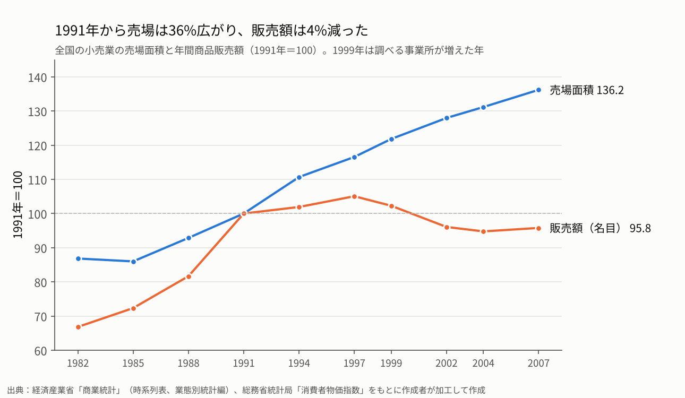
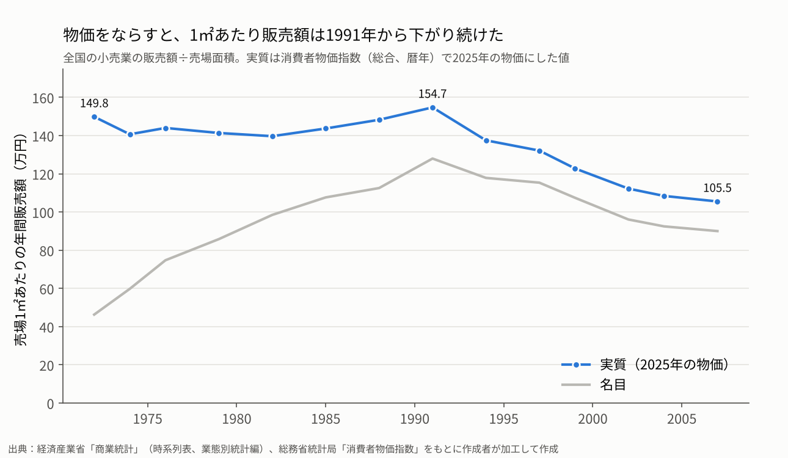
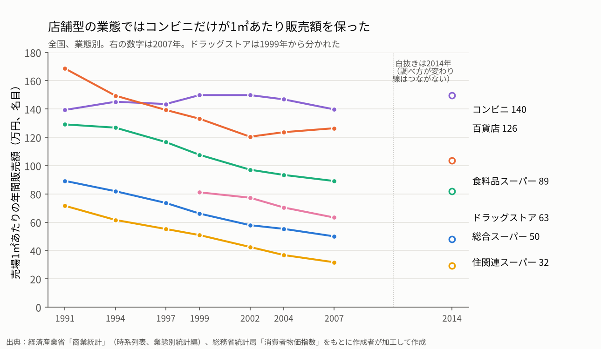
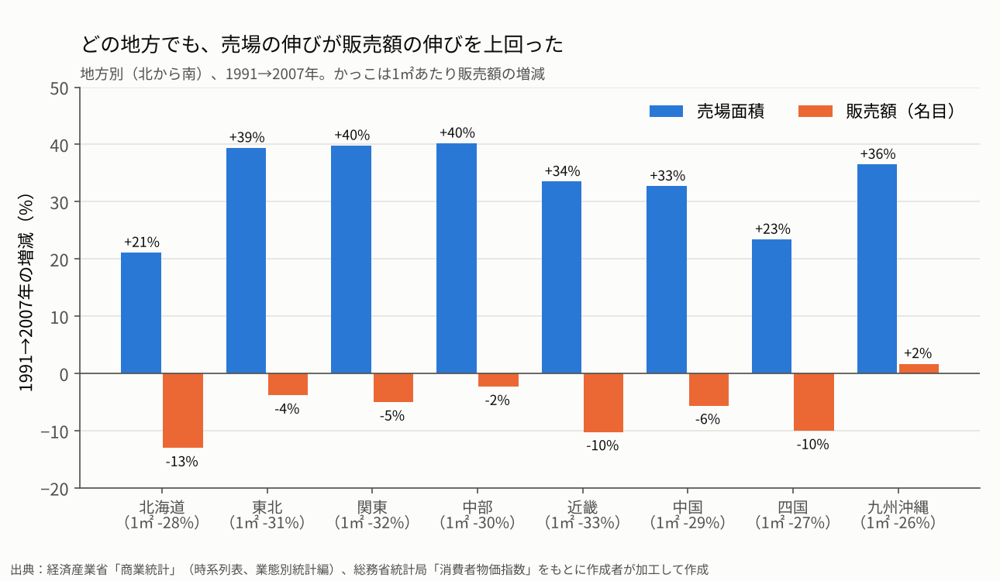

# F526 店の売場面積は増えたのに、売上は増えていないのか？ 1991→2007年に売場は36%増、販売額は4%減で、1㎡あたりは30%下がった。店舗型の業態ではコンビニだけが横ばい

## 結論（先に）
- 全国の小売業の売場面積は、1991年の1.10億㎡から2007年の1.50億㎡に36.2%増えました。同じ期間に年間商品販売額は140.6兆円から134.7兆円へ4.2%減りました（山は1997年の147.7兆円）。売場1㎡あたりの販売額は128.0万円から90.0万円へ29.7%下がりました。
- 物価の変化（消費者物価指数の総合、暦年）をならしても、1㎡あたりの販売額は31.8%下がりました。2025年の物価にした値は、1972〜1988年は139.7〜149.8万円の幅で横ばいで、1991年の154.7万円から下がり続け、2007年は105.5万円です。
- 業態別では、店舗型の業態（百貨店・スーパー・コンビニ・ドラッグストア）のうち、コンビニだけが1991年139.3万円、2007年139.7万円と横ばいでした。総合スーパーは89.2万円から50.0万円（−44.0%）、住関連スーパー（ホームセンターなど）は71.6万円から31.7万円（−55.7%）、食料品スーパーは−31.0%、百貨店は−25.0%でした。
- 地方別（北から南の8地方）では、どの地方も売場の伸び（+21〜+40%）が販売額の伸び（−13〜+2%）を上回り、1㎡あたりは25〜33%下がりました。
- 結果を見てから足した問いでは、全体の1㎡あたりの低下（1991→2007年）のうち約7割は各業態の中での低下、約3割は1㎡あたりの低い業態（ホームセンターなど）に売場が移った効果でした。

## 問い
「売場は広がったのに売上は伸びず、売場1㎡あたりの販売額（販売効率）が下がった」とよく言われます。商店街や流通の担当の人、小売の会社や地域の統計で売場の数字を読む人のために、その大きさと、物価をならしても言えるか、業態や地方で違うかを確かめます。出店の良し悪しは扱いません。

既存の F313（町の小さな店が減ったのは、大きな店に置き換わったからか）は、同じ商業統計で個人の店と会社の店の入れ替わりを見ています。この記事は、業態別・地方別の1㎡あたり販売額に絞ります。

## データ（出典）
- 経済産業省「商業統計」（e-Stat）その他のデータ（時系列）表2「都道府県別（昭和47年～平成16年）」：全国の小売業の年間商品販売額・売場面積（1972〜2004年の13回）と、1999年の「調整済前回比」。
- 同 表3「業態別、都道府県別（平成3年、6年、9年）」・表4「業態別、都道府県別（平成11年、14年、16年）」、平成19年（2007年）業態別統計編の第4表（都道府県別・業態別）。
- 参考：同 平成26年（2014年）業態別統計編 第1表。調査の方法と業態の区分が変わったので、2007年と線をつながず、図3に白抜きの点で示しました。
- 総務省統計局「消費者物価指数」2025年基準 年平均（暦年）の中分類指数（総合、持家の帰属家賃を除く総合。e-Stat の statInfId 000040482829）。年度平均の表（000040482957・959）は使っていません。
- 用語：1㎡あたり販売額＝年間商品販売額÷売場面積（単純な比、万円/㎡）。小売業の合計の比には、売場を持たない販売（通信販売など）の販売額も含まれます。2007年の表の「売場面積1㎡当たり年間商品販売額」は売場面積のある事業所だけで計算されていて、合計で66万円（この記事の単純な比は90万円）です。総合スーパー・食料品スーパー・コンビニなどの店舗型の業態は、表の値と単純な比が一致しました。
- 読み取りの確かめ（data/build_checks.json）：列・業態・年は見出しの文字で選び、都道府県は名前で付けました。都道府県の和は全国計と、1974年以降のすべての回で±4百万円以内（四捨五入の範囲）で一致しました（1972年は全国計に沖縄県が入っていないため差があります）。重なりのない業態の和は合計と一致し、表2と業態別の表の全国の値も一致しました。1991年の百貨店の販売額 11,349,861百万円、2007年の総合スーパーの販売額 7,446,736百万円は元の表と目で照らしました。

## 事前の計画
[PLAN.md](PLAN.md)（2026-11-19 06:00、業態別・地方別の集計の前に作成）。下見で全国の値と一部の業態の値を見ていたので、H3 は参考の仮説です。

| 仮説 | 外れの基準 | 結果 | 判定 |
|---|---|---|---|
| H1 1991→2007年に売場は20%以上増え、1㎡あたり（名目）は15%以上低下 | どちらかが成り立たない | 売場 +36.2%、1㎡あたり −29.7% | 支持 |
| H2 物価をならしても1㎡あたりは10%以上低下 | 低下が10%未満 | −31.8% | 支持 |
| H3 1㎡あたりの低下率は総合スーパーが百貨店より大きい（参考） | 百貨店の方が大きいか同じ | −44.0%対−25.0% | 支持 |
| H4 8地方すべてで売場の伸びが販売額の伸びを上回る | どこかで販売額の伸びが大きい | 8地方すべてで上回る | 支持 |

## やったこと
1. 時系列表・業態別の表・2007年の表から、全国・業態別・都道府県別の販売額と売場面積を抜き出しました（02_build.py）。
2. 1㎡あたり販売額、1991年＝100の指数、物価をならした値を出し、業態別・地方別に比べました（03_analysis.py）。
3. 結果を見てから、全体の低下を「業態の中の低下」と「売場の構成の変化」に分けました（03b_requestion.py）。

## 分かったこと

### 1. 売場は36%広がり、販売額は4%減った（図1）

1991年を100とすると、2007年の売場面積は136.2、販売額は95.8でした。販売額は1997年まで増え、その後は減っています。売場面積は1985年を除いて、どの回も前の回より広がりました。1999年は調べる事業所を広げた年で、1997→1999年の売場の増加（+4.5%）のうち、調整済前回比では+0.2%分だけが実際の増加とされています。

### 2. 物価をならすと、1991年から下がり続けた（図2）

2025年の物価にした1㎡あたり販売額は、1972年149.8万円、1982年139.7万円、1991年154.7万円、2007年105.5万円でした。1970〜80年代は売場の広がりに販売額がついていっていましたが、1991年からは売場だけが広がり、1㎡あたりが下がり続けています。

### 3. 店舗型の業態では、コンビニだけが1㎡あたりを保った（図3）

1991→2007年に、コンビニは売場が+123.6%、販売額が+124.2%で、1㎡あたりは139.3万円から139.7万円と変わりませんでした。総合スーパーは売場+56.5%・販売額−12.3%で、1㎡あたり−44.0%でした。住関連スーパーは売場が5.7倍（+471.2%）になり、1㎡あたりは−55.7%でした。百貨店は売場（−9.5%）より販売額（−32.1%）が大きく減りました。ドラッグストア（1999年から分かれた）は1999→2007年に売場+158.1%、1㎡あたり−21.9%でした。2014年（参考）でも、コンビニ149.5万円、百貨店103.4万円、総合スーパー47.9万円、食料品スーパー81.9万円と、並びは同じでした。

### 4. どの地方でも、売場の伸びが販売額を上回った（図4）

1991→2007年の売場面積の伸びは、北海道+21.1%から中部+40.2%まででした。販売額は九州沖縄（+1.7%）を除いて減り、1㎡あたりは8地方すべてで25〜33%下がりました。地方の差より、全国に共通する動きの方が大きい結果です。

## 問い直し（結果を見てから足した）

### 全体の低下は、業態の中の低下か、売場の構成の変化か
業態ごとの1㎡あたり販売額と、売場面積に占める割合に分けると、全体の1㎡あたり（業態の和で129.5万円→90.0万円、−39.5万円）の変化は、業態の中の低下が−28.7万円（72.7%）、構成の変化が−10.8万円（27.3%）でした。構成の変化とは、1㎡あたりの低い住関連スーパー（売場の割合 2.5%→10.6%）や衣料品スーパー、ドラッグストアに売場が移り、1㎡あたりの高い専門店・中心店（合わせて64.8%→46.4%）の割合が下がったことです。1997→2007年で見ても、構成の変化は21.8%でした。全体の低下の多くは、各業態の中で売場が販売額より速く広がったことによります（results/requestion_decomposition.csv）。

## 頑健性

| 確かめ方 | 売場面積 | 販売額 | 1㎡あたり |
|---|---|---|---|
| 本線：全国、1991→2007年 | +36.2% | −4.2% | −29.7% |
| 1991→2004年（表2だけ） | +31.1% | −5.2% | −27.7% |
| 1991→2004年、1997→1999年を調整済前回比でつなぐ | +25.7% | −10.4% | −28.8% |
| 1997→2007年（販売額の山から） | +16.8% | −8.8% | −22.0% |
| 1991年を再集計値（平成6年調査と対応）に | +36.2% | −5.3% | −30.5% |
| 店舗型の業態の合計（百貨店・スーパー・コンビニ・ドラッグストア） | +107.9% | +24.0% | −40.3% |
| 実質（物価指数：総合） | — | — | −31.8% |
| 実質（物価指数：持家の帰属家賃を除く総合） | — | — | −30.8% |

期間・つなぎ方・物価指数・業態の範囲を替えても、1㎡あたりは22〜40%下がりました。売場を持たない販売の影響が小さい店舗型の業態だけで見ると、低下はむしろ大きくなります（−40.3%）。地方別に店舗型の業態だけで見ても、8地方すべてで34〜45%下がりました。

## 言えないこと
- 1㎡あたりの販売額が下がった理由（人口・所得、価格の競争、営業時間、店の大型化、郊外への出店など）は、この統計だけでは分かりません。
- 2007年より後は、調査の方法と業態の区分が変わったため、同じ線では比べられません（2014年は参考の点だけ）。2012年以降の経済センサスとの接続も扱っていません。
- 業態の定義は年によって少しずつ変わっています（1999年にドラッグストアが分かれた など）。専門店・中心店の販売額には、売場をほとんど持たない販売も含まれます。
- 売場面積は店の売場だけで、倉庫・駐車場は含みません。もうけ（利益）や、売場あたりの人手は扱っていません。
- 1999年の事業所の捕そくの影響は、全国の値だけ調整済前回比でつなぎました。業態別・地方別は調整していません。

## 仕事で使うなら
- 「売場あたりの販売額が下がった」と言うときは、単純な比（販売額÷売場面積）か、売場のある事業所だけの値（表の販売効率）かを明記すると、話がかみ合いやすくなります。2007年の合計は、前者で90万円、後者で66万円です。
- 年ごとの値は results/national_by_year.csv、業態別は gyotai_by_year.csv、地方別は region_by_year.csv にあります。

## 計画からの変更
- 問い直し（業態の中と構成の分解）は結果を見てから足しました。1991年にないドラッグストアは、1991年の値を2007年と同じとみなしました。
- 頑健性に、計画になかった「店舗型の業態の合計」を足しました（合計の比に売場のない販売が含まれることが、2007年の表との照合で分かったため）。

## 再現のしかた
```
sh src/run_all.sh        # オフライン。所要約3秒
python3 src/01_fetch.py  # 元データを取り直すときだけ（ネットを使う）
```

| ファイル | 中身 |
|---|---|
| src/01_fetch.py | e-Stat の Excel 5本と物価指数の CSV を取る（run_all.sh では呼ばない） |
| src/02_build.py | 全国・業態別・都道府県別の値と物価指数を抜き出す → data/national_ts.csv・gyotai_pref.csv・gyotai_2014_reference.csv・cpi_annual.csv・build_checks.json |
| src/03_analysis.py | 指数・1㎡あたり・実質・業態別・地方別・仮説・頑健性 → results/main.json ほか |
| src/03b_requestion.py | 問い直し → results/requestion.json・requestion_decomposition.csv |
| src/04_figures.py | 図4枚 |

repro_check：/tmp/rep_F526 に写して流し直し、16ファイル（results 7、figures 4、data 5）が cmp で一致、所要3秒。乱数なし。

## レビューで直したこと

| # | 指摘 | 直し方 |
|---|---|---|
| 1 | 物価指数のファイル（statInfId 000040482829）は暦年の表で正しいが、2025年基準（2025年＝100）だった。本文・図2・SOURCES は「2020年基準」「2020年の物価」と書いていた | 「2025年基準」「2025年の物価」に直した。同梱のファイル名（cpi_2025base_annual_class.csv）と列名（real_eff_2025yen）もそろえた。値と増減率は変わらない（基準年の表記だけの誤り）。PLAN.md は作成時のまま残した |
| 2 | 題名・結論の「コンビニだけが横ばい」は、中心店（1991年108.0万円→2007年106.9万円、−1.1%）もほぼ横ばいなので、すべての業態については成り立たない | 「店舗型の業態ではコンビニだけが横ばい」に直した（題名・status・note の1行目と見出し・図3の題）。中心店・専門店は売場を持たない販売を含むので、店舗型（百貨店・スーパー・コンビニ・ドラッグストア）に絞る言い方がデータに合う |

題名の「1㎡あたりは30%下がった」は、売場を持たない販売も入る単純な比だが、店舗型だけでは−40.3%、期間やつなぎ方を替えても−22〜−40%で、向きは変わらず、30%はむしろ控えめなので残した。1991年の百貨店・2007年の総合スーパーの販売額と、北海道の売場面積（1991・2007年）を元の表の見出しの文字で照らして一致を確かめた。再実行で16ファイルが一致した。

## 出典
- 経済産業省「商業統計」（e-Stat）：https://www.e-stat.go.jp/stat-search/files?toukei=00550020 （各表の URL は data/raw/SOURCES.md）
- 総務省統計局「消費者物価指数」（e-Stat）：https://www.e-stat.go.jp/stat-search/files?toukei=00200573

（いずれも 経済産業省「商業統計」、総務省統計局「消費者物価指数」をもとに作成者が加工して作成）
