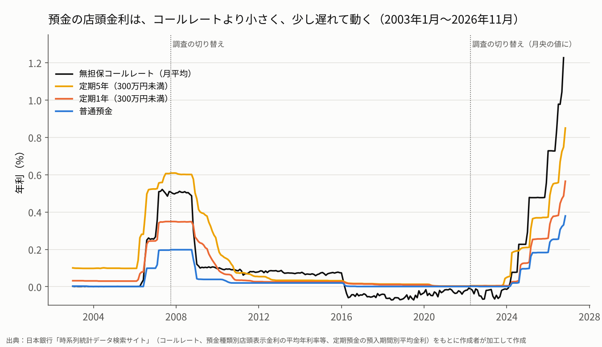
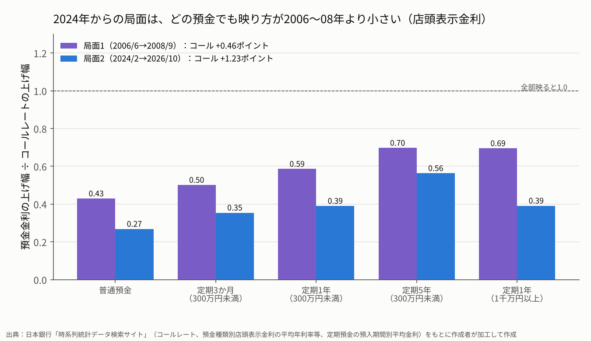
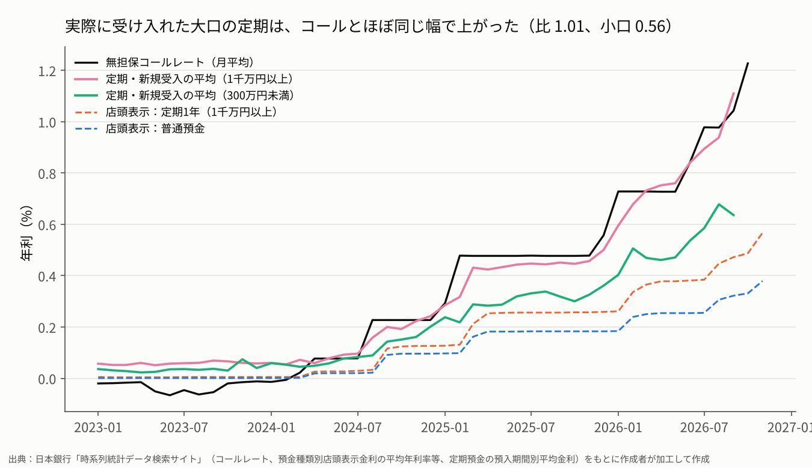
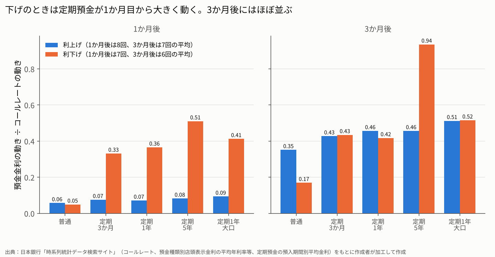

# F527 政策金利が上がると、預金の金利は何か月で、どれだけ動くのか？ 0〜2か月で動き始め、2024年からの上げ幅1.23ポイントに普通預金は0.33ポイント（比0.27）

## 結論（先に）

- 預金の店頭金利は、コールレート（政策金利の代わりに使う短期の市場金利）が上がった月から **0〜2か月** で動き始めました。利上げ8回×5種類の40組すべてで、2か月以内に0.005ポイント以上上がっています。
- 2024年2月から2026年10月までに、コールレートの月平均は **1.23ポイント** 上がりました。同じ期間に普通預金の店頭金利は **0.33ポイント**（比 **0.27**）、定期1年（300万円未満）は0.48ポイント（比0.39）、定期5年は0.69ポイント（比0.56）上がりました。期間の長い預金ほど大きく動きます。
- 2006〜08年の局面では、普通預金の比は **0.43** でした。店頭表示で見ると、2024年からはどの預金でも比が小さく、直前の利上げが映りきった月（2025年11月・2026年5月）で打ち切っても 0.38・0.35 です。
- ただし、実際に受け入れた定期預金の平均金利（新規受入分）では、1千万円以上の大口が **1.01**、300万円未満が0.56 で、2006〜08年（0.83、0.57）より小さくはありません。「映り方が小さくなった」と言えるのは店頭表示の金利についてです。
- 問い直し：利下げのときは、定期預金が1か月目から大きく動きます（下げ幅に対する比 0.33〜0.51、上げのときは0.07〜0.09）。3か月後にはほぼ並びます。

どこに預けるか、金利がこの先どうなるかは扱いません。

## 問い

「利上げ」のニュースのあと、通帳の金利はいつ、どれだけ上がるのか。銀行や企業の財務の担当にとっても、短期金利の動きのうちどれだけが預金の金利に映ってきたか（追随の比）の過去の値は、話の出発点になります。

日本銀行の「金融システムレポート」（2025年4月号）は、預金金利は緩やかに上がり、追随の度合いは金融機関ごとに異なると書いています。ここでは公表されている平均の金利で、次の3つを確かめます。

1. 預金の金利は、コールレートが上がってから何か月で動き始めるのか
2. 上げ幅のうち、どれだけが預金の金利に映るのか。預金の種類でどう違うのか
3. 2006〜08年の利上げ局面と、2024年からの局面で違うのか

## データ（出典）

すべて日本銀行「時系列統計データ検索サイト」の API で取得しました（2026年11月19日）。

| 名前 | 系列 | 内容 | 期間 |
|---|---|---|---|
| call_avg / call_end | FM02：STRACLUCON / STRECLUCON | 無担保コールレート翌日物の月平均／月末 | 1985/7〜2026/10 |
| ordinary | IR02：DLDR120 → DLDR120N → DLDR121N | 普通預金の店頭表示金利の平均 | 1994/10〜2026/11 |
| td3m / td1y / td5y | IR02：DLDR43TL33M・31Y・35Y → …N → 63MN・61YN・65YN | 定期預金（預入金額300万円未満）3か月・1年・5年 | 1993/6〜2026/11 |
| td1y_large | IR02：DLDR43TL11Y → 11YN → 41YN | 定期預金（1千万円以上）1年 | 1991/10〜2026/11 |
| new_td_* | IR03：DLDRK_DLDR442DB ほか | 定期預金の新規受入分の平均金利（実際に受け入れた金利） | 1993/10〜2026/9 |

- 店頭表示金利は3つの期間でつないでいます。2007年9月までと2007年10月〜2022年3月は週次で、月内の平均を月の値にしました。2022年4月からは月次の「月央値」です。日本銀行の2022年2月2日のお知らせによると、このとき調査先にインターネット専業銀行などが加わりました。
- つなぎ目での普通預金の差は、2007年9月→10月が +0.002ポイント、2022年3月→4月が +0.001ポイントでした。
- 系列の名前は、API が返す系列名と照らしてから付けました。

## 事前の計画

計画は [PLAN.md](PLAN.md) に、集計の前（2026-11-19 05:45 UTC）に書きました。仮説の判定は次のとおりです。

| 仮説 | 内容 | 判定 |
|---|---|---|
| H1 | 普通預金は、局面2の累計でコールの3分の1以下しか動かない（比 ≦ 0.33） | **支持**（0.27） |
| H2 | 定期は普通より大きく、期間が長いほど大きい（5年＞1年＞3か月＞普通） | **支持**（2つの局面とも） |
| H3 | 2024年からの局面は、2006〜08年より普通預金の比が大きい | **外れ**（0.27 対 0.43） |
| H4 | 動き始めるまでの時差は、ふつう1〜2か月以内 | **支持**（40組すべてが2か月以内） |

## やったこと

1. **月次にそろえる**：週次の店頭表示金利を月内の平均にし、3つの期間をつなぎました。
2. **利上げの出来事**：コールレートの月平均が前の月から0.07ポイント以上上がった月を出来事とし、続く月は1つにまとめました。2000年8月、2006年7月、2007年2月、2024年8月、2025年2月、2025年12月、2026年6月、2026年10月の8回です。2024年3月（マイナス金利の解除）は月平均の上げ幅が0.03ポイントで、この基準には入りません。
3. **時差**：出来事の前の月から0.005ポイント以上上がった最初の月までの月数です。
4. **追随の比**：預金金利の上げ幅をコールレートの上げ幅で割ります。出来事ごと（1・3・6か月後、次の出来事の前まで）と、局面全体の累計（局面1：2006年6月→2008年9月、局面2：2024年2月→2026年10月）の2通りです。
5. **分布ラグの回帰**（参考）：預金金利の月次の変化を、0〜6か月前のコールレートの変化で説明し、係数の合計を出しました。

## 分かったこと

### 図1：店頭金利は、コールレートより小さく、少し遅れて動く



- 2026年11月の店頭表示金利は、普通預金0.379%、定期1年（300万円未満）0.565%、定期5年0.850%です。2026年10月のコールレート月平均は1.227%でした。
- 2000〜07年の3回は出来事の月のうちに動き、2024年以降は1〜2か月後が多く見えます。2026年10月の出来事の時差0は、コールの月末値が9月にすでに上がっている（9月の月平均の上げ幅は0.07ポイント未満で、出来事は10月に数えた）ためで、実際の利上げからは約1か月です。ただし2022年4月からは「月央の値」で、月の後半の利上げは入りません。測り方の違いでも生じる差なので、遅くなったとは言えません。

### 図2：期間の長い預金ほど大きく映る。2024年からは店頭表示で小さめ



- 局面2の比は、普通預金0.27、定期3か月0.35、定期1年0.39、定期5年0.56でした。局面1は同じ順に0.43、0.50、0.59、0.70です。
- 局面2はコールの上げ幅が1.23ポイントと大きく、局面1（0.46ポイント）とは上げ幅も期間も違います。比が小さいのは、上げ幅が大きいと比が小さくなりやすいからかもしれません（推測。この記事では確かめていません）。

### 図3：実際に受け入れた大口の定期は、コールとほぼ同じ幅で上がった



- 新規受入分の定期預金の平均金利（2024年2月→2026年9月）は、1千万円以上が0.054%→1.110%（比1.01）、300万円未満が0.053%→0.636%（比0.56）でした。
- 店頭表示の定期1年（1千万円以上）の比0.39と比べると、大口の実際の金利はずっと大きく動いています。大口の金利は店頭の表示どおりでなく、相対で決まる部分が大きいためと考えられます（推測）。
- 新規受入分は全期間の平均で、受け入れた預金の期間の構成の変化も含みます。

## 問い直し（結果を見てから足した）

結果を見て「では下げのときは速いのか」を確かめました（`src/03b_requestion.py`）。1995〜2009年の利下げ7回（コールの月平均が0.07ポイント以上下がった月）を同じ方法で数えました。預金金利の自由化の直後の1994年は除きました。



- 1か月後の比は、利下げのとき定期3か月0.33、定期1年0.36、定期5年0.51、定期1年（大口）0.41でした。利上げのとき（0.07〜0.09）よりずっと大きく動いています。
- ただし、利上げ8回のうち5回は2022年4月からの「月央の値」で測っていて、1か月後の動きが小さく出やすい面があります。利下げと同じ週次の月内平均で測った2000〜07年の利上げ3回だけで見ると、1か月後の比は定期で0.14〜0.20でした。利下げの方が速いことは変わりませんが、差は半分ほどになります（レビューで追加）。
- 3か月後には、定期3か月・1年・大口で利上げと利下げがほぼ並びます（0.42〜0.52）。定期5年の利下げの0.94は、同じ時期の長い金利の低下も含んでいると考えられます（推測）。
- 普通預金は、利下げのときの3か月後の比が0.17と小さく出ました。1998〜2001年は普通預金がすでに0.10%前後で、下げる余地が小さかったことが効いていると考えられます（推測）。

## 頑健性

| 確かめ | 局面1 普通 | 局面1 定期1年 | 局面2 普通 | 局面2 定期1年 | 結論は変わったか |
|---|---|---|---|---|---|
| 基本（コール月平均、累計の比） | 0.43 | 0.59 | 0.27 | 0.39 | — |
| R1 コールを月末の値に | 0.38 | 0.52 | 0.27 | 0.39 | 変わらない（局面1が少し小さくなるが、局面2より大きい） |
| R2 「動いた」の基準を0.01ポイントに | 時差の中央値1か月、3か月以上は0% | | | | 変わらない |
| R3 新規受入分の定期の平均金利（300万円未満／1千万円以上） | 0.57／0.83 | | 0.56／1.01 | | **変わる**：局面2の方が小さいとは言えない |
| R4 局面2を2025年12月で打ち切る | | | 0.32 | 0.45 | 変わらない（局面1より小さい）。ただし12月は利上げの月で、その分がまだ映っていない |
| R5 次の利上げの前の月で打ち切る（2025年11月／2026年5月、レビューで追加） | | | 0.38／0.35 | 0.52／0.51 | 変わらない（局面1の0.43・0.59より小さい）。差は基本より小さい |
| 分布ラグの回帰（係数の合計） | 0.41 | 0.55 | 0.32 | 0.49 | 普通は同じ向き。定期1年は差が小さい |

H3 の「外れ」は、店頭表示の金利についての結論です。実際に受け入れた定期預金の金利では成り立ちません。

## 言えないこと

- 店頭表示の金利は表示の平均で、キャンペーンや個別に決まる金利は入りません。
- 1つ1つの銀行の違いや、どの銀行がよいかは扱っていません。
- コールレートは政策金利そのものではありません。出来事の月は月の単位で、決定の日とずれます。
- 利上げが預金金利を上げたという因果は、同じ時期の長期金利の上昇などと分けられていません。
- 局面2は続いていて、最近の利上げはまだ全部は映っていない可能性があります。比はこの先変わりえます。
- 金利がこの先どうなるか、どこにどう預けるべきかは、この分析からは言えません。

## 仕事で使うなら

- 「利上げ幅のうち何割が預金に映るか」を話すときは、店頭表示か実際の受入金利か、普通か定期か、どの局面かで0.27〜1.01まで幅があることを最初にそろえる。
- 時差を比べるときは、統計の調査時点（月内平均か月央の値か）が違うと見かけの遅れが出ることに気をつける。

## 計画からの変更

- 問い直しの利下げは、預金金利の自由化（1994年10月に完了）の直後の動きを除くため、1995年からにしました（計画では期間を決めていませんでした）。
- 新規受入分の比（R3）は、データが2026年9月までのため、局面2の終わりを2026年9月にしました。
- 図3（店頭表示と新規受入の比べ）は、R3 の結果を見てから足しました。

## 再現のしかた

```sh
pip install -r requirements.txt
sh src/run_all.sh        # オフライン。01_fetch.py は呼ばない
# 元データを取り直すときだけ： python3 src/01_fetch.py
```

| ファイル | 中身 |
|---|---|
| src/01_fetch.py | 日本銀行の API から取得し data/raw に保存（ネットが必要） |
| src/02_build.py | data/raw → data/monthly.csv（月次の表） |
| src/03_analysis.py | 出来事・局面・分布ラグ・頑健性 → results/main.json ほか |
| src/03b_requestion.py | 問い直し（利下げ） → results/events_cuts.csv ほか |
| src/04_figures.py | 図4枚 |

所要時間は約6秒（CPU 1つ）。再現の確かめ：results/repro_check.txt を参照。

## レビューで直したこと

| # | 指摘 | 直し方 |
|---|---|---|
| 1 | R4 の打ち切り月（2025年12月）は利上げの月で、「まだ映っていない分を除く」確かめになっていない | 次の利上げの前の月（2025年11月・2026年5月）で打ち切る R5 を `03_analysis.py` に足した（普通 0.38・0.35）。H3 の判定は変わらない |
| 2 | 問い直しの1か月後の比べは、利上げの多くが月央の値で測られ、利下げ（週次の月内平均）と測り方がそろっていない | 2022年3月までの利上げ3回だけの比を `03b_requestion.py` に足し（main.json の requestion.hike_weekly_only）、本文に書いた |
| 3 | 2026年10月の出来事の時差0は、利上げが9月末だったことによる見かけ | 図1の節に1文足した |

## 出典

- 日本銀行「時系列統計データ検索サイト」 https://www.stat-search.boj.or.jp/ （コールレート、預金種類別店頭表示金利の平均年利率等、定期預金の預入期間別平均金利）
- 日本銀行「『預金種類別店頭表示金利の平均年利率等』の見直しについて」（2022年2月2日） https://www.boj.or.jp/statistics/outline/notice_2022/not220202d.pdf
- 日本銀行「金融システムレポート（2025年4月号）」 https://www.boj.or.jp/research/brp/fsr/fsr250423.htm

このページは、日本銀行時系列統計データ検索サイトの API 機能を使用しています。内容は日本銀行によって保証されたものではありません。

（いずれも日本銀行の公表データをもとに作成者が加工して作成）
