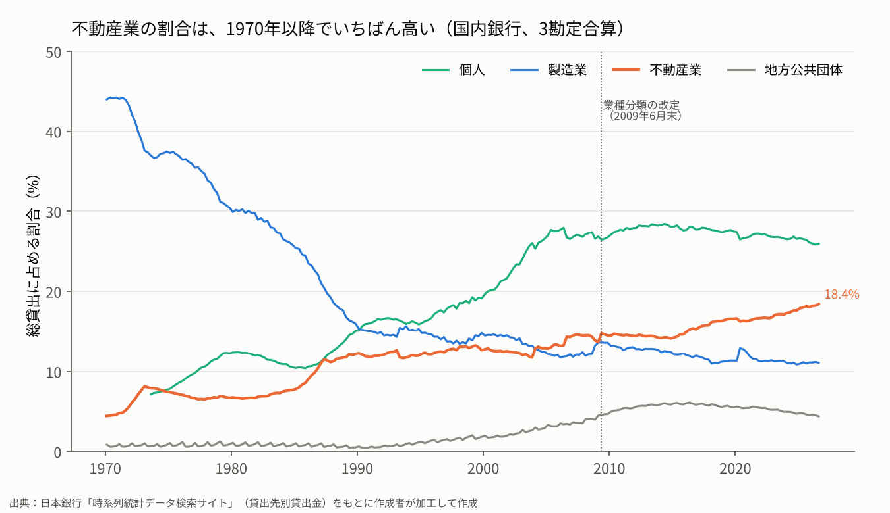
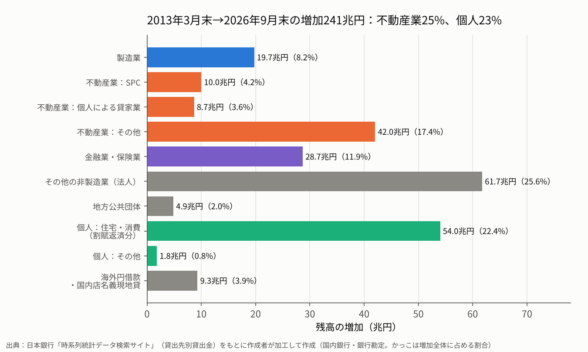
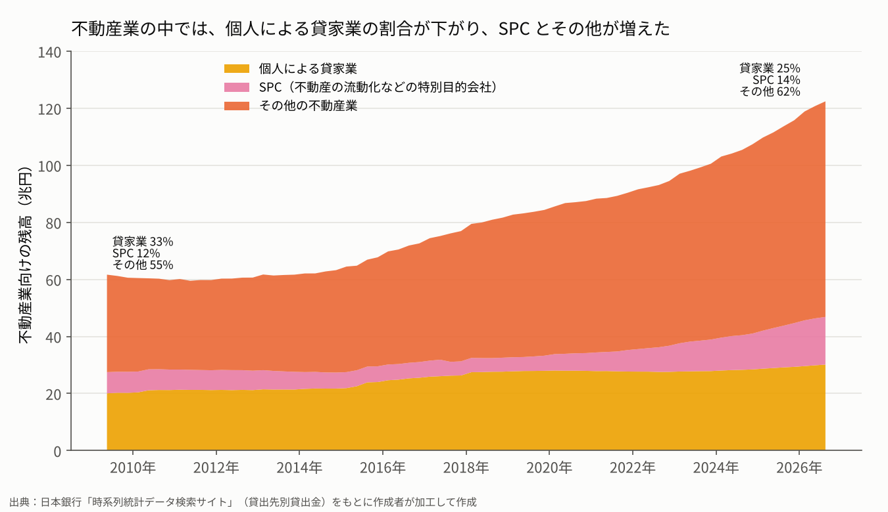
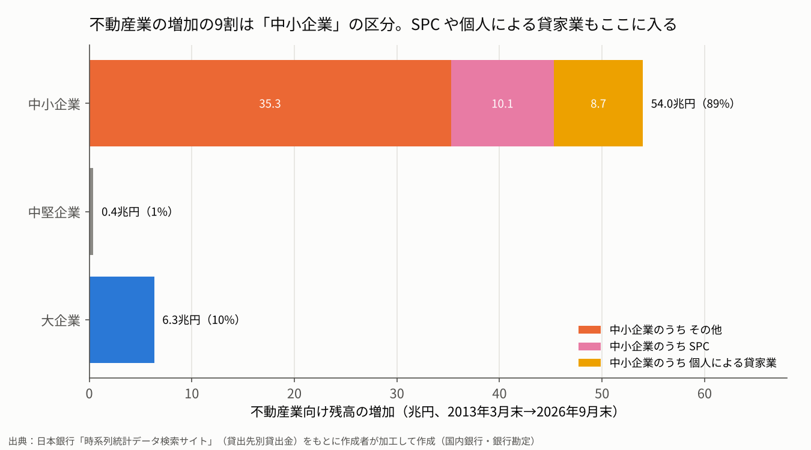

# F528 銀行の貸出は、どの借り手に向かっているのか？ 2013年からの増加241兆円のうち不動産業25%・個人23%、不動産業向けは総貸出の18%と1970年以降で最も高い

## 結論（先に）

- 国内銀行（銀行勘定）の貸出残高は、2013年3月末の427兆円から2026年9月末の668兆円へ **241兆円** 増えました。増加のうち **不動産業が25.2%**、**個人が23.2%**（ほぼ住宅・消費の割賦返済分＝住宅ローンなど）、その他の非製造業（法人）が25.6%、金融業・保険業が11.9%、製造業が8.2%でした。
- 不動産業向けが総貸出に占める割合は **18.3%**（銀行勘定）で、1992年以降で最も高くなっています。信託・海外店を含む3勘定合算でも18.4%で、1970年以降で最も高い値です。2009年の業種分類の改定による段差（1.1ポイント）を除いても17.3%で、改定前の最高（14.6%）を上回ります。1ポイント以上の段差3つ（2004年3月末・2006年9月末・2009年6月末）をすべて除いても15.1%で、やはり最も高い値です。
- 不動産業の中では、個人による貸家業（いわゆるアパートローンなど）の割合が2015年9月末の35.7%から **24.6%** に下がり、SPC（不動産の流動化などのための特別目的会社）は6.3%（2019年12月末）から **13.7%** に上がりました。
- 製造業の割合は、2009年6月末の13.8%から11.2%へ2.6ポイント下がりました。
- 問い直し：2013年3月末からの不動産業向けの増加61兆円のうち **89%** は、統計の区分で「中小企業」向けでした。SPC と個人による貸家業もこの区分に入ります。

## 問い

「銀行の貸出が増えている」と聞いても、誰が借りているのかはわかりません。日本銀行の「金融システムレポート」（2026年4月号）は、不動産業向け貸出が全産業より速く増え、貸出全体に占める割合が趨勢的に上がっていること、その相手が個人による貸家業から、それ以外の不動産業や不動産ファンドへ徐々に移っていることを指摘しています。

この記事では、日本銀行が公表している「貸出先別貸出金」を使い、増えた分がどの借り手に向かったのか、不動産業の中で何が変わったのかを数字で確かめます。金融機関の企画やリスク管理の担当が、公式の統計で構成の変化を見るときの手がかりにもなります。貸すべき・借りるべき相手や、不動産の価格の見通しは扱いません。

## データ（出典）

日本銀行「時系列統計データ検索サイト」の API で取得しました（2026年11月19日、最新は2026年9月末）。

| 区分 | 内容 |
|---|---|
| 国内銀行・銀行勘定 | 業種別の残高（四半期末、億円）。全規模・中小企業・中堅企業・大企業。多くの業種は2009年6月末から |
| 国内銀行・3勘定合算 | 銀行・信託・海外店の合計。総貸出・不動産業・製造業・個人などは1970年から（長い推移と頑健性に使用） |
| 信用金庫 | 主な区分（頑健性に使用） |

- 区分は重ならないように作りました：製造業／不動産業（SPC、個人による貸家業、その他）／金融業・保険業／その他の非製造業（法人）／地方公共団体／個人（住宅・消費の割賦返済分、その他）／海外円借款・国内店名義現地貸。足し算と総貸出の差は、2009年6月末以降で最大15億円（総貸出の0.001%未満）でした。
- 系列の名前は、API が返す系列名（「不動産業／残高／銀行勘定／国内銀行」など）を「／」で区切って読み、勘定・規模・業種を付けました。

## 事前の計画

計画は [PLAN.md](PLAN.md) に、割合・寄与を計算する前（2026-11-19 06:20 UTC）に書きました。

| 仮説 | 内容 | 判定 |
|---|---|---|
| H1 | 2013年3月末からの増加のうち、不動産業と個人で半分以上 | **外れ**（48.4%。わずかに届かない） |
| H2 | 不動産業の割合は、2026年9月末が最も高い | **支持**（銀行勘定1992年〜、3勘定1970年〜とも最高） |
| H3 | 不動産業の中で個人による貸家業の割合が2009年6月末より下がり、SPC とその他が上がった | **支持**（32.5%→24.6%、SPC 12.1%→13.7%、その他 55.4%→61.7%） |
| H4 | 製造業の割合は2009年6月末より下がった | **支持**（−2.6ポイント） |

## やったこと

1. 区分ごとの残高を総貸出で割り、割合を出しました。
2. 期間の増加額を区分ごとに分け、総貸出の増加に占める割合（寄与）を出しました。起点は2013年3月末（大規模な金融緩和の直前）を基本にし、2009年6月末と2019年12月末でも出しました。
3. 不動産業を SPC・個人による貸家業・その他に分けました。
4. 3勘定合算で、1970年からの割合の推移を描きました。
5. 企業の規模（中小・中堅・大企業）で、不動産業の増加を分けました（問い直し）。

## 分かったこと

### 図1：不動産業の割合は、1970年以降でいちばん高い



- 3勘定合算の不動産業の割合は、1990年12月末11.9%、改定前の最高は2007年6月末の14.6%で、2026年9月末は18.4%です。
- 製造業は1970年3月末の44.0%から11.1%（3勘定合算）へ下がり、個人は1990年代に増えて26〜28%の横ばいが続いています。
- 2009年6月末に業種分類が改定され、不動産業の割合は前の期から1.1ポイント上がっています。この段差を除いても17.3%で、結論は変わりません。
- ほかに2004年3月末（+1.1ポイント）と2006年9月末（+1.1ポイント）にも、1四半期で1ポイントを超える段差があります（どちらも個人の割合が同時に下がっています）。理由はこの統計からは分かりませんが、これらも分類の変更とみなして3つとも除くと、2026年9月末は15.1%で、それまでの最高（2026年6月末の14.9%）をなお上回ります（レビューで追加、R6）。

### 図2：2013年からの増加は、不動産業・個人・その他の非製造業がそれぞれ4分の1



- 241兆円の増加のうち、不動産業は60.7兆円（25.2%）、個人の住宅・消費の割賦返済分は54.0兆円（22.4%）でした。
- その他の非製造業（法人）は61.7兆円（25.6%）、金融業・保険業は28.7兆円（11.9%）です。不動産業と個人だけで「増加の半分」とまでは言えません。
- 地方公共団体の割合は5.8%から4.5%に下がりました。

### 図3：不動産業の中では、個人による貸家業の割合が下がった



- 不動産業向けの残高は、2013年3月末の61.7兆円から122.4兆円に倍増しました。
- 個人による貸家業は、残高は増え続けていますが、不動産業の中の割合は2015年9月末の35.7%をピークに24.6%へ下がりました。
- SPC は2019年12月末の6.3%から13.7%へ上がり、その他の不動産業は61.7%です。金融システムレポートの指摘と同じ向きです。

## 問い直し（結果を見てから足した）

図3を見て、「増えた不動産業向けは、大きな会社と小さな会社のどちらか」を確かめました（`src/03b_requestion.py`）。



- 2013年3月末→2026年9月末の不動産業向けの増加60.7兆円のうち、中小企業は54.0兆円（89%）、大企業は6.3兆円（10%）、中堅企業は0.4兆円（1%）でした。
- 中小企業の増加のうち、SPC が10.1兆円、個人による貸家業が8.7兆円、その他が35.3兆円です。SPC と個人による貸家業は、この統計では全額が中小企業の区分に入っています。
- そのため、「中小企業向け」の増加は、街の小さな不動産会社への貸出だけを意味しません。資本金の小さい事業のための会社（たとえばファンドの器）も含むと考えられます（推測。統計からは中身まではわかりません）。
- 企業向け全体での中小企業の割合は、2009年6月末70.3%、2026年9月末69.8%で、ほとんど変わっていません。

## 頑健性

| 確かめ | 不動産業の寄与 | 個人の寄与 | 製造業の寄与 | 不動産業の割合（最新） | 結論は変わったか |
|---|---|---|---|---|---|
| 基本：起点2013年3月末（銀行勘定） | 25.2% | 23.2% | 8.2% | 18.3% | — |
| R1 起点2009年6月末 | 24.1% | 26.0% | 6.9% | 18.3% | 不動産業＋個人が50.1%で H1 はぎりぎり届く |
| R1 起点2019年12月末 | 24.0% | 22.2% | 10.4% | 18.3% | 変わらない |
| R2 3勘定合算 | 25.2% | 22.2% | 8.1% | 18.4% | 変わらない |
| R3 信用金庫 | 34.4% | 17.1% | −1.6% | 23.7% | 不動産業の比重がさらに大きい |
| R4 海外円借款と金融業・保険業を除く | 29.9% | 27.5% | 9.7% | 20.8% | 不動産業＋個人が57.4%で H1 は成り立つ |
| R5 2009年の段差を除く（3勘定合算） | — | — | — | 17.3% | H2 は変わらない |
| R6 1ポイント以上の段差3つ（2004年3月末・2006年9月末・2009年6月末）をすべて除く（3勘定合算、レビューで追加） | — | — | — | 15.1% | H2 は変わらない（それまでの最高14.9%を上回る） |

H1 は「半分」の境目のすぐ近くで、起点や分母の取り方で判定が入れ替わります。言えるのは「不動産業と個人で増加のおよそ半分」までです。

## 言えないこと

- 残高だけでは、借り手の返済の力やリスクの大きさはわかりません。
- 業種は銀行の分類で、借りたお金の実際の使い道まではわかりません。
- 社債、ノンバンク、政府系金融機関からの借入は入っていません。
- 「中小企業」は統計上の区分で、SPC のような器の会社も含みます。
- 1970年からの比べは、何度かの分類の改定をまたいでいます。目立つ段差（2004年・2006年・2009年）は除いて確かめましたが、もっと小さな改定の影響は残っているかもしれません。
- 不動産の価格や貸出の今後、どこに貸すべき・借りるべきかは、この分析からは言えません。

## 仕事で使うなら

- 「貸出の伸び」を説明するときは、総額だけでなく、不動産業・個人・その他の非製造業の3つに分けて寄与を示すと、伸びの中身の違いが伝わる。
- 「中小企業向け」の数字を読むときは、SPC や個人による貸家業が入っていることを先に確かめる。

## 計画からの変更

- 計画になかった R5（2009年の業種分類の改定による段差を除く確かめ）を、図1の段差を見てから足しました。
- 信用金庫（R3）は、銀行の区分と同じ足し算がそろうことを確かめてから使いました。

## 再現のしかた

```sh
pip install -r requirements.txt
sh src/run_all.sh        # オフライン。01_fetch.py は呼ばない
# 元データを取り直すときだけ： python3 src/01_fetch.py
```

| ファイル | 中身 |
|---|---|
| src/01_fetch.py | 日本銀行の API から取得し data/raw に保存（ネットが必要） |
| src/02_build.py | data/raw → data/loans_long.csv（勘定・規模・業種・四半期の長い表） |
| src/03_analysis.py | 割合・寄与・頑健性 → results/main.json ほか |
| src/03b_requestion.py | 問い直し（規模別） |
| src/04_figures.py | 図4枚 |

所要時間は約5秒（CPU 1つ）。再現の確かめ：results/repro_check.txt を参照。

## 関連する記事

- F191（お金の量を増やすと、貸出は増えたのか？）：貸出の総額とマネタリーベースの関係を見た記事です。この記事は総額ではなく、増えた貸出の借り手の内訳を見ます。

## レビューで直したこと

| # | 指摘 | 直し方 |
|---|---|---|
| 1 | 題名の「1970年以降で最も高い」は、2009年の段差だけを除いて確かめていた。3勘定合算の不動産業の割合には、2004年3月末と2006年9月末にも2009年と同じ大きさ（約1.1ポイント）の段差がある | 1ポイント以上の段差3つをすべて除く R6 を `03_analysis.py` に足した（2026年9月末15.1%、それまでの最高14.9%）。題名の主張は変わらないので、題名はそのまま |

## 出典

- 日本銀行「時系列統計データ検索サイト」 https://www.stat-search.boj.or.jp/ （貸出先別貸出金）
- 日本銀行「貸出先別貸出金」 https://www.boj.or.jp/statistics/dl/loan/ldo/index.htm
- 日本銀行「金融システムレポート（2026年4月号）」 https://www.boj.or.jp/research/brp/fsr/data/fsr260421a.pdf

このページは、日本銀行時系列統計データ検索サイトの API 機能を使用しています。内容は日本銀行によって保証されたものではありません。

（いずれも日本銀行の公表データをもとに作成者が加工して作成）
