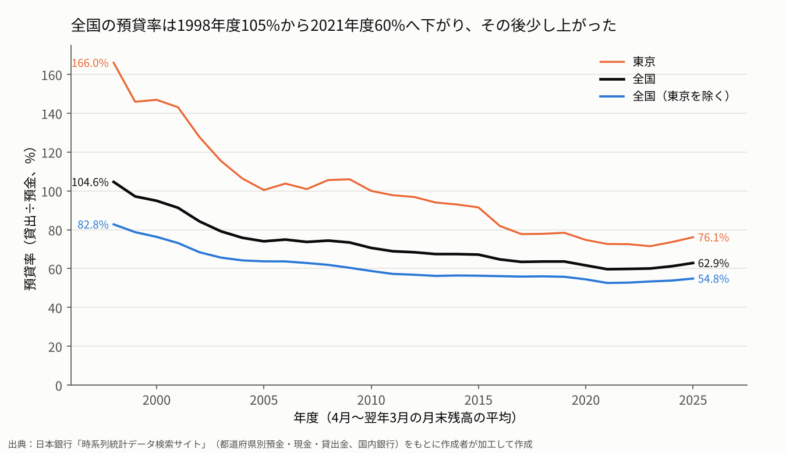
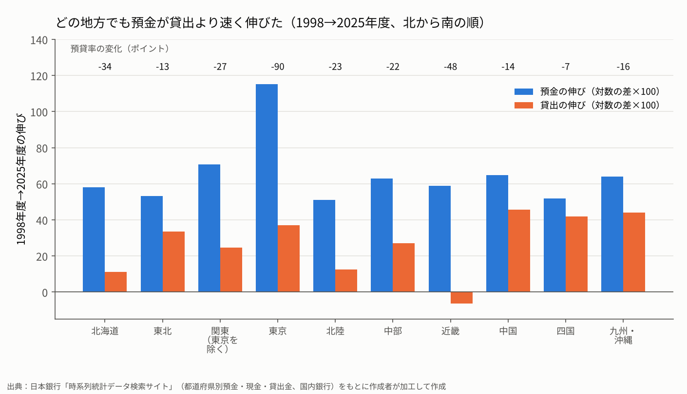
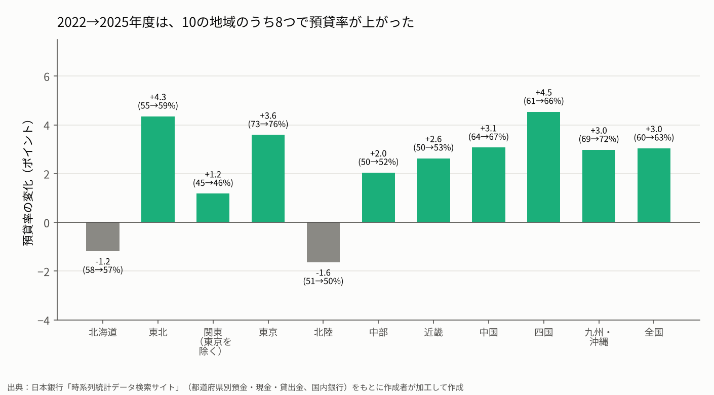
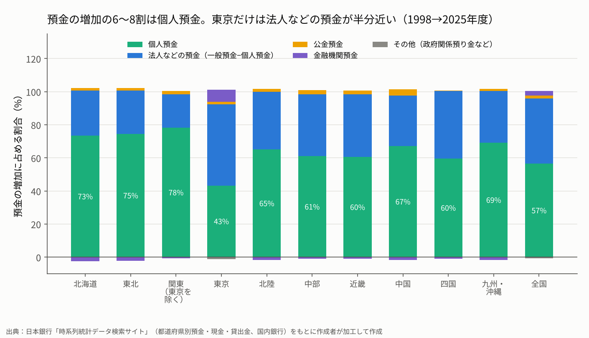

# F529 国内銀行の預貸率の低下は、地域でどう違うのか？ 全国は1998年度105%から2025年度63%へ、どの地方も預金が貸出より速く伸び、2022年度からは10地域中8つで上昇

## 結論（先に）

- 国内銀行の預貸率（貸出÷預金）は、全国で1998年度の **104.6%** から2021年度の59.7%まで下がり、2025年度は **62.9%** でした（1998年度から −41.8ポイント）。直近12か月（2025年10月〜2026年9月）は63.8%です。
- 北から南の10の地域（関東を東京と東京以外に分けたもの）の **すべてで、預金の伸びが貸出の伸びを上回りました**。47都道府県のうち45で預貸率が下がっています。
- 下がり幅は東京が −89.9ポイント（166.0%→76.1%）と大きく、東京以外の9地域の中央値は −22.4ポイントでした。東京の預金が1998年度の約3.2倍に増えたことが効いています。
- 2022年度→2025年度は、10の地域のうち **8つ** で預貸率が上がりました（全国 +3.0ポイント）。日本銀行の金融システムレポート（2026年4月号）の「預貸率はやや上昇傾向」と同じ向きです。
- 都道府県の間の違いは、預金の伸びの違いより **貸出の伸びの違い** から来ている部分が大きい（ばらつきの大きさが約2倍）。問い直しでは、預金の増加の6〜8割（東京以外）は個人預金でした。

## 問い

地域の金融の話題では「預金は集まるのに、貸出が伸びない」「預貸率が下がっている」とよく言われます。けれども、全国の数字には東京の大きな銀行の本支店の動きが混ざります。地方ごとに見ると、預貸率はどう動いたのか。下がったのは預金が増えたからか、貸出が減ったからか。

日本銀行の金融システムレポート（2026年4月号）は、預貸率は地域銀行を中心にやや上昇傾向にあるものの、全体としては預金残高が貸出残高を大きく上回っていると書いています。この記事では、都道府県別の統計で、長い期間（1998年度から）と最近（2022年度から）の両方を確かめます。地域の金融機関や自治体の企画の担当が、自分の地方の動きを全国と比べるときの材料にもなります。預貸率が高い・低いことの良し悪しや、銀行の経営の良し悪しは扱いません。

## データ（出典）

- 日本銀行「時系列統計データ検索サイト」の都道府県別預金・現金・貸出金（MD12）。国内銀行、月末残高、1998年4月〜2026年9月。全国計・8つの地方計・47都道府県の、預金合計・一般預金・個人預金・公金預金・金融機関預金・譲渡性預金・貸出金（392系列）を API で取得しました（2026年11月19日）。
- 店舗の所在地で集計した統計です。信用金庫・信用組合・農協・ゆうちょ銀行は入りません。
- 地域の名前は、系列名（「青森／東北計／全国計／預金合計／国内銀行」など）の見出しの文字から付けました。日本銀行サイトの公表資料（2026年3月末の Excel）と、都道府県名・地方名で突き合わせ、56地域×7項目のすべてで値が一致しました（`data/check_vs_excel_202603.csv`）。
- 年度は4月〜翌年3月の月末残高の平均です（1998〜2025年度）。

## 事前の計画

計画は [PLAN.md](PLAN.md) に、預貸率を計算する前（2026-11-19 06:55 UTC）に書きました。

| 仮説 | 内容 | 判定 |
|---|---|---|
| H1 | 全国の預貸率は1998→2025年度に10ポイント以上下がった | **支持**（−41.8ポイント） |
| H2 | 下がり幅は、東京より東京以外の地方の方が大きい | **外れ**（東京 −89.9、ほかの中央値 −22.4） |
| H3 | 2022→2025年度に、10の地域の半分以上で上がった | **支持**（8つ） |
| H4 | 都道府県の間の違いは、預金より貸出の伸びの違いから来ている部分が大きい | **支持**（ばらつき 0.048 対 0.023） |

## やったこと

1. 年度平均の残高から、全国・10の地域・47都道府県の預貸率を出しました。
2. 預貸率の変化を、対数の差で「貸出の伸び − 預金の伸び」に分けました（1998→2025、1998→2012、2012→2022、2022→2025年度）。
3. 47都道府県の間で、預貸率の変化のばらつき（分散）を、貸出の伸びと預金の伸びのばらつきに分けました。
4. 地域は北から南の順に並べ、悪い方からの順位は作っていません。

## 分かったこと

### 図1：全国の預貸率は2021年度まで下がり、その後少し上がった



- 全国は104.6%（1998年度）→68.4%（2012年度）→59.7%（2021年度）→62.9%（2025年度）でした。
- 東京を除く全国でも、82.8%→54.8%と下がっています。2021年度の52.6%から少し戻りました。
- 東京は166.0%から76.1%で、全国の下がり幅の一部は東京の動きです。

### 図2：どの地方でも、預金が貸出より速く伸びた



- 1998→2025年度の預金の伸び（対数の差×100）は51〜115、貸出の伸びは −6〜46 でした。10の地域すべてで預金の方が大きく伸びています。
- 北海道・北陸は貸出の伸びが11〜13と小さく、近畿は貸出が −6 と減りました。中国・四国・九州・沖縄は貸出も42〜46伸び、預貸率の下がり幅が7〜16ポイントと小さめです。
- 近畿の貸出が減った理由は、この統計からはわかりません。大きな銀行の再編で、貸出を記帳する店が東京に移った影響もありうると考えられます（推測）。

### 図3：2022年度からは、多くの地域で上がっている



- 2022→2025年度に預貸率が上がったのは、東北・関東（東京を除く）・東京・中部・近畿・中国・四国・九州・沖縄の8つで、北海道（−1.2）と北陸（−1.6）は下がりました。
- 全国では貸出が12.6、預金が7.7（対数の差×100）伸び、預貸率は59.8%から62.9%になりました。
- 47都道府県で見ると、30で上がりました。

### 都道府県の間の違い

- 47都道府県の預貸率の幅は、1998年度の56〜166%から、2025年度は35〜91%に狭まりました。
- 1998→2025年度の変化のばらつきは、貸出の伸びのばらつき（分散0.048）が預金の伸び（0.023）の約2倍でした。貸出と預金の伸びには正の相関（0.51）があり、預金の伸びた県では貸出も伸びる傾向があります。

## 問い直し（結果を見てから足した）

図2を見て、「伸びた預金は誰の預金か」を確かめました（`src/03b_requestion.py`）。



- 全国の預金は1998→2025年度に550.8兆円増え、そのうち個人預金が311.3兆円（56.5%）、法人などの預金（一般預金−個人預金）が216.4兆円（39.3%）でした。同じ期間に貸出は155.3兆円増えています。
- 東京以外の9地域では、預金の増加のうち個人預金が60〜78%（中央値67.2%）です。東京だけは個人預金が43.3%で、法人などの預金が48.9%でした。
- 地方の預貸率の低下は、主に個人の預金が積み上がる一方で、貸出がそれほど伸びなかったことの表れと読めます。

## 頑健性

| 確かめ | 全国 1998年度 | 全国 2025年度 | 東京の変化 | 東京以外の中央値 | 2022→2025年度に上がった地域 | 結論は変わったか |
|---|---|---|---|---|---|---|
| 基本：貸出÷預金合計（年度平均） | 104.6% | 62.9% | −89.9 | −22.4 | 8 | — |
| R1 分母に譲渡性預金を足す | 96.3% | 61.2% | −54.3 | −22.3 | 8 | 変わらない |
| R2 分母を一般預金に | 114.7% | 67.1% | −106.9 | −25.7 | 8 | 変わらない |
| R3 3月末の残高 | 101.3% | 63.5% | −81.0 | −18.4 | 8 | 変わらない |
| R4 東京・大阪を除く45道府県で H4 | — | — | — | — | — | 変わらない（貸出 0.046 対 預金 0.016） |

R1 で東京の下がり幅が小さくなるのは、1998年度の東京に譲渡性預金（CD）が多かったためです。

## 言えないこと

- 店舗の所在地での集計です。借り手・預け手の住む場所とは一致しません（東京の店が地方の企業に貸す、など）。
- 国内銀行だけで、信用金庫・信用組合・農協・ゆうちょ銀行は入りません。地域の預金のかなりの部分がこれらにあるので、地域全体の預貸率ではありません。
- 預貸率が高い・低いことの良し悪しや、銀行の経営の良し悪しは言えません。
- 預金・貸出の伸びの原因（人口、企業の立地、銀行の再編、政策）は、この分析では確かめていません。
- 2022年度からの上昇が続くかどうかは、この分析からは言えません。

## 仕事で使うなら

- 地方の預貸率を全国と比べるときは、東京を除いた全国（2025年度54.8%）とも並べると、東京の本支店の影響を避けられる。
- 預貸率の変化は「貸出の伸び」と「預金の伸び」に分けて示すと、どちらの話なのかがはっきりする。

## 計画からの変更

- 図1に「全国（東京を除く）」の線を足しました（東京の影響の大きさを見てから）。
- 47都道府県の預貸率の幅（最小と最大）は数字だけ示し、どの県かは書いていません（悪い方からの順位にしないため）。

## 再現のしかた

```sh
pip install -r requirements.txt
sh src/run_all.sh        # オフライン。01_fetch.py は呼ばない
# 元データを取り直すときだけ： python3 src/01_fetch.py
```

| ファイル | 中身 |
|---|---|
| src/01_fetch.py | 日本銀行の API と公表資料（Excel）を取得し data/raw に保存（ネットが必要） |
| src/02_build.py | data/raw → data/pref_monthly.csv、公表資料との突き合わせ（data/check_vs_excel_202603.csv） |
| src/03_analysis.py | 預貸率・分解・ばらつき・頑健性 → results/main.json ほか |
| src/03b_requestion.py | 問い直し（預金の増加の中身） |
| src/04_figures.py | 図4枚 |

所要時間は約5秒（CPU 1つ）。再現の確かめ：results/repro_check.txt を参照。

## レビューで直したこと

| # | 指摘 | 直し方 |
|---|---|---|
| 1 | 題名に「国内銀行」がなく、地域全体（信用金庫・信用組合・ゆうちょ銀行などを含む）の預貸率と読まれうる。問いの部分の言い回しも分かりにくい | 題名を「国内銀行の預貸率の低下は、地域でどう違うのか？ …」に直した（結果の部分は同じ）。status・note の原稿の1行目とファイル名も合わせた |

## 出典

- 日本銀行「時系列統計データ検索サイト」 https://www.stat-search.boj.or.jp/ （都道府県別預金・現金・貸出金）
- 日本銀行「都道府県別預金・現金・貸出金」 https://www.boj.or.jp/statistics/dl/depo/pref/index.htm
- 日本銀行「金融システムレポート（2026年4月号）」 https://www.boj.or.jp/research/brp/fsr/data/fsr260421a.pdf

このページは、日本銀行時系列統計データ検索サイトの API 機能を使用しています。内容は日本銀行によって保証されたものではありません。

（いずれも日本銀行の公表データをもとに作成者が加工して作成）
