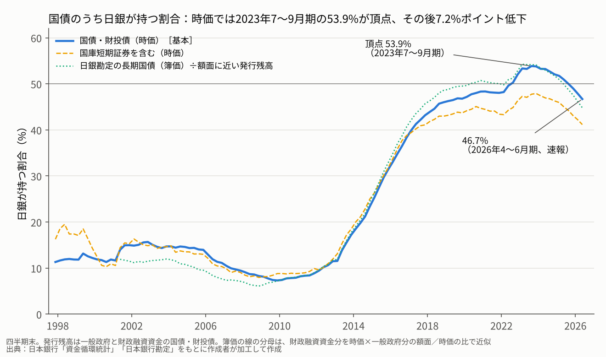
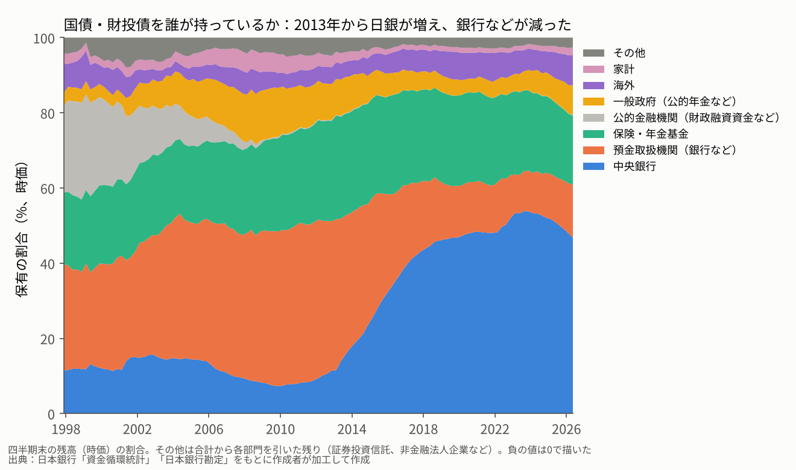
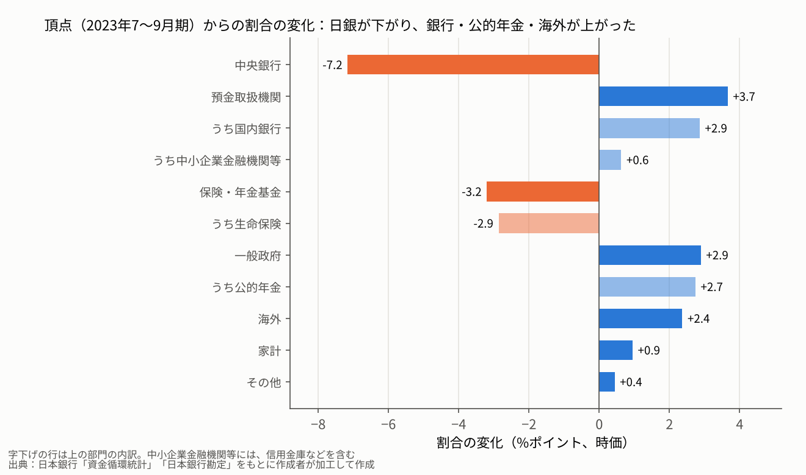
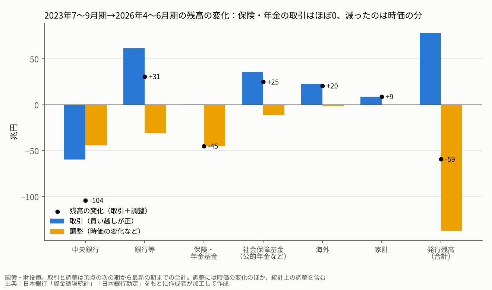

# F530 国債のうち日銀が持つ割合は、どこまで上がり、どこから下がり始めたのか？ 時価で見た頂点は2023年7〜9月期の53.9%、2026年6月末（速報）は46.7%。その間に割合が上がったのは銀行・公的年金・海外

## 結論（先に）

- 国債・財投債（時価）のうち日銀が持つ割合は、2013年1〜3月期の11.6%から上がり、2022年7〜9月期に初めて50%を超えました（50.3%）。頂点は2023年7〜9月期の53.9%です。
- その後は下がり続け、2025年7〜9月期に50%を下回り（49.99%）、2026年4〜6月期（速報）は46.7%です。頂点から7.2%ポイント低い水準です。
- 頂点から最新の期までに、日銀の残高（時価）は104.1兆円減りました。うち59.8兆円（57.5%）は取引（買い入れが償還に届かない分の純減）、44.3兆円は調整（時価の下落など）です。
- 割合が最も上がったのは、預金取扱機関（銀行など、＋3.7%ポイント）で、一般政府（公的年金、＋2.9）、海外（＋2.4）が続きます。保険・年金基金は−3.2%ポイントですが、取引はほぼ0（＋0.3兆円）で、減ったのは時価の分でした。
- 頂点の時期は、物差しで1年ほど動きます。簿価・額面に近い基準では2023年1〜3月期（54.3%）、国庫短期証券を含めると2023年10〜12月期（47.9%）です。いずれも2023年が頂点で、その後の低下は5%ポイントを超えます。

## 問い

2022年9月末の資金循環統計で「日銀の国債保有が初めて5割を超えた」と報道されました（時事通信）。その後、日本銀行は2024年7月に長期国債の買い入れを段階的に減らす計画を決めています（日本銀行の公表文）。

ニュースで「日銀の保有割合」という数字を見る人や、仕事で国債の保有者の内訳を資料にする人にとって、割合がいつ・どの水準で頂点をつけ、その後どれだけ下がったのか、その間にどの部門の割合が上がったのかは、基本の事実です。この記事は、日本銀行の資金循環統計で、その推移を確かめます。金利・国債の売買・政策の良し悪しについての見方は書きません。

## データ（出典）

- 日本銀行「資金循環統計」：時系列統計データ検索サイトの API（db=FF）から、国債・財投債と国庫短期証券の保有部門別の残高（四半期末、時価）、発行残高（一般政府と財政融資資金、時価と額面）、主な部門の取引（フロー）と調整を取得しました。1997年10〜12月期〜2026年4〜6月期（速報）、71系列です。
- 日本銀行「日本銀行勘定」：長期国債・短期国債の月末残高（簿価）。四半期末の月だけを使いました。
- 日本銀行「資金循環統計 参考図表（時系列表）」sjlong.xlsx：API から作った表の照らし合わせに使いました。

主な指標は、日銀の保有割合＝中央銀行の国債・財投債の残高 ÷（一般政府＋財政融資資金の国債・財投債の発行残高）です。時価（市場の値段で評価した額）なので、金利が上がると残高は小さく出ます。

部門の名前は、系列の名称（例「資産・−国債・財投債／中央銀行／ストック」）の「／」で挟まれた文字から付けました。API の値は、参考図表の「中央政府＋財政融資資金が発行する債券（長期）」の5行×10期（総発行残高、中央銀行、社会保障基金、家計、海外）と、50セルすべてで一致しました（results/crosscheck_sjlong.csv）。

## 事前の計画

計画は [PLAN.md](PLAN.md) に、割合の推移を集計する前（2026-11-19 05:45）に書きました。下見で見たのは、2026年4〜6月期の日銀の残高と発行残高の値だけです。

| 仮説 | 外れの基準 | 判定 |
|---|---|---|
| H1 頂点は50%を超え、2023年以降 | 50%以下か、2022年以前 | 支持（2023年7〜9月期、53.9%） |
| H2 2026年4〜6月期は頂点より5%ポイント以上低い | 下がり幅が5%ポイント未満 | 支持（7.2%ポイント） |
| H3 日銀の残高の減少の半分以上は取引による | 調整が半分を超える | 支持（取引が57.5%） |
| H4 頂点から割合が最も上がったのは海外 | 海外以外 | 外れ（最も上がったのは預金取扱機関の＋3.7。海外は＋2.4で3番目） |

## やったこと

- 四半期ごとに、保有部門別の割合を計算しました。大きな部門は、中央銀行、預金取扱機関（銀行等と、2007年までの郵便貯金）、保険・年金基金、公的金融機関（財政融資資金など）、一般政府（公的年金を含む社会保障基金など）、海外、家計、その他（合計からの残り）の8つです。
- 日銀の割合の頂点の期を求め、頂点から最新の期までの部門ごとの割合の変化を出しました。
- 日銀の残高の変化を、資金循環統計の恒等式「残高の差＝取引＋調整」で分けました。恒等式は全期で誤差0で成り立っています。

## 分かったこと

### 1. 頂点は2023年7〜9月期の53.9%（図1）



- 割合が最も低かったのは2009年10〜12月期の7.3%です。2013年1〜3月期は11.6%でした。
- 2013年から急に上がり、2022年7〜9月期に50.3%で初めて50%を超えました（報道時の速報値は50.26%、いまの値は改定後の50.27%）。50%を超えていたのは2025年4〜6月期（50.9%）までの12期です。
- 頂点は2023年7〜9月期の53.9%で、2026年4〜6月期は46.7%です。次の2023年10〜12月期も53.8%で、頂点の前後はほぼ横ばいでした（results/shares_quarterly.csv）。
- 日銀の残高（時価）の頂点は、割合より1期遅い2023年10〜12月期の581.3兆円で、2026年4〜6月期は470.0兆円です。

### 2. 2013年からの10年で、銀行と日銀の立場が入れ替わった（図2）



- 2013年1〜3月期には、預金取扱機関が40.2%、保険・年金基金が27.6%を持ち、日銀は11.6%でした。
- 2016年10〜12月期には、日銀38.4%、預金取扱機関22.4%で、すでに日銀が上回っていました。
- 頂点の2023年7〜9月期には、預金取扱機関は10.6%まで下がっていました。
- 2026年4〜6月期の内訳は、日銀46.7%、保険・年金基金18.3%、預金取扱機関14.2%、一般政府8.0%、海外7.9%、家計2.2%です（results/shares_quarterly.csv）。
- 1990年代末から2000年代前半には、財政融資資金などの公的金融機関が2割強（1997年10〜12月期 23.0%）を持っていました。この分は2008年ごろまでにほぼなくなっています。

### 3. 日銀の割合が下がった期間に、銀行・公的年金・海外の割合が上がった（図3）



- 頂点から2026年4〜6月期までに、日銀は−7.2%ポイントでした。
- 上がったのは、預金取扱機関＋3.7（うち国内銀行＋2.9）、一般政府＋2.9（うち公的年金＋2.7）、海外＋2.4、家計＋0.9です。
- 下がったのは保険・年金基金の−3.2（うち生命保険−2.9）です。

## 問い直し（結果を見てから足した）

### 割合の変化は、売り買いによるのか、時価の変化によるのか（図4）

図3の割合は時価で計算しています。金利が上がる局面では、満期の長い国債ほど値段が下がるので、長い国債を多く持つ部門ほど割合が小さく出ます。そこで、結果を見てから、取引と調整の系列がある部門について、頂点の次の期から最新の期までの残高の変化を、取引と調整に分けました。



| 部門 | 残高の変化（兆円） | 取引 | 調整（時価の変化など） |
|---|---|---|---|
| 中央銀行 | −104.1 | −59.8 | −44.3 |
| 銀行等 | ＋30.6 | ＋61.3 | −30.8 |
| 保険・年金基金 | −45.0 | ＋0.3 | −45.3 |
| 社会保障基金（公的年金など） | ＋24.7 | ＋35.9 | −11.2 |
| 海外 | ＋20.5 | ＋22.3 | −1.9 |
| 家計 | ＋8.8 | ＋8.9 | −0.1 |
| 発行残高（合計） | −59.4 | ＋77.9 | −137.3 |

- 保険・年金基金の残高の減少（−45.0兆円）は、ほぼすべて調整でした。取引はほぼ0で、売り越してはいません。
- 発行残高は、取引では77.9兆円増えましたが、調整が−137.3兆円で、時価の合計は59.4兆円減りました。
- 分母と分子を分けると、日銀の残高だけが動いた場合は−9.8%ポイント、発行残高だけが動いた場合は＋3.2%ポイントです。発行残高の時価が縮んだことは、日銀の割合を押し上げる向きに働いていました。
- 頂点の期の残高に、その後の取引だけを足した「時価の変化を除いた」割合は45.0%で、時価で見た46.7%より低くなります。

## 頑健性

| 確かめ | 頂点の期 | 頂点 | 最新 | 低下（%ポイント） |
|---|---|---|---|---|
| 基本：国債・財投債（時価） | 2023年7〜9月期 | 53.9% | 46.7% | 7.2 |
| 国庫短期証券を含む国債等（時価） | 2023年10〜12月期 | 47.9% | 41.2% | 6.7 |
| 日銀勘定の長期国債（簿価）÷額面に近い発行残高 | 2023年1〜3月期 | 54.3% | 44.8% | 9.5 |
| 年度末（3月末）だけ | 2023年1〜3月期 | 53.3% | 47.9%（2026年3月末） | 5.5 |
| 日銀の残高（時価）の頂点 | 2023年10〜12月期 | 581.3兆円 | 470.0兆円 | — |
| 日銀の残高（簿価）の頂点 | 2023年10〜12月期 | 588.4兆円 | 518.3兆円 | — |

- どの物差しでも、頂点は2023年で、その後の低下は5%ポイントを超えました。結論は変わりません。
- 頂点の期は、物差しで2023年1〜3月期から10〜12月期まで動きます。「2023年に頂点」までは言えますが、どの期かは定義によります。
- 額面に近い基準の分母は近似です。財政融資資金の分の額面が API になく、時価に一般政府分の額面／時価の比（2026年4〜6月期は1.149）をかけました。

## 言えないこと

- 割合が下がった理由が、買い入れの減額の方針なのか、償還の時期の偏りなのかは、この統計だけでは分けられません。
- 調整には時価の変化のほか、統計上の調整も含まれます。すべてが値段の変化とは言えません。
- 2026年4〜6月期は速報で、改定されます。四半期の値はのちに数字が変わることがあります。
- 銀行・公的年金・海外が「日銀の代わりに買った」という因果は、この集計からは言えません。同じ期に割合が動いたことを示しているだけです。
- 今後の割合、金利、国債の需給の見通しは書きません。日銀の政策の評価もしません。

## 仕事で使うなら

- 「日銀の保有割合」を引用するときは、時価か簿価か、国庫短期証券を含むかを添えると、数字の違いで混乱しません（2013年以降、同じ期で最大7.1%ポイント、2026年4〜6月期で5.5%ポイント違います）。
- 保有者別の割合の変化を説明するときは、取引と調整に分けて示すと、「売った」のか「値段が下がった」のかを取り違えにくくなります。

## 計画からの変更

- 大きな部門に「公的金融機関」を加えました。1990年代末に財政融資資金などが2割強を持っていて、「その他」に入れると「その他」が3割近くになったためです。
- 預金取扱機関には、2007年までの郵便貯金も含めました（「銀行等」だけだと2007年以前の郵便貯金が抜けるため）。
- API の値を、日銀の参考図表（sjlong.xlsx）と照らし合わせる手順（03c）を足しました。

## 再現のしかた

```sh
pip install -r requirements.txt
sh src/run_all.sh        # オフライン。02 → 03 → 03b → 03c → 04
# python3 src/01_fetch.py  # 取り直すときだけ（ネットが要る）
```

| ファイル | 中身 |
|---|---|
| src/01_fetch.py | 日銀の API と参考図表から取得（run_all.sh では呼ばない） |
| src/02_build.py | JSON を期×系列の表にする（data/ff_quarterly.csv、bs01_quarterly.csv、series_names.csv） |
| src/03_analysis.py | 割合、頂点、取引と調整、頑健性（results/main.json ほか） |
| src/03b_requestion.py | 問い直し：部門ごとの取引と調整（results/requestion.json、requestion_sector_decomp.csv） |
| src/03c_crosscheck.py | 参考図表との照らし合わせ（results/crosscheck_sjlong.csv） |
| src/04_figures.py | 図4枚 |

所要は約3秒（CPU 1つ）。乱数は使いません。repro_check：results/repro_check.txt を参照（/tmp に写して流し直し、results と figures と data の生成ファイルが cmp で一致）。

## レビューで直したこと

| # | 指摘 | 直し方 |
|---|---|---|
| 1 | 題名の「頂点は2023年7〜9月期」は物差しで動く（簿価・額面に近い基準では2023年1〜3月期、国庫短期証券を含むと10〜12月期）のに、題名だけではそれが伝わらなかった | 題名を「時価で見た頂点は…」にし、最新の期に「（速報）」を足した。図1の題も「時価では…」にした |
| 2 | 題名・見出し・図3の題の「空いた分は銀行・公的年金・海外が持った」「埋めた」は、言えないことに書いた「日銀の代わりに買った」という因果に近い | 「その間に割合が上がったのは…」と、同じ期間の動きとして書き直した |
| 3 | 図2の凡例・図3の行名と注、note に、特定の銀行の名前が入っていた | 「銀行など」「信用金庫など」の分類の言い方に替えた |
| 4 | 頂点の2023年7〜9月期（53.86%）と次の10〜12月期（53.78%）の差が小さいことが書かれていなかった | 「分かったこと」1に、頂点の前後はほぼ横ばいだったことを足した |
| 5 | note の見出し「保険・年金は売っていない」は、取引の差し引き（純額）しか見ていないのに言い切りが強い | 「保険・年金基金は売り越していない」にした |

## 出典

- 日本銀行「資金循環統計」 https://www.boj.or.jp/statistics/sj/index.htm
- 日本銀行 時系列統計データ検索サイト（API） https://www.stat-search.boj.or.jp/
- 日本銀行「日本銀行勘定」（時系列統計データ検索サイト db=BS01）
- 日本銀行「当面の金融政策運営について」（2024年7月31日、長期国債買入れの減額計画を含む） https://www.boj.or.jp/mopo/mpmdeci/state_2024/k240731a.htm
- 時事通信「日銀の国債保有、初の5割超」（2022年9月末の資金循環統計の報道） https://sp.m.jiji.com/english/show/23726

（いずれも 日本銀行「資金循環統計」「日本銀行勘定」 をもとに作成者が加工して作成）
