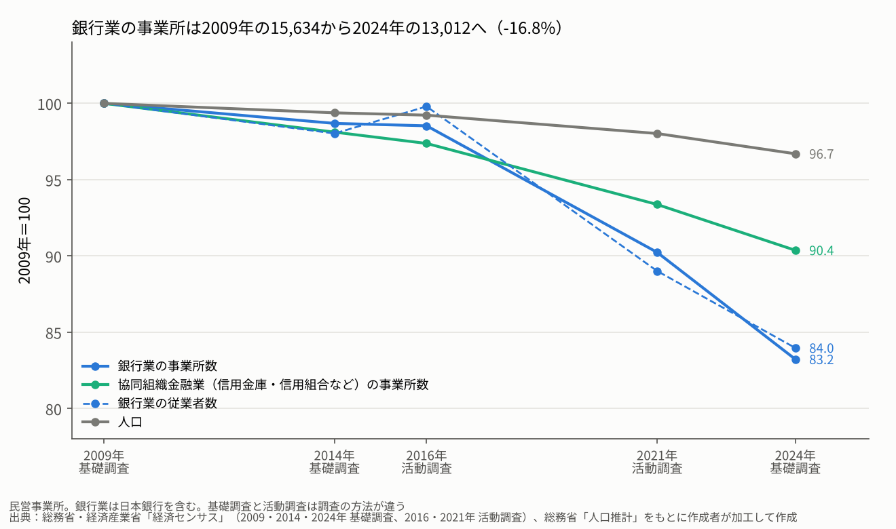
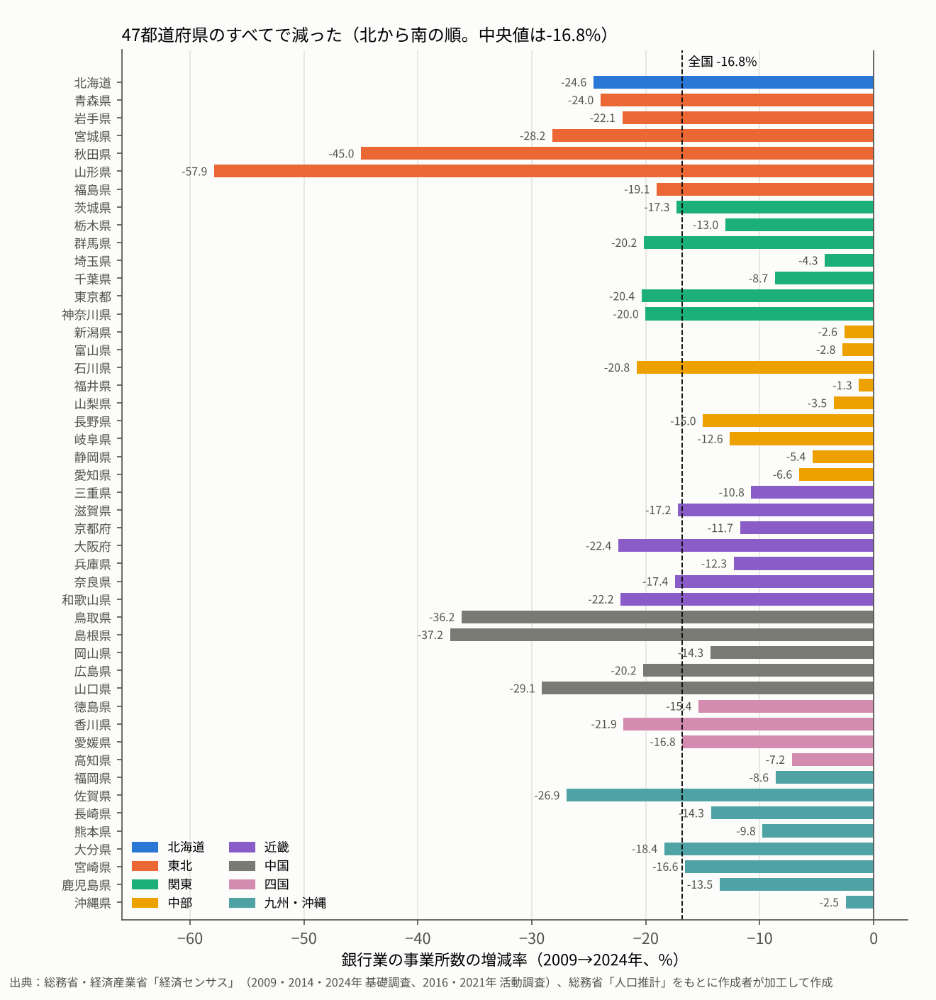
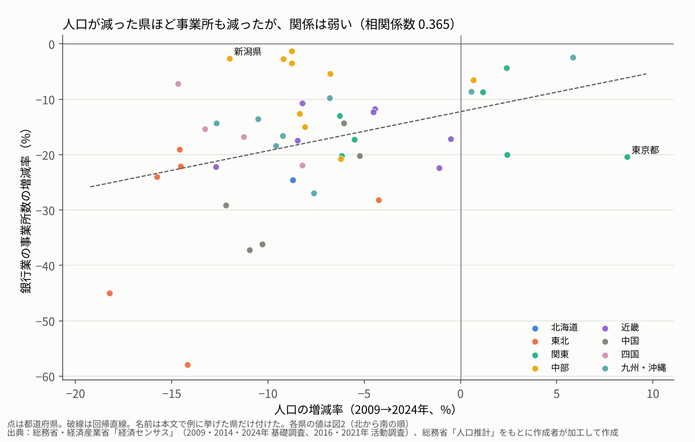
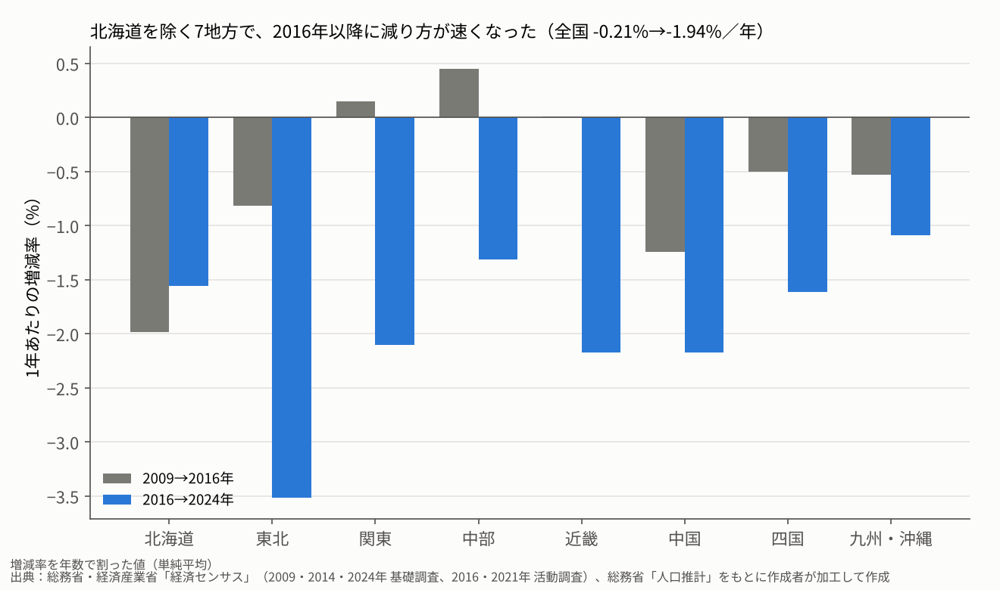

# F531 銀行の店舗は、どれだけ減ったのか？ 銀行業の事業所は2009年から2024年に16.8%減り、47都道府県のすべてで減った。2016年以降に減り方が速くなった

## 結論（先に）

- 経済センサスの銀行業の事業所（支店・出張所・本部などの拠点）は、2009年の15,634から2024年の13,012へ、2,622（16.8%）減りました。同じ期間に人口は3.3%減っています。人口10万人あたりでは12.21から10.51になりました。
- 47都道府県のすべてで減りました。増減率の中央値は−16.8%で、県によって−1.3%から−57.9%まで幅があります。
- 減り方は2016年以降に速くなりました。全国の1年あたりの増減率は、2009→2016年の−0.21%から、2016→2024年の−1.94%になり、8地方のうち北海道を除く7地方で速くなっています。
- 人口が減った県ほど事業所も減る傾向はありますが、関係は弱めです（相関係数0.365）。人口が増えた東京都でも20.4%減りました。
- 事前の予想と違い、三大都市圏を含む地方（関東・中部・近畿）の減少率（−14.1%）は、それ以外の地方（−21.1%）より小さく、人口あたりの事業所数の県のあいだの差は広がりました。

## 問い

「銀行の支店が減っている」「店舗の統廃合が進んでいる」という報道は多く、地方では身近な店舗がなくなる話として受け止められています。銀行ごとの店舗数は各行の開示にありますが、この記事では、公的統計の経済センサスで、銀行業の事業所が2009年からどれだけ減ったのか、都道府県や地方でどう違うのか、人口あたりで見るとどうかを確かめます。

地域の金融の話題を読む人、自治体や企業で地域の資料を作る人を想定しています。特定の銀行の名前や良し悪し、経営や政策の評価は扱いません。

## データ（出典）

- 総務省・経済産業省「経済センサス」の、産業×都道府県の民営事業所数と従業者数。2009年（基礎調査）、2014年（基礎調査）、2016年（活動調査）、2021年（活動調査）、2024年（基礎調査）の5回です。
- 産業は「62 銀行業」（日本銀行を含む）と、比べるための「63 協同組織金融業」（信用金庫・信用組合・労働金庫など）です。2009・2014年は小分類「622 銀行（中央銀行を除く）」も使いました。農業協同組合の店舗は別の産業（協同組合）に入るため、ここには含まれません。
- 総務省「人口推計」の都道府県別人口（各年10月1日）。

経済センサスの「事業所」は、一つの場所で事業を行う単位です。銀行の支店・出張所のほか、本部や事務センターも1つずつ数えられます。ATM だけの場所は入りません。

都道府県の名前は、各表の地域の見出しの文字から付け、人口推計の都道府県名と照らしました。どの年・どの産業でも、都道府県の合計は全国の値と一致しています（results/build_checks.csv）。都道府県は北から南の順に並べ、少ない順や減り方の大きい順の順位は作っていません。

## 事前の計画

計画は [PLAN.md](PLAN.md) に、都道府県別の集計をする前（2026-11-19 06:05）に書きました。表の形を確かめるときに全国と北海道の値は見ていたため、全国の減り方は仮説にせず、都道府県・地方の違いを仮説にしました。

| 仮説 | 外れの基準 | 判定 |
|---|---|---|
| H1 2009→2024年に減った都道府県は40以上 | 40未満 | 支持（47すべて） |
| H2 人口の増減率との相関係数は0.3より大きい | 0.3以下 | 支持（0.365。ただし順位の相関は0.283で、基準を下回る） |
| H3 関東・中部・近畿の減少率は、それ以外の地方より大きい | 小さいか同じ | 外れ（−14.1%と−21.1%で、逆だった） |
| H4 人口10万人あたりの事業所数の県のあいだのばらつきは小さくなった | 大きいか同じ | 外れ（変動係数 0.279→0.305 で大きくなった） |

## やったこと

- 5回の調査の、全国・都道府県・地方の事業所数と従業者数を、見出しの文字で抜き出して1つの表にしました。
- 2009年と2024年を比べ、都道府県ごとの増減率、人口10万人あたりの事業所数、人口の増減率との関係を見ました。
- 地方は、北海道・東北・関東・中部・近畿・中国・四国・九州沖縄の8つに分けました。中部は新潟県から愛知県まで、三重県は近畿に入れています。

## 分かったこと

### 1. 全国では16.8%減り、従業者数もほぼ同じだけ減った（図1）



- 銀行業の事業所数は、2009年15,634、2014年15,429、2016年15,404、2021年14,108、2024年13,012です。15年で減った2,622のうち、2,392は2016年から2024年の8年間に減りました。
- 従業者数は2009年から16.0%減り、1事業所あたりの従業者数は28.5人から28.7人で、ほとんど変わっていません。
- 協同組織金融業の事業所数は9.6%減（11,880→10,736）で、銀行業より減り方がゆるやかでした。従業者数は15.4%減っています。
- 人口10万人あたりの銀行業の事業所数は、2009年12.21、2024年10.51です。

### 2. 47都道府県のすべてで減った（図2）



- 増えた県、変わらなかった県はありませんでした。
- 増減率の中央値は−16.8%で、−1.3%から−57.9%まで幅があります。
- 同じ地方の中でも県による差が大きく、地方の中の幅は、東北で−19.1%〜−57.9%、中国で−14.3%〜−37.2%、中部で−1.3%〜−20.8%、九州・沖縄で−2.5%〜−26.9%です。各県の値は図2に北から南の順で載せています。
- 地方別では、北海道−24.6%、東北−32.2%、関東−15.9%、中部−7.7%、近畿−17.3%、中国−24.6%、四国−16.0%、九州・沖縄−12.1%です。
- 人口10万人あたりの事業所数（地方別、2009→2024年）は、北海道9.12→7.54、東北16.19→12.55、関東9.98→8.16、中部12.05→11.76、近畿12.11→10.41、中国14.87→12.16、四国20.70→19.67、九州・沖縄13.99→12.89です。
- 都道府県の人口10万人あたりの値の幅は、2009年の7.43〜24.68から、2024年の5.80〜24.09になりました。

### 3. 人口との関係は弱め（図3）



- 人口の増減率と事業所数の増減率の相関係数は0.365でした。回帰直線の傾きは0.71で、人口が1%多く減った県では、事業所が平均0.71%多く減っていた計算です。
- ただし、人口が8.7%増えた東京都でも事業所は20.4%減り、人口が12.0%減った新潟県では2.6%減にとどまりました。人口だけでは減り方の違いの多くを説明できません。
- 東京都を除いた46道府県では、相関係数は0.419でした。

## 問い直し（結果を見てから足した）

### 減り方が速くなったのは、いつ・どこか（図4）

全国の推移を見ると、2016年までの減り方がゆるく、2016年以降に速くなっていました。そこで、結果を見てから、都道府県と地方ごとに、2016年の前と後の1年あたりの増減率を比べました。



- 全国の1年あたりの増減率は、2009→2016年の−0.21%から、2016→2024年の−1.94%になりました。
- 8地方のうち7地方で、2016年以降の方が速く減っています。北海道だけは、2016年までの方が速く減っていました（−1.98%→−1.56%）。
- 関東・中部・近畿は、2016年までは横ばいか少し増えていて（＋0.15%、＋0.45%、＋0.01%）、2016年以降に減り始めました。
- 都道府県では47のうち38で、2016年以降の方が速く減りました。
- 調査の種類が混ざらないように、基礎調査どうしで比べても（2009→2014年と2014→2024年）、全国は−0.26%から−1.57%に速くなり、47のうち36の都道府県で後の方が速く減っていました。

## 頑健性

| 確かめ | 減った都道府県 | 増減率の中央値 | 人口の増減率との相関 |
|---|---|---|---|
| 基本：銀行業の事業所数 2009→2024年 | 47 | −16.8% | 0.365 |
| 起点を2014年（同じ基礎調査） | 45 | −13.4% | 0.195 |
| 従業者数で見る | 43 | −21.4% | 0.271 |
| 銀行業＋協同組織金融業 | 46 | −13.7% | 0.441 |
| 協同組織金融業だけ | 41 | −11.7% | 0.211 |
| 東京都を除く（46道府県） | 46 | −16.7% | 0.419 |

- 「ほとんどの都道府県で減った」は、どの見方でも変わりませんでした（41〜47）。
- 人口との相関は、見方によって0.195から0.441まで動き、基準の0.3を下回るものもありました。H2 の「支持」は弱い支持です。
- 銀行業（日本銀行を含む）と、小分類の「銀行（中央銀行を除く）」の差は、全国で218（2009年）と144（2014年）です。2009→2014年の都道府県ごとの増減率の相関は0.87で、日本銀行を含むかどうかで傾向は変わりません。

## 言えないこと

- 経済センサスの事業所は場所の単位です。同じ建物に複数の支店を集めた場合（店舗内店舗）は、支店の数が変わらなくても事業所としては減って見える可能性があります（推測。銀行ごとの支店数とは照らしていません）。減り方の大きい県の数字に、こうした集約がどれだけ含まれるかは分かりません。
- 基礎調査と活動調査は調べ方が違い、年のあいだの差には調査の違いも入ります。問い直しでは基礎調査どうしでも確かめましたが、完全には分けられません。
- ATM、郵便局やコンビニでの取引、インターネットでの取引で代わる部分は、この統計からは分かりません。
- 減った理由（銀行の統合、デジタル化、人口の減少など）は分けられません。良し悪しの評価もしません。
- 人口10万人あたりの事業所数は、銀行の本部や事務センターの場所にも左右されます。

## 仕事で使うなら

- 地域の資料で「銀行の拠点数」を使うときは、経済センサスの事業所は場所の単位で、支店数とは一致しないことを添えると誤解が少なくなります。
- 2016年以降に減り方が速くなっているため、比べる年によって減少率が大きく変わります。起点の年を明記すると、資料どうしの数字の違いを説明しやすくなります。

## 計画からの変更

- 結果を見てから、2016年の前と後の減り方の比較（問い直し）を足しました。
- H2 は、ピアソンの相関係数（0.365）では支持ですが、順位の相関（0.283）や起点を2014年にした場合（0.195）では基準を下回るため、「弱い支持」と書きました。

## 再現のしかた

```sh
pip install -r requirements.txt
sh src/run_all.sh        # オフライン。02 → 03 → 03b → 04
# python3 src/01_fetch.py  # 取り直すときだけ（ネットが要る）
```

| ファイル | 中身 |
|---|---|
| src/01_fetch.py | e-Stat から7ファイルを取得（run_all.sh では呼ばない） |
| src/02_build.py | 5回の調査の表から銀行業・協同組織金融業を抜き出し、人口と合わせる（data/offices_long.csv、population.csv） |
| src/03_analysis.py | 全国・都道府県・地方の集計、仮説、頑健性（results/main.json ほか） |
| src/03b_requestion.py | 問い直し：2016年の前と後の減り方 |
| src/04_figures.py | 図4枚 |

所要は約14秒（CPU 1つ。大半は Excel の読み込み）。乱数は使いません。repro_check：results/repro_check.txt を参照（/tmp に写して流し直し、results と figures と data の生成ファイルが cmp で一致）。data/raw は約24MB です。

## レビューで直したこと

| # | 指摘 | 直し方 |
|---|---|---|
| 1 | 本文で減り方の大きい4県を県名で挙げており、悪い方から並べた順位に近い書き方になっていた | 県名を外し、地方ごとの県の幅（最小〜最大の値だけ）に書き換えた。幅は results/main.json の region_pref_change_range_pct に出した |
| 2 | 図3で、減り方の大きい2県に名前が付いていた（図2と同じ値のため名前は不要） | 本文で例に挙げた東京都・新潟県だけに名前を付けた。各県の値は北から南の順の図2で見られる |
| 3 | 「言えないこと」でも同じ2県を名指ししていた | 「減り方の大きい県の数字」に言い換えた |
| 4 | 三重県をどの地方に入れたかが書かれていなかった | 「やったこと」に、三重県は近畿に入れたことを書いた |

## 出典

- 総務省・経済産業省「経済センサス‐基礎調査」（平成21年・平成26年・令和6年） https://www.e-stat.go.jp/stat-search/files?toukei=00200552
- 総務省・経済産業省「経済センサス‐活動調査」（平成28年・令和3年） https://www.e-stat.go.jp/stat-search/files?toukei=00200553
- 総務省「人口推計」 https://www.e-stat.go.jp/stat-search/files?toukei=00200524

（いずれも 総務省・経済産業省「経済センサス」、総務省「人口推計」 をもとに作成者が加工して作成）
