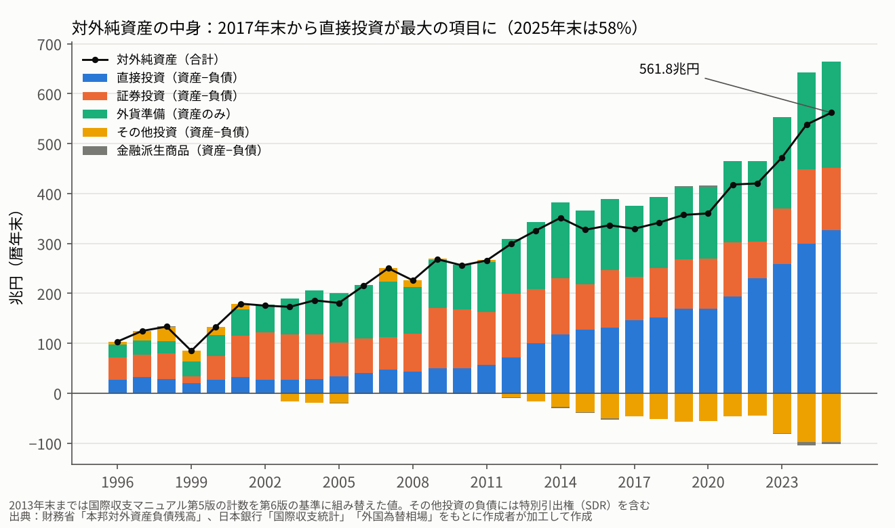
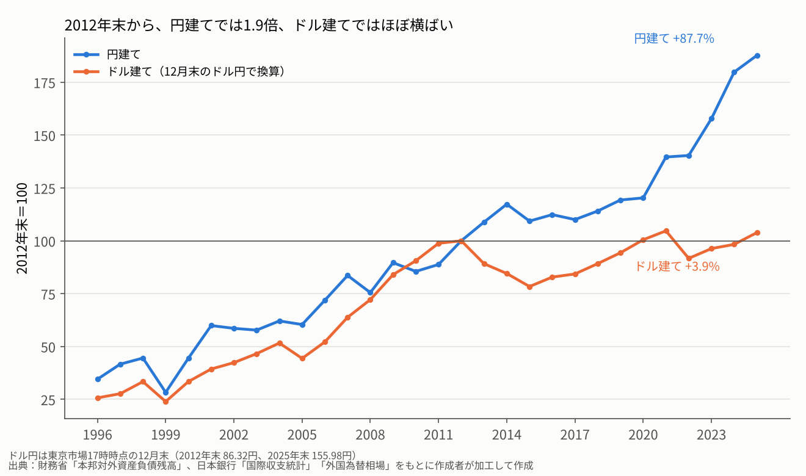
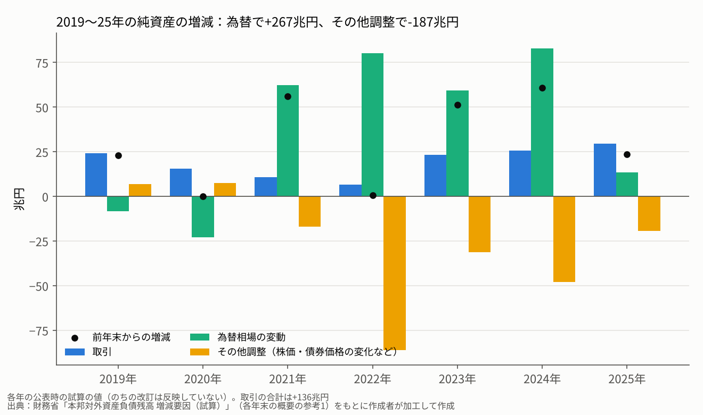
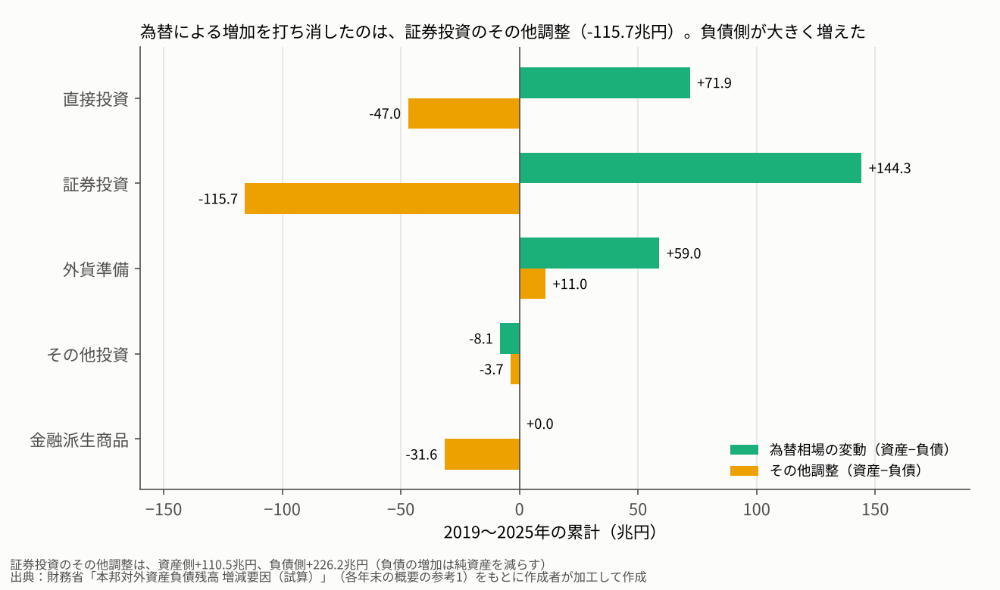

# F532 「日本は世界最大の対外純資産国」は、中身で見るとどう変わったのか？ 直接投資が58%を占める最大の項目になった。2012年末から円建てでは88%増えたが、ドル建てでは4%増にとどまる

## 結論（先に）

- 対外純資産（海外に持つ資産−海外から受け入れた負債）は、2012年末の299.3兆円から2025年末の561.8兆円へ、87.7%増えました。財務省の参考資料では、2024年末からドイツが日本を上回り、2025年末は日本が3番目です。
- 中身は入れ替わりました。2012年末は証券投資の純額（42.6%）が最大でしたが、2017年末から直接投資（海外の子会社や工場への出資など）が最大の項目になり、2025年末は純資産の58.0%（326.0兆円）を占めます。
- 2012年末→2025年末の増加262.4兆円のうち、取引（金融収支の累計）は235.8兆円（89.8%）で、増えた分のほとんどは実際の投資の積み上げで説明できます。
- ただし、財務省の試算（2019〜2025年）では、為替相場の変動で+267.1兆円増え、その他調整（株価・債券価格の変化など）で−187.0兆円減っていて、二つの大きな動きがほぼ打ち消し合っていました。
- ドル建て（各年12月末のドル円で換算）では、2012年末から3.9%増にとどまります。同じ期間にドル円は86.32円から155.98円になっていて、円建てで測るかドル建てで測るかで、増え方の大きさが大きく変わります。

## 問い

「日本は長く世界最大の対外純資産国だった」という言い方は、ニュースや解説でよく使われます。財務省の概要の参考資料（主要国の対外純資産）では、2023年末は日本が一番上でしたが、2024年末はドイツ（569.7兆円）が日本を上回り、2025年末はドイツ（675.5兆円）、中国（636.3兆円）、日本（561.8兆円）の順です。

国際収支や為替のニュースを読む人、企業の海外事業や金融機関の資料を作る人にとって、「最大」の看板がなくなったいま、日本の対外純資産の中身がどう変わり、増えた分のうちどれだけが実際の投資で、どれだけが円安や値動きによる評価の変化なのかは、数字を読むうえでの基本になります。この記事は、財務省と日本銀行の公表データで、それを確かめます。為替や投資の見通し、政策の評価は扱いません。

## データ（出典）

- 財務省「本邦対外資産負債残高の推移（時系列データ）」：暦年末、1996〜2025年。資産と負債の項目別（直接投資、証券投資、金融派生商品、その他投資、外貨準備）と対外純資産。表の単位は10億円で、金融収支と合わせるため億円に直しました。2013年末までは、旧基準（国際収支マニュアル第5版）の計数を新基準に組み替えた値です。
- 財務省「本邦対外資産負債残高 増減要因（試算）」：令和元年末（2019年）〜令和7年末（2025年）の概要の参考1（PDF）。前年末からの増減を、取引・為替相場変動・その他調整に分けた表です。PDF からテキストにして読み、項目の和と合計、増減の恒等式が成り立つことを確かめました（results/factor_checks.csv）。
- 日本銀行 時系列統計データ検索サイト：国際収支統計の金融収支（月次）を暦年に合計しました。ドル円は東京市場17時時点の12月末の値です（2025年末155.98円は、財務省の参考資料の値と一致）。

項目の名前は、表の見出しの文字（「資産残高」「負債残高」と、その下の「直接投資」など）から付けました。2012年と2025年の値は元の表と照らし合わせています。

## 事前の計画

計画は [PLAN.md](PLAN.md) に、項目別の純額や増減の分解を計算する前（2026-11-19 05:55）に書きました。下見で、資産側の時系列と2025年末の負債・純資産、2025年の増減要因の1年分は見ていました。そのため、仮説はそれ以外の点（2012年末の項目、期間の累計、2019〜2024年の要因）に置きました。

| 仮説 | 外れの基準 | 判定 |
|---|---|---|
| H1 2012年末の最大の項目は証券投資（直接投資ではない） | 直接投資の純額が証券投資以上 | 支持（証券投資127.6兆円、直接投資72.0兆円） |
| H2 2012年末→2025年末の増加の半分以上は取引による | 取引が半分未満 | 支持（89.8%） |
| H3 2019〜2025年の為替による増加は正で、増加の合計の4分の1以上 | 負か4分の1未満 | 支持（123.8%。為替だけで増加の合計を上回る） |
| H4 直接投資の資産の増加の7割以上は取引による | 7割未満 | 支持（97.3%） |

## やったこと

- 項目ごとに「資産−負債」の純額を出し、純資産に占める割合を年ごとに並べました（外貨準備は資産だけ）。
- 期間の初めと終わりの純資産の差を、その間の金融収支の合計（取引）と、残り（評価の変化など）に分けました。
- 財務省の試算の7年分を年ごとに並べ、取引・為替・その他を累計しました。
- 純資産を各年12月末のドル円で割り、ドル建てでも見ました。

## 分かったこと

### 1. 2017年末から、直接投資が最大の項目になった（図1）



- 2012年末の純額は、証券投資127.6兆円（42.6%）、外貨準備109.5兆円（36.6%）、直接投資72.0兆円（24.1%）、その他投資−9.1兆円でした。
- 2013〜2016年末は外貨準備が最大で、2017年末から直接投資が最大の項目です。
- 2025年末は、直接投資326.0兆円（58.0%）、外貨準備213.7兆円（38.0%）、証券投資124.8兆円（22.2%）、その他投資−97.8兆円（−17.4%）です。
- 資産の総額に占める直接投資の割合は、2012年末の13.9%から2025年末の21.3%に上がりました。
- 直接投資の資産の増加293.3兆円のうち、取引は285.3兆円（97.3%）でした。

### 2. 円建てでは1.9倍、ドル建てではほぼ横ばい（図2）



- 円建ての純資産は2012年末の299.3兆円から2025年末の561.8兆円へ、87.7%増えました。2025年末が最も大きい値です。
- 同じ期間に、ドル円は86.32円から155.98円になりました。ドル建てでは3兆4,674億ドルから3兆6,014億ドルへ、3.9%増です。
- ドル建ての最大は2021年末の3兆6,302億ドルで、2025年末はそれをわずかに下回ります。

### 3. 為替で増え、その他調整で減った（図3）



- 財務省の試算の2019〜2025年の累計は、増減+215.7兆円、取引+135.6兆円、為替+267.1兆円、その他調整−187.0兆円です。
- 為替の寄与は2021〜2025年の5年で正、2019・2020年は負でした。
- その他調整は2022年に−86.1兆円と最も大きく、その年は為替の+80.3兆円をほぼ打ち消して、増減は+0.7兆円でした。

## 問い直し（結果を見てから足した）

### 為替で増えた分を打ち消したのは、どの項目か（図4）

図3で、為替の増加とその他調整の減少がほぼ打ち消し合っていたため、結果を見てから、2019〜2025年の累計を項目ごとに「資産の分−負債の分」で分けました。



| 項目 | 為替（純額、兆円） | その他調整（純額） | うち資産側 | うち負債側 |
|---|---|---|---|---|
| 直接投資 | +71.9 | −47.0 | −57.4 | −10.4 |
| 証券投資 | +144.3 | −115.7 | +110.5 | +226.2 |
| 外貨準備 | +59.0 | +11.0 | +11.0 | — |
| その他投資 | −8.1 | −3.7 | +12.5 | +16.2 |
| 金融派生商品 | 0.0 | −31.6 | +635.1 | +666.7 |

- 打ち消しの最大は証券投資でした。資産側のその他調整は+110.5兆円でしたが、負債側（海外の投資家が持つ日本の株や債券）は+226.2兆円と2倍以上増え、純額で−115.7兆円です。財務省の注記では、その他調整には株価・債券価格などの変動のほか、統計の作り方の違いによる増減も入ります。
- 2025年末の対外資産のうち外貨建ては1,350.7兆円（74.8%）、対外負債のうち外貨建ては284.9兆円（22.9%）です（試算の注記）。外貨建ての純額は1,065.8兆円で、純資産561.8兆円の1.9倍あります。言い換えると、円建ての部分は差し引き−504.0兆円の負債です。円の値打ちが変わると、外貨建ての純額に応じて円建ての純資産が大きく動く形になっています。
- 金融派生商品は、取引と調整が資産・負債ともに600兆円を超えて逆向きに動いています。計上の仕方による見かけの大きさで、純額では小さくなります。

## 頑健性

| 確かめ | 純資産の増減（兆円） | 取引 | 取引以外 | 取引の割合 |
|---|---|---|---|---|
| 2012年末→2025年末（基本） | +262.4 | +235.8 | +26.6 | 89.8% |
| 2014年末→2025年末（新基準の開始から） | +210.6 | +229.9 | −19.3 | 109.2% |
| 2000年末→2025年末 | +428.7 | +421.1 | +7.6 | 98.2% |
| 2012年末→2025年末（金融派生商品を除く） | +266.6 | +197.2 | +69.4 | 74.0% |
| 2018年末→2025年末 | +220.3 | +140.5 | +79.8 | 63.8% |
| 財務省の試算 2019〜2025年の累計 | +215.7 | +135.6 | +80.1（為替+267.1、その他−187.0） | 62.9% |

- 起点をどこに置いても、増加の6割以上は取引で説明できました（H2 は変わりません）。
- 2018年末→2025年末の残差の方法（取引の割合63.8%）と、財務省の試算（62.9%）はほぼ一致しました。年ごとの取引の値は、いまの金融収支と公表時の試算とで最大6.0兆円（2021年）違います。のちの改訂によるものです（results/flow_check_bop_vs_mof.csv）。
- ドル建てでは、2012年末→2025年末は+3.9%でした（表は results/robustness.csv）。

## 言えないこと

- その他調整の中身（価格の変化と統計上の差）は、試算の表からは分けられません。負債側の増加を「株価の上昇による」と言い切ることはできません。
- 国の順位は、各国の統計の作り方と、円に換える為替レートで変わります。順位は財務省の参考資料の引用にとどめています。
- 直接投資の残高は、時価ではない評価（財務省は時価ベースの推計も参考に出しています）で、時価にすると値も割合も変わります。
- 為替の試算は2019〜2025年の7年分だけで、それより前の年の為替の寄与は分かりません。
- 今後の為替・投資・純資産の見通しは書きません。政策の評価もしません。

## 仕事で使うなら

- 「対外純資産が過去最高」を引用するときは、ドル建ての値や、為替・その他調整の内訳を添えると、円安の分と投資の積み上げの分を分けて読めます。
- 対外純資産の中身を説明するときは、直接投資・証券投資・外貨準備の純額を並べると、「誰が何を持っているか」の違いが伝わりやすくなります。

## 計画からの変更

- 6IIP.xls の単位が10億円だったため、最初の集計で金融収支（億円）と単位がずれていました。表の単位の文字を読んで確かめる処理を足し、億円にそろえ直しました。
- 試算の取引と、いまの金融収支を年ごとに照らす表（flow_check_bop_vs_mof.csv）を足しました。
- 問い直しで、試算の注記にある外貨建ての資産・負債も読み、外貨建ての純額を出しました。

## 再現のしかた

```sh
pip install -r requirements.txt
sh src/run_all.sh                 # オフライン。02 → 03 → 03b → 04
# python3 src/01_fetch.py         # 取り直すときだけ（ネットが要る）
# python3 src/01b_extract_pdf.py  # PDF の読み直し（pdftotext が要る）
```

| ファイル | 中身 |
|---|---|
| src/01_fetch.py | 財務省・日銀から取得（run_all.sh では呼ばない） |
| src/01b_extract_pdf.py | 増減要因の PDF を読み、data/extracted に表を書く（run_all.sh では呼ばない） |
| src/02_build.py | 表の整形と、PDF の値の恒等式の確認 |
| src/03_analysis.py | 項目別の純額、取引と残差、試算の累計、頑健性（results/main.json ほか） |
| src/03b_requestion.py | 問い直し：項目ごとの為替とその他調整、外貨建ての純額 |
| src/04_figures.py | 図4枚 |

所要は約3秒（CPU 1つ）。乱数は使いません。repro_check：results/repro_check.txt を参照（/tmp に写して流し直し、results と figures と data の生成ファイルが cmp で一致）。

## レビューで直したこと

| # | 指摘 | 直し方 |
|---|---|---|
| 1 | 結論の「円建ての増加の多くは円安によって大きく見えている分です」は、同じ結論の「増加の89.8%は取引で説明できる」と食い違って読め、為替の寄与を因果のように言い切っていた | ドル建てでは3.9%増にとどまること、その差は同じ期間のドル円の動き（86.32円→155.98円）と重なることを書き、どの物差しで測るかで増え方の大きさが変わる、という書き方にした |
| 2 | 図1の凡例で、負債のない外貨準備にも「（資産−負債）」と付いていた | 「外貨準備（資産のみ）」にした |

## 出典

- 財務省「本邦対外資産負債残高」 https://www.mof.go.jp/policy/international_policy/reference/iip/index.htm
- 財務省「統計表一覧（本邦対外資産負債残高）」 https://www.mof.go.jp/policy/international_policy/reference/iip/data/index.htm
- 財務省「令和7年末現在本邦対外資産負債残高の概要」 https://www.mof.go.jp/policy/international_policy/reference/iip/data/2025_g.htm
- 財務省「令和6年末現在本邦対外資産負債残高の概要」 https://www.mof.go.jp/policy/international_policy/reference/iip/data/2024_g.htm
- 日本銀行 時系列統計データ検索サイト（国際収支統計、外国為替相場） https://www.stat-search.boj.or.jp/

（いずれも 財務省「本邦対外資産負債残高」、日本銀行「国際収支統計」「外国為替相場」 をもとに作成者が加工して作成）
