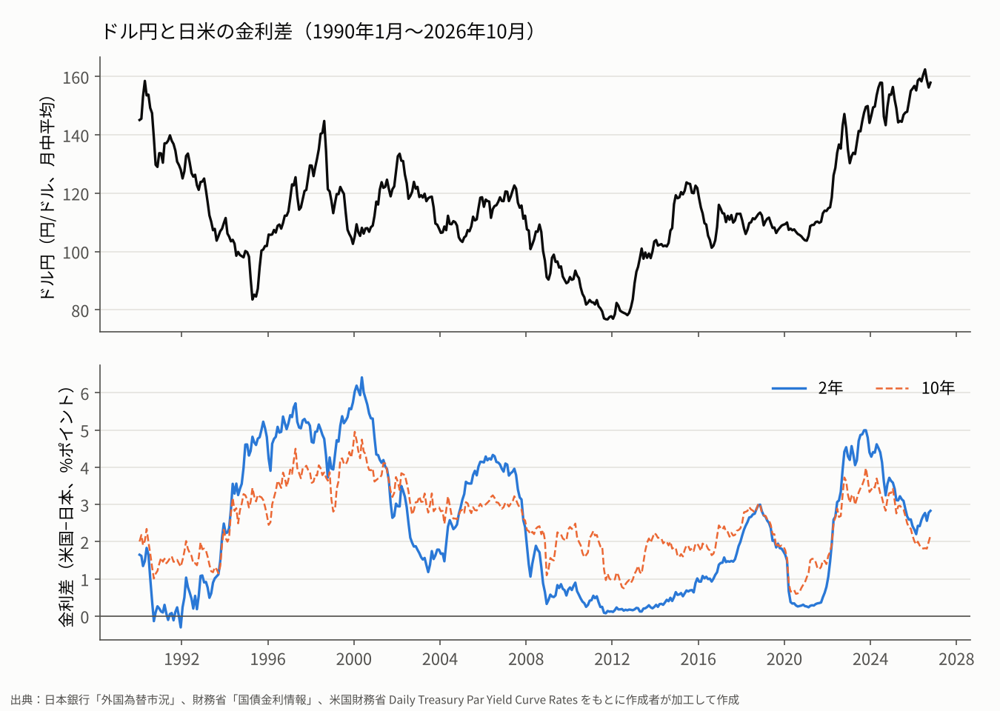
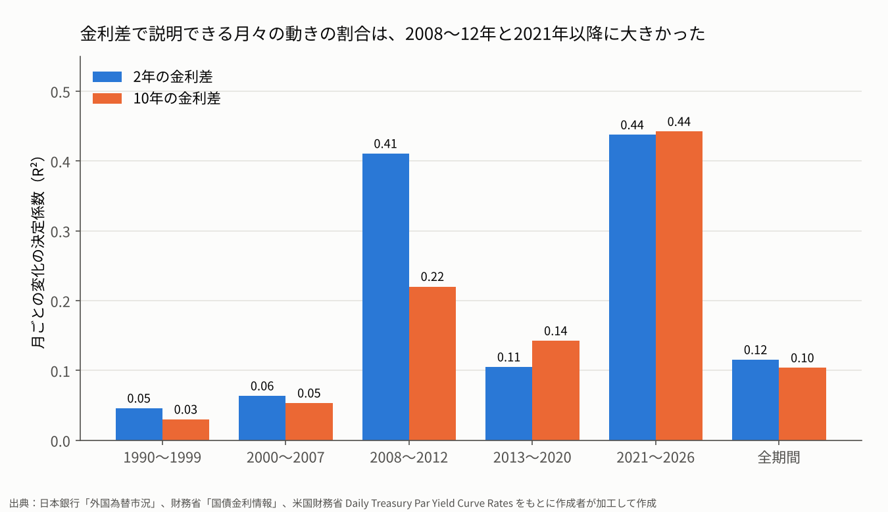
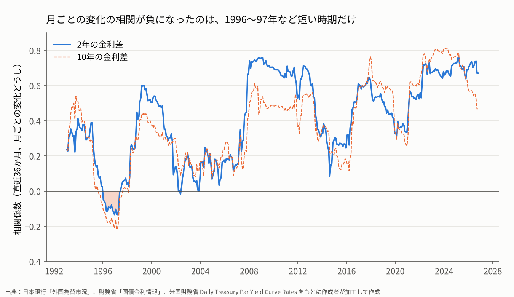
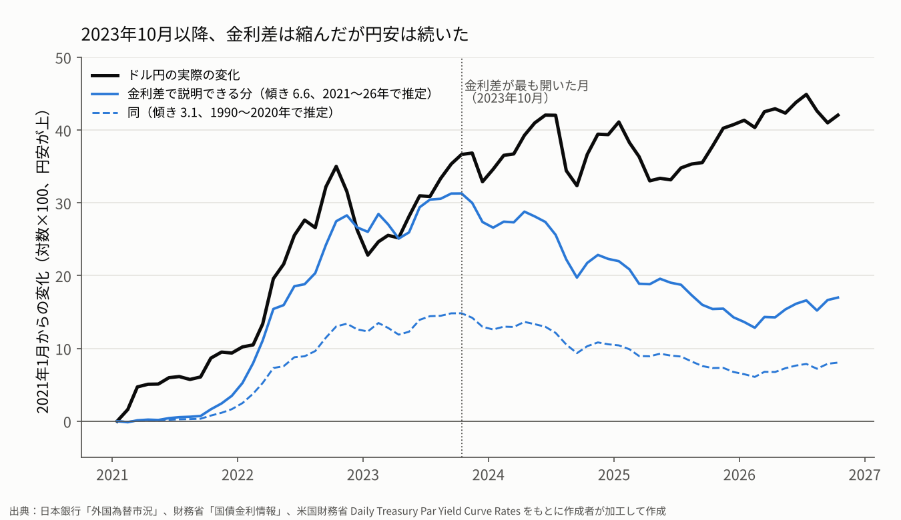

# F533 円安は、日米の金利差でどこまで説明できるのか？ 月々の動きで説明できるのは1990〜2026年で12%、2021年以降は44%。2023年10月から金利差は縮んだが円安は続いた

## 結論（先に）
- 1990年2月〜2026年10月の441か月で、ドル円（月中平均）の月ごとの変化を、日米の2年の国債金利の差の変化で説明できる割合（決定係数 R²）は0.12でした。金利差が1ポイント広がった月は、ドル円が平均で3.8%円安の方向に動いていました。関係ははっきりありますが、月々の動きの9割近くは金利差の外にあります。
- 説明できる割合は期間で大きく違い、1990〜2007年は0.05、2013〜2026年は0.26でした。2008〜2012年（0.41）と2021〜2026年（0.44）に特に大きくなっています。
- 2021年1月（103.70円）から、2021年以降で最も円安だった2026年7月（162.45円）までの円安を、1990〜2020年の関係（傾き3.1）と金利差の変化で説明できるのは18%でした。事前の仮説（50%以上）は外れました。
- 結果を見てから2021年以降を分けると、金利差が最も開いた2023年10月までは、金利差（+4.7ポイント）と円安（149.59円まで）が同じ向きに動いていました。その後2026年10月までに金利差は2.2ポイント縮みましたが、ドル円は157.89円とさらに円安の方向にありました。
- 為替や金利の先行き、投資や政策の判断については何も言いません。過去の数字の関係の読み方までです。

## 問い
「円安は日米の金利差のせい」という説明をよく聞きます。日本銀行のワーキングペーパー（宮本 2025、No.25-J-2）は、日次のデータを使い、2021年1月〜2023年9月半ばの約32%の円安のうち約24%分（4分の3ほど）が米国の金利の影響によるもので、ほかの期間やほかの通貨では米国の金利の説明力が常に高いわけではない、という趣旨を要旨で示しています（要約）。この記事の数字（金利差、月次、単純な回帰）とは方法が違い、直接は比べられません。この記事では、もっと単純な「金利差とドル円の月ごとの変化の関係」を1990年から見て、どの期間にどれだけ説明できるのか、関係が崩れた時期はいつかを確かめます。

## データ（出典）
- 日本銀行「外国為替市況」東京市場 ドル・円 スポット 17時時点/月中平均（FXERM07）。月末の中心相場（FXERM08、1992年8月から）を頑健性に使いました。時系列統計データ検索サイトの API で取得。
- 財務省「国債金利情報」の2年・10年の国債金利（日次、1974年から）。月平均にしました。
- 米国財務省 Daily Treasury Par Yield Curve Rates の2年・10年（日次、1990年から）。月平均にしました。
- 金利差＝米国の金利−日本の金利（%ポイント）。期間は1990年1月〜2026年10月（442か月、変化は441か月）。
- 元のファイル（日銀の JSON、財務省の CSV、米国財務省の年ごとの CSV 37本、計1.9MB）を `data/raw/` に同梱しました。

## 事前の計画
[PLAN.md](PLAN.md)（2026-11-19 05:47、集計の前に作成）。下見ではドル円の最後の3か月と、日米の金利のいくつかの日の値だけを見ていました。

| 仮説 | 外れの基準 | 結果 | 判定 |
|---|---|---|---|
| H1 全期間の R² は0.05以上0.3未満で傾きは正 | 範囲の外か傾きが負 | R² 0.115、傾き3.77（標準誤差0.74） | 支持 |
| H2 2013〜2026年の R² は1990〜2007年より大きい | 同じか小さい | 0.262 対 0.046 | 支持 |
| H3 全期間で2年の金利差の R² が10年より大きい | 同じか小さい | 0.115 対 0.104 | 支持（差は小さい） |
| H4 2021年1月〜最も円安の月の円安のうち、1990〜2020年の傾きで説明できる分は50%以上 | 50%未満 | 17.5%（2026年7月まで） | 外れ |

## やったこと
1. 日次の金利を月平均にし、ドル円・金利差の月次の表を作りました（02_build.py）。
2. ドル円の対数の変化（×100、%に近い）を、金利差の変化に回帰しました。標準誤差は、近い月どうしの誤差の相関に強い Newey–West（6か月）にしました。期間を5つに分けても計算しました。直近36か月の相関を1か月ずつずらして計算しました（03_analysis.py）。
3. 2021年1月から最も円安だった月までの変化を、「1990〜2020年の傾き×金利差の変化」と残りに分けました。
4. 結果を見てから、2021年以降を金利差が最も開いた月の前と後に分けました（03b_requestion.py）。

## 分かったこと

### 1. 長い目で見ると、水準は同じ向きに動かない時期もある（図1）

ドル円と2年の金利差の水準どうしの相関は、全期間で0.32でした。1990〜1999年は−0.45と逆向きで、2008〜2012年は0.91、2021〜2026年は0.71でした。水準どうしは、どちらもゆっくり動く波を持つため、見かけの相関が出やすく、この記事では参考にとどめます。

### 2. 月々の動きを説明できる割合は、期間で大きく違う（図2）

2年の金利差の R² は、1990〜1999年0.05、2000〜2007年0.06、2008〜2012年0.41、2013〜2020年0.11、2021〜2026年0.44でした。傾き（金利差1ポイントあたりのドル円の変化）も、2.2・2.5・9.1・5.2・6.6%と、期間で違います。10年の金利差でも形は同じでした。

### 3. 関係が逆向きになったのは短い時期だけ（図3）

直近36か月の相関が負になったのは、406か月のうち20か月で、1996年1月〜1997年5月と、2002〜2003年の3つの月だけでした。月々の変化どうしの関係は、ほとんどの時期に同じ向きです。

## 問い直し（結果を見てから足した）

### 2021年以降を、金利差が最も開いた月で分けると（図4）

H4 が外れたので、2021年以降を2年の金利差が最も開いた2023年10月で分けました。

| 期間 | ドル円 | 2年の金利差 | 円安（対数×100） | 金利差で説明できる分（傾き3.1／6.6） |
|---|---|---|---|---|
| 2021年1月→2023年10月 | 103.70 → 149.59円 | 0.26 → 5.00（米国0.13→5.07、日本−0.13→0.07） | +36.6 | +14.8／+31.3 |
| 2023年10月→2026年10月 | 149.59 → 157.89円 | 5.00 → 2.83（米国5.07→4.74、日本0.07→1.91） | +5.4 | −6.8／−14.3 |

2023年10月までは、金利差が広がるのと同じ向きに円安が進みました。2021〜2026年の中で推定した傾き（6.6）なら、この間の円安の85%ほどに当たります。その後は日本の2年の金利が上がって金利差が縮み、関係どおりなら円高の方向（−6.8〜−14.3）でしたが、実際は+5.4の円安でした。図3のとおり月々の変化どうしは同じ向きに動き続けていて、ずれは「水準」で積み重なっています。ずれの理由（貿易や投資のお金の流れ、リスクへの姿勢など）は、このデータでは分けられません。

## 頑健性

| 確かめたこと | 傾き | 標準誤差 | R² |
|---|---|---|---|
| 本線：月中平均・2年・全期間 | 3.77 | 0.74 | 0.115 |
| 月末のドル円（1992年8月〜） | 5.16 | 0.94 | 0.152 |
| 10年の金利差 | 3.96 | 0.70 | 0.104 |
| 2008年9月〜2009年3月を除く | 3.57 | 0.73 | 0.106 |
| 3か月ごとの変化 | 4.15 | 1.06 | 0.118 |
| 2013〜2026年・月末のドル円 | 6.08 | 1.10 | 0.182 |

| H4 の分解の確かめ | 説明できる分 |
|---|---|
| 本線：1990〜2020年の傾き（3.13） | 17.5% |
| 傾きを2000〜2020年で推定（4.48） | 25.1% |
| 10年の金利差で分解 | 5.6% |
| 2021〜2026年の中で推定した傾き（6.6、同じ期間に当てはめ） | 37.0% |

どの確かめでも、全期間の R² は0.10〜0.15で、「関係はあるが、月々の動きの大半は金利差の外」という結論は変わりませんでした。H4 の割合は傾きの取り方で5.6〜37.0%と幅がありますが、どれも50%には届きません。

## 言えないこと
- 金利差がドル円を動かしたのか、同じ出来事（物価の見通しや景気の変化）が両方を動かしたのか（因果）は、この回帰では分かりません。
- 月平均の値を使っているので、1日の中や日ごとの反応は見ていません。日本銀行のワーキングペーパーの日次の分析とは方法が違い、数字は比べられません。
- 2023年10月以降のずれの理由（貿易収支、投資のお金の流れ、介入、リスクへの姿勢など）は、一つずつ分けていません。
- 2年・10年の国債金利は、政策金利や先行きの期待の一部しか表しません。物価の違いを引いた実質の金利差は見ていません。
- 過去の関係から、この先のドル円や金利を見通すことはできません。投資や政策の判断には使えません。

## 仕事で使うなら
「円安は金利差のせい」と書くときは、期間を添えると誤解が減ります。月々の動きでは2021〜2023年のように金利差とよく合う時期もあれば、1990年代や2023年10月以降のように水準がずれる時期もあります。

## 計画からの変更
- H4 が外れたので、2021年以降を金利差が最も開いた月の前後に分ける分析（図4）と、2021〜2026年の中で推定した傾きでの分解を、結果を見てから足しました。
- 頑健性に「2013〜2026年・月末のドル円」を足しました。

## 再現のしかた
```
sh src/run_all.sh
```
ネットにはつながず、`data/raw/` から `data/monthly.csv`、`results/`、`figures/` を作ります（約10秒）。元データを取り直すときは `python3 src/01_fetch.py`（米国財務省の CSV は1年ずつ取るので数分かかります）。Python 3.13、requirements.txt の版で確かめました。

| ファイル | 中身 |
|---|---|
| src/02_build.py | 日次の金利を月平均にし、ドル円とつなぐ |
| src/03_analysis.py | 回帰、期間別、移動相関、H4 の分解、頑健性 |
| src/03b_requestion.py | 2021年以降を2つに分ける（問い直し） |
| src/04_figures.py | 図4枚 |
| results/main.json | 本文の数字のもと |

repro_check：/tmp/rep_F533 に写し、02 以降が作るファイル（results・figures・data/monthly.csv）を消してから流し直し、11ファイルがすべて cmp で一致しました（所要4秒。results/repro_check.txt）。

## レビューで直したこと

| # | 指摘 | 直し方 |
|---|---|---|
| 1 | 「問い」で引いた日本銀行ワーキングペーパーの要約が「多く」とだけあり、数字と方法の書き方があいまいだった | 要旨の文（2021年1月〜2023年9月半ばの約32%の円安のうち約24%分が米国の金利の影響）に合わせて書き直し、この記事の方法とは直接比べられないことを足した（note の原稿も同じ） |
| 2 | results/main.json の robustness に `NaN`（JSON の決まりにない値）が入っていた | 03_analysis.py で `null` を出すように直した（ほかの数字は変わらない） |

## 出典
- 日本銀行 時系列統計データ検索サイト「外国為替市況」（FXERM07・FXERM08）：https://www.stat-search.boj.or.jp/
- 財務省「国債金利情報」：https://www.mof.go.jp/jgbs/reference/interest_rate/index.htm （データ：https://www.mof.go.jp/jgbs/reference/interest_rate/data/jgbcm_all.csv ）
- U.S. Department of the Treasury, Daily Treasury Par Yield Curve Rates：https://home.treasury.gov/resource-center/data-chart-center/interest-rates/TextView?type=daily_treasury_yield_curve （年ごとの URL は data/raw/SOURCES.md）
- 宮本亘「日本の為替レートの動向と決定要因に関する分析」日本銀行ワーキングペーパーシリーズ No.25-J-2（2025年2月）：https://www.boj.or.jp/research/wps_rev/wps_2025/data/wp25j02.pdf

（いずれも 日本銀行「外国為替市況」、財務省「国債金利情報」、米国財務省 Daily Treasury Par Yield Curve Rates をもとに作成者が加工して作成）
