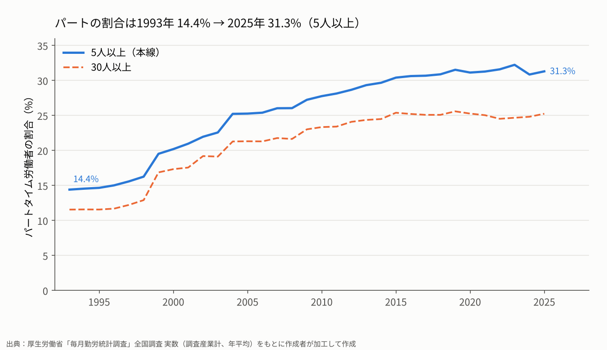
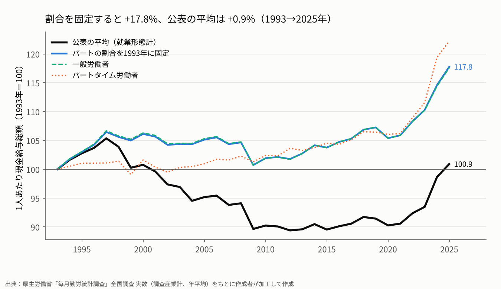
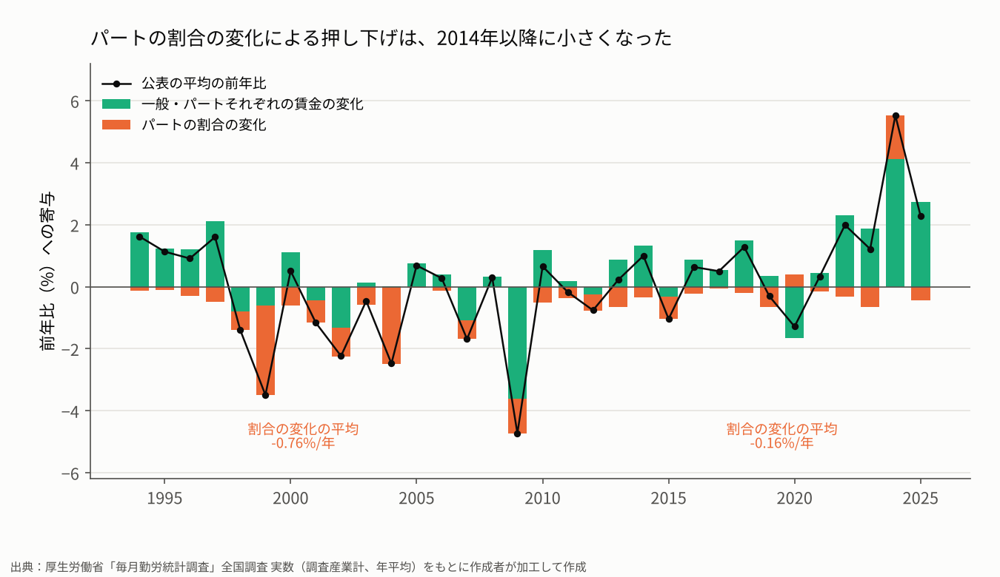
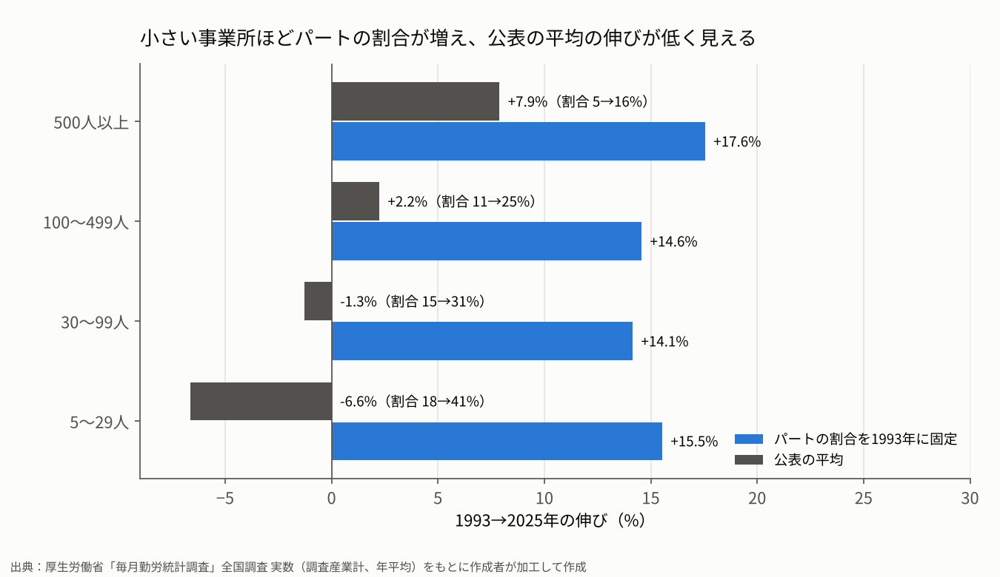

# F534 毎月勤労統計の1人あたり賃金の伸びは、パートの割合の増加でどれだけ低く出ているのか？ 1993→2025年の公表の平均は+0.9%。パートの割合を1993年のままとした仮の計算では+17.8%で、差の16.9ポイントが割合の増加による押し下げ

## 結論（先に）
- 厚生労働省「毎月勤労統計調査」の1人あたり現金給与総額（調査産業計・5人以上・年平均）は、1993年35万2,744円、2025年35万5,941円で、32年で+0.9%でした。
- 同じ期間に、働く人に占めるパートタイム労働者の割合は14.4%から31.3%に増えました。パートの1人あたりの額は一般労働者の4分の1ほどなので、割合が増えるだけで平均は下がります。
- パートの割合を1993年のまま固定して平均を作り直すと、伸びは+17.8%でした。公表の平均との差は16.9ポイントで、これが「平均の作り方（構成）」による押し下げです。一般労働者だけでは+17.6%、パートだけでは+22.2%でした。+17.8%は「割合が変わらなかったら」という仮の計算で、2024年の調査の土台の切り替えによる段差も含みます。2023年まででは、割合を固定した伸びは+10.3%（公表の平均は−6.5%）で、差は16.8ポイントとほぼ同じでした。
- 割合の変化による押し下げは、1994〜2007年は平均で年−0.76%、2014〜2025年は年−0.16%と小さくなりました。2013年を基準にすると、2013→2025年の押し下げは2.2ポイントだけです。
- 1時間あたり（現金給与総額÷総実労働時間）で見ると、押し下げは6.4ポイントで、月額の約4割でした。月額の押し下げの残りの6割ほどは、パートの働く時間の短さによる分と読めます。

## 問い
「日本の賃金は30年上がっていない」と言われます。そのとき使われることの多い毎月勤労統計の「1人あたりの賃金」は、正社員などの一般労働者と、パートタイム労働者をまとめた平均です。パートが増えると、1人ひとりの賃金が変わらなくても平均は下がります。

厚生労働省「令和5年版 労働経済の分析」第Ⅱ部第1章は、パートタイム労働者の増加が1996〜2019年に一貫して1人あたりの賃金を押し下げたという趣旨を述べています（要約）。この記事では、同じことを毎月勤労統計の公表の数字だけで、2025年まで確かめます。押し下げの大きさを数字で見せることが目的で、賃金の水準の良し悪しや、どうすべきかは扱いません。

関連する記事：F66（共通事業所と本系列の前年比の差、2018〜2026年）、F257（賃上げの広がりとパートの時給）、F258（実質賃金の連続マイナスと物価の選び方）。この記事は、就業形態の構成が平均をどれだけ動かすかだけを扱う点が違います。

なお、topics.tsv のたたき台は「共通事業所の系列と本系列の違い」でしたが、既存の F66 が同じ問いを扱っているため、同じ「平均の作り方」の中で、就業形態の構成に切り口を変えました（REPLACED.md に記録）。

## データ（出典）
- 厚生労働省「毎月勤労統計調査」全国調査 実数・指数累積データ 実数（e-Stat、CSV）。調査産業計（TL）、年平均（CY）、1993〜2025年。
- 規模：5人以上（本線）、30人以上（頑健性）、500人以上・100〜499人・30〜99人・5〜29人（問い直し）。規模の記号は、5人以上＝30人以上＋5〜29人、30人以上＝3つの規模の合計、になることを労働者数で確かめました。ただし、30人以上の中の3つの記号（4・5・7）を500人以上・100〜499人・30〜99人のどれに当てるかは、1人あたりの額と労働者数の並び（規模が大きいほど額が高い）から推したものです（推測。記号の説明の表では確かめていません）。
- 項目：現金給与総額、所定内給与、総実労働時間、本月末労働者数、パートタイム労働者数。就業形態別（一般・パート）の値は1993年からです。
- 元の CSV（約21MB）は gzip で圧縮して `data/raw/` に同梱しました（8.2MB）。

## 事前の計画
[PLAN.md](PLAN.md)（2026-11-19 05:49、集計の前に作成）。下見では、CSV の見出しと記号の一覧、年の範囲だけを見ていました。

| 仮説 | 外れの基準 | 結果 | 判定 |
|---|---|---|---|
| H1 1993年の割合で固定した伸びは、公表の伸びより5ポイント以上大きい | 5ポイント未満 | +17.8% 対 +0.9%（差16.9ポイント） | 支持 |
| H2 割合の変化による押し下げ（年あたり）は2014〜2025年の方が1994〜2007年より小さい | 同じか大きい | 年−0.16% 対 年−0.76% | 支持 |
| H3 一般労働者だけの伸びは、公表の平均の伸びより大きい | 同じか小さい | +17.6% 対 +0.9% | 支持 |
| H4 1時間あたりの押し下げは月額の半分以下 | 半分より大きい | 6.4 対 16.9ポイント（0.38倍） | 支持 |

## やったこと
1. 累積データから、調査産業計・年平均・1993〜2025年の行を抜き出しました（02_build.py）。
2. パートの割合 p＝パートタイム労働者数÷本月末労働者数 とし、平均を W＝(1−p)×一般＋p×パート と組み立てました。組み立てた平均と公表の就業形態計の差は、どの年も0.04%以内でした。
3. p を1993年の値に固定した平均を作り、公表の平均と伸びを比べました。年ごとの変化は、2時点の平均で重みをつける方法で「それぞれの賃金の変化」と「割合の変化」に分けました（足すと前年比に一致します）（03_analysis.py）。
4. 1時間あたりは、総実労働時間の割合で重みをつけて同じ計算をしました。
5. 結果を見てから、事業所の規模別に同じ計算をしました（03b_requestion.py）。

## 分かったこと

### 1. パートの割合は2倍あまりになった（図1）

5人以上の事業所で、パートの割合は1993年14.4%、2007年26.0%、2013年29.3%、2025年31.3%でした。増え方は2000年代までが速く、2015年ごろからはほぼ横ばいです。

### 2. 割合を固定すると、伸びは+17.8%（図2）

一般労働者の1人あたりは39万6,218円から46万5,923円（+17.6%）、パートは9万3,719円から11万4,527円（+22.2%）に増えました。どちらも増えたのに、まとめた平均は+0.9%にとどまります。パートの割合を1993年のまま固定すると+17.8%で、差の16.9ポイントは割合の変化から来ています。

### 3. 押し下げは2014年以降に小さくなった（図3）

32年のうち30年で、割合の変化は平均を押し下げていました。年あたりの押し下げは、1994〜2007年が−0.76%、2008〜2013年が−0.53%、2014〜2025年が−0.16%です。2024年だけは割合が下がり、押し上げ（+1.42%）になっていますが、この年は公表の平均の前年比も+5.5%と大きく、調査の土台の切り替えによる段差を含むと考えられます（推測）。2024年を含まない2014〜2023年の平均は−0.29%でした。

## 問い直し（結果を見てから足した）

### 押し下げは、事業所の規模でどう違うのか（図4）

5〜29人の事業所では、パートの割合が18.5%から40.7%に増え、公表の平均は−6.6%でした。割合を固定すると+15.5%で、差は22.2ポイントです。500人以上では割合が5.1%から15.6%で、公表の平均+7.9%、固定+17.6%、差は9.7ポイントでした。割合を固定した伸びは規模によらず+14〜18%で近く、公表の平均の違いの多くは、パートの割合の増え方の違いから来ています。

## 頑健性

| 確かめたこと | 割合を固定した伸び | 公表の平均の伸び | 差（ポイント） |
|---|---|---|---|
| 本線：5人以上・現金給与総額・1993→2025年 | +17.8% | +0.9% | 16.9 |
| 30人以上 | +16.8% | +3.8% | 13.0 |
| 所定内給与（ボーナスなどを除く） | +20.8% | +5.3% | 15.6 |
| 2000年の割合で固定（2000→2025年） | +11.1% | +0.1% | 11.0 |
| 2013年の割合で固定（2013→2025年） | +14.8% | +12.6% | 2.2 |
| 割合を公表の平均から逆算 | +17.8% | +0.9% | 16.9 |
| 1993→2023年（2024年の段差を避ける） | +10.3% | −6.5% | 16.8 |
| 1時間あたり（時間の割合で固定） | +25.9% | +19.5% | 6.4 |

30人以上でも、所定内給与でも、2024年を避けても、押し下げは13〜17ポイントで、結論は変わりませんでした。押し下げの大部分は2013年より前に起きています。

## 言えないこと
- 割合を固定した伸びは「同じ人の賃金の伸び」ではありません。一般・パートの中でも、年齢・産業・働く時間の構成が変わっています。
- 毎月勤労統計の実数は、調査対象の入れ替えや土台の切り替えで段差を含みます。公表の前年比（指数で計算）とは少し違います。2024年の大きな動きや、1999年・2004年ごろの割合の跳ねには、段差が入っている可能性があります（推測）。
- パートが増えた理由（年齢の高い人や女性の働き方の変化など）は、このデータでは分けられません。
- 「平均が上がらなかった」ことと「1人ひとりの賃金が上がらなかった」ことのどちらが正しいかは、この計算だけでは決められません。両方の見え方がある、ということまでです。
- 賃金の水準の良し悪しや、どうすべきかは扱いません。

## 仕事で使うなら
毎月勤労統計の1人あたりの賃金を長い期間で比べるときは、就業形態計だけでなく、一般労働者・パート別の値とパートの割合を並べて示すと、平均の動きの理由が読み取りやすくなります。2013年ごろ以降は割合がほぼ横ばいなので、最近の比較では構成の影響は小さくなっています。

## 計画からの変更
- 2024年の段差に気づいたため、1993→2023年の比較と2014〜2023年の平均を頑健性に足しました。
- 規模別の計算（図4）を、結果を見てから足しました。

## 再現のしかた
```
sh src/run_all.sh
```
ネットにはつながず、`data/raw/maikin_jissu_cumulative.csv.gz` から `data/maikin_tl_cy.csv`、`results/`、`figures/` を作ります（約10秒）。元データを取り直すときは `python3 src/01_fetch.py`。Python 3.13、requirements.txt の版で確かめました。

| ファイル | 中身 |
|---|---|
| src/02_build.py | 累積データから調査産業計・年平均を抜き出す |
| src/03_analysis.py | 平均の組み立て、割合を固定した伸び、年ごとの分解、頑健性 |
| src/03b_requestion.py | 規模別（問い直し） |
| src/04_figures.py | 図4枚 |
| results/main.json | 本文の数字のもと |

repro_check：/tmp/rep_F534 に写し、02 以降が作るファイル（results・figures・data/maikin_tl_cy.csv）を消してから流し直し、11ファイルがすべて cmp で一致しました（所要3秒。results/repro_check.txt）。

## レビューで直したこと

| # | 指摘 | 直し方 |
|---|---|---|
| 1 | 題名の「+17.8%」が、実際の伸びのように読める | 題名を「仮の計算では+17.8%で、差の16.9ポイントが割合の増加による押し下げ」に変え、結論の主語を差（押し下げ）にした（status・note の1行目もそろえた） |
| 2 | +17.8%に2024年の土台の切り替えの段差が入っていることが、結論の箇所から読み取れない | 結論と note に、2023年まででは固定した伸びが+10.3%で、差は16.8ポイントとほぼ同じことを足した |
| 3 | 規模の記号（4・5・7）の割り当てが値の並びから推したものであることが書かれていない | 「データ」に推測であることを明記した |
| 4 | 同じデータを使う既存の記事への言及が F66 だけだった | 「関連する記事」として F66・F257・F258 と違いを1文で足した |

## 出典
- 厚生労働省「毎月勤労統計調査」全国調査 実数・指数累積データ 実数（e-Stat）：https://www.e-stat.go.jp/stat-search/file-download?statInfId=000032189776&fileKind=1
- 厚生労働省「令和5年版 労働経済の分析」第Ⅱ部第1章 賃金の現状と課題：https://www.mhlw.go.jp/stf/wp/hakusyo/roudou/23/2-1.html

（いずれも 厚生労働省「毎月勤労統計調査」をもとに作成者が加工して作成）
