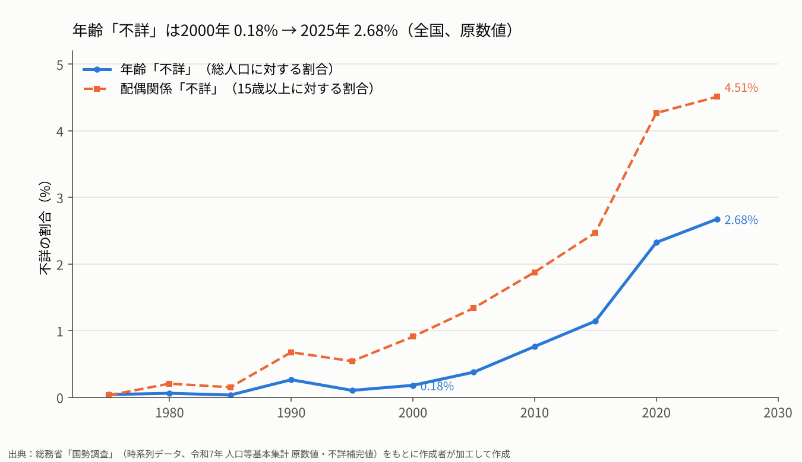
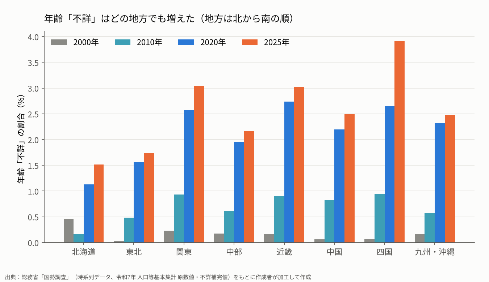
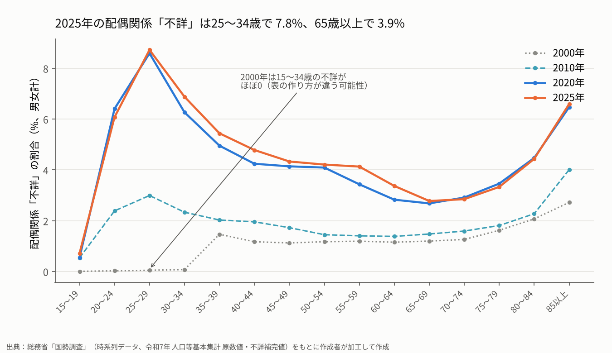
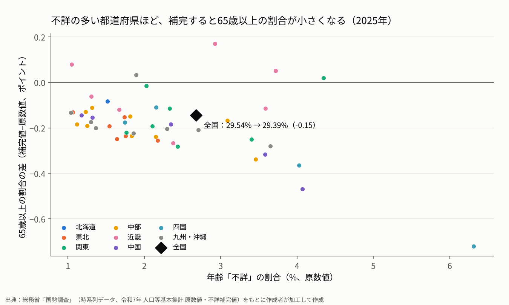

# F535 国勢調査の「不詳」は、どれだけ増えたのか？ 年齢「不詳」は2000年の0.18%から2025年の2.68%へ15倍。補完すると65歳以上の割合は29.54%から29.39%に

## 結論（先に）
- 国勢調査で年齢が分からない人（年齢「不詳」）は、2000年の22万9千人（総人口の0.18%）から、2020年293万人（2.32%）、2025年329万人（2.68%）に増えました。2025年の割合は2000年の約15倍です。
- 15歳以上で配偶関係が分からない人の割合は、2000年0.91%、2020年4.27%、2025年4.51%でした。2025年は25〜34歳で7.8%、65歳以上で3.9%と、若い年齢で高くなっています。
- 地方別（北から南）の年齢「不詳」の割合は、2025年に1.5〜3.9%で、2000年（0.03〜0.46%）からどの地方でも増えました。南関東の4都県と京都・大阪・兵庫をまとめると3.28%、それ以外の道県は2.21%でした。
- 不詳を補った「不詳補完値」で見ると、2025年の65歳以上の割合は29.39%で、不詳を除いて計算する原数値の29.54%より0.15ポイント小さくなりました。65歳以上の人数は79万人多くなります。都道府県では47のうち42で小さくなり、不詳の多いところほど差が大きい傾向でした（相関−0.47）。
- 年齢「不詳」の64%は、日本人と分かっていない人（外国人と、日本人かどうか不詳の人。人口の4.5%）の中にいました（問い直し）。

## 問い
国勢調査の数字は、人口・年齢・家族の話の土台です。ところが、調査票を集めにくい世帯が増え、年齢や配偶関係などが「不詳」の人が増えています。総務省統計局も、未回収・未回答の増加による不詳の増加を課題とし、2015・2020年に不詳を補った参考表を出し、2025年に向けて補完の方法を見直してきました（令和7年国勢調査有識者会議 企画WG 資料、2023年7月。要約）。

不詳はどれだけ増え、どの年齢・地方で多いのか。原数値と補完値のどちらを使うかで、よく使う数字はどれだけ変わるのか。調査の良し悪しや、どうすべきかは扱いません。既存の F120 が扱った「配偶関係不詳と未婚割合」とは重ならないよう、未婚割合は扱いません。

## データ（出典）
- 総務省「国勢調査」時系列データ 第5表：年齢（3区分）別人口－全国、都道府県（1920〜2020年）。総数は年齢「不詳」を含む（表の注による年のみ）。2015・2020年は2022年公表の不詳補完値（※）の行もあります。
- 時系列データ 第4表：配偶関係（4区分）、年齢（5歳階級）、男女別15歳以上人口－全国（1920〜2020年）。総数は配偶関係「不詳」を含みます（1950年以降）。
- 令和7年（2025年）国勢調査 人口等基本集計 第2-3表（年齢）の原数値と不詳補完値、第4-1表（配偶関係）の原数値。
- 2025年の公表と同時に出た、2020年の不詳補完値の遡及集計 第2-3表。
- 不詳の数＝総数−（区分の合計）、または表の「不詳」の列。都道府県の名前は「13000_東京都」のような地域名の文字で付け、北海道・東京都・大阪府・沖縄県などの値を元の表と照らしました。
- 元の Excel 6本（7.8MB）を `data/raw/` に同梱しました。

## 事前の計画
[PLAN.md](PLAN.md)（2026-11-19 05:55、集計の前に作成）。下見では表の見出しと、2025年の全国・いくつかの道県の年齢別人口の最初の列だけを見ていました。

| 仮説 | 外れの基準 | 結果 | 判定 |
|---|---|---|---|
| H1 2025年の年齢「不詳」は1.5%以上で、2000年の5倍以上 | どちらかを満たさない | 2.68%、14.9倍 | 支持 |
| H2 2025年の配偶関係「不詳」は25〜34歳が65歳以上の2倍以上 | 2倍未満 | 7.80% 対 3.92%（1.99倍） | 外れ（わずかに届かず） |
| H3 南関東と京都・大阪・兵庫の年齢「不詳」はそれ以外より高い | 同じか低い | 3.28% 対 2.21% | 支持 |
| H4 2025年の65歳以上の割合の差（補完値−原数値）は0.3ポイント以内 | 0.3より大きい | −0.15ポイント | 支持 |

## やったこと
1. 6本の Excel から、年齢3区分と不詳の数を見出しの文字で探して読み出しました（02_build.py）。
2. 全国・地方・都道府県の不詳の割合と、配偶関係「不詳」の年齢別の割合を出しました。地方は北海道・東北・関東・中部・近畿・中国・四国・九州沖縄の8つで、北から南の順に並べ、順位は出していません（03_analysis.py）。
3. 65歳以上・15歳未満の割合を、原数値（不詳を除いて計算。公表の構成比と同じ29.54%になることを確かめました）と補完値で比べました。
4. 結果を見てから、年齢「不詳」を日本人と分かっている人とそれ以外に分けました（03b_requestion.py）。

## 分かったこと

### 1. 年齢・配偶関係の不詳は2000年代から急に増えた（図1）

年齢「不詳」の割合は、1975〜2000年は0.04〜0.26%でしたが、2005年0.38%、2010年0.76%、2015年1.14%、2020年2.32%、2025年2.68%と増えました。配偶関係「不詳」（15歳以上）は、2010年1.88%、2015年2.47%、2020年4.27%、2025年4.51%です。2020年から2025年の増え方は、2015年から2020年より小さくなっています。

### 2. どの地方でも増えた（図2）

2025年の地方別の年齢「不詳」は、北海道1.52%、東北1.73%、関東3.04%、中部2.17%、近畿3.02%、中国2.49%、四国3.91%、九州・沖縄2.48%でした。都道府県では1.04〜6.31%（中央値1.89%）と幅があり、2020年から2025年に47のうち27で上がりました。

### 3. 配偶関係「不詳」は20〜30代で多い（図3）

2025年の配偶関係「不詳」は、25〜29歳の男性で10.4%、女性で7.0%でした。85歳以上でも6%台と高く、若い年齢と高い年齢の両方で多い形です。なお、2000年（と2005年）は15〜34歳の不詳がほぼ0で、35歳以上とつながっていません。若い年齢の不詳の扱いが違っていた可能性があります（推測）。都道府県別では、2025年の配偶関係「不詳」は0.92〜10.86%で、年齢「不詳」の割合との相関は0.35でした。

### 4. 補完すると65歳以上の割合は少し小さくなる（図4）

原数値は不詳の人を除いて割合を計算し、補完値は不詳の人に年齢を割り当てて総人口で割ります。2025年の全国では、65歳以上の割合は29.54%（原数値）と29.39%（補完値）、15歳未満は11.08%と10.86%でした。人数で見ると、65歳以上は3,535万人から3,614万人に79万人増えます。割合が下がるのは、不詳の人に15〜64歳が多く割り当てられているためと読めます（補完の中身からの推測）。都道府県では差は−0.72〜+0.17ポイントで、47のうち42で小さくなりました。

## 問い直し（結果を見てから足した）

### 年齢の分からない人は、国籍も分からないことが多いのか
2025年の年齢「不詳」329万人のうち、日本人と分かっている人の中にいたのは119万人で、日本人の1.01%でした。残りの210万人（64%）は、外国人と、日本人かどうか不詳の人をまとめたグループにいました。このグループは人口の4.5%ですが、その37.7%で年齢が不詳です。地方別でも、年齢「不詳」のうちこのグループの人の割合は57〜73%でした。調査票の中身がほとんど得られなかった人で、年齢と国籍が同時に不詳になっていると考えられます（推測）。このため、日本人だけの数字では不詳の影響は小さく、総人口の数字では大きくなります。

## 頑健性

| 確かめたこと | 値 |
|---|---|
| 本線：2025年の年齢「不詳」（全国・男女計） | 2.68% |
| 男／女 | 2.93%／2.43% |
| 日本人だけ | 1.01% |
| 2020年の65歳以上の割合の差（補完値−原数値）：2026年の遡及集計／2022年公表 | −0.16／−0.12ポイント |
| 2020年の65歳以上の割合（補完値）：2026年の遡及集計／2022年公表 | 28.51%／28.56% |
| 2020年の都道府県の65歳以上の割合：2つの補完値の差の最大 | 0.16ポイント |
| 2015年の65歳以上の割合の差（補完値−原数値） | −0.05ポイント |
| 2025年の15歳未満の割合の差（補完値−原数値） | −0.22ポイント |
| H3 を南関東4都県だけで：南関東／それ以外 | 3.21%／2.44% |

同じ2020年の補完値でも、2022年の公表と2026年の遡及集計で値が少し違います（全国の65歳以上の割合で0.05ポイント）。補完の方法が変わると補完値も変わる、ということです。補完による差は2015年−0.05、2020年−0.12〜−0.16、2025年−0.15ポイントと、不詳が増えるにつれて大きくなりました。

## 言えないこと
- 不詳が増えた理由（調査票を集めにくい世帯、回答の仕方の変化など）は、この集計では確かめられません。
- 不詳補完値は推計で、本当の値ではありません。補完の方法が変われば値も変わります（2020年の2つの補完値の違いのとおり）。
- 都道府県や地方の不詳の割合の違いを、調査の良し悪しとして読むことはできません。
- 2000・2005年の若い年齢の配偶関係「不詳」がほぼ0である理由は、表からは分かりません。
- 就業状態・国籍など、ほかの項目の不詳の推移は扱っていません。

## 仕事で使うなら
2015年以降の国勢調査の割合を使うときは、原数値（不詳を除く）か不詳補完値かを書き添えると、ほかの資料と数字が合わない理由が説明しやすくなります。65歳以上の割合の差は0.15ポイントでも、人数では79万人の違いになります。

## 計画からの変更
- 2000・2005年の配偶関係「不詳」の年齢別の形が他の年と違うことに気づき、図3と言えないことに書き足しました。
- 年齢「不詳」を国籍で分ける分析（問い直し）を、結果を見てから足しました。

## 再現のしかた
```
sh src/run_all.sh
```
ネットにつながず、`data/raw/` の Excel 6本から中間ファイル・`results/`・`figures/` を作ります（約10秒）。取り直しは `python3 src/01_fetch.py`。Python 3.13、requirements.txt の版で確認。

| ファイル | 中身 |
|---|---|
| src/02_build.py | Excel から年齢・配偶関係の不詳を読み出す |
| src/03_analysis.py | 不詳の割合、地方別、配偶関係、補完の影響、頑健性 |
| src/03b_requestion.py | 年齢「不詳」を国籍で分ける（問い直し） |
| src/04_figures.py | 図4枚 |
| results/main.json | 本文の数字のもと |

repro_check：/tmp/rep_F535 で02以降が作るファイルを消して流し直し、18ファイルが cmp で一致（10秒。results/repro_check.txt）。

## レビューで直したこと

独立レビューで数字の照合・再実行・図を確かめ、直すところはなかった（東京都・大阪府・沖縄県・全国の2025年の総数と年齢「不詳」の数、2000年の配偶関係の行を元の Excel と照らして一致）。

## 出典
- 総務省「国勢調査」時系列データ 第5表：https://www.e-stat.go.jp/stat-search/file-download?statInfId=000012993808&fileKind=0
- 同 第4表：https://www.e-stat.go.jp/stat-search/file-download?statInfId=000001085974&fileKind=0
- 令和7年国勢調査 人口等基本集計 第2-3表（原数値）：https://www.e-stat.go.jp/stat-search/file-download?statInfId=000040506427&fileKind=0 、（不詳補完値）：https://www.e-stat.go.jp/stat-search/file-download?statInfId=000040506655&fileKind=0
- 令和2年国勢調査 不詳補完値（遡及集計）第2-3表：https://www.e-stat.go.jp/stat-search/file-download?statInfId=000040317622&fileKind=0
- 令和7年国勢調査 人口等基本集計 第4-1表（原数値）：https://www.e-stat.go.jp/stat-search/file-download?statInfId=000040506436&fileKind=0
- 総務省統計局「国勢調査の不詳補完に係る課題と対応の方向性」（令和7年国勢調査有識者会議 企画WG 第1回 資料1、2023年7月）：https://www.stat.go.jp/info/kenkyu/kokusei/yusiki07/pdf/ki01_01.pdf

（いずれも 総務省「国勢調査」をもとに作成者が加工して作成）
