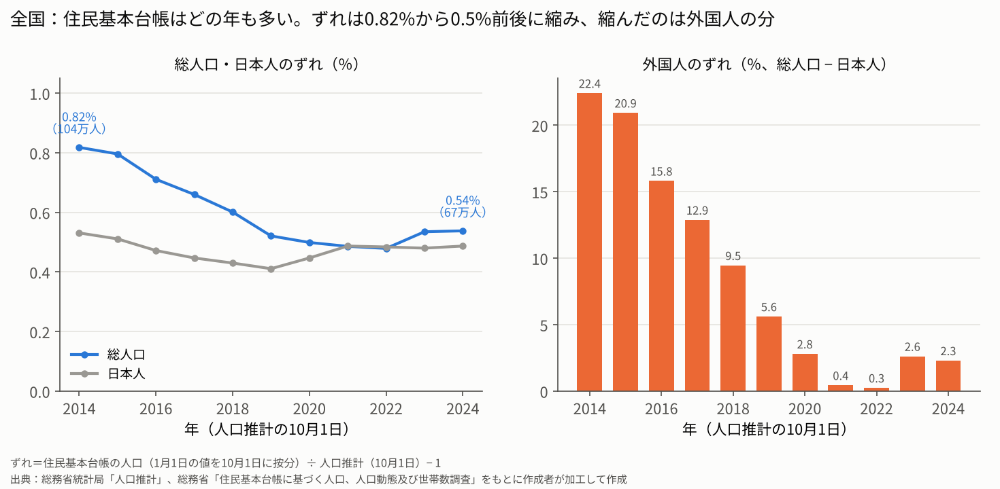
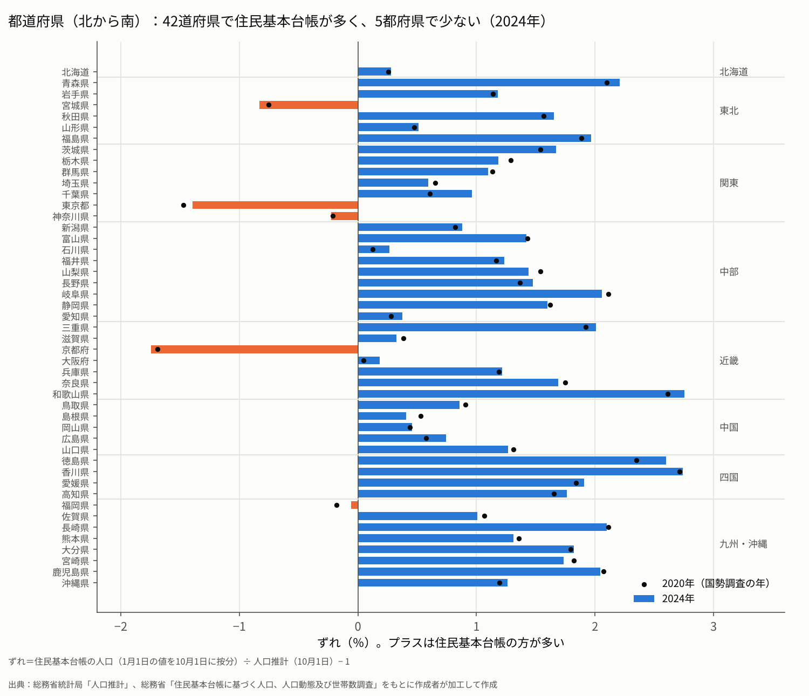
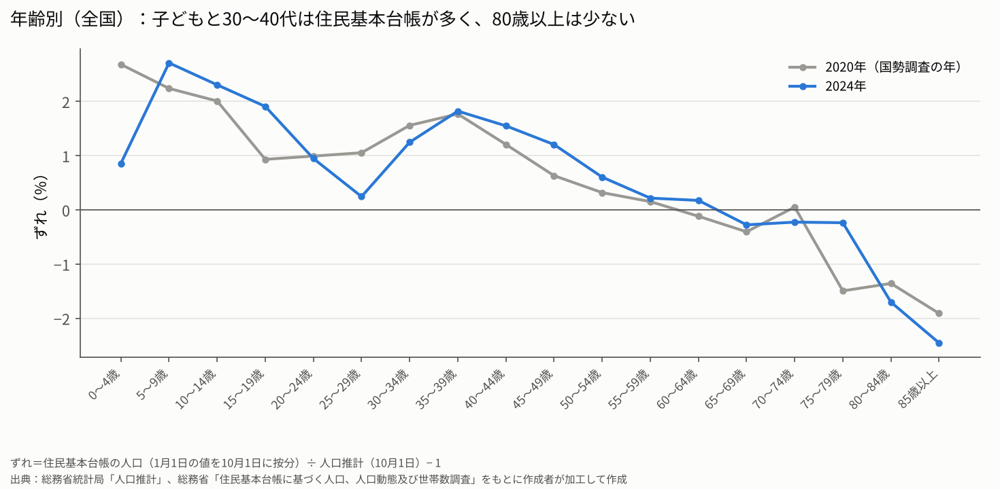
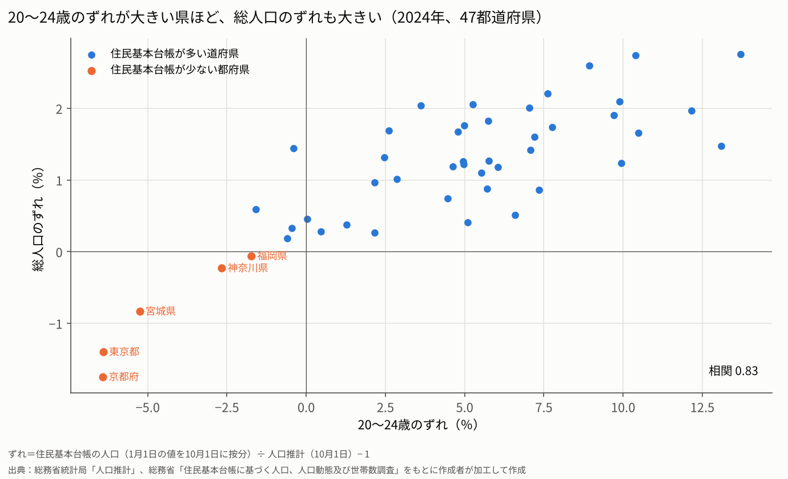

# F536 人口推計と住民基本台帳の人口は、どれだけずれるのか？ 全国では住民基本台帳の方が0.48〜0.82%多く、差が縮んだのは外国人の分。都道府県では42道府県で多く、5都府県で少ない

## 結論（先に）
- 総務省統計局の「人口推計」（10月1日）と、総務省の「住民基本台帳に基づく人口」（1月1日、住民票の数）を、日付をそろえて（住民基本台帳を10月1日に按分）2014〜2024年で比べました。
- 全国の総人口では、どの年も住民基本台帳の方が多く、ずれは2014年の0.82%（104万人）から2022年の0.48%（60万人）に縮み、2024年は0.54%（67万人）でした。
- 日本人だけのずれは0.41〜0.53%でほぼ一定です。縮んだのは外国人の分で、外国人のずれは2014年の22.4%から2022年の0.3%、2024年は2.3%でした。
- 都道府県では、2020年・2024年とも42道府県で住民基本台帳の方が多く、宮城県・東京都・神奈川県・京都府・福岡県の5都府県で少なくなっています（2024年のずれは−1.75%〜+2.75%）。少ない5都府県の差の6〜7割は15〜29歳の分でした。
- 2020年の国勢調査で人口推計が直された幅は、2019年の全国で+0.31%（39万人）、47都道府県すべてで±1%以内でした。

## 問い
都道府県の人口には、よく使われる数字が2つあります。人口推計は、5年ごとの国勢調査（実際に住んでいる場所で数える）の人口に、その後の出生・死亡・転出入を足し引きした推計です。住民基本台帳の人口は、市区町村の住民票の数です。自治体の計画づくりや、「人口1人あたり」の数字を作る人にとって、どちらを分母にするかで数字がどれだけ変わるかは知っておきたいところです。2つの数字はどれだけずれるのか、ずれは年とともに変わるのか、どの都道府県・年齢で大きいのかを確かめます。どちらが「正しい」かは扱いません。

## データ（出典）
- 総務省統計局「人口推計」：長期時系列の都道府県別人口（2000〜2020年。2016〜2019年は2020年国勢調査のあとに直された「補間補正人口」）、2019年版の第5表（2015〜2019年、直す前の公表値）、2024年版の第5表（2020〜2024年）、都道府県・年齢5歳階級別人口（2020年・2024年）。千人単位。2015・2020年は国勢調査の人口です。
- 総務省「住民基本台帳に基づく人口、人口動態及び世帯数調査」：都道府県別人口（総計・日本人住民、2014〜2026年の各1月1日）、都道府県別年齢階級別人口（総計、2020・2021・2024・2025年）。
- 住民基本台帳に外国人住民が入ったのは2013年、調査日が1月1日になったのは2014年からなので、2014年1月1日以降を使いました。外国人は「総人口 − 日本人」です。

## 事前の計画
[PLAN.md](PLAN.md)（2026-11-19 07:10、集計の前に作成）。下見では、全国の値と表の最初の数行だけを見ていました。

| 仮説 | 外れの基準 | 結果 | 判定 |
|---|---|---|---|
| H1 全国では2014〜2024年のどの年も住民基本台帳の方が多い | 1年でも少ない | いちばん小さい年でも+0.48%（2022年） | 支持 |
| H2 2020年に住民基本台帳の方が多い都道府県は40以上 | 39以下 | 42 | 支持 |
| H3 20〜24歳で住民基本台帳が5%以上多い都道府県が24以上（2024年） | 23以下 | 23（2020年は30） | 外れ（境目） |
| H4 国勢調査による直しは40以上の都道府県で±1%以内 | 39以下 | 47（−0.11%〜+0.66%） | 支持 |

## やったこと
1. 35の Excel から、都道府県を表の中の都道府県コードで付け、同じ行の都道府県名の文字が一致することを確かめて読みました。年・人口区分・年齢は見出しの文字で探しました（02_build.py）。東京都・京都府・沖縄県などの値を元の表と照らしました。
2. 住民基本台帳のt年1月1日とt+1年1月1日の人口を 0.25：0.75 で按分してt年10月1日の値にし、人口推計との比（ずれ）を全国・都道府県・地方・年齢別に出しました（03_analysis.py）。都道府県は北から南に並べ、順位は出していません。
3. 結果を見てから、都道府県のずれと若い年齢のずれの関係を足しました（03b_requestion.py）。

## 分かったこと

### 1. 全国のずれは縮んだが、縮んだのは外国人の分（図1）

日本人のずれは0.41%（2019年）〜0.53%（2014年）で、ほぼ一定です。外国人は、2014年に住民基本台帳の方が22.4%（37.5万人）多く、2019年5.6%、2020年2.8%、2021年0.4%と縮みました。2023年2.6%、2024年2.3%です。

国勢調査の年の段差も見ました。2015年の国勢調査をもとに公表されていた2019年の人口推計（全国1億2,616.7万人）は、2020年の国勢調査のあとで1億2,655.5万人（+0.31%、+38.8万人）に直されました。直した分のうち23.0万人は外国人、15.8万人は日本人です。この直しで、2019年の全国のずれは0.83%から0.52%に縮みました。都道府県別の直しの幅は−0.11%〜+0.66%で、47都道府県すべてで±1%以内でした。

### 2. 42道府県で住民基本台帳が多く、5都府県で少ない（図2）

2024年に住民基本台帳の方が少ないのは、宮城県（−0.83%）・東京都（−1.40%、−19.8万人）・神奈川県（−0.23%）・京都府（−1.75%）・福岡県（−0.06%）で、2020年も同じ5都府県でした（2014年は宮城県・東京都・京都府の3都府県）。地方別では、関東が−0.06%、四国が+2.23%、ほかの地方は+0.28%〜+1.02%でした（2024年）。大学の多い都府県で少ない形ですが、理由はこのデータでは確かめていません（推測）。

### 3. 子どもと30〜40代は多く、80歳以上は少ない（図3）

2024年の全国では、5〜9歳+2.71%、10〜14歳+2.31%、35〜39歳+1.82%で住民基本台帳の方が多く、80〜84歳−1.70%、85歳以上−2.46%で少なくなっています。20〜24歳は+0.95%でした。2020年も同じ形です（0〜4歳+2.68%、85歳以上−1.91%）。20〜24歳で住民基本台帳が5%以上多いのは23道府県（2020年は30）、少ないのは9都府県（同8）でした。

## 問い直し（結果を見てから足した）

### 都道府県のずれは、若い人のずれで説明できるか（図4）

都道府県の総人口のずれと20〜24歳のずれの相関は、2024年0.83、2020年0.87でした。住民基本台帳が少ない5都府県では、差（2024年に合計−28.5万人）のうち−17.4万人（61%）が15〜29歳の分で、2020年は70%でした。47都道府県のうち44で、15〜29歳の差と総人口の差の向き（多い・少ない）がそろっています。進学や就職で住所を移しても住民票を移さない人がいれば、こうした形になると考えられます（推測）。

## 頑健性

| 確かめたこと | 結果 | 結論は変わったか |
|---|---|---|
| 按分しない（t+1年1月1日の住民基本台帳と比べる） | 全国のずれ 0.78%（2014年）→ 0.43%（2024年）、どの年もプラス | 変わらない |
| 日本人だけ | 住民基本台帳が多いのは41道府県（2014・2020・2024年）。少ないのは5都府県に大阪府が加わる | ほぼ変わらない |
| 千人単位の丸め（人口推計±500人） | ずれの符号が変わる都道府県は0（2020・2024年） | 変わらない |
| 年齢別を2020年（国勢調査の年）で | 子どもで多く80歳以上で少ない形は同じ。20〜24歳で5%以上多いのは30道府県 | H3 は2020年なら支持 |

## 言えないこと
- どちらの人口が「正しい」かは言えません。数え方（住んでいる場所か、届け出か）の違いの大きさを示すだけです。
- ずれの理由（住民票を移さない学生、外国人の転出の届け出の遅れなど）は、このデータでは確かめていません（推測）。
- 2021〜2024年の人口推計は2020年の国勢調査をもとにした値で、2025年の国勢調査（2026年9月に人口等基本集計を公表）を受けて、今後直されます。2019年は直しで全国のずれが0.83%から0.52%に動いたので、2021年以降のずれも同じくらい動く可能性があります。
- 人口推計は千人単位なので、小さな県の0.1%前後の差は丸めの影響を受けます。
- 1月1日から10月1日への按分は直線を仮定していて、季節の動き（3〜4月の転居など）は入っていません。
- 市区町村の単位は扱っていません（人口推計に市区町村別がないため）。

## 仕事で使うなら
「人口1人あたり」の数字は、分母を人口推計にするか住民基本台帳にするかで、全国で約0.5%、都道府県で−1.7〜+2.8%変わります。都道府県どうしを比べるときは、同じ種類の人口でそろえ、どちらを使ったかを書き添えると読み違えにくくなります。

## 計画からの変更
- 都道府県のずれと若い年齢のずれの関係（図4）を、結果を見てから足しました。

## 再現のしかた
```
sh src/run_all.sh
```
ネットにはつながず、data/raw の35の Excel（1.6MB）から data/population_long.csv、results、figures を作ります（約5秒）。元データを取り直すときは `python3 src/01_fetch.py`。Python 3.13、requirements.txt の版で確かめました。

| ファイル | 中身 |
|---|---|
| src/02_build.py | Excel → data/population_long.csv |
| src/03_analysis.py | 全国・都道府県・地方・年齢のずれ、国勢調査による直し → results/main.json ほか |
| src/03b_requestion.py | 問い直しと頑健性 → results/requestion.json、requestion_young.csv |
| src/04_figures.py | 図4枚 |

repro_check：/tmp/rep_F536 に写し、02 以降が作るファイル（results・figures・data/population_long.csv）を消してから流し直し、13ファイルがすべて cmp で一致しました（所要5秒、results/repro_check.txt）。

## レビューで直したこと

| # | 指摘 | 直し方 |
|---|---|---|
| 1 | 題名が101字と長く、人数（60万〜104万人）まで入っていた | 題名から人数を外し、89字にした（本文の数字はそのまま）。status と note の1行目も合わせた |
| 2 | 2021〜2024年の人口推計は2020年の国勢調査をもとにした値で、2025年の国勢調査を受けて直されることが書かれていなかった | 「言えないこと」に、直しで2019年のずれが0.83%→0.52%動いた例とともに足した（note にも） |
| 3 | 図4の点が0.1刻みに丸めた値で描かれ、格子状に並んでいた | requestion_young.csv の丸めを小数1桁から3桁にし、図4を作り直した（相関などの数字は変わらない） |

## 出典
- 総務省統計局「人口推計」（e-Stat）：https://www.e-stat.go.jp/stat-search/files?toukei=00200524&tstat=000000090001
- 総務省「住民基本台帳に基づく人口、人口動態及び世帯数調査」（e-Stat）：https://www.e-stat.go.jp/stat-search/files?toukei=00200241&tstat=000001039591
- 各ファイルの statInfId と URL は data/raw/SOURCES.md

（いずれも 総務省統計局「人口推計」、総務省「住民基本台帳に基づく人口、人口動態及び世帯数調査」をもとに作成者が加工して作成）
