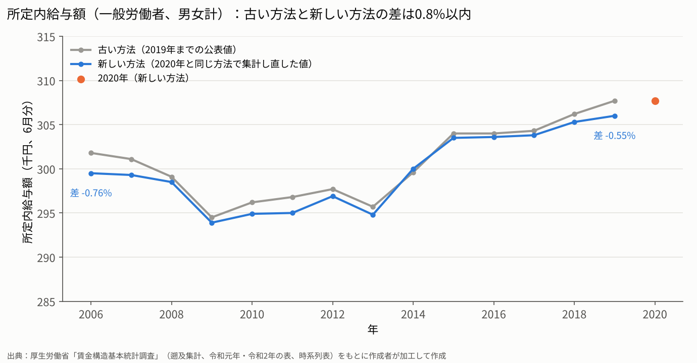
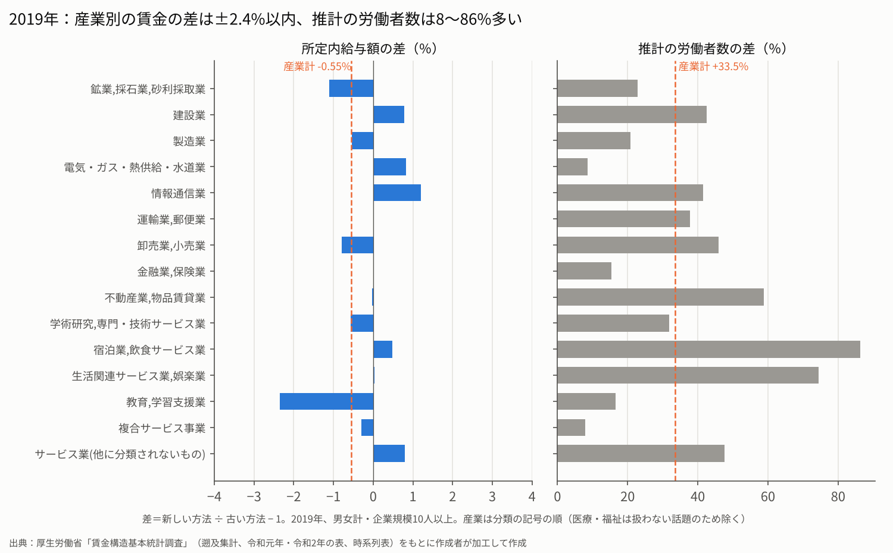
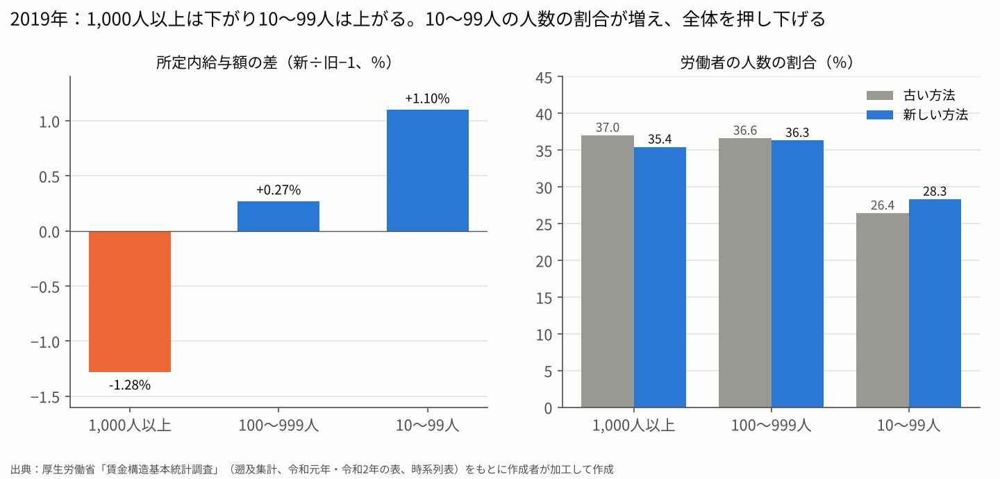
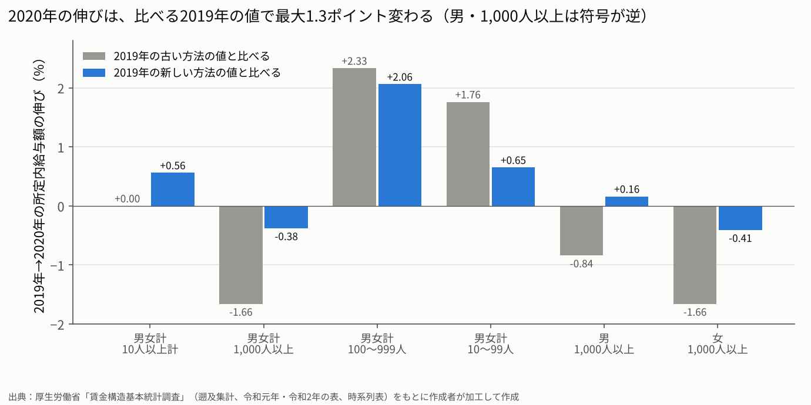

# F537 賃金構造基本統計調査の推計方法が2020年に変わって、賃金の数字はどれだけ動いたのか？ 2019年の所定内給与額は新旧で−0.55%とほぼ同じ、2006〜2019年の伸びの差も0.22ポイント。一方、推計の労働者数は33.5%多くなった

## 結論（先に）
- 厚生労働省は2020年調査から、賃金構造基本統計調査（賃金センサス）の推計方法（1人の回答を何人分に数えるかの「復元倍率」の計算）を変え、2006〜2019年の分を新しい方法で集計し直した表（遡及集計）を出しています。同じ2019年を新旧の方法で比べました。
- 2019年の一般労働者の所定内給与額（産業計・男女計・企業規模10人以上）は、古い方法307.7千円、新しい方法306.0千円で、差は−0.55%でした。2006〜2019年の各年の差は−0.76%〜+0.13%、2006→2019年の伸びは古い方法1.95%、新しい方法2.17%で、差は0.22ポイントです。
- 産業別（医療・福祉を除く15産業）の差は−2.35%〜+1.20%で、3%を超える産業はありませんでした。企業規模別では、1,000人以上が−1.28%、10〜99人が+1.10%と向きが逆です。
- 大きく違うのは、推計の労働者数です。2019年は古い方法2,217,882十人、新しい方法2,960,880十人で、33.5%多くなりました。10〜99人では43.3%、宿泊業・飲食サービス業では86.2%多くなっています。
- 2019→2020年の伸びは、古い方法の2019年と比べると0.00%、新しい方法の2019年と比べると+0.56%です（問い直し）。1,000人以上の男では−0.84%と+0.16%で、向きが逆になります。

## 問い
賃金センサスは、産業・規模・年齢・男女ごとの賃金を長い期間で比べられる、ほかにない統計です。2020年に推計方法が変わったため、2019年以前の古い表と2020年以降の表をそのままつないでよいのかが問題になります。人事・労務の担当や、賃金の長い動きを調べる人が、どの数字なら古い表とつないでも差が小さく、どの数字は注意が要るのかを知りたいはずです。厚労省の説明（[令和2年調査の変更点](https://www.mhlw.go.jp/toukei/itiran/roudou/chingin/kouzou/detail/chousa_change.html)、[遡及集計について](https://www.mhlw.go.jp/toukei/itiran/roudou/chingin/kouzou/detail/sokyu.html)）では、復元倍率を「抽出率の逆数」から「母集団の事業所数・労働者数に対する有効回答の割合の逆数」に変えたとしています。その結果、数字がどれだけ動いたかを確かめます。賃金の水準の良し悪しや、賃金をどう決めるべきかは扱いません。

## データ（出典）
- 新しい方法：厚生労働省「令和2年賃金構造基本統計調査の変更に伴う遡及集計」第1表 一般労働者の産業大分類、性、学歴、年齢階級、企業規模別（2006〜2008年、2009〜2014年、2015〜2019年の3ファイル）。
- 古い方法：令和元年（2019年）調査 一般労働者 産業大分類 第1表（産業計・産業別）、時系列表 第3表 所定内給与額の推移（1976〜2019年、男女別）（e-Stat）。
- 2020年：令和2年調査 一般労働者 産業大分類 第1表（e-Stat）。
- いずれも民営事業所、企業規模10人以上、6月分、一般労働者。千円・十人。学歴計の行だけを使いました。医療・福祉の産業は、この記事では扱わない話題のため、産業別の表と図から除きました（産業計には含まれます）。

## 事前の計画
[PLAN.md](PLAN.md)（2026-11-19 06:20、集計の前に作成）。下見で、2019年の産業計・男女計の新旧の所定内給与額と労働者数、2020年の値は見ていました。仮説は、下見で見ていない伸び・産業・規模・男女について立てました。

| 仮説 | 外れの基準 | 結果 | 判定 |
|---|---|---|---|
| H1 2006→2019年の伸びの新旧の差は1ポイント未満 | 1ポイント以上 | 1.95%と2.17%（差0.22ポイント） | 支持 |
| H2 新旧の差が3%以上の産業が3つ以上 | 2つ以下 | 0（最大は教育,学習支援業の−2.35%） | 外れ |
| H3 10〜99人の差（絶対値）が1,000人以上より大きい | 同じか小さい | +1.10%と−1.28% | 外れ |
| H4 女の差（絶対値）が男より大きい | 同じか小さい | −0.48%と−0.56% | 外れ |

## やったこと
1. 6つの Excel から、「区　分」のセルと企業規模・項目の見出しの文字で列を探し、学歴計の行（男女計・男・女×年齢階級）を、産業・規模・年ごとに読み出しました（02_build.py）。2019年の産業計（新旧）、2006・2009年（新）、2020年の値を元の表と照らしました。
2. 新旧の差（新÷旧−1）を、男女・規模・産業・年齢別に出し、産業計の差を「産業ごとの賃金の差」と「産業ごとの人数の割合の差」に分けました（03_analysis.py）。産業の値を人数で重み付けした平均は、新旧とも産業計の値と一致しました（307.67と307.7、306.01と306.0）。
3. 結果を見てから、2020年の伸びと、規模の人数の割合による分け方を足しました（03b_requestion.py）。

## 分かったこと

### 1. 賃金の水準は、新旧でほとんど変わらない（図1）

2006〜2019年の14年のうち13年で、新しい方法は古い方法より0.13%〜0.76%低く（2014年だけ+0.13%）、動きの形は同じです。前年比の差は平均0.20ポイント、最大0.45ポイント（2014年）で、前年比の符号が新旧で逆になったのは2016年（古い方法0.00%）だけでした。伸びの差は、2009年起点で−0.36ポイント、2015年起点で−0.40ポイントです。

### 2. 産業別の賃金の差は小さいが、人数は大きく違う（図2）

所定内給与額の差は、15産業のうち教育,学習支援業（−2.35%）を除く14産業で±1.2%以内でした（絶対値の平均0.65%）。一方、推計の労働者数は、複合サービス事業の+7.9%から宿泊業,飲食サービス業の+86.2%まで、産業によって大きく違います。産業計の差（−1.65千円）は、産業ごとの賃金の差で−0.66千円、産業ごとの人数の割合の差で−0.99千円と分けられます。

### 3. 規模別では向きが逆で、10〜99人の割合が増えた（図3）

1,000人以上は344.1→339.7千円（−1.28%）、10〜99人は273.2→276.2千円（+1.10%）でした。労働者数は10〜99人で43.3%、1,000人以上で27.7%多くなり、10〜99人の割合は26.4%から28.3%に上がりました。年齢別の差は−1.39%（70歳以上）〜+0.28%（19歳以下）で、50〜54歳は−1.07%でした。

## 問い直し（結果を見てから足した）

### 2020年の伸びは、どちらの2019年と比べるかで変わる（図4）

2020年の所定内給与額（産業計・男女計）は307.7千円です。古い方法の2019年と比べると伸びは0.00%、新しい方法の2019年と比べると+0.56%です。規模別の差は最大1.28ポイント（1,000人以上：−1.66%と−0.38%）で、1,000人以上の男では−0.84%と+0.16%と、上がったか下がったかの向きまで変わります。

### 産業計の差は、規模の人数の割合でも説明できる
規模で分けると、産業計の差のうち−1.09千円が人数の割合の差（10〜99人が多く数えられる）、−0.54千円が規模ごとの賃金の差でした。どの分け方でも、全体の差の半分以上は人数の割合の違いから来ています。

## 頑健性

| 確かめたこと（2019年、新÷旧−1） | 産業計 | 1,000人以上 | 100〜999人 | 10〜99人 | 3%以上の産業 | 産業の範囲 |
|---|---|---|---|---|---|---|
| 所定内給与額（本線） | −0.55% | −1.28% | +0.27% | +1.10% | 0 | −2.35〜+1.20% |
| きまって支給する現金給与額 | −0.71% | −1.35% | +0.22% | +0.95% | 0 | −2.18〜+1.09% |
| 年間賞与その他特別給与額 | −3.66% | −3.54% | −0.82% | −1.81% | 6 | −6.22〜+2.15% |

| 確かめたこと（伸び、産業計・男女計） | 古い方法 | 新しい方法 | 差 |
|---|---|---|---|
| 2006→2019年（本線） | 1.95% | 2.17% | +0.22 |
| 2009→2019年 | 4.48% | 4.12% | −0.36 |
| 2015→2019年 | 1.22% | 0.82% | −0.40 |
| 2006→2019年、男／女 | 0.09%／12.76% | 0.27%／12.98% | +0.18／+0.22 |

月々の給与は、どの項目でも差が小さいままです。賞与は差が大きく（産業計−3.66%、6産業で3%以上）、つなぐときの注意が月給より要ります。

## 言えないこと
- 新しい方法の方が「正しい」かは、このデータでは言えません。違いの大きさを示すだけです。
- 遡及集計は推計方法（復元倍率）の変更を反映したものです。2020年には調査票の項目や回答のしかたも変わっていて、その影響は分けられません。
- 産業・年齢の細かい区分は、標本が少ないところで誤差が大きくなります。
- 労働者数が多くなった理由（有効回答の少ない層が以前は少なく数えられていた、など）は推測で、このデータでは確かめていません。
- 賃金の水準の良し悪しや、賃金の決め方は扱いません。

## 仕事で使うなら
2019年以前と2020年以降をつなぐときは、遡及集計の値を使うと、同じ方法の数字どうしで比べられます。月給の水準は新旧でほぼ同じですが、労働者数（人数で重み付けした平均を含む）と賞与は差が大きく、古い表とそのままつなぐと段差になります。

## 計画からの変更
- 2020年の伸びの比べと、規模の人数の割合による分け方を、結果を見てから足しました。

## 再現のしかた
```
sh src/run_all.sh
```
ネットにはつながず、data/raw の6つの Excel（約9MB）から data/wage_long.csv・data/old_timeseries.csv、results、figures を作ります（約13秒）。元データを取り直すときは `python3 src/01_fetch.py`。Python 3.13、requirements.txt の版で確かめました。

| ファイル | 中身 |
|---|---|
| src/02_build.py | Excel → data/wage_long.csv、data/old_timeseries.csv |
| src/03_analysis.py | 新旧の差、伸び、分け方、頑健性 → results/main.json ほか |
| src/03b_requestion.py | 問い直し → results/requestion.json、requestion_2020_growth.csv |
| src/04_figures.py | 図4枚 |

repro_check：/tmp/rep_F537 に写し、02 以降が作るファイル（results・figures・data の2つの CSV）を消してから流し直し、14ファイルがすべて cmp で一致しました（所要13秒、results/repro_check.txt）。

## レビューで直したこと

独立レビューで数字の照合・再実行・図を確かめ、直すところはなかった。

## 出典
- 厚生労働省「令和2年賃金構造基本統計調査の変更に伴う遡及集計について」：https://www.mhlw.go.jp/toukei/itiran/roudou/chingin/kouzou/detail/sokyu.html （第1表 https://www.mhlw.go.jp/toukei/itiran/roudou/chingin/kouzou/detail/xls/sokyu-01.xlsx ほか）
- 厚生労働省「令和2年調査の変更点」：https://www.mhlw.go.jp/toukei/itiran/roudou/chingin/kouzou/detail/chousa_change.html
- 厚生労働省「賃金構造基本統計調査」令和元年・令和2年の表、時系列表（e-Stat）：https://www.e-stat.go.jp/stat-search/files?page=1&toukei=00450091&tstat=000001011429 （各ファイルの URL は data/raw/SOURCES.md）

（いずれも 厚生労働省「賃金構造基本統計調査」をもとに作成者が加工して作成）
