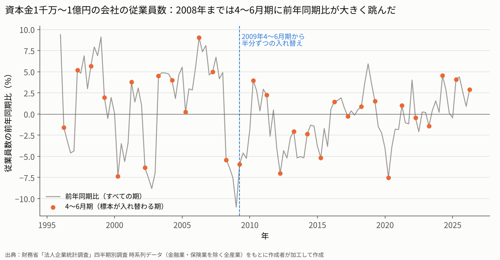
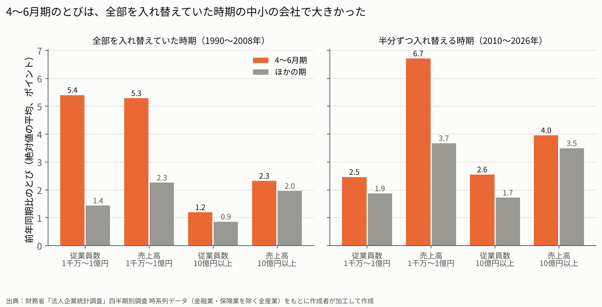
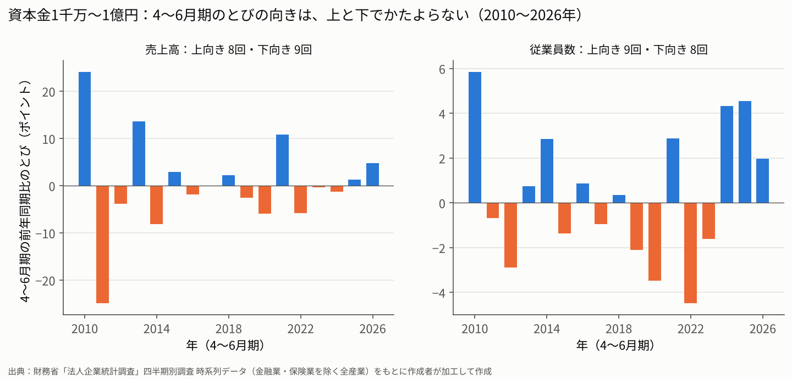

# F538 法人企業統計の4月の標本の入れ替えで、数字にどれだけ段差ができるのか？ 資本金1千万〜1億円の会社の従業員数の前年同期比は、2008年までは4〜6月期に平均5.4ポイント跳んだ（ほかの期の3.8倍）。半分ずつの入れ替えにした2010年以降は2.5ポイント（1.3倍）

## 結論（先に）
- 財務省「法人企業統計調査」の四半期別調査（季報）は、毎年4〜6月期に標本の会社を入れ替えます。公表の前年同期比は、公表された水準どうしの比で、標本の違う年どうしを比べています（2026年4〜6月期の売上高5.92%・経常利益24.65%・設備投資1.59%を水準から計算し、公表の5.9%・24.6%・1.6%と一致）。
- 段差の目安として、前年同期比の「とび」（その期の前年同期比 − 前の期の前年同期比）を、標本が替わる4〜6月期とほかの期で比べました。資本金1千万〜1億円の会社の従業員数では、標本を毎年全部入れ替えていた1990〜2008年に、4〜6月期のとびが平均5.4ポイント、ほかの期は1.4ポイントでした（3.8倍）。
- 2009年4〜6月期から標本を半分ずつ入れ替える方式に変わったあと（2010〜2026年）は、同じ従業員数のとびが2.5ポイント、ほかの期は1.9ポイント（1.3倍）に縮みました。売上高の比は2.3倍から1.8倍になりましたが、4〜6月期のとびそのものは5.3から6.7ポイントに大きくなっています（景気の大きな年の影響を受けます）。
- 従業員数の比（題名の3.8倍・1.3倍）は、確かめ方で少し動きます。2010年以降は、年の除き方・中央値・業種を変えると1.2〜1.6倍、2008年までは、期間を2000〜2008年に短くすると3.5倍です。どの確かめ方でも「大きく縮んだ」ことは変わりません。売上高の比（2010年以降1.83倍）は、2010・2011・2020・2021年を除くと1.41倍になり、年の選び方に左右されます。
- 全数調査の資本金10億円以上の会社では、売上高の4〜6月期のとびはほかの期の1.1〜1.2倍で、段差はほとんど見えません。
- 4〜6月期のとびの向きは、上向きと下向きがほぼ半々で、標本が替わると決まった向きにずれる形ではありません（問い直し）。

## 問い
法人企業統計の季報は、会社の売上高・利益・設備投資の動きを見る代表的な統計で、国内総生産（GDP）の推計にも使われます。財務省は、全数調査の大きな会社を除き、毎年4〜6月期に標本の会社を入れ替えています。入れ替えのたびに数字に段差ができるなら、4〜6月期の前年同期比は、景気の動きと標本の入れ替えが混ざった数字になります。

財務省は2009年に、標本を毎年全部入れ替える方式から、半分ずつ入れ替えて1社を2年続けて調べる方式（ローテーション・サンプリング）に変え、「1〜3月期と4〜6月期の計数の変動が小さくなり、前期比・前年同期比が安定する」と説明しています（[財務省 標本設計の見直しについて](https://www.mof.go.jp/pri/reference/ssc/summary/hyohon.htm)、[標本の入替え](https://www.mof.go.jp/pri/reference/ssc/summary/hyohon/b00.htm)）。季報の前年同期比をニュースや資料で読む人、会社の数字を全体と比べる人に向けて、段差の大きさと、方式の変更の効果を数字で確かめます。

## データ（出典）
- 財務省「法人企業統計調査」四半期別調査 時系列データ「All items」（英語版の時系列データのページ）。原数値、1954年4〜6月期〜2026年4〜6月期。億円・人・社。
- 資本金の区分：全規模、10億円以上（全数調査）、1億〜10億円、1千万〜1億円。業種は金融業・保険業を除く全産業を本線にし、製造業・非製造業を頑健性に使いました。
- 使った項目：売上高、従業員数、経常利益、設備投資（ソフトウェアを除く／含む）、資本金、前期末資本金、法人数（母集団の推計の法人数）。

## 事前の計画
[PLAN.md](PLAN.md)（2026-11-19 05:50、集計の前に作成）。下見では、ファイルの最後の数行と、2026年4〜6月期の公表の前年同期比の照合だけをしていました。

| 仮説 | 外れの基準 | 結果 | 判定 |
|---|---|---|---|
| H1 1千万〜1億円の売上高、2010年以降の4〜6月期のとびはほかの期の1.5倍以上 | 1.5倍未満 | 1.83倍（2010・2011・2020・2021年を除くと1.41倍） | 支持（ただし年の除き方で外れに近づく） |
| H2 10億円以上（全数）の売上高は1.3倍未満 | 1.3倍以上 | 1.13倍 | 支持 |
| H3 1千万〜1億円の売上高の4〜6月期のとびは、2010年以降の方が小さい | 同じか大きい | 5.29 → 6.71ポイント | 外れ |
| H4 1千万〜1億円の従業員数も、2010年以降は1.5倍以上 | 1.5倍未満 | 1.32倍 | 外れ |

## やったこと
1. 時系列 Excel の70のシートから、左上の項目名（英語）でシートを探し、業種・規模を見出しの行の文字で付けて、縦長の表にしました（02_build.py）。2026年の売上高（全規模・1千万〜1億円など）の値を元の表と照らしました。
2. 公表された水準から前年同期比と、そのとびを計算しました。規模×項目×時期で、4〜6月期とほかの期のとびの大きさ（絶対値の平均）を比べ、差を順位和の検定（マン・ホイットニーの検定、片側）で見ました（03_analysis.py）。
3. 資本金について、その期の標本が答えた前期末資本金と、前の期に公表された資本金の食い違いを出しました。
4. 結果を見てから、とびの向きと、1社あたりの値でのとびを足しました（03b_requestion.py）。

## 分かったこと

### 1. 2008年までは、4〜6月期に従業員数の前年同期比が跳んだ（図1）

従業員数は景気でゆっくり動く数字なので、四半期ごとの前年同期比は本来なめらかに動くはずです。1千万〜1億円の会社では、2008年までは4〜6月期（橙の点）で前年同期比が大きく動き、そのまま1年続く形が見えます。全規模でも、従業員数の比は1990〜2008年の3.99倍から2010年以降の1.52倍に下がりました。

### 2. 段差は、全部を入れ替えていた時期の中小の会社で大きかった（図2）

4〜6月期のとび／ほかの期のとび（ポイント）は、1千万〜1億円の従業員数で5.40／1.44（1990〜2008年）から2.46／1.87（2010〜2026年）に、売上高で5.29／2.26から6.71／3.68になりました。10億円以上（全数調査）の売上高は2.32／1.96、3.96／3.50で、どちらの時期も差は小さいままです。1億〜10億円の売上高は3.28倍から1.96倍に下がりました。

一方、10億円以上の従業員数でも4〜6月期のとびは1.49倍（p=0.019）でした。全数調査でも、毎年4月に調べる会社の名簿（母集団）が新しくなるためと考えられます（推測）。1千万〜1億円の会社の母集団の法人数は、4〜6月期にだけ変わり、2010年以降の平均で−1.50%でした。

経常利益と設備投資は、ふだんの四半期のとびが大きく（1千万〜1億円の経常利益で、ほかの期の平均22.7ポイント）、4〜6月期の段差を見分けられませんでした（2010年以降の比は0.68〜1.70）。

## 問い直し（結果を見てから足した）

### 段差は、決まった向きにずれるのか（図3）

1千万〜1億円の会社の4〜6月期のとびは、2010〜2026年の17回のうち、売上高で上向き8回・下向き9回、従業員数で上向き9回・下向き8回でした（符号の検定でどちらも p=1.0）。1990〜2008年も、売上高9回・従業員数10回が上向き（19回中）です。標本が替わると数字がいつも上（下）にずれる、という形ではなく、年ごとにどちらにも出る「ばらつき」です。

母集団の法人数で割った1社あたりの値で見ても、従業員数の比は4.33倍（1990〜2008年）、1.23倍（2010〜2026年）、売上高は2.89倍、1.77倍で、本線と同じ形でした。段差の主な元は、法人数の更新ではなく、標本の入れ替えの方と読めます。

## 頑健性

| 確かめたこと（1千万〜1億円、2010〜2026年） | 売上高の比 | 従業員数の比 |
|---|---|---|
| 本線（絶対値の平均） | 1.83 | 1.32 |
| 2020〜2021年を除く | 1.76 | 1.24 |
| 2010・2011・2020・2021年を除く | 1.41 | 1.28 |
| 中央値で比べる | 1.37 | 1.16 |
| 製造業だけ | 2.25 | 1.64 |
| 非製造業だけ | 1.65 | 1.38 |
| 入れ替え前（1990〜2008年） | 2.34 | 3.75 |
| 入れ替え前を2000〜2008年に短く | 1.79 | 3.54 |

| 確かめたこと（10億円以上、全数調査） | 売上高の比 | 従業員数の比 |
|---|---|---|
| 本線 2010〜2026年 | 1.13 | 1.49 |
| 中央値で比べる | 0.70 | 1.59 |
| 入れ替え前（1990〜2008年） | 1.18 | 1.39 |

従業員数で段差が大きく縮んだことは、どの確かめ方でも変わりません（3.5倍以上 → 1.2〜1.6倍）。売上高は、2010・2011年（景気の大きな戻りと落ち込み）を除くと比が1.41倍になり、H1 の「1.5倍以上」は年の選び方に左右されます。

資本金での照合は、計画どおりには使えませんでした。1千万〜1億円では、前期末資本金と前の期の資本金の食い違いが、4〜6月期以外の期の方が大きかった（平均の絶対値10.3%、4〜6月期5.8%）ためです。回答する会社が毎期変わることの影響と考えられます（推測）。10億円以上では、4〜6月期の食い違いが1990〜2008年の1.89%から2010年以降の0.67%に縮みました。

## 言えないこと
- とびには、標本の入れ替えのほか、本当の景気の変化も入ります。4〜6月期とほかの期の差を段差の目安にしましたが、1社ずつ分けて段差を測ったものではありません。
- 2008年以前と2010年以降では景気の波の大きさが違い、方式の変更だけの効果とは言い切れません。
- 財務省が段差を調整した系列は、公表されているものを見つけられませんでした。調整した系列は作っていません。
- 経常利益・設備投資の段差は、ふだんの動きが大きく、このやり方では見分けられません。
- 個々の会社や業界の良し悪し、投資の判断は扱いません。

## 仕事で使うなら
季報の4〜6月期の前年同期比は、標本の違う年どうしの比べです。資本金1千万〜1億円の会社の数字を見るときは、4〜6月期に動きが変わっても、次の期以降も同じ向きが続くかを見てから読むと、読み違えにくくなります。

## 計画からの変更
- 資本金の食い違いは、段差の物差しとしては使えなかったため、頑健性の補足に回しました。
- 「2010・2011・2020・2021年を除く」を頑健性に足しました（図3で2010・2011年の売上高のとびが特に大きかったため）。
- 問い直し（とびの向き、1社あたりの値）を、結果を見てから足しました。

## 再現のしかた
```
sh src/run_all.sh
```
ネットにはつながず、data/raw の Excel（2.9MB）から data/quarterly_long.csv、results、figures を作ります（約6秒）。元データを取り直すときは `python3 src/01_fetch.py`。Python 3.13、requirements.txt の版で確かめました。

| ファイル | 中身 |
|---|---|
| src/02_build.py | Excel → data/quarterly_long.csv |
| src/03_analysis.py | 前年同期比のとび、比、頑健性、資本金の食い違い → results/main.json ほか |
| src/03b_requestion.py | 問い直し → results/requestion.json、requestion_sign.csv、requestion_per_corp.csv |
| src/04_figures.py | 図3枚 |

repro_check：/tmp/rep_F538 に写し、02 以降が作るファイル（results・figures・data/quarterly_long.csv）を消してから流し直し、13ファイルがすべて cmp で一致しました（所要5秒、results/repro_check.txt）。

## レビューで直したこと

| # | 指摘 | 直し方 |
|---|---|---|
| 1 | 題名の「資本金1億円未満」は、使った区分（1千万〜1億円）より広い。「5.4ポイント（3.8倍）」がどの時期の値かが題名から読めなかった | 題名を「資本金1千万〜1億円」「2008年までは」とした。status と note の1行目も合わせた（「仕事で使うなら」の区分名も同じく直した） |
| 2 | 題名の3.8倍・1.3倍が確かめ方でどれだけ動くかが、結論に書かれていなかった | 「結論（先に）」に、2010年以降は1.2〜1.6倍、2008年までは期間を短くしても3.5倍、売上高は年の選び方で1.83→1.41倍になることを1点足した |
| 3 | 経常利益・設備投資の「比は0.68〜1.70」は2010年以降だけの範囲だった（1990〜2008年を入れると0.63〜1.96） | 「2010年以降の比は0.68〜1.70」と時期を書いた |

## 出典
- 財務省「法人企業統計調査」四半期別調査 時系列データ All items：https://www.mof.go.jp/english/pri/reference/ssc/historical/all.xls （掲載ページ https://www.mof.go.jp/english/pri/reference/ssc/historical.htm ）
- 財務省「法人企業統計調査の標本設計の見直しについて」（2009年）：https://www.mof.go.jp/pri/reference/ssc/summary/hyohon.htm 、標本の入替え：https://www.mof.go.jp/pri/reference/ssc/summary/hyohon/b00.htm
- 財務省「法人企業統計調査結果（令和8年4〜6月期）」：https://www.mof.go.jp/pri/reference/ssc/results/r8.4-6.pdf

（いずれも 財務省「法人企業統計調査」をもとに作成者が加工して作成）
