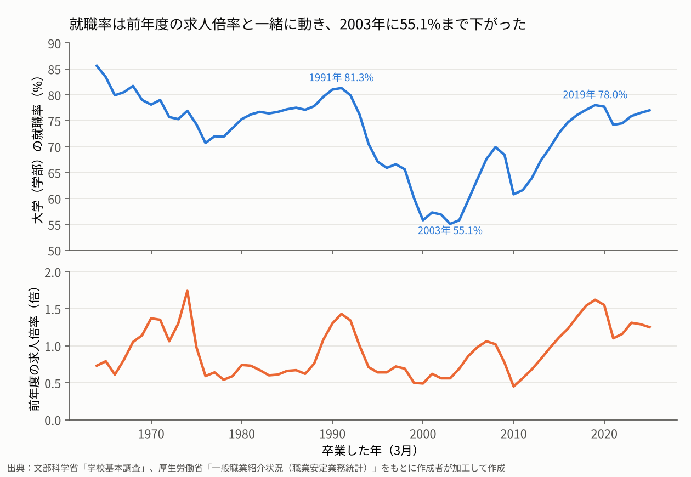
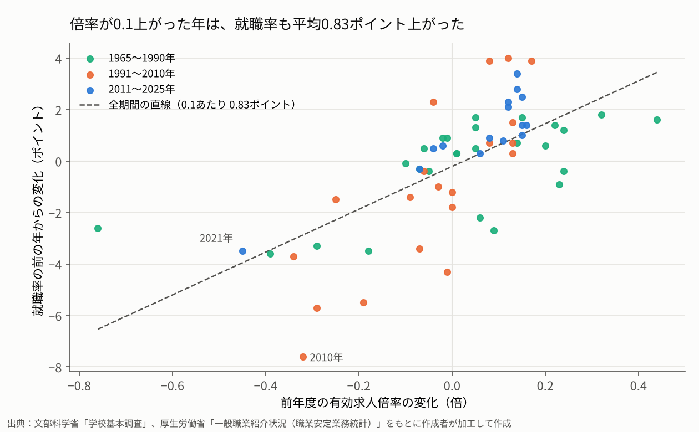
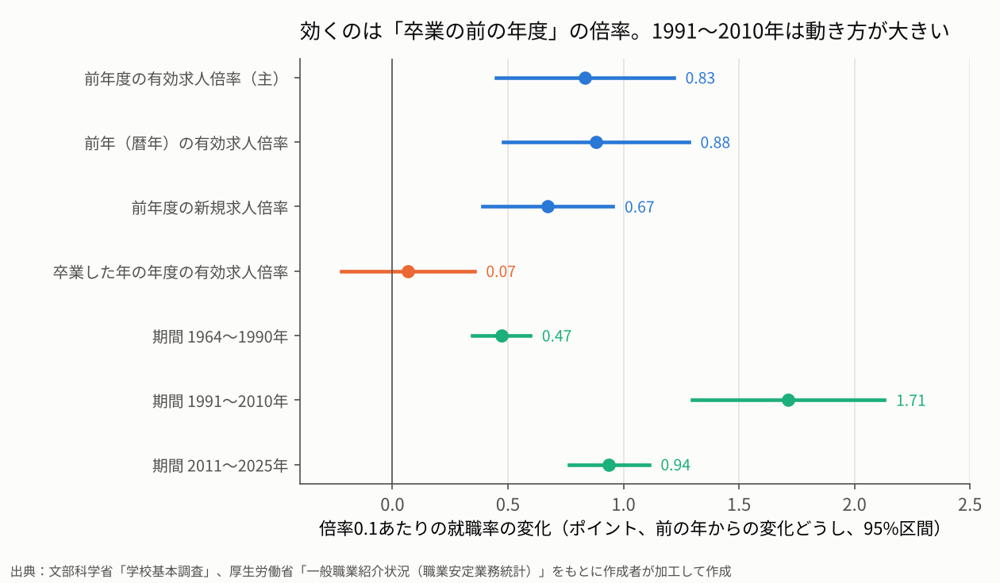
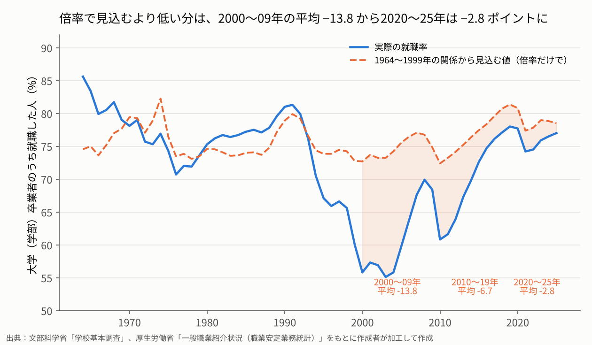

# F539 大学を卒業する人の就職率は、景気でどれだけ動くのか？ 前年度の求人倍率0.1あたり0.83ポイント、1991〜2010年は1.71ポイントと大きかった

## 結論（先に）

- **前年度の有効求人倍率が0.1上がった年は、大学（学部）の就職率が平均0.83ポイント上がりました**（前の年からの変化どうしの回帰、1964〜2025年の卒業、95%区間0.45〜1.22）。卒業者のうち就職した人の割合は、1991年81.3%、2003年55.1%、2019年78.0%、2025年77.0%です。
- **効くのは「卒業の前の年度」の倍率です。** 卒業した年の年度の倍率に替えると、係数は0.07で、ほぼ関係が見えません。就職活動と内定がおおむね前の年度に入ることと合っています。
- **動き方は1991〜2010年に大きく（0.1あたり1.71ポイント）**、1964〜1990年（0.47）と2011〜2025年（0.94）は小さめでした。
- **倍率が同じでも、2000年以降の就職率は低めです。** 水準の回帰で2000年以降を表す項は −9.2ポイントでした。ただし、1964〜1999年の関係から見込む値との差は、2000〜09年の平均 −13.8ポイントから2010〜19年 −6.7、2020〜25年 −2.8 に縮みました。



## 問い

「就職氷河期」「売り手市場」という言い方があるように、大学を出る年の求人の多さで、就職できる人の割合は大きく変わると言われます。では、大学を卒業した人のうち就職した人の割合は、求人倍率が0.1上がると何ポイント動くのでしょうか。上がるときと下がるときで同じか。景気と関係のない水準は、1990年代のあとで変わったのか。

知りたい人：大学で就職を支える仕事の人、採用の担当で新卒の動きを読む人、統計の読み方を学ぶ人です。

（既存の看板記事では、大学の数と18歳人口（F500）、大学院への進学（F350）、都道府県の求人倍率（jodn 090）などを扱っていますが、大学の就職率と景気の関係を調べたものはありません。）

## データ（出典）

- 文部科学省「学校基本調査」年次統計「卒業者に占める就職者の割合」（1950〜2025年、各年3月の卒業者、5月1日現在）。大学（学部）と短期大学の計・男・女。列は見出しの文字（「大学」「計」）で選び、2010年60.8%・2019年78.0%・2025年77.0%を元の表と照らしました（data/build_checks.json）。
- 厚生労働省「一般職業紹介状況（職業安定業務統計）」の長期時系列。有効求人倍率と新規求人倍率（パートタイムを含む一般、実数）の年度平均と年平均（1963年〜）。新規学卒者の求人は含みません。
- 卒業年 t（t 年3月卒）には、t−1 年度（t−1 年4月〜t 年3月）の倍率を合わせました。使った期間は1964〜2025年の卒業です。

## 事前の計画

[PLAN.md](PLAN.md)（2026-11-19 08:45ごろ、集計の前に作成。ファイルの時刻による）。

| 仮説 | 外れの基準 | 結果 | 判定 |
|---|---|---|---|
| H1 水準の回帰で倍率0.1あたり +1ポイント以上 | +1 未満 | +1.16（95%区間0.43〜1.88） | 支持 |
| H2 前の年からの変化どうしでも正、区間が0を含まない | 区間が0を含む | +0.83（0.45〜1.22） | 支持 |
| H3 倍率をそろえても2000年以降は −3ポイント以下 | −3 より大きい | −9.2（−13.2〜−5.2） | 支持 |
| H4 女性の係数が男性の1.2倍以上 | 1.2倍未満 | 女性0.94、男性0.80（1.18倍） | 外れ |

## やったこと

1. 卒業年ごとに、大学の就職率（計・男・女）、短期大学の就職率、前年度・前年・卒業年度の有効求人倍率と新規求人倍率を並べました。
2. 水準の回帰（就職率＝定数＋係数×倍率＋2000年以降の項）と、前の年からの変化どうしの回帰を当てました。標準誤差は自己相関に強い Newey-West 型（ラグ3）です。
3. 変化どうしの回帰を、倍率が上がった年と下がった年に分けました。期間別（1964〜1990、1991〜2010、2011〜2025年）にも出しました。
4. 年のまとまり（4年）ごとに引き直すブロック・ブートストラップ（1,000回、種 20261116）で、変化どうしの係数の区間も出しました。0.57〜1.38 で、主の区間とほぼ同じです。

## 分かったこと

### 就職率は前年度の倍率と一緒に動く（図1）

- 倍率が1.43倍だった前年度を受けた1991年の卒業は81.3%、0.56倍だった2003年は55.1%でした。2008年の69.9%から2010年は60.8%に下がり、そのあと2019年の78.0%まで戻りました。
- 2021年は前年度の倍率が1.55→1.10倍に下がり、就職率は77.7%から74.2%になりました。

### 倍率0.1あたり0.83ポイント（図2）



- 前の年からの変化どうしの相関は0.68です。共通の長い流れだけによる見かけとは考えにくい形です。
- 倍率が上がった年（34年）の係数は0.75、下がった年（25年）は0.88で、区間は大きく重なります。上がるときと下がるときで動き方がはっきり違うとは言えません。

### 効くのは卒業の前の年度。1991〜2010年は動きが大きい（図3）



- 前年（暦年）の倍率でも0.88、新規求人倍率でも0.67と、同じような関係が出ます。卒業した年の年度の倍率では0.07でした。
- 1991〜2010年は0.1あたり1.71ポイントで、1964〜1990年の0.47の3倍以上です。この時期は、倍率の小さな動きでも就職率が大きく動いた形です。理由はこの表だけでは分かりません。

## 問い直し（結果を見てから足した）

H3 で「2000年以降は倍率が同じでも −9.2ポイント低い」と出ました。では、その低さは今も続いているのか。1964〜1999年の卒業だけで「就職率＝定数＋係数×前年度の倍率」を当てはめ（0.1あたり0.77ポイント）、それを2000年以降に延ばした値と実際の値の差を見ました（src/03b_requestion.py）。



| 期間 | 実際 − 見込む値（平均、ポイント） |
|---|---|
| 1964〜1999年 | 0.0 |
| 2000〜2009年 | −13.8 |
| 2010〜2019年 | −6.7 |
| 2020〜2025年 | −2.8 |

- 差は2003年に −18.1ポイントで、2019年は −3.3、2025年は −1.5でした。倍率で見込むより低い分は、この20年で縮みました。
- ただし、1964〜1999年の当てはまりは弱く（決定係数0.19）、見込む値そのものに幅があります。差の縮みの理由（大学院に進む人の割合、就職の数え方、卒業者の構成の変化など）はこの表では分けられません。

## 頑健性

前の年からの変化どうしの係数（倍率0.1あたり、ポイント）：

| 確かめ | 係数 | 95%区間 | 年数 |
|---|---|---|---|
| 主（大学計、前年度の有効求人倍率） | 0.83 | 0.45〜1.22 | 61 |
| 新規求人倍率にする | 0.67 | 0.39〜0.96 | 61 |
| 卒業した年の年度の有効求人倍率 | 0.07 | −0.22〜0.36 | 61 |
| 前年（暦年）の有効求人倍率 | 0.88 | 0.48〜1.28 | 61 |
| 2020・2021年の変化を除く | 0.84 | 0.41〜1.28 | 59 |
| 1990年以降だけ | 1.42 | 1.01〜1.83 | 35 |
| 短期大学 | 1.00 | 0.53〜1.47 | 61 |

年の合わせ方を「卒業した年の年度」にしたときを除き、どれも正で区間は0を含みません。卒業した年の年度で関係が消えることは、合わせ方が結論を左右することを示しています。

## 言えないこと

- この就職率の分母は卒業者全体で、大学院に進んだ人も含みます。進学する人の割合が変われば、景気と関係なく就職率が動きます。2000年以降の低さとその縮みに、どれだけ効いているかは分けられません。
- 文部科学省・厚生労働省の「大学等卒業者の就職状況調査」の4月1日の就職率（就職を希望する人に占める割合。2025年度の調査で98.0%）とは定義が違い、比べられません。
- 就職の中身（正社員かどうか、どんな会社か）は、この長い系列では分かりません。
- 求人倍率はハローワークの求人と求職で、大学の新卒の求人そのものではありません。関係は相関で、倍率を上げれば就職率が上がるという因果の大きさではありません。
- 女性の係数が男性より大きいのは、区間が大きく重なっていて、違いがあるとは言えません。

## 仕事で使うなら

- 新卒の就職の動きを見込むときは、卒業の前の年度の求人倍率を見ると、関係がはっきり出ます。卒業した年の倍率では、ほとんど何も分かりません。
- 「倍率0.1で約0.8ポイント」は全期間の平均で、1991〜2010年は約1.7ポイントでした。時期によって幅があることを添えて伝えると、読みすぎを防げます。

## 計画からの変更

- 頑健性の「2020〜2021年を除く」は、計画では年そのものを除く書き方でしたが、前の年からの変化を取ってから2020年と2021年の変化を除く形にしました（年を除いてから変化を取ると、2019→2022年の変化が1つ入るため）。
- 問い直しを足しました。そのほかは計画どおりです。

## 再現のしかた

```bash
pip install -r requirements.txt
python3 src/01_fetch.py   # 元データを取り直すときだけ（ネットにつなぐ）
sh src/run_all.sh         # オフラインで 02 → 03 → 03b → 04
```

| ファイル | 中身 |
|---|---|
| src/01_fetch.py | e-Stat から Excel 3本を取る。URL は data/raw/SOURCES.md |
| src/02_build.py | 卒業年ごとの表 data/panel.csv を作る |
| src/03_analysis.py | 水準・変化どうしの回帰、期間別、ブートストラップ、頑健性 → results/main.json ほか |
| src/03b_requestion.py | 問い直し → results/requestion.json |
| src/04_figures.py | 図4枚 |

所要時間は約6秒（CPU 1つ）。data/raw は約0.6MB です。再実行の確かめの結果は results/repro_check.txt にあります。

## レビューで直したこと

| # | 指摘 | 直し方 |
|---|---|---|
| 1 | 題名の数字が多く、当てはまりの弱い（決定係数0.19）問い直しの結果（−13.8→−2.8）まで題名に入っていた | 題名を「前年度の求人倍率0.1あたり0.83ポイント、1991〜2010年は1.71ポイントと大きかった」に短くし、問い直しの結果は本文だけにした（status・note の1行目も同じに） |
| 2 | 「見込むより低い分はほぼ消えつつある」は、見込む値の当てはまりの弱さと進学の割合の変化を考えると強い | 「この20年で縮んだ」に弱めた（README・note） |
| 3 | 「共通の長い流れだけによる見かけではありません」は言い切りが強い | 「見かけとは考えにくい形です」に弱めた |
| 4 | PLAN.md の頑健性の括弧書きに、扱わない話題の語が残っていた | 語を除き、除いたことを PLAN.md に書いた（計画の中身は変えていない） |
| 5 | PLAN.md の作成時刻の記載（08:52）が、ファイルの時刻（08:45）や結果の作成時刻（08:52）と合わない | README の記載をファイルの時刻に合わせた |
| 6 | 所要時間の記載（約4秒）が再実行（6秒）と違った | 約6秒に直した |

独立レビューで、学校基本調査の1964・1991・2003・2010・2021・2025年の行と、有効求人倍率の1990・2002・2009・2018・2020・2024年度の行を元の表と照らし、すべて一致しました。再実行も13ファイルが一致しました。

## 出典

- 文部科学省「学校基本調査」年次統計「卒業者に占める就職者の割合」：https://www.e-stat.go.jp/stat-search/files?toukei=00400001&tstat=000001011528
- 厚生労働省「一般職業紹介状況（職業安定業務統計）」長期時系列表：https://www.e-stat.go.jp/stat-search/files?toukei=00450222&tstat=000001020327
- 文部科学省「令和7年度大学等卒業者の就職状況調査（4月1日現在）」：https://www.mext.go.jp/b_menu/toukei/chousa01/naitei/kekka/k_detail/1422624_00027.htm

（いずれも文部科学省「学校基本調査」、厚生労働省「一般職業紹介状況」をもとに作成者が加工して作成）
