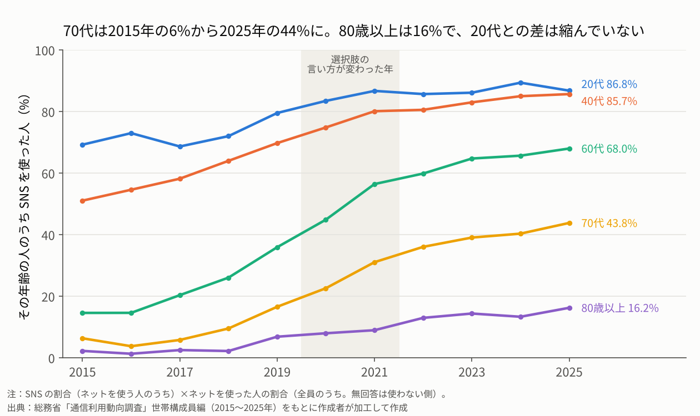
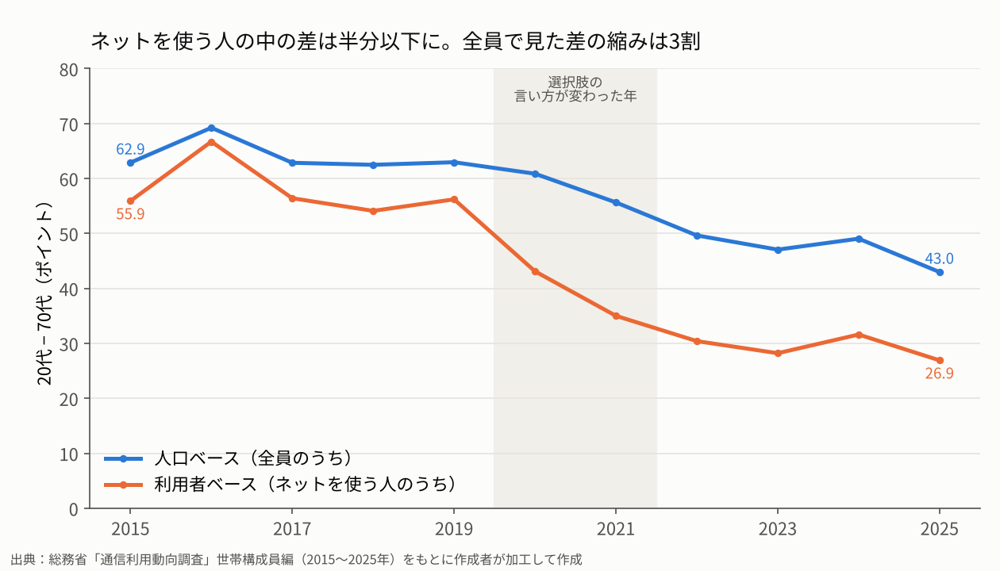
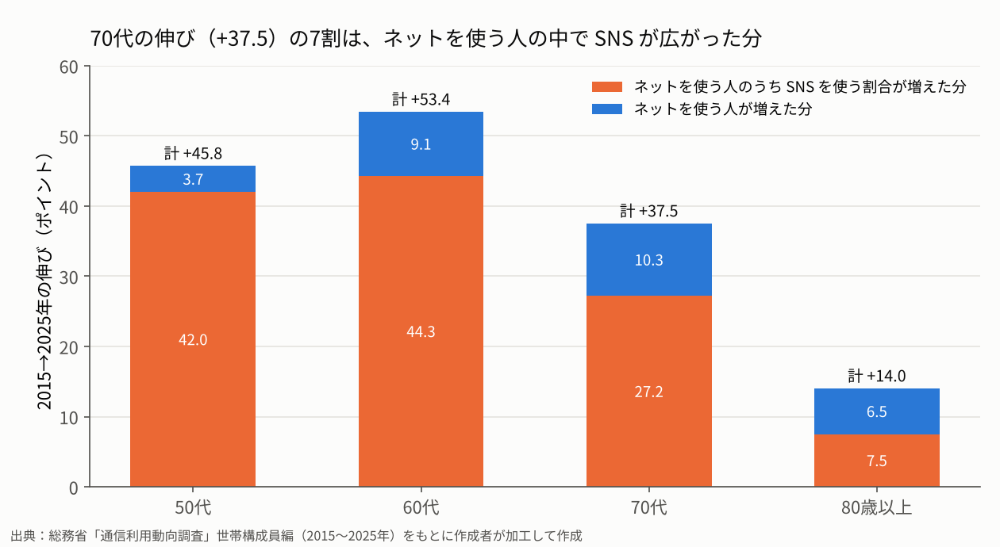
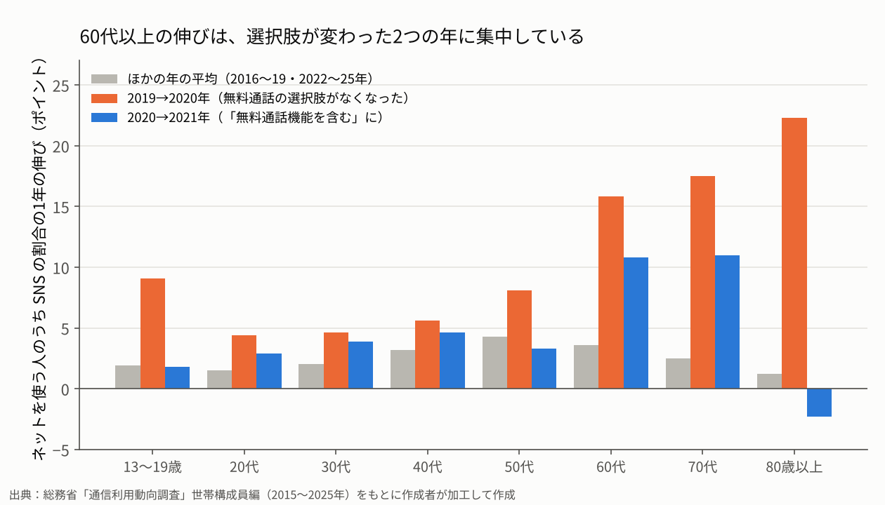

# F540 SNS を使う人の割合は、年齢でどこまで差が縮まったのか？ 20代と70代の差は2015→2025年に62.9→43.0ポイント、80歳以上との差は67.0→70.5で縮まず

## 結論（先に）

- **20代と70代の差は、3割縮みました。** その年齢の人全員のうち SNS を使った人の割合（人口ベース）は、20代が2015年69.2%→2025年86.8%、70代が6.3%→43.8%です。差は62.9ポイントから43.0ポイントになりました。事前に置いた「半分以下になる」という仮説は外れです。
- **ネットを使う人の中だけで見ると、差は半分以下になりました**（利用者ベース、55.9→26.9ポイント）。70代の人口ベースの伸び（+37.5ポイント）の72.5%は、ネットを使う人のうち SNS を使う割合が増えた分です。
- **80歳以上との差は縮んでいません。** 20代と80歳以上の差は67.0ポイントから70.5ポイントです。80歳以上で SNS を使う人は2025年で16.2%です。
- **60代以上の伸びは、調査の選択肢の言い方が変わった2つの年（2019→2020、2020→2021年）に集中しています。** 利用者ベースの差の縮みの73%がこの2年に入り、その一部は定義の変化による見かけかもしれません（推測）。人口ベースの差の縮みでは、この2年の分は37%です。



## 問い

総務省の通信利用動向調査の報道資料（令和7年調査、2026年5月29日）は、ネットで使った機能のうち SNS がいちばん多く、13〜49歳の各年齢層でもいちばん多いとまとめています。では、SNS を使う人の割合の年齢による差は、10年でどこまで縮まったのでしょうか。縮んだのは高い年齢の人が使い始めたからか、ネットを使う人が増えただけか。調査の選択肢の言い方が変わったことで、見え方はどれだけ変わるのか。

知りたい人：SNS を使った告知・広報・販売の仕事で、年齢層ごとの届き方を考える人。統計の「分母」や選択肢の変更の読み方を学びたい人です。

（既存の看板記事 027 は同じ調査で動画サイトを中心に年代を比べ、SNS は2019年と2025年の年代別の値を1枚の図で示しています。この記事は SNS だけを2015〜2025年の毎年で追い、差の縮み方を分母と選択肢の変更に分けて調べる点が違います。）

## データ（出典）

- 総務省「通信利用動向調査」世帯構成員編（e-Stat、2012〜2025年調査の各年の CSV）
  - 過去1年間のインターネット利用経験（対象：全員、対象：無回答を除く）
  - 過去1年間にインターネットで利用した機能・サービス（対象：インターネット利用者）
- 列は見出しの文字で選び、行は「本人の性別・年齢」の見出しの文字（「２０～２９歳」など）で選びました。2015・2018・2025年の値を元の CSV と照らしました（data/build_checks.json に年ごとに使ったファイル名）。
- SNS の選択肢の言い方は年によって違います。2015〜2020年は「ソーシャルネットワーキングサービスの利用」（2019年までは別に「無料通話アプリやボイスチャットの利用」があります）、2021〜2025年は「ＳＮＳ（無料通話機能を含む）の利用」です。2012〜2014年は「ソーシャルメディアの利用」で、参考として頑健性だけで使いました。
- 報道資料の要約は、全体の SNS の割合を82.3%としています。この記事で使った e-Stat の表の「全体」（ネットを使う人のうち）は79.4%で、一致しません。報道資料の概要（別紙2）は無回答を除いて算出しており（母数34,322人、この記事の表は35,794人）、その違いです（レビューで確かめた）。概要の値でも20代と70代の差は25.2ポイントで、この記事の26.9と大きくは違いません。

## 事前の計画

[PLAN.md](PLAN.md)（2026-11-19 08:44ごろ、集計の前に作成。ファイルの時刻による）。

| 仮説 | 外れの基準 | 結果 | 判定 |
|---|---|---|---|
| H1 人口ベースの20代と70代の差は2015→2025年に半分以下 | 半分より大きい | 62.9→43.0（0.68倍） | 外れ |
| H2 70代の伸びの多くは、ネットを使う人の中で SNS が広がった分 | その分が半分未満 | 27.2/37.5＝72.5% | 支持 |
| H3 2020→2021年の60代以上の伸びは前後の年の平均の2倍以上 | どれかが2倍未満 | 60代2.99倍、70代4.4倍、80歳以上はマイナス | 外れ |
| H4 80歳以上を含めると差は縮んでいない | 20代との差が10ポイント以上縮む | 67.0→70.5（3.6ポイント広がった） | 支持 |

## やったこと

1. 年×性別×年齢（13〜19歳〜80歳以上の8区分）の表を作り、利用者ベースの割合 s（ネットを使う人のうち）に、ネットを使った人の割合 u（全員のうち、無回答は使わない側）を掛けて、人口ベースの割合 p＝s×u を出しました。
2. 20代と70代の差、20代と80歳以上の差、13〜79歳の最大と最小の差を毎年出しました。
3. 2015→2025年の70代などの p の伸びを、s が伸びた分と u が伸びた分に分けました（両端の年の平均を使う中点の分け方）。
4. 年齢ごとに s の1年の伸びを、選択肢が変わった年とほかの年で比べました。

## 分かったこと

### 70代は6%から44%に。80歳以上は16%にとどまる（図1）

- 人口ベースの割合は、2015→2025年に60代が14.6%→68.0%、70代が6.3%→43.8%、80歳以上が2.2%→16.2%です。
- 2015年の60代（14.6%）は、2025年に70代として43.8%です（10歳幅なので、おおよそ同じ世代）。

### ネットを使う人の中の差は半分以下、全員で見た差は3割の縮み（図2）



- 利用者ベースの20代と70代の差は55.9→26.9ポイントで、0.48倍です。人口ベースは62.9→43.0ポイントで、0.68倍です。
- 2025年でも70代の30.8%はネットを使っておらず（無回答を含む）、その人たちは SNS も使っていない側に入ります。人口ベースの差が残るのは主にこの分です。

### 70代の伸びの7割は、ネットを使う人の中での広がり（図3）



- 70代の +37.5ポイントのうち、s の伸びの分が27.2、u の伸びの分が10.3です。
- 60代は +53.4のうち44.3（83%）、50代は +45.8のうち42.0（92%）が s の分です。80歳以上は +14.0のうち7.5（54%）で、ネットを使う人が増えた分の重みが大きくなります。

### 60代以上の伸びは、選択肢が変わった2つの年に集中（図4）



- 70代の s は、2019→2020年に +17.5、2020→2021年に +11.0ポイントでした。ほかの年（2016〜19年と2022〜25年）の平均は1年 +2.5ポイントです。
- 80歳以上は2019→2020年に +22.3ポイントでした。60代は +15.8と +10.8です。20〜40代の伸びは、この2年も1年6ポイント未満です。
- 2019年の70代は SNS 25.6%、無料通話アプリ18.6%（別の選択肢）でした。両方を使った人の重なりが分からないため、2020年の SNS 43.1%への伸びのどこまでが定義の変化かは決められません。

## 問い直し（結果を見てから足した）

H3 は「2020→2021年」に絞って置きましたが、結果を見ると、それより前の2019→2020年の伸びの方が大きいことが分かりました。そこで「選択肢が変わった2つの年（2019→2020、2020→2021）を除くと、差はどれだけ縮んだのか」を足しました（src/03b_requestion.py、results/requestion.json）。

| 見方 | 2015年の差 | 2025年の差 | 変化 | うち変わり目の2年 | それ以外の年 |
|---|---|---|---|---|---|
| 利用者ベース | 55.9 | 26.9 | −29.0 | −21.2（73.1%） | −7.8 |
| 人口ベース | 62.9 | 43.0 | −19.9 | −7.3（36.7%） | −12.6 |

- 利用者ベースの差の縮みの7割あまりは、変わり目の2年に入っています。この2年の動きを除くと、2025年の差は48.1ポイントで、2015年の55.9から大きくは縮んでいない計算になります。
- 人口ベースでは、変わり目以外の年の縮みの方が大きく（−12.6）、ネットを使う高齢の人が増えたことが効いています。ただし、ネットを使った人の割合 u は年によってぶれが大きく（80歳以上は2019年49.2%、2020年22.0%）、この分け方も幅を持って読む必要があります。

## 頑健性

| 確かめ | 2015年の差 | 2025年の差 | 倍率 | 半分以下か |
|---|---|---|---|---|
| 主（人口ベース、20代−70代） | 62.9 | 43.0 | 0.683 | いいえ |
| u を無回答除くにする | 62.1 | 42.2 | 0.679 | いいえ |
| 利用者ベース s の差 | 55.9 | 26.9 | 0.481 | はい |
| 2021→2025年だけ（同じ選択肢） | 55.6 | 43.0 | 0.772 | いいえ |
| 差を最大−最小（13〜79歳）にする | 62.9 | 43.0 | 0.683 | いいえ |
| 男性だけ | 56.7 | 38.3 | 0.676 | いいえ |
| 女性だけ | 68.6 | 47.4 | 0.691 | いいえ |
| 2013年から（ソーシャルメディア、参考） | 56.2 | 43.0 | 0.765 | いいえ |

人口ベースではどの見方でも0.68〜0.77倍で、「3割前後の縮み」は変わりませんでした。同じ選択肢の2021→2025年だけでも、差は55.6から43.0に縮んでいます。

## 言えないこと

- どの SNS（LINE・X・Instagram など）を使っているか、メッセージのやりとりか投稿や閲覧かは、この表では分かりません。
- 選択肢の言い方が変わっているため、年をまたいだ伸びの一部は定義の変化かもしれません。どの程度かは、上の比べ方による推測にとどまります。
- 標本調査なので、年齢層ごとの値にはぶれがあります（2016年の70代の s は8.6%で前後の年より低いなど）。標準誤差は公表されておらず、小さな年の上下は読んでいません。
- 使う頻度や使い方（見るだけか、書くか）は分かりません。
- 世代を追った比べ方は、10歳幅の区分を10年ずらしたもので、同じ人を追った調査ではありません。

## 仕事で使うなら

- 「SNS を使う人の割合」を年齢で比べるときは、分母が「ネットを使う人」か「全員」かを最初に確かめると、差の大きさの読み違いを減らせます。
- 2019〜2021年をまたぐ伸びには、選択肢の言い方の変化が入っている可能性を添えて伝えると、伸びの読みすぎを防げます。
- 80歳以上は、ネットを使う人の割合そのものが36%（2025年）で、ほかの年齢層とは別の見方が要ります。

## 計画からの変更

- H3 は2020→2021年だけで判定し、2019→2020年の伸びは問い直しとして足しました。
- 2012〜2014年は計画どおり頑健性の1行（2013年から）だけで使いました。

## 再現のしかた

```bash
pip install -r requirements.txt
python3 src/01_fetch.py   # 元データを取り直すときだけ（ネットにつなぐ）
sh src/run_all.sh         # オフラインで 02 → 03 → 03b → 04
```

| ファイル | 中身 |
|---|---|
| src/01_fetch.py | e-Stat から42ファイル（14年×3表）を取る。URL は data/raw/SOURCES.md |
| src/02_build.py | 年×性別×年齢の表 data/panel.csv を作る |
| src/03_analysis.py | 差の推移、伸びの分け方、変わり目の年、頑健性 → results/main.json ほか |
| src/03b_requestion.py | 問い直し → results/requestion.json |
| src/04_figures.py | 図4枚 |

所要時間は約2秒（CPU 1つ）。data/raw は約0.6MB です。再実行の確かめの結果は results/repro_check.txt にあります。

## レビューで直したこと

| # | 指摘 | 直し方 |
|---|---|---|
| 1 | 題名の差の数字が、いつからいつまでか分からない | 「2015→2025年に」を足した（status・note の1行目も同じに） |
| 2 | 報道資料の82.3%と表の79.4%の違いを「推測」としていた | 報道資料の概要（別紙2）で、無回答を除いた分母（34,322人）であることを確かめ、事実として書き直した。概要の値でも20代と70代の差は25.2ポイントで、結論は変わらない |
| 3 | 結論の「ネットを使う人の中では半分以下」に、その縮みの73%が選択肢の変わった2年に入ることが並んでいなかった | 結論の4点目に、利用者ベースは73%、人口ベースは37%がこの2年に入ることを並べた。頑健性の下に、同じ選択肢の2021→2025年だけでも55.6→43.0に縮むことを書いた |
| 4 | README が6,000字を超えていた | やったこと・結論・問いの重なりを短くした |
| 5 | PLAN.md の作成時刻の記載（08:50）が、結果の作成時刻（08:47）より後になっていた | README の記載をファイルの時刻（08:44）に合わせた |

独立レビューで、2015・2020・2025年の20代・70代・80歳以上の行（SNS の割合とネット利用の割合）を元の CSV と照らし、s×u がこの記事の値と一致することを確かめました。再実行も18ファイルが一致しました。

## 出典

- 総務省「通信利用動向調査」世帯構成員編（2012〜2025年調査）：https://www.e-stat.go.jp/stat-search/files?toukei=00200356
- 総務省「令和7年通信利用動向調査の結果」（報道資料、2026年5月29日）：https://www.soumu.go.jp/menu_news/s-news/01tsushin02_02000183.html（概要の別紙2：https://www.soumu.go.jp/main_content/001074768.pdf）

（いずれも総務省「通信利用動向調査」をもとに作成者が加工して作成）
