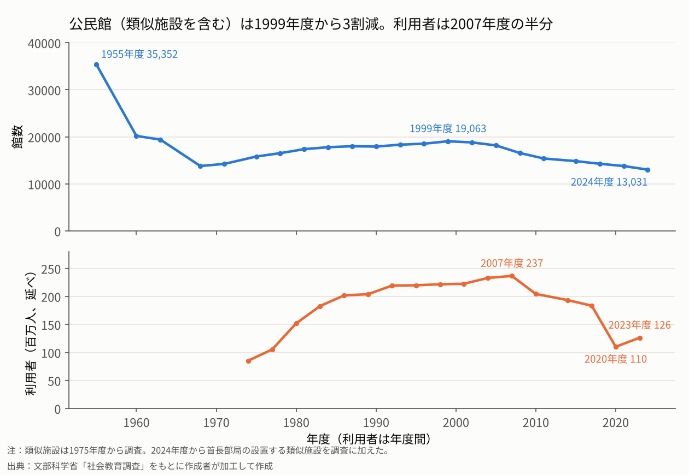
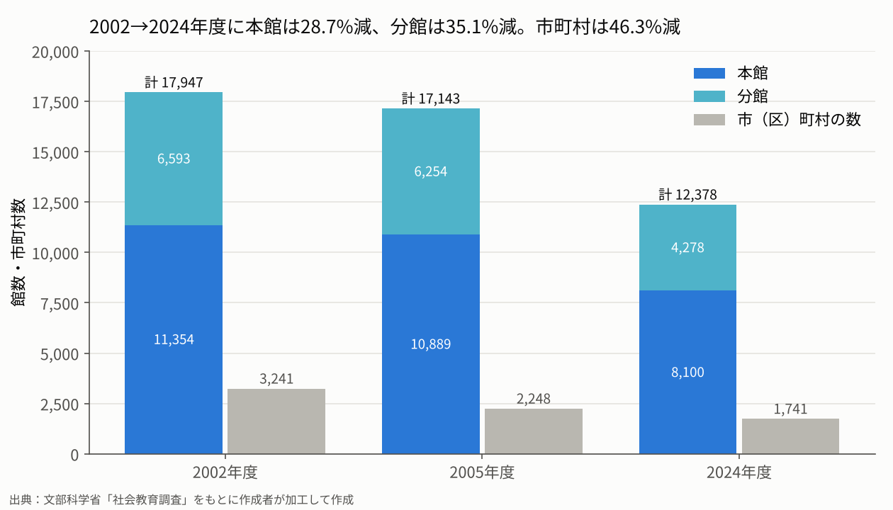
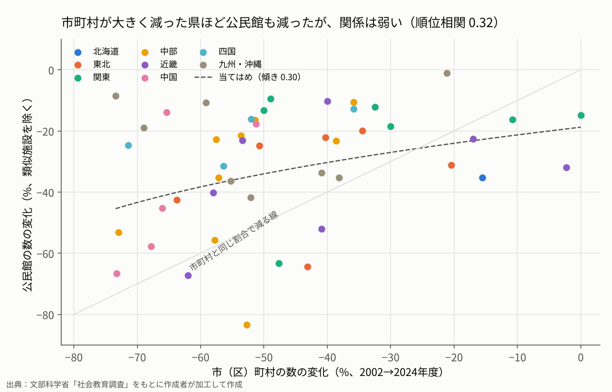
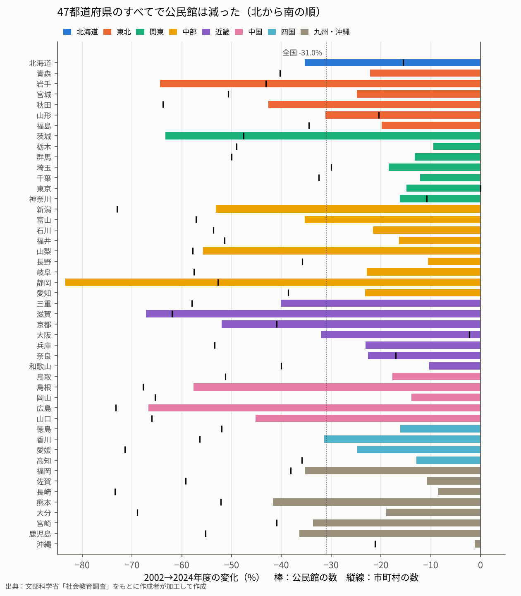

# F541 公民館は、どれだけ減ったのか？ 1999年度の19,063館から2024年度は13,031館へ31.6%減。47都道府県すべてで減り、市町村の減り方との関係は弱い（順位相関0.32）

## 結論（先に）

- **公民館（類似施設を含む）は、1999年度の19,063館から2024年度は13,031館へ、31.6%減りました。** 調査でいちばん多いのは1955年度の35,352館で、そこからは63.1%減です。
- **類似施設を除く公民館では、2002→2024年度に17,947館から12,378館へ31.0%減りました。** 本館は28.7%減、分館は35.1%減で、分館の方が減り方が大きい一方、減った数の58%は本館でした。47都道府県のすべてで減っています。
- **市町村の数が大きく減った県ほど、公民館も減る傾向はありますが、弱い関係です。** 県ごとの減少率の順位相関は0.32（95%区間0.03〜0.58）で、頑健性の7つの確かめのうち3つでは0.3を下回り、比べる年を2005年度にすると0.12でした。市町村の数は同じ間に46.3%減り、1市町村あたりの公民館は5.54館から7.11館に増えました。合併のあとも、多くの公民館は残ったと読めます。
- **利用者は館の数より速く減りました。** 延べの利用者は2007年度間の2億3,662万人から2023年度間は1億2,641万人へ46.6%減り、1館あたりでは32.1%減です。2017年度間でも、2007年度間より10.0%少なくなっていました。



## 問い

文部科学省は「令和6年度社会教育統計（社会教育調査）」の確定値の公表（2026年3月27日）で、公民館などの施設が減る傾向にあるとまとめています。では、公民館はいつから、どれだけ減ったのでしょうか。減ったのは分館か本館か。平成の大合併で市町村が大きく減った県ほど、公民館も減ったのか。使う人の数はどう変わったのか。

知りたい人：地域の集会施設や生涯学習の仕事をする人、自治体の施設の統計を読む人です。

（既存の看板記事 F518 は、市町村の公共施設の延床面積と人口の関係を扱っています。jodn 205 は図書館の貸出、F194 は博物館の入館者です。公民館の数と本館・分館、市町村の合併との関係を扱ったものはありません。）

## データ（出典）

- 文部科学省「社会教育調査」（e-Stat）
  - 年次統計 表1「施設数の推移」（公民館（類似施設を含む）、1955〜2024年度）、表7「利用者数の推移」（年度間、千人）
  - 2002年度（平成14年度）「設置者別 公民館数」「市（区）町村立公民館の設置状況」
  - 2005年度（平成17年度）「設置者別本館・分館別公民館数」「市（区）町村立公民館の設置状況」
  - 2024年度（令和6年度）「設置者別所管別本館・分館別公民館数」「市（区）町村立公民館の設置状況」
- 都道府県の名前は、行の順ではなく見出しの文字（「青   森」「青森県」など）を正規化して付けました。各表で47都道府県の和が「全国」と一致すること、計＝本館＋分館を自動で確かめ、青森県・熊本県・北海道などの値を元の表と照らしました（data/build_checks.json）。
- 類似施設は1975年度から調査され、2024年度からは首長部局が設置する類似施設が加わりました。都道府県の比べ方は、類似施設を除く「公民館」で行いました。

## 事前の計画

[PLAN.md](PLAN.md)（2026-11-19 08:45ごろ、集計の前に作成。ファイルの時刻による）。

| 仮説 | 外れの基準 | 結果 | 判定 |
|---|---|---|---|
| H1 いちばん多かった年から2024年度までに25%以上減った | 25%未満 | 1955年度から63.1%減（1999年度からは31.6%減） | 支持 |
| H2 分館の減少率が本館より大きい | 分館が本館以下 | 分館35.1%減、本館28.7%減 | 支持 |
| H3 市町村の減少率と公民館の減少率の順位相関が +0.3 以上 | +0.3 未満 | 0.32（区間0.03〜0.58） | 支持（ぎりぎり） |
| H4 1館あたりの利用者は減っていない | 減っていれば外れ | 1.43万人→0.97万人（32.1%減） | 外れ |

## やったこと

1. 年次統計から全国の館数（1955〜2024年度）と利用者（1974〜2023年度間）を並べました。
2. 2002・2005・2024年度の都道府県別の本館・分館の数と市町村の数をそろえ、2002→2024年度の変化率を出しました。
3. 市町村の数の変化率と公民館の数の変化率のスピアマンの順位相関を出し、県を引き直すブートストラップ（2,000回、種 20261116）で区間を付けました。
4. 地方別（北海道・東北・関東・中部・近畿・中国・四国・九州・沖縄）に合計して変化率を出しました。
5. 利用者（年度間）を、次の調査年度の館数で割って1館あたりを出しました。

## 分かったこと

### 全国：1999年度から3割減、利用者は2007年度の半分（図1）

- 館数は1955年度の35,352から1968年度の13,801まで減り、そのあと1999年度の19,063まで増えて、再び減りました。1955〜1971年度は類似施設を調べていない数字です。
- 利用者は1974年度間の8,538万人から増え、2007年度間の2億3,662万人が最も多く、2020年度間は1億1,020万人、2023年度間は1億2,641万人でした。

### 本館も分館も減った。減った数では本館が多い（図2）



- 2002→2024年度に、本館は11,354→8,100（3,254館減）、分館は6,593→4,278（2,315館減）です。
- 市（区）町村の数は3,241→1,741（46.3%減）、うち町と村は2,543→926でした。

### 市町村が減った県ほど減ったが、関係は弱い（図3）



- 順位相関は0.32（p=0.028）です。点は大きく散らばっていて、市町村が7割減っても公民館は1割ほどしか減っていない県もあれば、市町村がほとんど減っていないのに3割減った県もあります。
- 市町村の数が変わらなかった東京都でも、公民館は14.9%減りました。

### 47都道府県のすべてで減った（図4、北から南の順）



- 減少率の中央値は23.2%です。地方別では、北海道35.3%、東北33.8%、関東26.0%、中部29.1%、近畿32.7%、中国42.5%、四国21.5%、九州・沖縄30.3%の減少でした。
- 減り方が大きい県の中には、公民館を別の名前の施設（コミュニティセンターなど）に替えた例が含まれている可能性があります。この表ではどちらか区別できません（推測）。

## 問い直し（結果を見てから足した）

H3 の相関が弱かったので、「合併で市町村が減っても、もとの町村の公民館は残ったのか」を足しました。県ごとに、公民館の数の比の対数を市町村の数の比の対数に当てはめ、傾き（市町村が1%減ったとき公民館が何%減るか）を見ました（src/03b_requestion.py）。傾き0なら「市町村が減っても公民館はそのまま」、1なら「市町村と同じ割合で減った」です。

| 指標 | 値 |
|---|---|
| 傾き | 0.30（ブートストラップの区間0.06〜0.54） |
| 市町村が変わらないときの見込み（切片） | 18.8%減 |
| 1市町村あたりの公民館が増えた県 | 47のうち36 |
| 1市町村あたりの公民館（県の中央値） | 5.36館→7.04館 |

- 市町村の減り方の3割ほどしか公民館は減っておらず、合併のあとも多くの公民館は残ったと読めます。
- 一方で、市町村が減らなくても2割近く減る分（切片）があり、全国の減少の大きな部分は合併以外の理由によるものと考えられます（理由はこの表では分かりません）。

## 頑健性

| 確かめ | 相関 | p | 県の数 | +0.3 以上か |
|---|---|---|---|---|
| 主（公民館計、2002→2024年度、スピアマン） | 0.320 | 0.028 | 47 | はい |
| 本館だけ | 0.261 | 0.076 | 47 | いいえ |
| 分館だけ（2002年度に分館10館以上の県） | 0.281 | 0.068 | 43 | いいえ |
| ピアソンの相関 | 0.305 | 0.037 | 47 | はい |
| 北海道を除く | 0.347 | 0.018 | 46 | はい |
| 2005→2024年度 | 0.117 | 0.435 | 47 | いいえ |
| 市町村数の代わりに町と村の数 | 0.355 | 0.014 | 47 | はい |

相関は0.12〜0.36の間で動き、7つのうち3つで +0.3 を下回りました。H3 は「支持」ですが、境目のすぐ上で、確かな関係とは言えません。2005年度は合併の途中で、その時点ですでに市町村が2,248まで減っていたため、残りの変化が小さく、相関が弱く出たと考えられます（推測）。

## 言えないこと

- 減った公民館が、廃止されたのか、名前や位置づけを変えて調査の対象から外れたのかは、この表では分かりません。
- 2019年の法改正で公民館を首長部局に移せるようになったことなど、所管の変化が数にどう効いたかは分けられません。
- 利用者は延べの人数で、同じ人が何度も来れば重ねて数えます。また、類似施設を含む数字で、2024年度に調査の対象が広がった分は館数にだけ入っています。
- 合併と公民館の減少の関係は相関で、合併が原因だとは言えません。人口の変化や建物の古さは見ていません。
- 公民館をどうすべきかといった助言はしません。

## 仕事で使うなら

- 公民館の数を年で比べるときは、類似施設の範囲が1975年度と2024年度に変わっていることを添えると、数字の読み違いを防げます。
- 県どうしを比べるときは、本館と分館を分けて見ると、減り方の違いが分かりやすくなります。

## 計画からの変更

- H1 の「いちばん多かった年」は、計画を書いたときは1999年度を考えていましたが、表の最初の1955年度（35,352館）が最も多かったため、計画の文言どおり1955年度で判定し、1999年度からの減り方を並べて書きました。
- 問い直しを足しました。そのほかは計画どおりです。

## 再現のしかた

```bash
pip install -r requirements.txt
python3 src/01_fetch.py   # 元データを取り直すときだけ（ネットにつなぐ）
sh src/run_all.sh         # オフラインで 02 → 03 → 03b → 04
```

| ファイル | 中身 |
|---|---|
| src/01_fetch.py | e-Stat から Excel 8本を取る。URL は data/raw/SOURCES.md |
| src/02_build.py | 全国の推移 data/national.csv、都道府県の表 data/pref.csv |
| src/03_analysis.py | 減少率、本館・分館、順位相関、地方別、利用者、頑健性 → results/main.json ほか |
| src/03b_requestion.py | 問い直し → results/requestion.json |
| src/04_figures.py | 図4枚 |

所要時間は約5秒（CPU 1つ）。data/raw は約0.2MB です。再実行の確かめの結果は results/repro_check.txt にあります。

## レビューで直したこと

| # | 指摘 | 直し方 |
|---|---|---|
| 1 | 図3の縦軸の下の端が −82% で、−83.4% の県の点が枠の外に出て見えていなかった（47県のうち46点） | 縦軸を −90% からにした（src/04_figures.py）。計算は変わらない |
| 2 | 題名の「市町村が減った県ほど減った」は、頑健性の7つのうち3つで0.3を下回り、2005年度起点では0.12（p=0.44）であることを考えると強い。また「1館あたりの利用者も3割減」は、2007→2017年度間では10.0%減で、多くが2017年度間より後の動き | 題名を「47都道府県すべてで減り、市町村の減り方との関係は弱い（順位相関0.32）」にした（status・note の1行目も同じに）。利用者は本文に残した |
| 3 | 結論に、相関が頑健性で揺れることが書かれていなかった | 結論の3点目に「7つの確かめのうち3つでは0.3を下回り」を足した |
| 4 | PLAN.md の作成時刻の記載（08:54）がファイルの時刻（08:45）と合わない。所要時間の記載（約4秒）が再実行（5秒）と違った | README の記載をファイルの時刻と再実行の時間に合わせた |

独立レビューで、岩手県・島根県・静岡県・宮崎県・福岡県の2002年度と2024年度の本館・分館と、岩手県の市町村の数を元の表と照らし、すべて一致しました。図3を直したあと再実行し、14ファイルが一致しました。

## 出典

- 文部科学省「社会教育調査」（年次統計、平成14・17年度、令和6年度）：https://www.e-stat.go.jp/stat-search/files?toukei=00400004
- 文部科学省「令和6年度社会教育統計（社会教育調査の結果）の確定値」の公表について（2026年3月27日）：https://www.mext.go.jp/content/20260327-mxt_chousa01-000048443_1.pdf

（いずれも文部科学省「社会教育調査」をもとに作成者が加工して作成）
