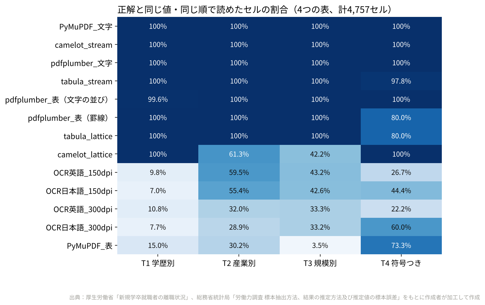
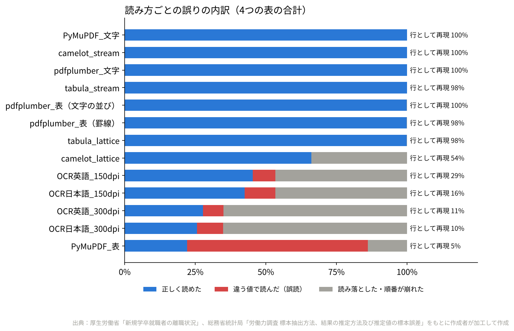
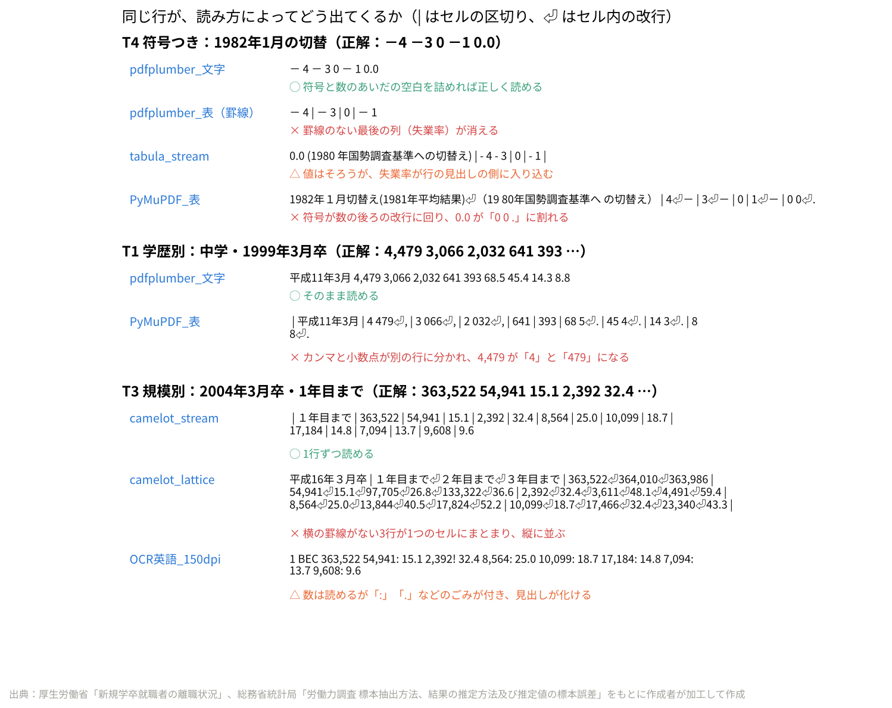
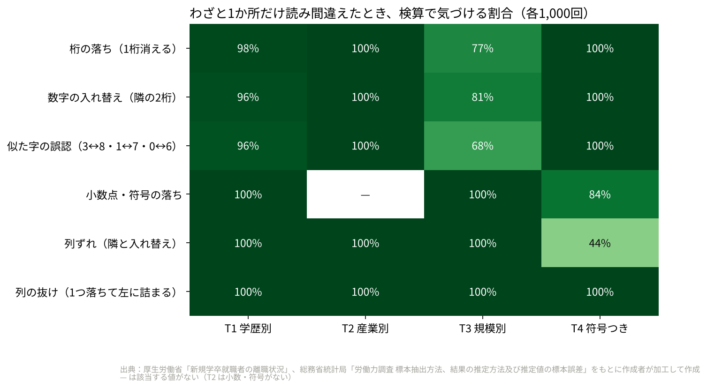
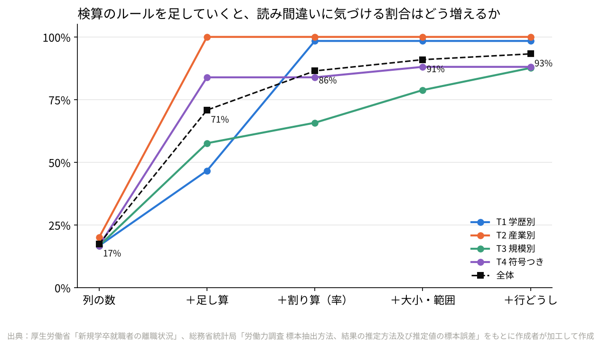

# F93 PDF の統計表を機械で読むと、どれくらい間違えるか？

## 問い

これまでの記事（F07・F66）では、厚生労働省や総務省の PDF にしかない統計表を、文字を取り出して表に組み直して使ってきた。
PDF の表を読む道具はいくつもあるが、**どの道具で読むと、どんな形の表で、どれくらい間違えるのか**。
そして、**表の中の決まりごと（合計・率・大小）で「検算」すれば、読み間違いにどこまで自動で気づけるのか**を確かめる。

## データ

| 表 | PDF | 形 | 正解のセル |
|---|---|---|---|
| T1 学歴別 | 厚生労働省「新規学卒就職者の離職状況」学歴別（1ページ） | 縦に長い・罫線あり・1行9つの数 | 112行×9＝1,008 |
| T2 産業別 | 同 大学・産業別（6ページ） | 横に広い・1行に4年分16の数・秘匿は「-」 | 186行・2,759 |
| T3 規模別 | 同 大学・事業所規模別（1ページ） | 数と率が交互・3行で1年分 | 63行×15＝945 |
| T4 段差 | 総務省統計局「労働力調査 標本抽出方法、結果の推定方法及び推定値の標本誤差」3ページ目（参考１） | 罫線なし・符号つき（「－ 4」） | 9行×5＝45 |

- 正解（ground truth）は、F07・F66 で同じ PDF から作り、検算（1〜3年目の合計＝3年計、率の再計算、産業計との一致、公表値との照合）を通した CSV（`data/raw/*.csv`）。T1 の1〜3年目それぞれの離職率（F07 の CSV にない3列）は 離職者数÷就職者数 を小数1桁に丸めて作り、PDF の文字の層と 336 セルすべてで一致することを確かめた。
- PDF は Chrome のページ上で取得し、`data/raw/` に置いた（ハッシュは `src/01_取得.py`）。
- 設計では F14（立地適正化計画の一覧）も候補だったが、F14 の PDF は「公表済みかどうか」を**文字ではなく色**で表しているため、表の抽出の比較には入れなかった（「言えないこと」参照）。

## 手法

1. **13 通りの読み方**で4つの表を読む（`src/03a_抽出.py`）。
   - 文字の層を読むもの：pdfplumber（文字の行／表：罫線／表：文字の並び）、camelot（lattice／stream）、tabula（lattice／stream）、PyMuPDF（表／文字の行）
   - 画像にしてから読むもの（スキャンした PDF の代わり）：Tesseract 5.3（英語／日本語＋英語 × 150dpi／300dpi）
2. **数の取り出し**（`src/common.py` の `numbers`）：全角→半角、桁区切りのカンマを外す、行の見出しにある年・月などの数を消す。T4 だけ「－ 4」を −4 と読む（T2 では「-」は秘匿の記号なので、「- 675」は「欠測、675」）。
3. **セル単位の評価**（`src/03b_評価.py`）：ページごとに正解の数の並びと、読み取った数の並びを `difflib.SequenceMatcher` で並べ合わせ、
   一致＝正しく読めた／置き換え＝**誤読**（違う値）／正解側だけ＝**読み落とし・順番の崩れ**／読み側だけ＝余分、に分ける。あわせて、正解の1行がそのまま1行として読めた割合（行の再現）も出す。
4. **検算**（`src/03c_検算.py`）：表ごとに決まりごとを書き、
   - R0 列の数（1行の数の個数）
   - R1 足し算（T1 1〜3年目＝3年計、T2 製造業＝内訳の合計・大分類の合計＝調査産業計、T3 6規模の合計＝規模計、T4 就業者＋失業者＋非労働力＝15歳以上人口 ±2万人）
   - R2 割り算（率＝離職者数÷就職者数、小数1桁、±0.1）
   - R3 大小・範囲（3年目まで≧2年目まで≧1年目まで、率は0〜100、失業率の段差は±1以内）
   - R4 行どうし（T3 同じ卒業年の1・2・3年目までが減っていない）

   (1) 実際の読み取り結果、(2) 正解にわざと1か所だけ読み間違いを入れたもの（6つの型×4表×1,000回、乱数固定 `SEED=20261028`）に当てはめ、気づけた割合を出す。

## 結果



- **文字の層を素直に行で読むやり方（pdfplumber の文字・PyMuPDF の文字）と camelot_stream は、4つの表の 4,757 セルをすべて正しく読めた。** tabula_stream、pdfplumber の表（文字の並び）も 99.9% 以上。
- **罫線を手がかりにするやり方（pdfplumber の表：罫線、tabula_lattice）は、罫線のない T4 の最後の列（失業率）を落とした**（T4 は 80%）。
- **camelot_lattice は T2 61%・T3 42%**。横の罫線がない3行（1・2・3年目まで）が1つのセルにまとまり、数が縦に並んでしまう。値は1つも間違えていないが、どの値がどの行かが分からなくなる。
- **PyMuPDF の表抽出は 22%、しかも 64% が「違う値」**。この PDF ではカンマと小数点が別の位置に置かれていて、`4,479` が「4」と「479」、`68.5` が「68」と「5」に割れる。数としては読めているので、**エラーにならずに間違った数が出てくる**のがいちばん危ない。
- **OCR（画像から読む）は 26〜45%**。日本語のモデルを足しても、数の読み取りは良くならなかった（細かい罫線と小さい字の表が苦手）。150dpi のほうが 300dpi より良かったのは、Tesseract の行の切り方が解像度で変わるため（推測）。




### 検算でどこまで気づけるか




- わざと入れた読み間違い 24,000 件のうち、**5つのルールすべてで 93% に気づけた**。列の数だけだと 17%、足し算を足すと 71%、率の割り算を足すと 86%。
- **気づきにくいのは、T4 の「隣の列との入れ替え」（44%）と、T3 の「率」の列の誤り（似た字の誤認で 68%）**。足し算は並べ替えに弱く、T3 の規模別の率は分母（規模別の就職者数）が表にないので検算できない。
- 実際の読み取り結果では、列の数が合っていて値が違う行が 137 行あり、そのうち 107 行（78%）に気づけた。見逃した 30 行はすべて OCR の T2 で、T2 の足し算はページ全体がそろわないと使えないため。
- 正しく読めた 3,192 行のうち 17 行を誤って疑ったが、17 行すべてが**公表された表そのものがルールを通らない2行**（大学・サービス業（他に分類されないもの）の 2006年3月卒で「2年目まで 17,558 ＞ 3年目まで 8,955」、2007年3月卒で「1年目まで 9,204 ＞ 2年目まで 6,088」）だった。この2行も、列の合計は調査産業計と一致する（`results/rule_failures_in_published_table.csv`）。

## 頑健性

1. **ツール（13通り）**：上のとおり。文字の層があれば、行で読むやり方は安定していた。
2. **表の形（4つ）**：罫線なし（T4）は罫線を使うやり方で、3行が1つにまとまる表（T3）は camelot_lattice で崩れた。どの表でも 100% を出したのは3通りだけ。
3. **数の取り出し方**：カンマを外さない素朴な取り出し方だと、文字の層を完全に読めていても正読率は 31〜54% に落ちる（`results/accuracy_naive_parse.csv`）。また、T4 の符号の読み方（「－ 4」→−4）を全部の表に使うと、T2 の「- 675」（秘匿、675）を −675 と読み、6 セル誤読する（`results/accuracy_signs_everywhere.csv`）。
4. **検算のルール**：ルールを1つずつ足すと気づける割合は 17%→71%→86%→91%→93%（図5）。率の許容幅を 0.05〜0.5 に変えても 92〜93%（`results/rules_tolerance.csv`）。
5. **OCR の条件**：英語／日本語＋英語、150／300dpi のどれでも 45% を超えなかった。

## 再現手順

```
pip install -r requirements.txt   # tabula には Java、OCR には Tesseract（eng、jpn は tessdata_fast）が必要
cd src
python 01_取得.py      # PDF の確認（ハッシュ・ページ数）
python 02_整形.py      # 正解の表を「1行＝数の列」に（data/ground_truth/）
python 03a_抽出.py     # 13通りの読み方（data/extracted/、OCR は数分）
python 03b_評価.py     # セル単位の評価（results/accuracy_*.csv）
python 03c_検算.py     # 検算（results/rules_*.csv）
python 04_図.py        # 図（figures/）
```

## 言えないこと

- **ツールの優劣の一般論ではない**。4つの表（3つは同じ作り方の厚労省の PDF）での結果で、PDF の作り方（どのソフトで書き出したか）が変われば順位は変わる。各ツールは既定の設定に近い形で使っており、設定を詰めれば改善する可能性がある（特に camelot_lattice の行の分け方、PyMuPDF のカンマの位置の後処理、OCR の前処理）。
- **正解は手入力ではなく、pdf.js で読んだ文字の層に検算をかけたもの**。文字の層そのものが画面の見た目と違う場合（埋め込みの誤り）は、正解にも同じ誤りが入る。
- **公表された表がルールを通らない2行が、誤りかどうかは分からない**。この記事は公表値をそのまま扱っており、どちらの値が正しいかの判断はしていない。
- わざと入れた読み間違いは、よくある6つの型を1か所ずつ入れたもので、実際の読み間違いの起こり方（同じ行に複数、型の割合）とは違う。93% は「この型・この表なら」の数字。
- F14 の一覧のように**色や記号で情報を持つ表**、セルの結合が多い表、スキャンしかない古い PDF は扱っていない。

## 出典

- 厚生労働省「新規学卒就職者の離職状況」（https://www.mhlw.go.jp/stf/seisakunitsuite/bunya/0000137940.html）学歴別・産業別（大学）・事業所規模別（大学）の PDF
- 総務省統計局「労働力調査 標本抽出方法、結果の推定方法及び推定値の標本誤差」（https://www.stat.go.jp/data/roudou/pdf/10.pdf）
- 正解の表：本リポジトリ F07（articles/F07_turnover_survival）、F66（articles/F66_series_breaks）
- Tesseract 日本語モデル：tesseract-ocr/tessdata_fast（https://github.com/tesseract-ocr/tessdata_fast）

各表をもとに作成者が加工して作成。
