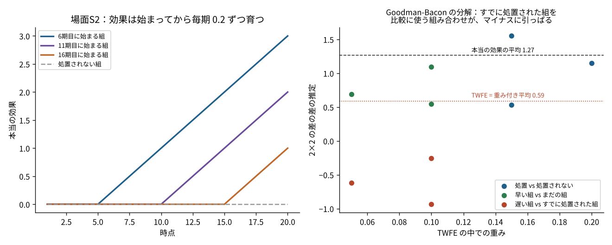
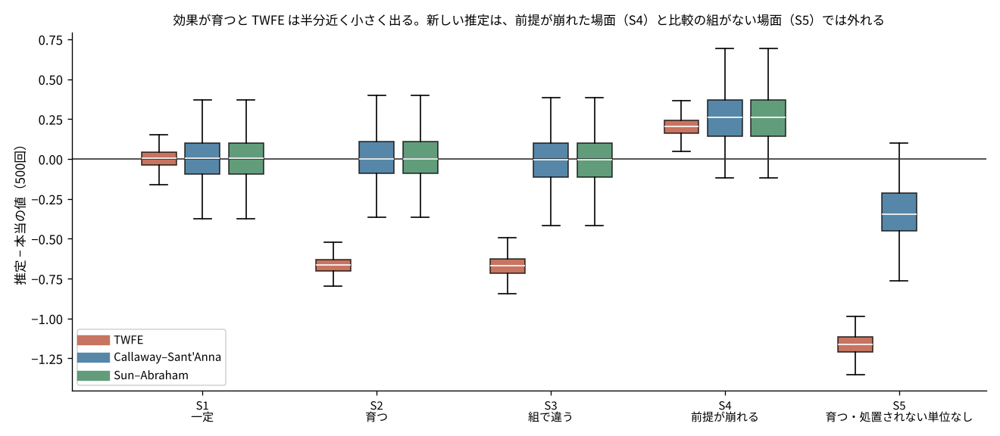
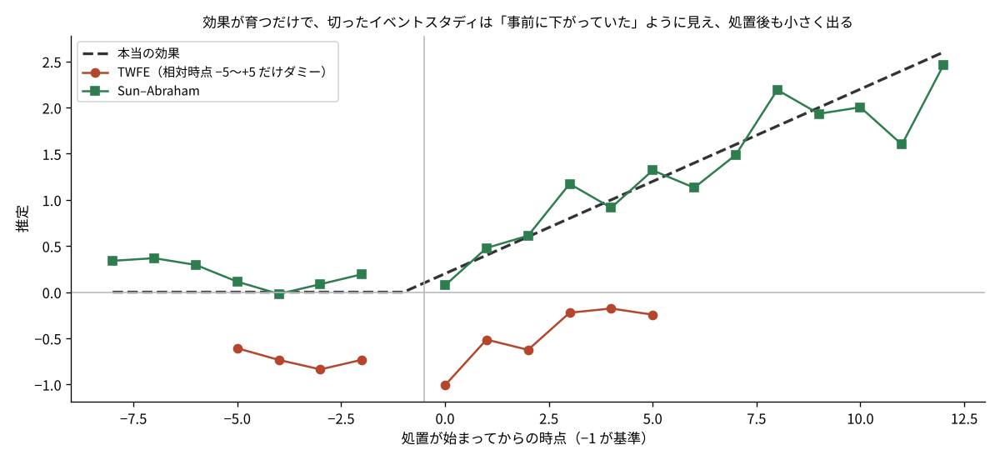
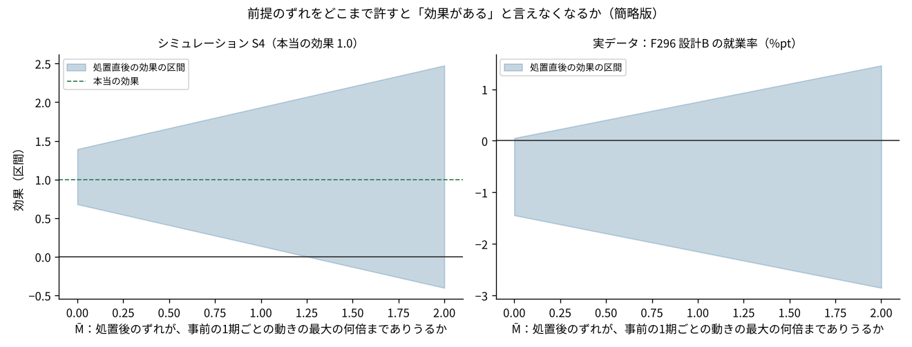
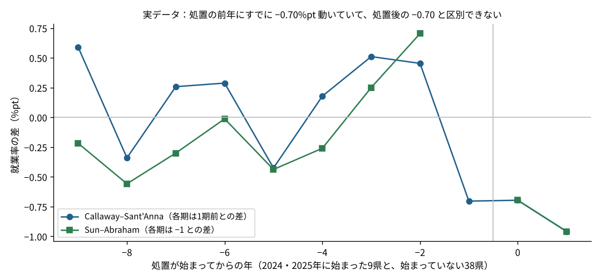

# P01 差の差の新しい推定は、どの順番で読めば仕事に使えるのか？ 効果が育つ場面では従来の推定が本当の値の半分になり、4本の論文はそれぞれ別の穴をふさいでいた

## この記事で分かること
- 差の差（DID）を「処置が始まる時期がばらばら」なデータで使うと、昔からの回帰（TWFE）がなぜ外れるのか
- Goodman-Bacon → Callaway–Sant'Anna → Sun–Abraham → Rambachan–Roth の4本を、この順に読むと何が分かるか
- 本当の効果が分かっているシミュレーションと、都道府県の実データ（[F296](../../articles/F296_minimum_wage_did_assumptions)）で、4本の考え方を手で試した結果

## 読んだ論文
| 順 | 論文 | 無料で読める版 |
|---|---|---|
| 1 | Andrew Goodman-Bacon (2021) "Difference-in-differences with variation in treatment timing", *Journal of Econometrics* 225(2) | [NBER Working Paper 25018](https://www.nber.org/papers/w25018) |
| 2 | Brantly Callaway, Pedro H. C. Sant'Anna (2021) "Difference-in-Differences with multiple time periods", *Journal of Econometrics* 225(2) | [arXiv:1803.09015](https://arxiv.org/abs/1803.09015) |
| 3 | Liyang Sun, Sarah Abraham (2021) "Estimating dynamic treatment effects in event studies with heterogeneous treatment effects", *Journal of Econometrics* 225(2) | [arXiv:1804.05785](https://arxiv.org/abs/1804.05785) |
| 4 | Ashesh Rambachan, Jonathan Roth (2023) "A More Credible Approach to Parallel Trends", *Review of Economic Studies* 90(5) | [著者のページの原稿](https://asheshrambachan.github.io/assets/files/hpt-draft.pdf) |

この記事は論文の結果を確かめたものではありません。論文の考え方を、別のデータ（シミュレーションと日本の都道府県のデータ）で試したものです。式や細かい条件は、必ず元の論文で確かめてください。

## 論文の問い：なぜ新しい推定が必要になったのか

差の差は、「処置を受けたグループ」と「受けていないグループ」の変化を比べて、処置の効果を測る方法です。2つのグループ・2つの時点なら話は簡単で、処置群の変化から対照群の変化を引けば終わりです。

ところが実務のデータでは、処置が始まる時期がばらばらなことがほとんどです。ある店舗には4月から新しい施策を入れ、別の店舗には10月から入れ、残りの店舗には入れない。都道府県の制度なら、県ごとに始まる年が違います。

こういうデータで長く使われてきたのが、二方向固定効果（Two-Way Fixed Effects、略して TWFE）の回帰です。「単位ごとの違い」と「時点ごとの違い」を両方取り除いたうえで、処置を受けているかどうか（0か1か）の係数を効果と読みます。書くのは1行で、どの統計ソフトでもすぐ動きます。

2018年前後に相次いで出た論文が示したのは、この1行の回帰が、**効果が時間とともに変わる（育つ・しぼむ）と、本当の効果とは違うものを測ってしまう**ということでした。ひどいときは符号まで逆になります。2021年に、同じ学術誌の同じ号に、この問題を扱う論文がまとめて載りました。今回読んだ1〜3本目はその中の3本です。

4本目の Rambachan–Roth は、別の穴を扱います。差の差の大前提である「処置がなければ、両グループは同じように動いたはず」（平行トレンド）が少し崩れていたら、結論はどこまで持つのか、という問いです。

## 論文の考え方

### 1. Goodman-Bacon：TWFE の中身を分解する（何が起きているかを知る）

最初に読むべき1本です。TWFE の推定値が、データの中にある「2グループ・2時点の差の差」（2×2 と呼びます）全部の、重み付き平均になっていることを示しました。

2×2 には3種類あります。

- **処置 vs 処置されない**：処置が始まった組と、ずっと処置されない組を比べる。素直な比較
- **早い組 vs まだの組**：先に始まった組と、まだ始まっていない組を、後の組が始まる前の期間で比べる。これも素直
- **遅い組 vs すでに処置された組**：後から始まった組を、**もう処置を受けている組**を対照にして比べる。これが問題

3つ目では、対照にした「すでに処置された組」の中で効果が育っていると、その育った分が「対照の変化」として引かれてしまいます。処置群の効果から、対照群の効果の伸びを引くことになるので、推定が小さく、ときにマイナスになります。

重みは、組の大きさと、処置を受けている期間の割合の分散で決まります。パネルの真ん中あたりで処置が始まった組ほど、重みが大きくなります。研究者が決めた重みではなく、回帰の仕組みが勝手に決める重みです。

この論文を読むと、「TWFE が悪い」というより「TWFE は自分が何を比べているかを教えてくれない」ことが問題だと分かります。

### 2. Callaway–Sant'Anna：比べてよいものだけを比べる（直し方1）

2本目は、直し方の基本形です。考え方はシンプルで、**「始まった時期 g の組の、時点 t での効果」ATT(g,t) を、比べてよい相手とだけ比べて1つずつ出し、あとで目的に合わせてまとめる**、というものです。

- 比べる相手は、ずっと処置されない組（never-treated）か、その時点ではまだ処置されていない組（not-yet-treated）。すでに処置された組は使わない
- 基準の時点は、処置が始まる直前（g−1）に固定する
- ATT(g,t) を、組の大きさで重みをつけて「全体の平均」「始まってから何期目か別」「組別」などにまとめる。まとめ方を分析する人が選び、選んだことを書ける

共変量（規模・地域など）を条件にした平行トレンドも扱えて、回帰・傾向スコアの重み・その両方を組み合わせる方法（二重に頑健）が使えます。この記事では共変量なしの一番簡単な形だけを試しました。

### 3. Sun–Abraham：イベントスタディの図を正しく描く（直し方2）

3本目は、効果を「処置が始まってから何期目か」別に並べた図（イベントスタディ）に焦点を当てています。

よくある書き方は、TWFE に「処置の何期前・何期後か」のダミーを入れる回帰です。Sun–Abraham は、時期のずれと効果の違いがあると、**ある期の係数に、別の期の効果が混ざる**ことを示しました。処置前の係数（事前のずれのチェックに使うところ）にも混ざるので、効果の育ち方が違うだけで、「事前にずれていた」ように見えることがあります。

直し方は、「始まった組 × 何期目か」の組み合わせごとにダミーを入れて、比べる相手を処置されない組（またはいちばん最後に処置される組）に限り、最後に組の大きさで重みをつけて平均することです（interaction-weighted 推定）。処置されない組と比べ、基準を g−1 に置く点で、2本目と同じことを回帰の形で書いたものと考えられます。実際、この記事のシミュレーションでは、2本目と3本目の推定は小数4桁まで一致しました。

### 4. Rambachan–Roth：前提が少し崩れたら、結論はどこまで持つか（確かめ方）

4本目は、平行トレンドそのものを扱います。

よくあるのは、「処置前の係数がゼロと区別できないので、平行トレンドは成り立つ」と言うやり方です。ところが、処置前のデータが少なかったりばらついていたりすると、この検定はずれを見つける力が弱く、「通った」ことにあまり意味がありません。

Rambachan–Roth は、平行トレンドを「成り立つ／成り立たない」の二択でなく、**どれくらいのずれまでなら許すか**を分析する人が決め、そのもとで効果の幅を出す方法を示しました。代表的な決め方が「相対的な大きさ」で、処置後のずれは、処置前に見えたずれの最大の M̄ 倍までありうる、とします。M̄ を0から大きくしていき、「効果がある」と言えなくなる M̄（ブレイクダウンの値）を報告します。M̄ が1を超えても結論が変わらなければ、「処置前に見えた最大のずれと同じくらいずれていても大丈夫」と言えます。

この記事では、元の論文の最適な区間の作り方は使わず、「推定値 ± M̄ ×（処置前の1期ごとの動きの最大）± 1.96×標準誤差」という簡略版で試しました。元の方法より区間は広く出るはずです（推測）。

### 読む順番のすすめ
1. **Goodman-Bacon**：何が壊れているかを知る。自分の TWFE を分解して、「すでに処置された組」を対照にした重みがどれだけあるかを見る
2. **Callaway–Sant'Anna**：直し方の基本。ATT(g,t) を出して、目的に合わせてまとめる
3. **Sun–Abraham**：イベントスタディの図を描くときに読む。2本目とほぼ同じ考え方なので、短く済む
4. **Rambachan–Roth**：直した推定でも、平行トレンドが崩れていれば外れる。最後に「どこまで許せるか」を確かめる

## 手元で試す

### 試したデータ
- **シミュレーション**：40単位×20期。6期目・11期目・16期目に始まる組が10単位ずつと、処置されない組が10単位。単位ごと・時点ごとの違いと、標準偏差0.5の揺れを入れ、乱数の種を固定して500回ずつ作り直した。場面は5つ
  - S1 一定：効果は始まった時点からずっと1.0
  - S2 育つ：効果は始まった期が0.2で、そこから毎期0.2ずつ増える
  - S3 組で違う：早く始まった組ほど効果が大きく（1.5・1.0・0.5）、毎期0.15ずつ増える
  - S4 前提が崩れる：効果は1.0で一定だが、処置される組だけが毎期0.04ずつ上向いている（平行トレンドが崩れている）
  - S5 処置されない組がない：S2 から、処置されない組を除いたもの
- **実データ**：F296 の設計B。都道府県×年（2015〜2025年）の就業率で、最低賃金の上げ幅が中央値より5円以上大きかった県を「処置」とした。2024年に始まった4県、2025年に始まった5県、期間内に始まっていない38県（F296 の data/panel.csv をそのまま使った）

比べたのは、TWFE（処置ダミー1本）、Callaway–Sant'Anna 型（共変量なし・平均の差・処置されない組と比較）、Sun–Abraham 型（組×何期目かのダミー・処置されない組と比較）の3つです。差の差の専用パッケージは使わず、numpy と pandas で書きました（`src/did_tools.py`）。Goodman-Bacon の分解は、重み付き平均が TWFE の値と小数4桁まで一致することを確かめています。

### 本当の効果の決め方
「処置を受けた単位×時点の効果の単純な平均」を本当の値にしました。TWFE・Callaway–Sant'Anna の全体のまとめ（simple）・Sun–Abraham の全体のまとめは、どれも組の大きさで重みをつけるので、組の大きさがそろったこのシミュレーションでは、同じものを目指していることになります。

## 分かったこと

### 1. 効果が育つと、TWFE は本当の値の半分しか出さない。原因は「すでに処置された組」との比較だった



| 場面 | 本当の値 | TWFE | Callaway–Sant'Anna | Sun–Abraham |
|---|---|---|---|---|
| S1 一定 | 1.00 | 1.00（+0.2%） | 1.01（+0.5%） | 1.01（+0.5%） |
| S2 育つ | 1.27 | 0.60（−52.4%） | 1.28（+0.8%） | 1.28（+0.8%） |
| S3 組で違う | 1.97 | 1.30（−34.1%） | 1.96（−0.4%） | 1.96（−0.4%） |
| S4 前提が崩れる | 1.00 | 1.20（+20.2%） | 1.26（+25.9%） | 1.26（+25.9%） |
| S5 処置されない組がない | 1.27 | 0.10（−92.0%） | 0.93（−26.4%） | （比べる組がないので出していない） |

（500回の平均。かっこは本当の値との差）

- 効果が一定（S1）なら、TWFE も正しく、ばらつきは新しい推定より小さかった（RMSE 0.066 と 0.143）。TWFE が悪いのは「効果が時間で変わるとき」に限られる
- 効果が育つ（S2）と、TWFE は 0.60 で、本当の 1.27 の半分以下だった。1回分のデータを Goodman-Bacon の方法で分解すると、9つの 2×2 のうち「遅い組 vs すでに処置された組」の3つが −0.26・−0.94・−0.62 とマイナスで、その重みの合計は 0.25 あった
- 処置された単位×時点ごとの重みで見ると、300のうち50（いちばん早い組の、始まってから10期目以降）に負の重みがかかっていた。いちばん効果が育った時点の効果を、マイナスに数えていることになる
- 処置されない組がない（S5）と、TWFE は 0.10（−92%）まで落ちた。「遅い組 vs すでに処置された組」の重みが 0.50 に増えるため

### 2. 相対時点のダミーを途中で切ったイベントスタディは、育ち方だけで「事前のずれ」を作る


- 場面 S2 で、よくある書き方（処置の5期前〜5期後だけダミーを入れ、それより外は基準と同じ扱い）の TWFE を200回流すと、処置前（−5〜−2期）の係数の平均は −0.71 だった。本当は処置前の効果はゼロなので、「事前に下がっていた」という誤った絵になる
- 処置5期後の係数は、本当の 1.2 に対して平均 −0.25 で、符号まで逆だった
- Sun–Abraham 型では、処置前の係数の平均は 0.007、5期後は 1.19 で、本当の値に近かった

### 3. 新しい推定は、平行トレンドが崩れていれば外れる。実データでは前提の段階で止まった



- 処置される組だけが上向いている S4 では、Callaway–Sant'Anna 型・Sun–Abraham 型も +25.9% ずれた。直し方は「比べる相手」の問題を解くが、「比べる相手が平行に動いていない」問題は解かない
- S4 の1回分で簡略版の Rambachan–Roth を当てると、処置直後の効果は 1.04（本当は1.0）で、「効果がない」と言えなくなる M̄ は 1.3 だった。処置前の1期ごとの動き（ほとんどが揺れ）の最大 0.54 の1.3倍までずれを許しても、効果ありの結論は持つ
- 実データ（就業率）では、TWFE が −0.60%pt、Callaway–Sant'Anna 型と Sun–Abraham 型がどちらも −0.78%pt だった。差のほとんどは基準の年の置き方から来ていて、「すでに処置された組」の重みは 0.4% しかなかった（2024年と2025年の組の比較だけなので）
- ところが、処置の前年（e=−1）にすでに −0.70%pt 動いていて、処置直後（e=0）の −0.70%pt と同じ大きさだった。簡略版の Rambachan–Roth では M̄=0（ずれをまったく許さない）でも区間がゼロをまたぎ、効果があるとは言えなかった。推定の方法を選ぶ前に、前提の段階で止まる例になった

## 論文の限界と、試して分かった落とし穴
- **新しい推定は、ばらつきが大きい**：効果が一定の S1 では、TWFE の RMSE は 0.066、新しい推定は 0.143 で、2倍以上だった。比べる相手を絞るぶん、使えるデータが減る。効果が時間で変わらないと強く言えるなら、TWFE のほうが精度はよい
- **比べる相手がいないと、新しい推定も外れる**：S5 では Callaway–Sant'Anna 型（まだ処置されていない組と比較）も −26% ずれた。最後の組が始まったあとの期間には比べる相手がいないので、そこを使う集計は作れない。この記事の実装では、まとめに使える ATT(g,t) だけで平均したので、早く始まった組の後半の大きな効果が入らず、小さめに出た
- **処置前の係数の基準が、方法で違う**：Callaway–Sant'Anna 型の処置前は「1期前との差」、Sun–Abraham 型は「−1期との差」で、同じデータでも図の形が違う（図5）。図を見比べるときは、何と比べた係数かを確かめる
- **平行トレンドの検定に頼りすぎない**：実データでは、処置前の大きなずれが1期だけだった。事前の検定は「ずれを見つけられなかった」だけで、「ずれがない」の証拠にはならない。Rambachan–Roth のように、許すずれの大きさを決めて幅で示すほうが正直
- **簡略版の感度分析は保守的**：この記事の Rambachan–Roth は、偏りの上限を区間に足しただけ。元の論文の方法（線形計画で最適な区間を作る）より区間は広く、ブレイクダウンの値は小さく出るはず（推測）

## 仕事で使うなら
1. **施策の開始時期が店舗・地域でずれるなら、まず TWFE を分解する**：Goodman-Bacon の分解で「すでに処置された組と比べている重み」が小さければ、TWFE と新しい推定はあまり変わらない。大きければ、新しい推定に切り替える
2. **報告の主役は ATT(g,t) のまとめにする**：「全体の平均」だけでなく、「始まってから何期目か別」を必ず並べる。効果が育つのか、しぼむのかが、施策を続けるかどうかの判断に直接効く
3. **前提がどこまで崩れても結論が持つかを、1つの数字で添える**：ブレイクダウンの M̄ を出し、「処置前に見えた最大のずれの何倍までなら大丈夫か」を、業務を知っている人と一緒に「ありうるか」で判断する

## 関連する論文と、次に読むもの
- de Chaisemartin & D'Haultfœuille (2020)「Two-Way Fixed Effects Estimators with Heterogeneous Treatment Effects」*American Economic Review*：処置された単位×時点ごとの負の重みを示した論文。この記事の「300のうち50が負の重み」は、この考え方で数えた
- Borusyak, Jaravel & Spiess (2024)「Revisiting Event-Study Designs」*Review of Economic Studies*：処置されていない観測だけで単位と時点の効果を推定し、処置後の観測から引く方法（imputation）
- Roth (2022)「Pretest with Caution」*American Economic Review: Insights*：事前の検定を通ったものだけを報告すると、かえって偏るという話。4本目の前に読むと動機が分かる
- Roth, Sant'Anna, Bilinski & Poe (2023)「What's Trending in Difference-in-Differences?」*Journal of Econometrics*：ここまでの流れをまとめた展望論文。全体の地図として最初か最後に読むとよい

## 言えないこと
- 論文の結果を確かめたのではなく、論文の考え方を、シミュレーションと日本の都道府県のデータで試しただけ
- シミュレーションの場面は5つだけで、効果の形・組の数・揺れの大きさは作者が決めた。別の設定では差の大きさが変わる
- 実装は共変量なしの一番簡単な形。論文のパッケージ（R の did・HonestDiD など）とは、細かい扱い（標準誤差の出し方、処置前の基準など）が違う
- Rambachan–Roth は簡略版で、元の方法の区間ではない
- 実データの就業率の結果は、最低賃金の効果について何かを言うものではない。最低賃金をどう決めるべきかは扱っていない

## 再現のしかた
```
pip install -r requirements.txt
cd src
bash run_all.sh   # 7分ほど。乱数の種は固定（20261114）
```
2回流して results/ の13ファイルが一致することを確かめた。

| ファイル | 中身 |
|---|---|
| src/did_tools.py | TWFE・ATT(g,t)・Sun–Abraham・Goodman-Bacon の分解・単位×時点の重み |
| src/p01_main.py | シミュレーション・実データ・感度分析 |
| src/p01_figures.py | 図 |
| data/panel_f296.csv | F296 の都道府県パネル（出典は F296 の README） |
| data/sim_S2_one.csv | 図1・図3に使った S2 の1回分 |
| results/sim_summary.csv | 5つの場面×3つの推定の、500回の平均・偏り・RMSE |
| results/main.json | 本文の数字 |

## 出典
- 論文：上の「読んだ論文」の4本（いずれも2026-11-14 に無料の版を確認）
- 実データ：[F296](../../articles/F296_minimum_wage_did_assumptions) と同じ（総務省「労働力調査（都道府県別モデル推計値）」、厚生労働省「地域別最低賃金の全国一覧」）

コード：MIT License
