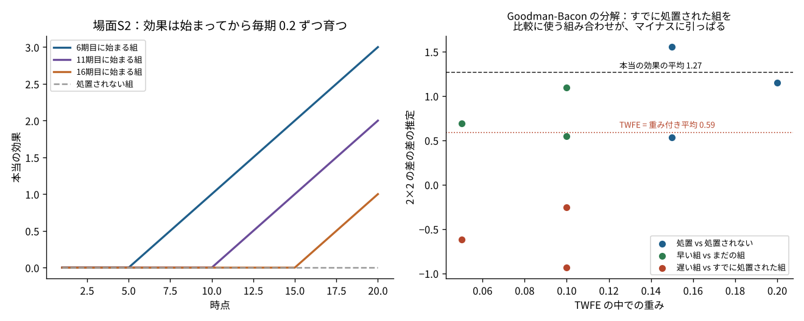
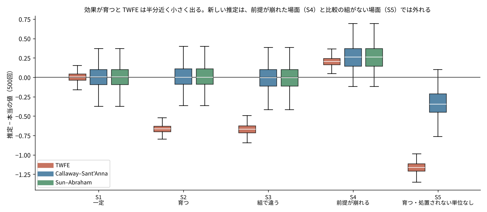
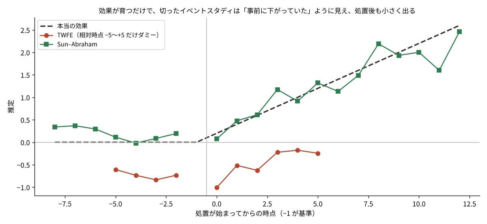
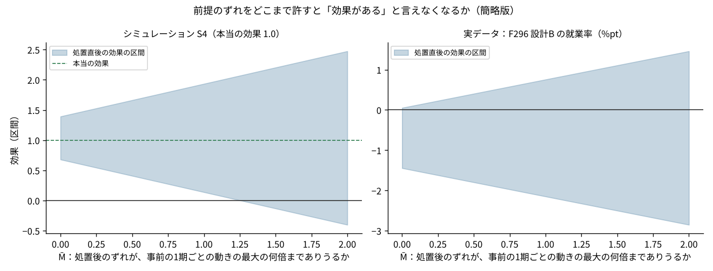
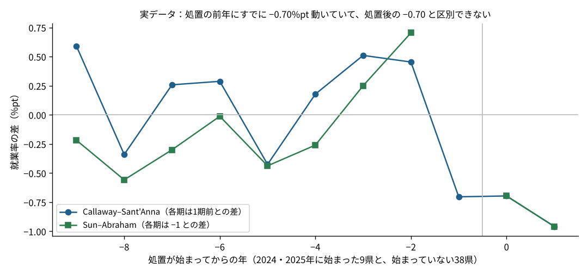

# P01 In what order should you read the new difference-in-differences estimators to use them at work? When effects grow over time, the classic estimate came out at half the true value, and each of the four papers fixes a different hole

Japanese version: [README.md](README.md). Index of the paper series: [papers/README_EN.md](../README_EN.md).

## Question

- Why does the classic regression (two-way fixed effects, TWFE) go wrong when difference-in-differences (DiD) is used on data where treatment starts at different times?
- What do you learn by reading Goodman-Bacon → Callaway–Sant'Anna → Sun–Abraham → Rambachan–Roth in this order?
- What happens when the ideas of the four papers are tried by hand on a simulation where the true effect is known, and on real prefecture data ([F296](../../articles/F296_minimum_wage_did_assumptions))?

### Papers read

| Order | Paper | Free version |
|---|---|---|
| 1 | Andrew Goodman-Bacon (2021) "Difference-in-differences with variation in treatment timing", *Journal of Econometrics* 225(2) | [NBER Working Paper 25018](https://www.nber.org/papers/w25018) |
| 2 | Brantly Callaway, Pedro H. C. Sant'Anna (2021) "Difference-in-Differences with multiple time periods", *Journal of Econometrics* 225(2) | [arXiv:1803.09015](https://arxiv.org/abs/1803.09015) |
| 3 | Liyang Sun, Sarah Abraham (2021) "Estimating dynamic treatment effects in event studies with heterogeneous treatment effects", *Journal of Econometrics* 225(2) | [arXiv:1804.05785](https://arxiv.org/abs/1804.05785) |
| 4 | Ashesh Rambachan, Jonathan Roth (2023) "A More Credible Approach to Parallel Trends", *Review of Economic Studies* 90(5) | [manuscript on the author's page](https://asheshrambachan.github.io/assets/files/hpt-draft.pdf) |

This article does not verify the papers' results. It tries the papers' ideas on other data (a simulation and Japanese prefecture data). Always check formulas and detailed conditions in the original papers.

### Why new estimators were needed

DiD measures a treatment effect by comparing the change in a treated group with the change in an untreated group. With two groups and two periods it is simple: subtract the control group's change from the treated group's change.

In real data, treatment usually starts at different times: one set of stores gets a new initiative in April, another in October, the rest never. For prefectural policies, each prefecture starts in a different year.

For such data, the long-standing tool has been the TWFE regression: remove both unit differences and time differences, then read the coefficient on a 0/1 treatment indicator as the effect. It is one line and runs in any statistics package.

Papers appearing around 2018 showed that this one-line regression **measures something other than the true effect when effects change over time (grow or fade)**, sometimes even with the wrong sign. In 2021 several papers on this problem appeared in the same issue of the same journal; papers 1–3 here are three of them.

Paper 4 deals with a different hole: if the core assumption of DiD — "without treatment, both groups would have moved alike" (parallel trends) — is slightly broken, how far does the conclusion hold?

### The papers' ideas, briefly

1. **Goodman-Bacon: decompose TWFE (know what is happening).** The TWFE estimate is a weighted average of every "two groups, two periods" DiD (2×2) in the data. There are three kinds: treated vs never-treated; early vs not-yet-treated (before the later group starts); and **late vs already-treated**, where the already-treated group serves as the control. In the third kind, if the effect is growing within the already-treated group, that growth is subtracted as "the control's change", making the estimate smaller or even negative. The weights come from group sizes and the variance of the share of time treated — set by the mechanics of the regression, not by the researcher. The lesson is less "TWFE is bad" than "TWFE does not tell you what it is comparing".
2. **Callaway–Sant'Anna: compare only what may be compared (fix 1).** Estimate ATT(g,t), the effect at time t for the group that started at time g, one at a time against valid comparisons only (never-treated, or not-yet-treated at that time; never the already-treated), with the base period fixed just before treatment (g−1). Then aggregate with group-size weights into an overall average, by event time, or by group — the analyst chooses and can state the choice. Covariate-conditional parallel trends are supported (regression, propensity-score weighting, or doubly robust); this article tried only the simplest form without covariates.
3. **Sun–Abraham: draw event-study plots correctly (fix 2).** The common event-study regression adds leads and lags to TWFE. With staggered timing and heterogeneous effects, **a coefficient for one period mixes in effects from other periods**, including pre-treatment coefficients used to check pre-trends — so differences in how effects grow can look like "pre-existing differences". The fix interacts cohort × event time, compares only with the never-treated (or last-treated) group, and averages with group-size weights (interaction-weighted estimator). Comparing with the never-treated and using g−1 as the base, it is essentially paper 2 written as a regression; in this article's simulation the two agreed to four decimal places.
4. **Rambachan–Roth: how far the conclusion holds if the assumption is slightly broken (a check).** The common practice is "pre-treatment coefficients are not distinguishable from zero, so parallel trends hold". With few or noisy pre-periods this test has little power, so passing it means little. Instead, the analyst decides **how large a violation to allow**, and reports a range for the effect under that. A typical choice is "relative magnitudes": post-treatment violations can be up to M̄ times the largest pre-treatment movement. Increase M̄ from 0 and report the value at which "there is an effect" can no longer be claimed (the breakdown value). If the conclusion survives M̄ above 1, it holds even with violations as large as the largest pre-treatment movement. This article used a simplified version — "estimate ± M̄ × (largest one-period pre-treatment movement) ± 1.96 × SE" — instead of the paper's optimal intervals; intervals should come out wider than with the original method (my interpretation).

### Suggested reading order

1. **Goodman-Bacon**: learn what is broken. Decompose your own TWFE and see how much weight is on comparisons with already-treated groups.
2. **Callaway–Sant'Anna**: the basic fix. Estimate ATT(g,t) and aggregate for your purpose.
3. **Sun–Abraham**: read when drawing event-study plots. Almost the same idea as paper 2, so it is quick.
4. **Rambachan–Roth**: even a fixed estimator fails if parallel trends break. Finish by checking how much violation you can tolerate.

## Data

- **Simulation**: 40 units × 20 periods. Groups starting in periods 6, 11 and 16 (10 units each) and 10 never-treated units. Unit and time differences plus noise with SD 0.5; 500 replications per scenario with fixed seeds. Five scenarios:
  - S1 constant: effect 1.0 from the start
  - S2 growing: 0.2 in the first treated period, then +0.2 each period
  - S3 differs by group: earlier groups have larger effects (1.5, 1.0, 0.5), growing 0.15 per period
  - S4 assumption broken: constant effect 1.0, but only treated groups trend upward by 0.04 per period (parallel trends fail)
  - S5 no never-treated group: S2 without the never-treated units
- **Real data**: design B of F296. Prefecture × year (2015–2025) employment rate; prefectures whose minimum-wage increase exceeded the median by 5 yen or more are "treated": 4 prefectures starting in 2024, 5 in 2025, and 38 not starting within the period (F296's data/panel.csv used as is).

## What I did

- Compared TWFE (one treatment dummy), a Callaway–Sant'Anna-type estimator (no covariates, difference in means, compared with never-treated) and a Sun–Abraham-type estimator (cohort × event-time dummies, compared with never-treated). No dedicated DiD package was used; everything is written in numpy and pandas (`src/did_tools.py`). The Goodman-Bacon decomposition's weighted average was checked to match TWFE to four decimal places.
- **True effect**: the simple average of effects over treated unit × time cells. TWFE, the overall (simple) aggregation of Callaway–Sant'Anna and the overall aggregation of Sun–Abraham all weight by group size, so with equal group sizes in this simulation they target the same quantity.

## Findings

### 1. When effects grow, TWFE gives only half the true value — because of comparisons with already-treated groups




| Scenario | True value | TWFE | Callaway–Sant'Anna | Sun–Abraham |
|---|---|---|---|---|
| S1 constant | 1.00 | 1.00 (+0.2%) | 1.01 (+0.5%) | 1.01 (+0.5%) |
| S2 growing | 1.27 | 0.60 (−52.4%) | 1.28 (+0.8%) | 1.28 (+0.8%) |
| S3 differs by group | 1.97 | 1.30 (−34.1%) | 1.96 (−0.4%) | 1.96 (−0.4%) |
| S4 assumption broken | 1.00 | 1.20 (+20.2%) | 1.26 (+25.9%) | 1.26 (+25.9%) |
| S5 no never-treated | 1.27 | 0.10 (−92.0%) | 0.93 (−26.4%) | (not computed: no comparison group) |

(Mean of 500 runs; difference from the true value in parentheses.)

- With a constant effect (S1), TWFE is correct and less variable than the new estimators (RMSE 0.066 vs 0.143). TWFE goes wrong only when effects change over time.
- With growing effects (S2), TWFE gave 0.60, less than half of the true 1.27. Decomposing one dataset with Goodman-Bacon, the three "late vs already-treated" comparisons among nine 2×2s were negative (−0.26, −0.94, −0.62), with total weight 0.25.
- By treated unit × time cell, 50 of 300 cells (the earliest group from its 10th treated period on) had negative weights: the cells where the effect had grown most were counted negatively.
- Without a never-treated group (S5), TWFE fell to 0.10 (−92%), because the weight on "late vs already-treated" rises to 0.50.

### 2. An event study that bins distant leads and lags creates "pre-trends" from the shape of growth alone



- In S2, running the common TWFE specification (dummies only for 5 periods before to 5 after; periods outside treated like the base) 200 times, the pre-treatment coefficients (−5 to −2) averaged −0.71. The true pre-treatment effect is zero, so this paints a false picture of "falling beforehand".
- The coefficient 5 periods after treatment averaged −0.25 against a true 1.2 — even the sign was wrong.
- With the Sun–Abraham type, pre-treatment coefficients averaged 0.007 and the 5-period-after coefficient 1.19, close to the truth.

### 3. The new estimators fail if parallel trends break; on real data the analysis stopped at the assumption stage




- In S4, where only treated groups trend upward, the Callaway–Sant'Anna and Sun–Abraham types were also off by +25.9%. The fixes solve "who to compare with", not "the comparison group does not move in parallel".
- Applying simplified Rambachan–Roth to one S4 dataset, the effect right after treatment was 1.04 (true 1.0), with a breakdown M̄ of 1.3: the conclusion of a positive effect holds even allowing violations 1.3 times the largest one-period pre-treatment movement (0.54, mostly noise).
- On the real data (employment rate), TWFE gave −0.60 pp and both Callaway–Sant'Anna and Sun–Abraham types gave −0.78 pp. Most of the difference came from the choice of base year; the weight on already-treated comparisons was only 0.4% (only the 2024 vs 2025 groups).
- But in the year before treatment (e = −1) the outcome had already moved by −0.70 pp, the same size as right after treatment (e = 0, −0.70 pp). With simplified Rambachan–Roth, even M̄ = 0 (no violation allowed) gave an interval crossing zero, so no effect could be claimed — an example of stopping at the assumption stage before choosing an estimator.

## What this does not show

- It does not verify the papers' results; it only tries their ideas on a simulation and Japanese prefecture data.
- Only five simulation scenarios; effect shapes, number of groups and noise were chosen by the author. Other settings would change the sizes of the differences.
- The implementation is the simplest form without covariates. Details (standard errors, pre-treatment base) differ from the papers' packages (R's did, HonestDiD, etc.).
- Rambachan–Roth is a simplified version, not the original method's intervals.
- The real-data employment results say nothing about the effect of the minimum wage, and this article does not discuss how the minimum wage should be set.

### Limits of the papers and pitfalls found while trying them

- **The new estimators are noisier.** In S1 (constant effect), TWFE's RMSE was 0.066 and the new estimators' 0.143, more than double: restricting comparisons reduces usable data. If you can strongly argue effects do not change over time, TWFE is more precise.
- **Without comparison groups, the new estimators also fail.** In S5, the Callaway–Sant'Anna type (compared with not-yet-treated) was off by −26%. After the last group starts there is nothing to compare with, so aggregations that use that period cannot be built; this implementation averaged only the usable ATT(g,t), omitting the large late effects of early groups, so it came out low.
- **Pre-treatment coefficients use different bases.** Callaway–Sant'Anna-type pre-treatment estimates are "difference from one period earlier", Sun–Abraham-type "difference from period −1", so the plots look different on the same data (Figure 5). Check what each coefficient is compared with.
- **Do not lean on pre-trend tests.** In the real data, the large pre-treatment movement was in a single period. A pre-test only says "no violation was detected", not "there is none". Choosing an allowed size of violation and reporting a range, as Rambachan–Roth do, is more honest.
- **The simplified sensitivity analysis is conservative.** Adding a bias bound to the interval gives wider intervals and smaller breakdown values than the paper's method (optimal intervals via linear programming) (my interpretation).

## How to use this at work

1. **If an initiative starts at different times across stores or regions, decompose TWFE first.** If the weight on comparisons with already-treated groups is small, TWFE and the new estimators will be close; if large, switch to the new estimators.
2. **Make aggregations of ATT(g,t) the main result.** Always show effects by time since start, not only the overall average; whether the effect grows or fades directly informs whether to continue.
3. **Add one number for how far the assumption can break.** Report the breakdown M̄ and judge with people who know the business whether "M̄ times the largest pre-treatment movement" is plausible.

## Related papers and what to read next

- de Chaisemartin & D'Haultfœuille (2020), "Two-Way Fixed Effects Estimators with Heterogeneous Treatment Effects", *American Economic Review*: shows negative weights on treated unit × time cells; this article's "50 of 300 negative weights" was counted this way.
- Borusyak, Jaravel & Spiess (2024), "Revisiting Event-Study Designs", *Review of Economic Studies*: estimate unit and time effects from untreated observations only and subtract them from treated ones (imputation).
- Roth (2022), "Pretest with Caution", *American Economic Review: Insights*: reporting only designs that pass pre-tests can increase bias — good motivation before paper 4.
- Roth, Sant'Anna, Bilinski & Poe (2023), "What's Trending in Difference-in-Differences?", *Journal of Econometrics*: a survey of this literature; read first or last as a map.

## Figures

The figures have Japanese labels.
- `figures/p01_01_bacon.png`: Goodman-Bacon decomposition of TWFE for one S2 dataset.
- `figures/p01_02_bias.png`: bias of the three estimators across scenarios.
- `figures/p01_03_event.png`: binned TWFE event study vs Sun–Abraham type in S2.
- `figures/p01_04_rr.png`: simplified Rambachan–Roth sensitivity in S4.
- `figures/p01_05_real_event.png`: event studies on the real prefecture data.

## Reproduce

```
pip install -r requirements.txt
cd src
bash run_all.sh   # about 7 minutes; random seed fixed (20261114)
```
Two runs produced identical files for all 13 files in results/.

## Files

| File | Contents |
|---|---|
| src/did_tools.py | TWFE, ATT(g,t), Sun–Abraham, Goodman-Bacon decomposition, unit × time weights |
| src/p01_main.py | simulation, real data, sensitivity analysis |
| src/p01_figures.py | figures |
| data/panel_f296.csv | F296's prefecture panel (sources in F296's README) |
| data/sim_S2_one.csv | one S2 dataset used for Figures 1 and 3 |
| results/sim_summary.csv | mean, bias and RMSE over 500 runs for 5 scenarios × 3 estimators |
| results/main.json | numbers in the text |

## Sources

- Papers: the four listed above (free versions checked on 14 Nov 2026).
- Real data: same as [F296](../../articles/F296_minimum_wage_did_assumptions) (Statistics Bureau "Labour Force Survey (prefectural model estimates)", Ministry of Health, Labour and Welfare list of regional minimum wages).

Code: MIT License
