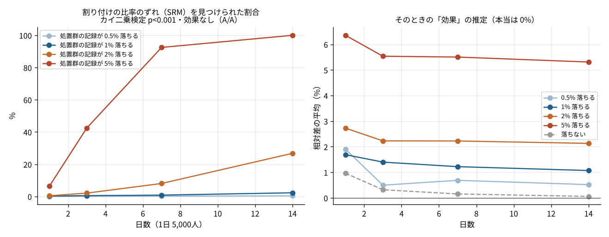
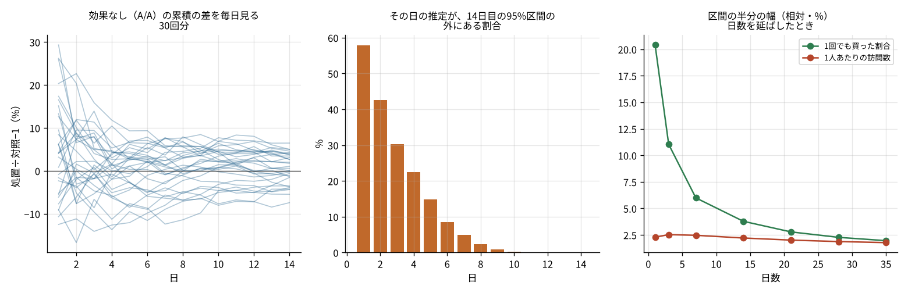
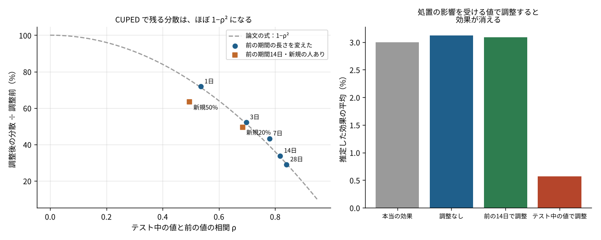
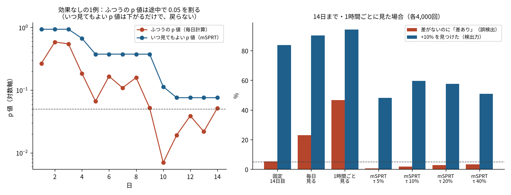

# P02 A/B テストの結果は、どこで信じられなくなるのか？ 論文3本を試すと、1%の記録漏れは14日では見つからず、途中で毎日見ると誤検出は23%になった

## この記事で分かること
A/B テストの実務でよく起きる「結果がおかしい」場面を、論文3本の考え方で読み直しました。種を固定したシミュレーションで試すと、記録の漏れ・途中で見ること・事前の値の使い方の3つで、結論が大きく変わりました。

- 処置群の記録が1%だけ漏れると、効果がないのに「+1.1%」と出ます。でも、比率のずれの検定（SRM）で14日以内に気づけたのは2.3%の回だけでした
- 結果を毎日見て有意になったら止めると、差がないのに「差あり」と言う割合が5.3%から23%に増えました。いつ見てもよい p 値（mSPRT）なら2%に収まりましたが、見つける力は84%から60%に下がりました
- テスト前の値で調整する CUPED は、前の期間を14日にすると分散を約3分の1にしました。ただ、テスト中の値で調整すると、3%の効果が0.6%まで消えました

## 読んだ論文
| # | 論文 | 読める場所 |
|---|---|---|
| 1 | Kohavi, Deng, Frasca, Longbotham, Walker, Xu (2012) "Trustworthy Online Controlled Experiments: Five Puzzling Outcomes Explained", KDD | https://exp-platform.com/puzzling-outcomes/ （著者の版） |
| 2 | Deng, Xu, Kohavi, Walker (2013) "Improving the Sensitivity of Online Controlled Experiments by Utilizing Pre-Experiment Data", WSDM（CUPED） | https://exp-platform.com/cuped/ （著者の版） |
| 3 | Johari, Pekelis, Walsh (2015, 2019 改訂) "Always Valid Inference: Bringing Sequential Analysis to A/B Testing" | https://arxiv.org/abs/1512.04922 |

3本目は、同じ著者たちが KDD 2017 でも実務向けに発表しています（Johari, Koomen, Pekelis, Walsh "Peeking at A/B Tests"）。この記事では arXiv の版を読みました。

このリポジトリの関連記事：[F237 途中で見ると何がまずいのか](../../articles/F237_ab_test_peeking_sequential)、[F238 前の期間のデータでテストを早く終わらせる（CUPED）](../../articles/F238_ab_test_cuped)。

## 論文の問い：なぜこの3本なのか
A/B テスト（ランダム化比較試験のウェブ版）は、「くじで2群に分けて比べるだけ」なので、仕組みはとても単純です。それでも、大きな会社の実験基盤では「結果がおかしい」ことが何度も起きてきました。

1本目は、Microsoft の Bing の実験チームが、実際に出会った不思議な結果5つを、なぜそうなったかまで説明した論文です。テーマは、評価の指標の選び方、クリックの記録漏れ、日がたつと効果が変わって見えること、日数を延ばしても精度が上がらないこと、前の実験の影響が残ることでした。共通する教えは、「数字そのものより先に、数字の作られ方を疑え」です。

2本目は、同じチームが「同じ人数で、もっと小さな差を見つけるにはどうするか」に答えた論文です。テストを始める前の、同じ人の行動のデータを使って、ばらつきを減らします。CUPED という名前で広く使われるようになりました。

3本目は、「結果を毎日見て、有意になったら止める」という、現場でとても多いやり方の問題に答えた論文です。途中で何度見ても誤りの率が保たれる p 値を作り、ツールに組み込みました。

3本を並べると、A/B テストの「信じられなさ」は、①データの作られ方（記録・割り付け）、②見方（いつ・何度見るか）、③ばらつき（人数が足りるか）の3か所から来ることが分かります。この記事では、それぞれを手元のシミュレーションで試しました。

## 論文の考え方

### 1本目：まず「割り付けが正しいか」を確かめる
論文の5つの話のうち、この記事で試すのは2つです。

- **記録の漏れ**：クリックを記録する仕組み（ビーコン）は、ページを移る瞬間に送信が取り消されることがあります。ある変更でページが少し遅くなると、送信が間に合う回が増え、「クリックが増えた」ように見えました。ブラウザごとに効果が違うことが、記録の問題を疑う手がかりになりました
- **トレンドに見える効果**：毎日の累積の結果を見ると、効果がだんだん大きくなる（小さくなる）ように見えることがあります。論文は、効果がゼロの A/A テストでも同じ形が出ることを示し、最初の数日は区間が広く、値が大きく揺れるだけだと説明しました。目新しさの効果は、思われているより少ないとも書いています
- **日数を延ばしても精度が上がらない指標**：1人あたりのセッション数のような指標は、日数を延ばすと人数は増えますが、来続ける人と来ない人の差も広がります。そのため、区間の幅がほとんど縮まないことがあります

この記事では、記録漏れの代わりに、実務でいちばんよく使われる確認である「割り付けの比率のずれ（SRM, sample ratio mismatch）」を試しました。50:50 で分けたはずの人数が、50:50 から統計的にずれていないかをカイ二乗検定で見るものです。ずれていたら、効果の数字を見る前に止めます。

### 2本目：CUPED（テスト前の値で引き算する）
考え方は「同じ人の、テスト前の同じ指標」を使って、もともとの個人差を引き算することです。

- テスト中の値を Y、テスト前の値を X とします
- 調整した値 = Y − θ ×（X − X の平均）。θ は Y と X の共分散を X の分散で割ったもの（回帰の傾き）
- くじで分けているので、X の平均は2群で同じです。だから引き算しても、差の推定はずれません
- 残る分散は、元の分散の「1 − ρ²」倍になります。ρ は X と Y の相関です。相関が0.7なら約半分、0.9なら約5分の1です

論文の実務上の注意は3つです。共変量は「同じ指標のテスト前の値」がいちばん効くこと。前の期間は1〜2週間がよく、短すぎても長すぎても相関が下がること。テスト前に来ていない新しい人は、「前の値があるか」の印を入れて扱えること。そして最も大事なのが、処置の影響を受ける値（テスト中の値）を共変量にしてはいけない、という点です。論文では、そうすると効果の符号が逆になった例が挙げられていました。Bing では、分散がおよそ半分になったと報告されています。

### 3本目：いつ見てもよい p 値（mSPRT）
ふつうの p 値は「最後に1回だけ見る」ことを前提に作られています。毎日見て、一度でも 0.05 を下回ったら止めると、偶然 0.05 を割る機会が増えて、誤りの率が5%を大きく超えます。

論文の答えは、逐次確率比検定（SPRT）を「混ぜた」もの（mixture SPRT）です。

- 「差がない」場合と、「差が何かある」場合の、データの起こりやすさの比（尤度比）を、時点ごとに計算します
- 「差が何かある」の中身は1つに決めず、平均0・幅 τ の正規分布で重みをつけて混ぜます。τ は「どのくらいの大きさの差を想定するか」の目安です
- p 値 = 1 ÷（その時点までの尤度比の最大）。こうすると、p 値は時間とともに下がるだけで戻らず、いつ止めても「差がないのに p<0.05 になる確率」は5%以下に保たれます

代わりに払うものもあります。最後に1回見る検定より保守的で、同じ人数なら見つける力が下がります。論文は、どの τ を選ぶかで「早く見つけたい差」と「見つける力」の釣り合いが変わることも議論しています。

## 手元で試す
すべて種を固定したシミュレーションです。設定は [F237](../../articles/F237_ab_test_peeking_sequential) に合わせました（架空のECサイト、購入率5%、1日5,000人を2群に半分ずつ、14日）。論文のデータは公開されていないので、「論文の結果を確かめた」のではなく、「同じ考え方を同じ種類の場面で試した」ものです。

| 試したこと | 設定 | 回数 |
|---|---|---|
| A. 割り付けの比率のずれ（SRM） | 効果なし（A/A）。処置群だけ、買わない人の記録が全体の0.5〜5%落ちる。1〜14日で、カイ二乗検定 p<0.001 で気づけるか | 各4,000回 |
| B1. トレンドに見える効果 | A/A。累積の相対差を毎日計算し、14日目の95%区間の外にある割合を数える | 4,000回 |
| B2. 日数と区間の幅 | 人ごとの「来る強さ」がガンマ分布。毎日、まだ来ていない人の約5%が初めて来て、来た後も来続ける。1人あたりの訪問数と、1回でも買った割合の区間の幅を比べる | 1回（人数6万人） |
| C. CUPED | 人ごとの強さを共通にして、テスト前 1〜28日の訪問数 X と、テスト中14日の訪問数 Y を作る。本当の効果は +3%。新規の人の割合と、テスト中の値を共変量にした場合も試す | 各800回 |
| D. mSPRT | 1時間ごとに購入数が増える。差なし／+10%。毎日・1時間ごとに見て止める方法、14日目に1回の方法、mSPRT（τ を基準の購入率の5〜40%） | 各4,000回 |

置いた値（来る強さの分布、記録の落ち方など）は、どれも説明のために決めた架空の値です。

## 分かったこと

### 1. 1%の記録漏れは、効果を +1.1% ずらすが、14日では見つからない


| 処置群で記録が落ちる割合 | 14日で SRM に気づけた割合 | そのときの「効果」（本当は0%） |
|---|---|---|
| 0%（落ちない） | 0.1% | +0.06% |
| 0.5% | 0.4% | +0.5% |
| 1% | 2.3% | +1.1% |
| 2% | 26.8% | +2.1% |
| 5% | 99.98% | +5.3% |

- 落ちるのが「買わない人」に偏っていると、落ちた分だけ処置群の購入率が高く見えます。1%落ちると、効果は +1.1% にずれました。このテストで見つけたい差（+10%）の1割にあたる大きさです
- 1日2,500人ずつの規模では、1%の人数のずれは偶然のばらつき（標準偏差で約1.3倍）と見分けにくく、14日たっても気づけたのは2.3%の回だけでした。5%落ちれば、7日で92%、14日でほぼ全部で気づけました
- つまり SRM の検定は「大きな事故」を確実に止めますが、小さな漏れは素通りします。人数のずれが小さくても、ずれた理由が行動と関係しているなら、効果の数字は同じだけずれます

### 2. 効果がなくても、最初の数日は「傾向」があるように見える。日数を延ばしても縮まない幅もある


- A/A テストで、1日目の累積の差が「14日目の95%区間」の外にあった割合は57.8%、2日目は42.6%、7日目でも4.9%でした
- 最初の4日間で、差が毎日同じ向きに動き続けた（ずっと上がる、またはずっと下がる）回が24.5%ありました。4回に1回は、効果ゼロでも「伸びている」「落ちている」ように見えるということです
- 1人あたりの訪問数では、日数を7日から28日に延ばすと、人数は1万8,248人から4万5,710人と2.5倍になりました。でも、人ごとのばらつき（変動係数）も1.20から1.44に増えたので、区間の半分の幅（相対）は2.46%から1.87%にしか縮みませんでした。「1回でも買った割合」は、同じ期間で5.99%から2.27%に縮みました
- 論文が「この種の指標は、日数より1日あたりの人数を増やすほうが効く」と書いたのと同じ形が出ました

### 3. CUPED は相関の2乗だけ分散を減らす。テスト中の値で調整すると効果が消える


| 共変量 | 相関 ρ | 調整後の分散 ÷ 調整前 | 論文の式 1−ρ² |
|---|---|---|---|
| テスト前1日 | 0.54 | 72% | 71% |
| テスト前3日 | 0.70 | 52% | 51% |
| テスト前7日 | 0.78 | 43% | 39% |
| テスト前14日 | 0.82 | 34% | 33% |
| テスト前28日 | 0.84 | 29% | 29% |
| テスト前14日・新規の人20% | 0.68 | 50% | 53% |
| テスト前14日・新規の人50% | 0.50 | 63% | 75% |

- 残る分散は、ほぼ論文の式（1−ρ²）どおりでした。前の期間を14日にすると約3分の1になり、同じ精度に要る人数も約3分の1になります
- 新しい人が半分いると、相関は0.50まで下がりますが、「前の値があるか」の印を入れて調整すると、分散は63%まで下がりました。相関だけから見た75%より良いのは、印そのものが「新しい人か」というばらつきを説明するからです
- テスト中の7日分の訪問数を共変量に使うと、本当の効果 +3.0% が、平均 +0.57% まで小さくなりました。処置が訪問を増やすと、共変量も増えるので、引き算で効果まで消してしまいます。分散はいちばん小さく（19%）見えるので、「よく効いた」と誤解しやすい失敗です

### 4. 途中で見るなら、いつ見てもよい p 値が要る。代わりに見つける力が下がる


| 方法（14日まで） | 差なしで「差あり」 | +10% を見つけた割合 |
|---|---|---|
| 14日目に1回だけ見る | 5.3% | 83.8% |
| 毎日見て p<0.05 で止める | 23.0% | — |
| 1時間ごとに見て p<0.05 で止める | 46.7% | — |
| mSPRT（τ = 基準の5%） | 0.6% | 48.2% |
| mSPRT（τ = 基準の10%） | 2.0% | 59.5% |
| mSPRT（τ = 基準の20%） | 2.9% | 57.7% |
| mSPRT（τ = 基準の40%） | 3.4% | 51.0% |

- 毎日見るだけで、誤検出は4倍強（23%）、1時間ごとならほぼ半分（47%）になりました。F237 と同じ結果です
- mSPRT は、何度見ても誤検出が2〜3%に収まりました。差があるとき、τ=10% の場合は平均8.0日目に止まりました
- ただし、14日で見つけられたのは約60%で、1回だけ見る固定の検定（84%）より低くなりました。τ は、見つけたい差（購入率の10%）と同じくらいにすると、いちばん力が出ました。小さすぎても大きすぎても下がります
- 図の左は、差がないのに、ふつうの p 値が10日目に 0.007 まで下がった例です。最後の14日目には 0.052 に戻っています。毎日見ていたら、10日目に「勝ち」と言っていたことになります。いつ見てもよい p 値は、同じデータで最後まで 0.076 より下がりませんでした

## 論文の限界と、試して分かった落とし穴
- **SRM は万能ではない**：検定が見つけるのは人数のずれだけです。今回のように1%の漏れは見逃し、しかも漏れ方が行動と関係していると、効果は同じだけずれます。SRM が「問題なし」でも、記録の仕組みが変わる施策（ページの遷移、読み込みの速さを変える施策）では、ブラウザ別・端末別の効果の違いも見るべきです
- **CUPED の「前の期間は長いほどよい」とは限らない**：今回のシミュレーションでは28日がいちばん効きましたが、それは「人の行動が時間とともに変わる」ことを入れていないためです。論文は、長すぎると相関が下がると書いています。実データでは、前の期間を何通りか試して相関を見てから決めるのが安全です（推測）
- **mSPRT の τ は先に決める**：結果を見ながら τ を選び直すと、いつ見てもよいという性質が崩れます。また、比率の差の正規近似を使っているので、人数がとても少ない最初の数時間は近似が粗くなります
- **論文1本目は Bing の規模の話**：1日に数百万人が来る規模では、ほんの小さな SRM も検出されます。今回のような1日5,000人の規模では、同じ確認でも見逃しが多くなります

## 仕事で使うなら
1. **結果を見る前に、割り付けを確かめる**：SRM の検定（p<0.001 など、厳しめの基準）を、ダッシュボードの一番上に置きます。人数のずれは小さくても、端末別・ブラウザ別に分けて確かめます
2. **テスト前のデータを使う**：同じ指標の前1〜2週間の値で CUPED をかけます。新規の人は印を入れて扱い、共変量にはテスト開始後の値を絶対に使いません。分散が減りすぎたときこそ疑います
3. **見方を先に決める**：途中で見るなら、mSPRT のような「いつ見てもよい」方法を使い、τ は見つけたい差の大きさで先に決めます。固定の日数で1回だけ見るなら、それまで結果を見ない運用にします。どちらにするかを、テストを始める前の計画に書きます

## 関連する論文と、次に読むもの
- Kohavi, Tang, Xu (2020) *Trustworthy Online Controlled Experiments*（Cambridge University Press）：1本目と2本目の著者による教科書。SRM や指標の決め方を体系的にまとめています
- Fabijan ら (2019) "Diagnosing Sample Ratio Mismatch in Online Controlled Experiments"（KDD）：SRM の原因の分類
- Howard, Ramdas, McAuliffe, Sekhon (2021) "Time-uniform, nonparametric, nonasymptotic confidence sequences"（Annals of Statistics）：いつ見てもよい区間（信頼系列）の一般的な理論
- 次は、群逐次検定（O'Brien–Fleming など）と mSPRT の使い分けを、[F237](../../articles/F237_ab_test_peeking_sequential) と合わせて読むのがよいと思います

## 言えないこと
- 論文の結果を再現したのではありません。論文のデータは公開されていないので、同じ考え方を、種を固定したシミュレーションで試しました
- 置いた値（購入率5%、1日5,000人、来る強さの分布、記録の落ち方など）は説明のための架空の値です。値を変えれば数字は変わります
- 記録漏れは「買わない人だけが落ちる」と置きました。実際の漏れ方は施策や仕組みで違います
- mSPRT は、比率の差の正規近似を使った簡単な版です。ツールに組み込まれた実装とは細部が違う可能性があります（推測）

## 再現のしかた
```
pip install -r requirements.txt
cd src
python p02_sim.py   # results/ を作る（約20秒）
python p02_fig.py   # figures/ を作る
```
2回流して、results/ のファイルがすべて同じになることを確かめました。

| ファイル | 中身 |
|---|---|
| src/p02_sim.py | 4つのシミュレーション（A〜D） |
| src/p02_fig.py | 図 |
| results/A_srm.csv | 記録の落ち方・日数ごとの、SRM に気づけた割合と効果の推定 |
| results/B1_aa_trend.csv・B2_ci_width.csv | A/A の累積の差と、日数ごとの区間の幅 |
| results/C_cuped.csv | 共変量ごとの相関と分散の比 |
| results/D_msprt.csv | 見方ごとの誤検出と検出力 |
| results/main.json | 本文の数字 |

## 出典
- 論文は上の表のとおり。どの論文も、文章や図は写さず、内容を自分の言葉でまとめ、図は自分のシミュレーションで描き直しました
- データ：すべてシミュレーション（外部のデータは使っていません）

コード：MIT License
