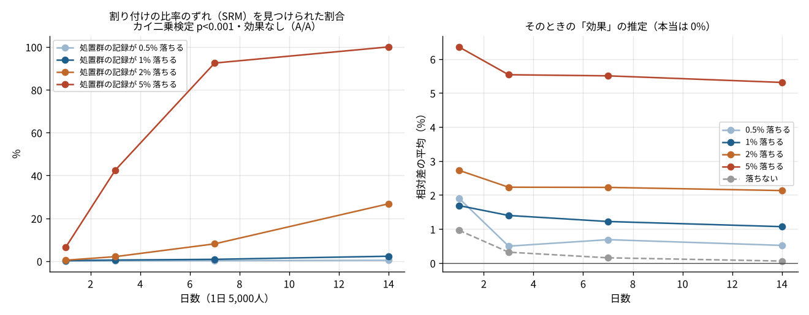
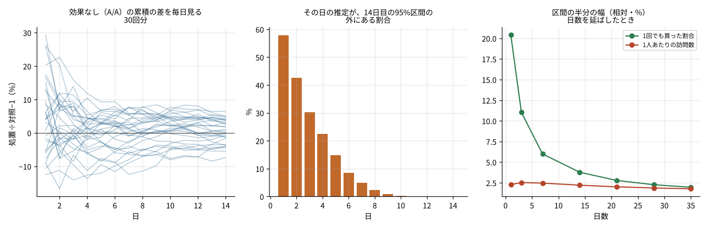
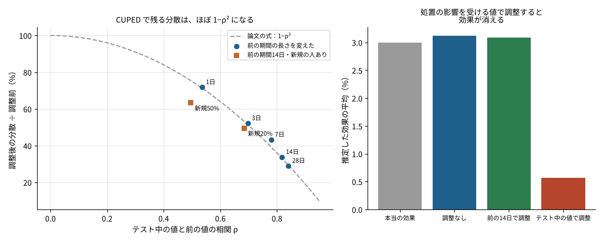
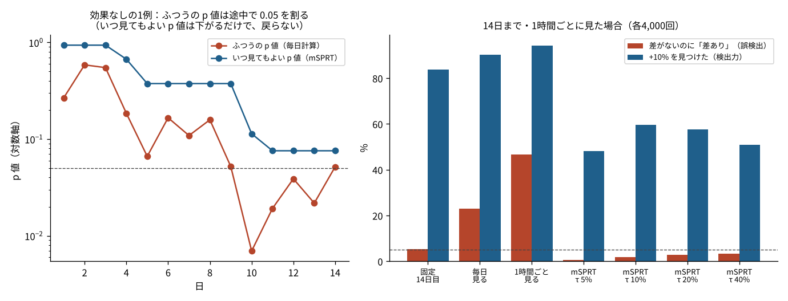

# P02 Where do A/B test results stop being trustworthy? Trying three papers: a 1% logging loss went unnoticed for 14 days, and checking daily raised false positives to 23%

Japanese version: [README.md](README.md). Index of the paper series: [papers/README_EN.md](../README_EN.md).

## Question

Using the ideas of three papers, this article re-reads common "the result looks wrong" situations in A/B testing. In seeded simulations, three things changed conclusions a lot: logging losses, peeking during the test, and how pre-test values are used.

- If 1% of the treatment group's records are lost, a test with no real effect shows "+1.1%". A sample ratio mismatch (SRM) test caught this within 14 days in only 2.3% of runs.
- Checking daily and stopping when significant raised the share of "a difference" with no real difference from 5.3% to 23%. An always-valid p-value (mSPRT) kept it at 2%, but power fell from 84% to 60%.
- Adjusting with pre-test values (CUPED) cut variance to about a third with a 14-day pre-period. But adjusting with values from during the test shrank a 3% effect to 0.6%.

### Papers read

| # | Paper | Where to read |
|---|---|---|
| 1 | Kohavi, Deng, Frasca, Longbotham, Walker, Xu (2012) "Trustworthy Online Controlled Experiments: Five Puzzling Outcomes Explained", KDD | https://exp-platform.com/puzzling-outcomes/ (authors' version) |
| 2 | Deng, Xu, Kohavi, Walker (2013) "Improving the Sensitivity of Online Controlled Experiments by Utilizing Pre-Experiment Data", WSDM (CUPED) | https://exp-platform.com/cuped/ (authors' version) |
| 3 | Johari, Pekelis, Walsh (2015, revised 2019) "Always Valid Inference: Bringing Sequential Analysis to A/B Testing" | https://arxiv.org/abs/1512.04922 |

The same authors as paper 3 also presented a practitioner version at KDD 2017 (Johari, Koomen, Pekelis, Walsh, "Peeking at A/B Tests"); this article read the arXiv version.

Related articles in this repository: [F237 What goes wrong when you peek](../../articles/F237_ab_test_peeking_sequential/README_EN.md), [F238 Finishing tests sooner with pre-period data (CUPED)](../../articles/F238_ab_test_cuped).

### Why these three papers

An A/B test (a web version of a randomized controlled trial) is mechanically simple: split by lottery into two groups and compare. Even so, large companies' experimentation platforms have repeatedly produced results that "look wrong".

Paper 1 is by Microsoft Bing's experimentation team and explains five puzzling results they actually encountered: choosing the evaluation metric, lost click logging, effects that appear to change over the days, metrics whose precision does not improve with more days, and carry-over from earlier experiments. The common lesson: suspect how the numbers were produced before the numbers themselves.

Paper 2, by the same team, answers "how can we detect smaller differences with the same number of people?" by using the same users' behavior before the test to reduce variance. It became widely used under the name CUPED.

Paper 3 answers the very common practice of "check results daily and stop when significant", building p-values whose error rate holds no matter how often you look, and building them into a tool.

Together, they show that the untrustworthiness of A/B tests comes from three places: (1) how the data is produced (logging, assignment), (2) how it is looked at (when and how often), and (3) variance (enough people?). This article tries each in a simulation.

### The papers' ideas, briefly

**Paper 1: first check that assignment is right.** Of the paper's five stories, this article draws on these:
- **Logging loss**: the mechanism that records clicks (a beacon) can be cancelled at the moment the page changes. When a change made a page slightly slower, more beacons got through and clicks appeared to rise. Effects differing by browser were the clue pointing to logging.
- **Effects that look like a trend**: daily cumulative results can make an effect seem to grow or shrink. The paper shows the same shape appears in A/A tests with zero effect: intervals are wide in the first days and values just swing. Novelty effects are rarer than people think.
- **Metrics whose precision does not improve with more days**: for metrics like sessions per user, more days add users but also widen the gap between frequent and infrequent visitors, so the interval may barely shrink.

Instead of logging loss itself, this article tried the most common check in practice: sample ratio mismatch (SRM), a chi-square test of whether a 50:50 split actually deviates from 50:50. If it does, stop before looking at the effect.

**Paper 2: CUPED (subtract using pre-test values).** Use the same metric for the same user before the test to subtract pre-existing individual differences.
- Let Y be the value during the test and X the value before it.
- Adjusted value = Y − θ × (X − mean of X), where θ is the covariance of Y and X divided by the variance of X (the regression slope).
- Because groups are randomized, the mean of X is the same in both, so the subtraction does not bias the difference.
- Remaining variance is (1 − ρ²) times the original, where ρ is the correlation of X and Y: about half at 0.7, about a fifth at 0.9.

The paper's practical notes: the best covariate is the same metric before the test; a pre-period of one to two weeks is good (too short or too long lowers the correlation); new users without pre-test data can be handled with an indicator for "has a pre-period value"; and most important, never use a value affected by the treatment (a value from during the test) as a covariate — the paper gives an example where this flipped the sign of the effect. Bing reported variance roughly halved.

**Paper 3: an always-valid p-value (mSPRT).** An ordinary p-value assumes you look once at the end. Looking daily and stopping the first time it dips below 0.05 creates more chances to cross by luck, pushing the error rate well above 5%. The answer is a "mixture" of the sequential probability ratio test (mixture SPRT):
- At each time, compute the likelihood ratio of "some difference" vs "no difference".
- Do not fix "some difference" to one value; mix over a normal distribution with mean 0 and width τ, where τ indicates the size of difference you expect.
- p-value = 1 ÷ (maximum likelihood ratio so far). It only goes down over time, and whenever you stop, the chance of p < 0.05 with no real difference stays at most 5%.

The price: it is more conservative than a single final test, so power is lower for the same sample. The paper also discusses how the choice of τ trades off "differences you want to catch early" against power.

## Data

All simulations with fixed seeds. Settings follow [F237](../../articles/F237_ab_test_peeking_sequential/README_EN.md) (a fictional online store, conversion 5%, 5,000 visitors a day split evenly, 14 days). The papers' data is not public, so this is not "verifying the papers' results" but "trying the same ideas in the same kind of situation".

| What was tried | Setup | Runs |
|---|---|---|
| A. Sample ratio mismatch (SRM) | no effect (A/A); only in treatment, records of non-buyers lost at 0.5–5% of the group; can a chi-square test at p < 0.001 detect it within 1–14 days? | 4,000 each |
| B1. Effects that look like trends | A/A; compute the cumulative relative difference daily and count how often it lies outside the day-14 95% interval | 4,000 |
| B2. Days and interval width | each person's visit intensity is gamma-distributed; each day about 5% of people not yet seen arrive for the first time and keep coming; compare interval widths for visits per person and share who bought at least once | 1 (60,000 people) |
| C. CUPED | common per-person intensity; visits X in the 1–28 days before the test and visits Y in the 14 test days; true effect +3%; also the share of new users and using a during-test value as covariate | 800 each |
| D. mSPRT | purchases accumulate hourly; no difference / +10%; stopping with daily or hourly looks, one look on day 14, mSPRT (τ = 5–40% of baseline conversion) | 4,000 each |

All chosen values (intensity distribution, how records are lost, etc.) are fictional, for explanation.

## What I did

Ran simulations A–D above in `src/p02_sim.py`, and drew figures in `src/p02_fig.py`. mSPRT uses a normal approximation for the difference in proportions.

## Findings

### 1. A 1% logging loss shifts the effect by +1.1% but is not detected in 14 days



| Share of treatment records lost | Detected by SRM within 14 days | "Effect" measured (truth 0%) |
|---|---|---|
| 0% (no loss) | 0.1% | +0.06% |
| 0.5% | 0.4% | +0.5% |
| 1% | 2.3% | +1.1% |
| 2% | 26.8% | +2.1% |
| 5% | 99.98% | +5.3% |

- When losses fall on non-buyers, treatment conversion looks higher by that amount: a 1% loss shifted the effect by +1.1%, a tenth of the lift this test is designed to detect (+10%).
- At 2,500 people per group per day, a 1% imbalance is hard to tell from chance (about 1.3 standard deviations), and even after 14 days it was detected in only 2.3% of runs. A 5% loss was detected in 92% of runs by day 7 and almost all by day 14.
- So the SRM test reliably stops big accidents but lets small leaks through. Even a small imbalance shifts the effect by the same amount if the reason for it is related to behavior.

### 2. Even with no effect, the first days look like a "trend"; some intervals do not shrink with more days



- In A/A tests, the cumulative difference lay outside the day-14 95% interval in 57.8% of runs on day 1, 42.6% on day 2, and still 4.9% on day 7.
- In 24.5% of runs the difference kept moving in the same direction every day for the first four days: one in four zero-effect tests looks like it is "rising" or "falling".
- For visits per person, extending from 7 to 28 days raised the number of people 2.5-fold (18,248 → 45,710), but person-to-person variation (coefficient of variation) also grew from 1.20 to 1.44, so the relative half-width shrank only from 2.46% to 1.87%. The share who bought at least once shrank from 5.99% to 2.27% over the same period.
- This matches the paper's point that, for this kind of metric, more people per day helps more than more days.

### 3. CUPED removes variance by the squared correlation; adjusting with during-test values erases the effect



| Covariate | Correlation ρ | Adjusted ÷ unadjusted variance | Paper's formula 1−ρ² |
|---|---|---|---|
| 1 day before | 0.54 | 72% | 71% |
| 3 days before | 0.70 | 52% | 51% |
| 7 days before | 0.78 | 43% | 39% |
| 14 days before | 0.82 | 34% | 33% |
| 28 days before | 0.84 | 29% | 29% |
| 14 days before, 20% new users | 0.68 | 50% | 53% |
| 14 days before, 50% new users | 0.50 | 63% | 75% |

- Remaining variance followed the paper's formula (1 − ρ²) closely. A 14-day pre-period cut it to about a third, and so the people needed for the same precision.
- With half the users new, the correlation fell to 0.50, but adjusting with a "has a pre-period value" indicator brought variance down to 63%, better than the 75% implied by the correlation alone, because the indicator itself explains the variation between new and returning users.
- Using 7 days of during-test visits as the covariate shrank the true +3.0% effect to +0.57% on average: the treatment raises visits, so the covariate rises too, and subtracting it removes the effect. Variance looks smallest (19%), so it is easy to mistake for "worked very well".

### 4. If you look during the test, you need an always-valid p-value — at the cost of power



| Method (up to 14 days) | "Difference" with no difference | Detected +10% |
|---|---|---|
| Look once on day 14 | 5.3% | 83.8% |
| Look daily, stop at p < 0.05 | 23.0% | — |
| Look hourly, stop at p < 0.05 | 46.7% | — |
| mSPRT (τ = 5% of baseline) | 0.6% | 48.2% |
| mSPRT (τ = 10% of baseline) | 2.0% | 59.5% |
| mSPRT (τ = 20% of baseline) | 2.9% | 57.7% |
| mSPRT (τ = 40% of baseline) | 3.4% | 51.0% |

- Looking daily alone multiplied false positives by more than 4 (23%); hourly, almost half (47%) — the same as F237.
- mSPRT kept false positives at 2–3% however often it looked. With a real difference and τ = 10%, it stopped on day 8.0 on average.
- But it detected the difference within 14 days only about 60% of the time, below the single fixed test (84%). τ worked best at about the size of the difference to detect (10% of conversion); smaller or larger lowered power.
- The left of the figure shows a case with no difference where the ordinary p-value fell to 0.007 on day 10, back to 0.052 by day 14. Looking daily, you would have declared a winner on day 10. The always-valid p-value on the same data never went below 0.076.

## What this does not show

- It does not reproduce the papers' results. Their data is not public, so the same ideas were tried in seeded simulations.
- The chosen values (5% conversion, 5,000 a day, intensity distribution, how records are lost, etc.) are fictional; different values give different numbers.
- Logging loss was assumed to hit "non-buyers only". Real losses depend on the change and the logging mechanism.
- mSPRT is a simple version using a normal approximation for the difference in proportions; it may differ in details from implementations in tools (my interpretation).

### Limits of the papers and pitfalls found while trying them

- **SRM is not a cure-all.** It only detects imbalances in counts. It missed a 1% leak here, and if the leak is related to behavior, the effect shifts by the same amount. Even when SRM says "fine", for changes that alter the logging path (page transitions, load speed), also compare effects by browser and device.
- **A longer pre-period is not always better for CUPED.** Here 28 days worked best, but only because behavior was assumed not to change over time; the paper says too long lowers the correlation. With real data, try several pre-periods and check the correlation before choosing (my interpretation).
- **Decide τ for mSPRT in advance.** Re-choosing τ while looking at results breaks the always-valid property. The normal approximation is rough in the first hours when counts are tiny.
- **Paper 1 is at Bing scale.** With millions of visitors a day even tiny SRMs are detected; at 5,000 a day, the same check misses much more.

## How to use this at work

1. **Check assignment before looking at results.** Put an SRM test (with a strict threshold such as p < 0.001) at the top of the dashboard, and also check by device and browser even when the overall imbalance is small.
2. **Use pre-test data.** Apply CUPED with the same metric over the previous one to two weeks, handle new users with an indicator, and never use values from after the test started as covariates. Be most suspicious when variance drops "too much".
3. **Decide how you will look before starting.** If you will look during the test, use an always-valid method such as mSPRT with τ set to the size of difference you want to detect; if you will look once at a fixed day, do not look before then. Write which one into the plan before the test starts.

## Related papers and what to read next

- Kohavi, Tang, Xu (2020), *Trustworthy Online Controlled Experiments* (Cambridge University Press): a textbook by the authors of papers 1 and 2, covering SRM and metric design systematically.
- Fabijan et al. (2019), "Diagnosing Sample Ratio Mismatch in Online Controlled Experiments" (KDD): a taxonomy of SRM causes.
- Howard, Ramdas, McAuliffe, Sekhon (2021), "Time-uniform, nonparametric, nonasymptotic confidence sequences" (Annals of Statistics): general theory of always-valid intervals (confidence sequences).
- Next, read how to choose between group sequential tests (O'Brien–Fleming etc.) and mSPRT together with [F237](../../articles/F237_ab_test_peeking_sequential/README_EN.md).

## Figures

The figures have Japanese labels.
- `figures/p02_01_srm.png`: SRM detection rate and effect bias by share of lost records.
- `figures/p02_02_trend_width.png`: apparent trends in A/A tests, and interval width by test length.
- `figures/p02_03_cuped.png`: variance reduction by covariate, including the during-test mistake.
- `figures/p02_04_msprt.png`: an example p-value path and false positives / power by method.

## Reproduce

```
pip install -r requirements.txt
cd src
python p02_sim.py   # builds results/ (about 20 seconds)
python p02_fig.py   # builds figures/
```
Two runs produced identical files in results/.

## Files

| File | Contents |
|---|---|
| src/p02_sim.py | the four simulations (A–D) |
| src/p02_fig.py | figures |
| results/A_srm.csv | SRM detection rate and effect estimate by loss and day |
| results/B1_aa_trend.csv, B2_ci_width.csv | A/A cumulative differences and interval width by number of days |
| results/C_cuped.csv | correlation and variance ratio by covariate |
| results/D_msprt.csv | false positives and power by method |
| results/main.json | numbers in the text |

## Sources

- Papers as listed above. Their text and figures were not copied; content is summarized in my own words and figures are redrawn from my own simulations.
- Data: all simulated (no external data).

Code: MIT License
