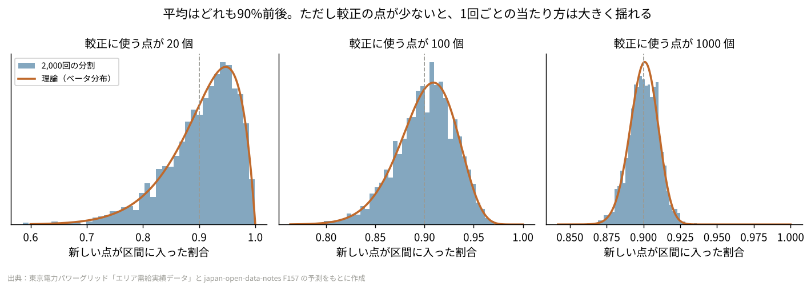
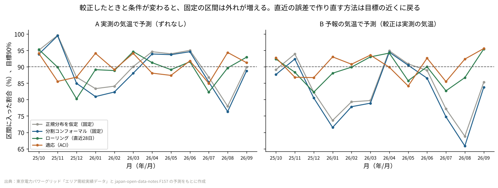
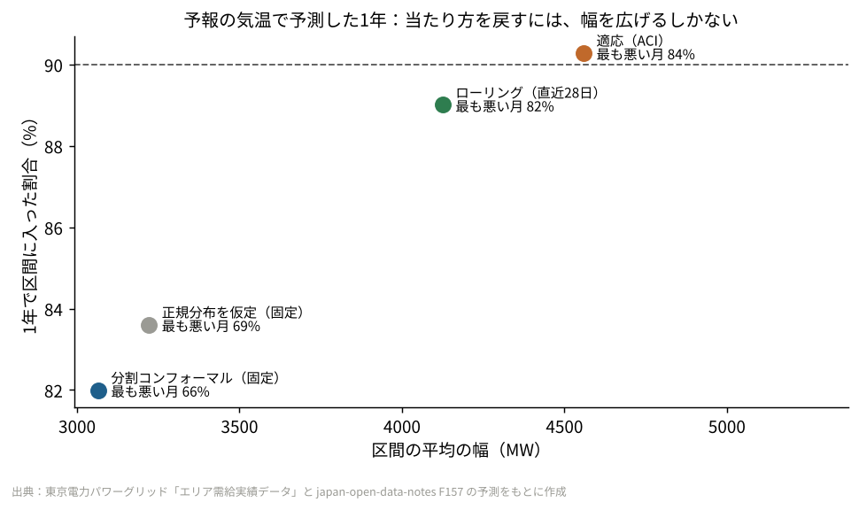
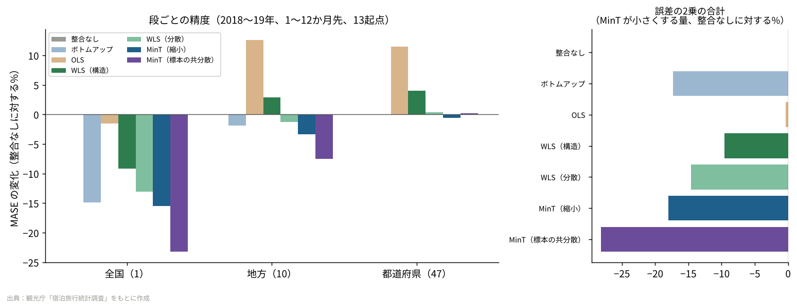
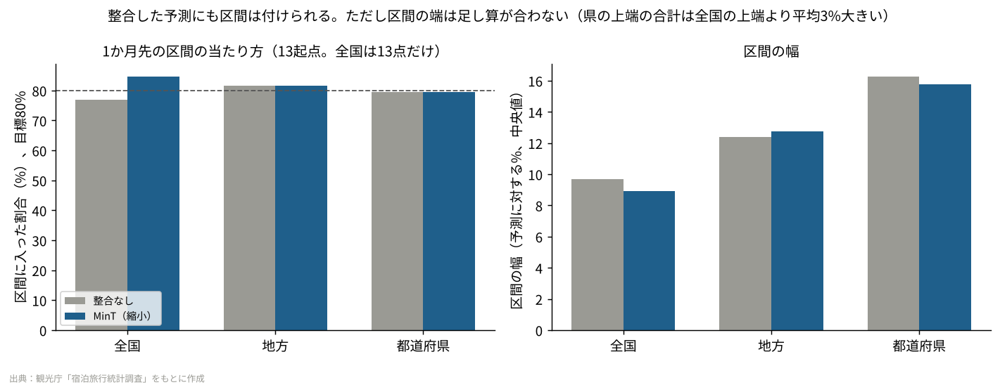

# P03 予測の「幅」は、論文どおりに当たるのか？ 条件が変わると固定の区間は82%まで落ち、直近の誤差で作り直すと90%に戻った

論文を読んで、手元のデータで試すシリーズの3本目（長編）。テーマは**予測の不確かさ**。

## この記事で分かること
- 予測に「この範囲に90%入る」という幅を付ける方法（コンフォーマル予測）が、何を保証していて、何を保証していないか
- 予測を作ったときと条件が変わると、その幅がどれだけ外れるか。直近の誤差を使って作り直すと、どこまで戻るか
- 全国・地方・都道府県の予測を「足し算が合う形」にそろえる方法（MinT）が、なぜ精度も上げるのか。そろえた予測にも幅は付けられるか

## 読んだ論文
| 論文 | 読んだ版 |
|---|---|
| Anastasios N. Angelopoulos, Stephen Bates (2021). "A Gentle Introduction to Conformal Prediction and Distribution-Free Uncertainty Quantification" | arXiv 版 v6（2022年12月）：https://arxiv.org/abs/2107.07511 |
| Shanika L. Wickramasuriya, George Athanasopoulos, Rob J. Hyndman (2019). "Optimal forecast reconciliation for hierarchical and grouped time series through trace minimization", Journal of the American Statistical Association 114(526) | 著者のページにある PDF：https://robjhyndman.com/papers/mint.pdf （紹介ページ：https://robjhyndman.com/publications/mint/ ） |

途中で、次の論文の考え方も使った（読んだのは要旨と考え方の部分だけ）。
- Isaac Gibbs, Emmanuel Candès (2021). "Adaptive Conformal Inference Under Distribution Shift"：https://arxiv.org/abs/2106.00170

---

## 第1部 コンフォーマル予測

### 論文の問い
機械学習のモデルは、1つの数字（点の予測）を返すのが普通だ。けれど仕事では、「明日の需要は 3万2千MW」だけでなく、「多くても 3万3千5百MW くらい」という幅がほしい。発電の準備も、在庫も、人の手配も、外れたときの備えは幅で決まるからだ。

ところが、モデルが自分で出す幅（たとえば「誤差は正規分布」と仮定した区間）は、仮定が外れると当たらない。木のモデルやニューラルネットのように、そもそも幅を出さないモデルも多い。

この論文が紹介するのは、**どんなモデルの予測にも、後から付けられる幅**の作り方だ。しかも「新しい点が幅に入る確率は少なくとも90%」という約束が、分布の形を何も仮定せずに成り立つ。条件は1つだけで、「較正に使う点と新しい点が、入れかえても同じとみなせる（入れかえ可能、exchangeable）」ことだ。

### 論文の考え方
いちばん簡単な「分割コンフォーマル」は、手順にすると4行で済む。

1. 手元のデータを、モデルを作る分と**較正（こうせい）用**の分に分ける
2. 較正用の n 点で、外れの大きさ（点数）を計る。回帰なら |実績 − 予測|
3. 点数を小さい順に並べ、(n+1)(1−α) を切り上げた番目の値を q とする（α=0.1 なら 90%）
4. 新しい点の幅は「予測 ± q」

なぜこれで90%入るのか。較正の n 点と新しい1点の、合わせて n+1 点の点数を並べたとき、新しい点が何番目に来るかは、入れかえ可能なら「どの順位も同じ確からしさ」になる。だから、上から10%の順位に入らない確率が90%以上になる。分布の形を使っていないので、正規分布でなくても、モデルが少しくらい悪くても、この約束は崩れない。

論文が強調している大事な点が2つある。

- **約束は「平均で90%」であって、「今回の幅が90%」ではない。** 幅は較正の n 点で決まるので、たまたま外れの小さい点が較正に集まれば、その幅は狭すぎる。どれだけ揺れるかは、n で決まるベータ分布で書ける（較正の n 点を固定したときの当たり方は、Beta(n+1−l, l)、l = ⌊(n+1)α⌋ に従う）。n が小さいと、平均は90%でも、1回ごとの当たり方は大きくばらつく
- **時間の順に並んだデータでは、入れかえ可能という条件が崩れやすい。** 季節が変わる、モデルの入力が変わる、世の中が変わる。こうなると約束は成り立たない。論文は、このときの手当て（直近を重く見る、外れの割合を見ながら α を動かす、など）を拡張として紹介している

### 手元で試す
材料は、このリポジトリの [F205](../../articles/F205_power_forecast_practice_part1)・[F206](../../articles/F206_power_forecast_practice_part2) で使った、**東京エリアの1時間ごとの電力需要の予測**（F157 で1年間運用した LightGBM の予測）だ。

- 較正：2024年10月〜2025年9月の1年（8,760時間）。毎月学習し直した予測の誤差
- 試す：2025年10月〜2026年9月の1年（8,760時間）
- 目標：90%（α = 0.1）

#### 試したこと1：入れかえ可能なら、約束どおりか
試す1年の誤差8,760個を、乱数で並べかえてから「較正 n 個／残りで当たり方を計る」に分けた。並べかえたので、入れかえ可能という条件はちょうど成り立つ。これを n = 20・100・1,000 で2,000回ずつ繰り返した（乱数の種は固定）。



| 較正の点の数 | 当たり方の平均 | 2,000回の5%点〜95%点 | 理論（ベータ分布）の5%点〜95%点 | 正規分布を仮定した区間の平均 |
|---|---|---|---|---|
| 20 | 90.4% | 78.0%〜98.3% | 78.4%〜98.2% | 87.4% |
| 100 | 90.1% | 84.8%〜94.5% | 84.8%〜94.5% | 89.4% |
| 1,000 | 90.0% | 88.3%〜91.6% | 88.4%〜91.5% | 89.9% |

- 平均はどれも90%で、ばらつきは論文のベータ分布とほぼ重なった
- 較正が20点だと、2,000回のうち18.1%で当たり方が85%を下回った。**約束は平均の話で、1回の幅が当たるとは限らない**ことが、数字で見える
- 正規分布を仮定した区間は、点が少ないと平均でも87.4%で、約束に届かなかった。電力需要の誤差は、正規分布より裾が重いためとみている（推測）

#### 試したこと2：時間の順に使うと、どうなるか
仕事では、去年の誤差で幅を決め、今年に使う。そこで、時間の順のまま4つの作り方を比べた。

| 作り方 | 中身 |
|---|---|
| 正規分布を仮定（固定） | 較正の1年の誤差の標準偏差 × 1.645 を ± に付ける |
| 分割コンフォーマル（固定） | 較正の1年で q を1回だけ決める（q = 1,533 MW） |
| ローリング（直近28日） | 毎日、前日までの28日分（672時間）の誤差で q を作り直す |
| 適応（ACI） | ローリングに加えて、前日の外れの割合が10%より多ければ α を下げ（幅を広げ）、少なければ α を上げる。更新の強さは 0.05 |

適応（ACI）は、Gibbs & Candès (2021) の考え方を1日単位にしたものだ。その日の実績は、その日が終わってから分かる前提にした。

比べたのは3つの場面だ。

- **A：ずれなし**。予測は実測の気温で作ったもの（較正と同じ作り方）
- **B：入力が変わる**。本番では、気温は前日の予報しか使えない。予報の気温で作った予測に、実測の気温で作った予測の誤差から決めた幅を付けた（較正と本番で入力が違う）
- **C：古いモデル**。3年前に学習したまま更新していないモデル（較正もそのモデルの去年の誤差）



| 場面 | 作り方 | 1年の当たり方 | 最も悪い月 | 85%を下回った月 | 平均の幅 |
|---|---|---|---|---|---|
| A ずれなし | 正規分布（固定） | 89.8% | 78.0% | 3 | 3,221 MW |
| | 分割コンフォーマル（固定） | 88.5% | 76.3% | 4 | 3,065 MW |
| | ローリング | 89.5% | 80.2% | 2 | 3,230 MW |
| | 適応（ACI） | 90.2% | 84.9% | 1 | 3,323 MW |
| B 入力が変わる | 正規分布（固定） | 83.6% | 68.8% | 6 | 3,221 MW |
| | 分割コンフォーマル（固定） | **82.0%** | **65.9%** | 7 | 3,065 MW |
| | ローリング | 89.0% | 82.3% | 2 | 4,125 MW |
| | 適応（ACI） | **90.3%** | 84.1% | 1 | 4,559 MW |
| C 古いモデル | 分割コンフォーマル（固定） | 88.9% | 77.0% | 3 | 3,665 MW |
| | 適応（ACI） | 90.1% | 85.9% | 0 | 3,953 MW |



### 分かったこと（第1部）
1. **入れかえ可能なら、約束は論文どおりに当たる。ただし「平均で」。** 較正20点では、5回に1回近く85%を下回った。較正に使う点は、数百以上ほしい
2. **ずれがない場面でも、固定の幅は月によって76%〜99%まで揺れた。** 1年を通すと88.5%で目標に近いが、夏（2026年8月）と冬（1月）に外れが集まった。季節で誤差の大きさが変わるので、月ごとには入れかえ可能と言えないためだ
3. **入力が変わると、固定の幅は1年で82.0%、最悪の月は65.9%まで落ちた。** 本番の誤差の標準偏差は 979 MW から 1,308 MW に増えていた。直近28日の誤差で作り直すと89.0%、ACI では90.3%に戻った。ただし、平均の幅は 3,065 MW から 4,125〜4,559 MW へ、3〜5割広がった。**当たり方を戻す方法は「幅を正直に広げる」ことで、精度を上げる方法ではない**

### 論文の限界と、試して分かった落とし穴
- 約束は「平均で」の話だ。どの時間帯・どの季節でも90%、という約束（条件つきの当たり方）は、分割コンフォーマルでは得られない。電力では、夏の昼や冬の朝のように誤差が大きい時間に外れが集まる。論文も、条件つきの当たり方は一般には保証できないとしている
- 1時間ごとの誤差は、前後の時間とよく似ている（自己相関）。1日の中の24時間は、24個の独立な点ではない。図1で「並べかえた」のは、この性質を壊して入れかえ可能にするためで、時間の順に使う図2では成り立たない
- ローリングと ACI は、本番の誤差が分かるまで1日待つ。急な変化（予報が大きく外れた日）には、1日〜数日遅れて追いつく
- ACI の α は一時 0.0125 まで下がった（＝幅を99%近くまで広げた）。外れが続くと幅が急に広がる。運用では、幅の上限や、広がったことを知らせる仕組みも要る（推測）

---

## 第2部 階層予測の整合（MinT）

### 論文の問い
全国・地方・都道府県のように、足し算でつながった系列を予測するとき、それぞれを別々に予測すると、**都道府県の予測の合計が、全国の予測と合わない**。予算や配分の会議で「全国は増える、県は全部減る」という表が出ると、説明がつかない。

足し算を合わせる方法（整合、reconciliation）は昔からある。下から足し上げる（ボトムアップ）、全国を割合で配る（トップダウン）、全部の段の予測を使って最小二乗でならす（OLS）などだ。この論文の問いは、「全部の段の予測を使って足し算を合わせるとき、**いちばん外れが小さくなる合わせ方は何か**」だ。

### 論文の考え方
系列を全部並べたベクトルを y、いちばん下の段（都道府県）を b とすると、足し算の関係は y = S b と書ける。S は「どの県をどの地方・全国に足すか」を表す0と1の表だ（ここでは58行×47列）。

別々に作った予測 ŷ を、足し算の合う予測 ỹ に直す方法は、どれも ỹ = S G ŷ の形に書ける。G は「全部の段の予測から、都道府県の予測を作り直す重み」だ。ボトムアップなら G は都道府県の予測だけを取り出す行列、OLS なら最小二乗の行列になる。

論文の結果は2つある。

1. 元の予測にかたよりがなければ、SGS = S を満たす G なら、直した予測もかたよらない
2. その中で、**全部の系列の誤差の分散の合計（共分散行列の対角和＝トレース）をいちばん小さくする G** は、閉じた式で書ける：G = (S′W⁻¹S)⁻¹ S′W⁻¹。W は元の予測の誤差の共分散行列

トレースを最小にするので MinT（Minimum Trace）と呼ぶ。問題は W が分からないことで、論文は手に入る1期先の誤差（当てはめの残差）から推定する方法を何通りか比べている。

| 名前 | W の置き方 | 中身 |
|---|---|---|
| OLS | 単位行列 | どの系列も同じ重み |
| WLS（構造） | 下にある都道府県の数 | 大きい系列ほど重みを軽く |
| WLS（分散） | 残差の分散（対角だけ） | 外れやすい系列ほど重みを軽く |
| MinT（標本の共分散） | 残差の共分散そのまま | 系列どうしの外れの連動も使う |
| MinT（縮小） | 共分散の相関の部分を0の方向へ縮める | 標本の共分散が不安定なときの手当て |

系列の数が多く、残差の長さが短いと、標本の共分散は不安定になり、逆行列が作れないこともある。そこで論文は、相関の部分を0へ縮める推定（縮小推定）を勧めている。

### 手元で試す
材料は、このリポジトリの [F36](../../articles/F36_hierarchical_forecast) と同じ、**観光庁「宿泊旅行統計調査」の延べ宿泊者数**（都道府県×月、2011年1月〜）だ。全国1・地方10・都道府県47の58系列になる。

- 元の予測：58系列それぞれに、対数をとって ETS（減衰トレンド＋加法の季節）を当てはめ、12か月先まで予測（F36 と同じ）
- 試す期間：起点 2017年12月〜2018年12月の13回（拡張窓）、1〜12か月先。コロナの前
- 評価：MASE（季節ナイーブの平均絶対誤差で割った誤差）を段ごとに平均。もう1つ、論文が小さくしようとしている量そのもの（全58系列の誤差の2乗の合計）も、整合なしに対する比で出した

F36 では整合の方法を6通り並べた。今回は論文の読みどころに合わせて、W の置き方の違い（WLS が2通り、MinT が2通り）を足した。整合なし・ボトムアップ・OLS・WLS（分散）・MinT（縮小）の値は F36 とほぼ同じになった（同じ設定で作り直したため）。



| 作り方 | 全国 | 地方 | 都道府県 | 58系列 | 誤差の2乗の合計（整合なし＝1） |
|---|---|---|---|---|---|
| 整合なし | 1.861 | 1.461 | 1.164 | 1.227 | 1.000 |
| ボトムアップ | 1.584 | 1.434 | 1.164 | 1.217 | 0.827 |
| OLS | 1.833 | 1.645 | 1.297 | 1.366 | 0.996 |
| WLS（構造） | 1.690 | 1.502 | 1.211 | 1.269 | 0.904 |
| WLS（分散） | 1.618 | 1.442 | 1.168 | 1.223 | 0.854 |
| MinT（縮小） | 1.573 | 1.411 | 1.157 | 1.208 | 0.820 |
| MinT（標本の共分散） | **1.429** | **1.351** | 1.166 | **1.202** | **0.719** |

（MASE。小さいほど良い。2018〜19年、1〜12か月先、13起点の平均）

- 別々に予測すると、全国の予測と47都道府県の予測の合計は、中央値で1.0%、最大で5.2%ずれた
- 縮小の強さ（λ）は、起点によって 0.18〜0.27 だった

### 第3部 整合した予測に、コンフォーマルの幅を付ける
2つの論文をつなぐ試しもした。1か月先の予測について、較正に別の24起点（2015年12月〜2017年11月）を使い、系列ごとに「|log(実績 ÷ 予測)|」の分割コンフォーマルで80%の幅を作った。試す13起点で、整合なしの予測と MinT（縮小）の予測の当たり方を比べた。



| | 全国 | 地方 | 都道府県 |
|---|---|---|---|
| 当たり方：整合なし | 76.9%（13回中10回） | 81.5% | 79.4% |
| 当たり方：MinT（縮小） | 84.6%（13回中11回） | 81.5% | 79.4% |
| 幅の中央値：整合なし | 予測の 9.7% | 12.4% | 16.3% |
| 幅の中央値：MinT（縮小） | 予測の 8.9% | 12.8% | 15.8% |

- 地方・都道府県の当たり方は、どちらも目標の80%前後だった。全国は13点しかないので、1回の違いで8ポイント動く
- MinT の予測に付けた幅は、全国で 9.7% → 8.9% と少し狭くなった。点の予測が良くなった分、外れの大きさが小さくなったためだ
- ただし、**幅の端は足し算が合わない。** 47都道府県の上端を足すと、全国の上端より平均3.0%大きかった。県ごとの「多くてもここまで」が全部同時に起きることは、まずないからだ

### 分かったこと（第2部・第3部）
1. **論文が小さくする量（誤差の2乗の合計）は、MinT（縮小）で18%減った。** MASE で見ても、全国 −15%、地方 −3%、都道府県 −0.6% と、どの段でも整合なしより良かった。OLS は誤差の2乗の合計をほとんど減らさず、MASE では悪くなった。系列の大きさが全国と小さい県で200倍以上違うのに、同じ重みで扱ったためだ
2. **このデータでは、標本の共分散の MinT が最も良かった（誤差の2乗の合計 −28%）。** ただし、その共分散は**逆行列が作れない形**だった。北海道地方と北海道、沖縄地方と沖縄は同じ系列なので、残差の行列の階数は58ではなく56になる。さらに、いちばん早い較正の起点では、残差の長さ（48か月）が系列の数（58）より短い。今回は一般化逆行列で計算したが、安定して使える状態ではない。論文が縮小推定を勧める理由が、そのまま出た
3. **整合した予測にも、系列ごとにコンフォーマルの幅は付けられる。ただし、幅そのものの足し算は合わない。** 「全国の幅」と「県の幅の合計」を同じ表に並べると、説明がつかない。幅まで合わせるには、確率の形で整合する別の方法が要る（次に読むもの）

### 論文の限界と、試して分かった落とし穴
- MinT の最適さは「元の予測にかたよりがない」ことが前提だ。ETS のような、季節とトレンドを持つ同じ種類のモデルを全系列に使うと、かたよりは小さいと考えられる。けれど、系列によって作り方が違う場合（全国だけ人が調整する、など）は、前提が崩れる（推測）
- W は1期先の残差から推定するが、12か月先の誤差の共分散は1期先と形が違う。論文も、先の期間の W を1期先の W の定数倍とみなす簡単化を置いている
- 単一の子しか持たない段（北海道地方＝北海道）は、行列を特異にする。階層を作るときに、こうした重複を取り除くか、縮小推定を使う
- コロナのような大きな変化には、整合では追いつかない（F36 で、2020年の誤差はどの整合でも約5倍になった）

---

## 仕事で使うなら
1. **予測を出すときは、点と一緒に「幅」を出す。その幅は、去年の誤差で一度決めて終わりにせず、直近の誤差で作り直す。** 毎月の報告に「幅に入った割合（目標90%）」を1行足すだけで、入力やモデルの変化に早く気づける
2. **検証の条件と本番の条件をそろえる。** 今回いちばん大きく外れたのは、検証では実測の気温、本番では予報の気温を使った場面だった。幅を較正するときは、本番と同じ入力（予報の気温など）で出した誤差を使う
3. **全国と内訳を両方予測するなら、MinT（縮小）で足し算を合わせる。** 精度も上がり、説明もしやすい。ただし幅は系列ごとに付け、「幅は足し算が合わない」ことを表の注に書く

## 関連する論文と、次に読むもの
- **Gibbs & Candès (2021)** "Adaptive Conformal Inference Under Distribution Shift"（https://arxiv.org/abs/2106.00170 ）：今回の ACI の元。α を外れの割合で動かすと、長い期間で見た当たり方が目標に近づくことを示している
- **Barber, Candès, Ramdas & Tibshirani (2023)** "Conformal prediction beyond exchangeability"（https://arxiv.org/abs/2202.13415 ）：入れかえ可能でないときに、古い点の重みを軽くするとどこまで約束を保てるか
- **Romano, Patterson & Candès (2019)** "Conformalized Quantile Regression"（https://arxiv.org/abs/1905.03222 ）：誤差が大きい時間帯は幅を広く、小さい時間帯は狭くする方法。今回の「夏と冬に外れが集まる」問題への手当て
- **Hyndman & Athanasopoulos "Forecasting: Principles and Practice"（第3版）11章**（https://otexts.com/fpp3/hierarchical.html ）：MinT の実装（R の fable）と、確率の形での整合の入口

## 言えないこと
- 論文の結果を確かめたのではなく、論文の方法を別のデータ（東京の電力需要の予測、都道府県の宿泊者数）で試した
- 電力は1つのエリア・1年分、宿泊者数はコロナ前の13起点だけ。季節やエリアを変えると、数字は変わる
- 電力の予測は F157 の LightGBM（軽い設定）だけ。予報の気温は F157 で作った「気温に誤差を入れた」予測で、本物の天気予報の誤差とは違う
- ACI の更新の強さ（0.05）とローリングの窓（28日）は、1通りしか試していない
- 第3部の全国の当たり方は13点だけで、目標との差を語れる量ではない

## 再現のしかた
```
pip install -r requirements.txt
cd src
bash run_all.sh    # a_conformal.py（数秒）と b_hier.py（ETS を2,146回当てはめるので数分）
```
空のフォルダに `src/`・`data/` を写して2回流し、`results/` が同じになることを確かめた。

| ファイル | 中身 |
|---|---|
| src/a_conformal.py | 第1部（図1〜3、results/a_*.csv・a_main.json） |
| src/b_hier.py | 第2部・第3部（図4・5、results/b_*.csv・b_main.json） |
| src/common.py | 分割コンフォーマルの分位点、図の体裁 |
| data/f157_pred_tokyo_2024_25.csv.gz・f157_pred_tokyo_2025_26.csv.gz | 東京の1時間ごとの実績と予測（F205 と同じファイル） |
| data/lodging_pref_monthly_2011_2025.csv | 都道府県×月の延べ宿泊者数（F36 と同じファイル） |

## 出典
- 東京電力パワーグリッド「エリア需給実績データ」、気象庁「過去の気象データ」（japan-open-data-notes の F22・F157 で取得・加工した予測）をもとに作成
- 観光庁「宿泊旅行統計調査」推移表（https://www.mlit.go.jp/kankocho/tokei_hakusyo/shukuhakutokei.html ）をもとに作成
- 論文は上の「読んだ論文」「次に読むもの」のとおり

コード：MIT License
