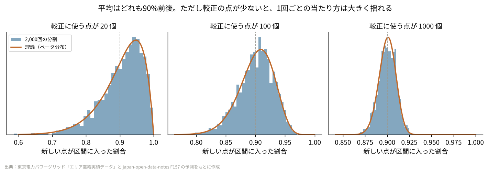
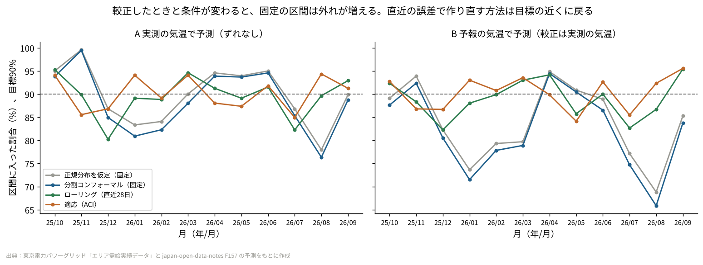
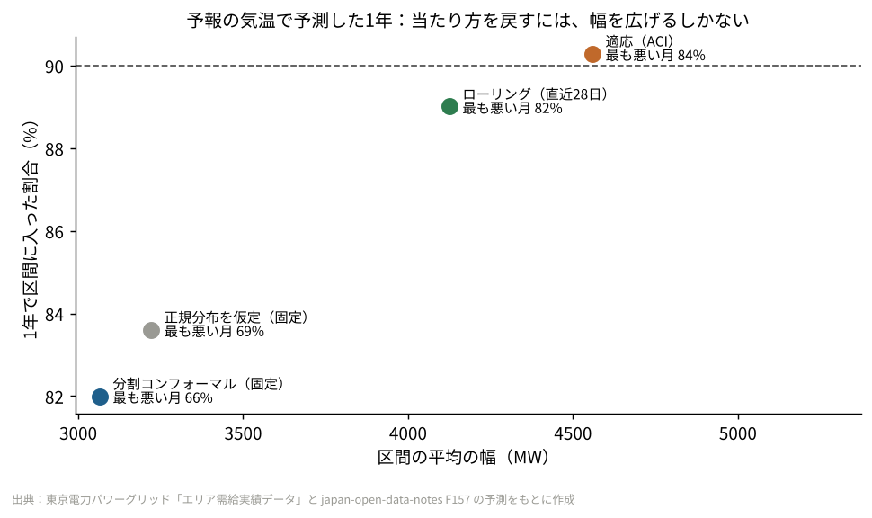
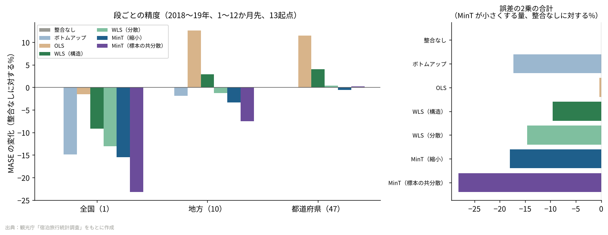
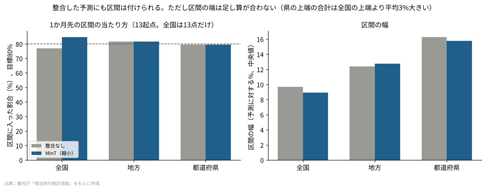

# P03 Do forecast intervals cover as the papers promise? When conditions change, a fixed interval fell to 82%; rebuilding it from recent errors brought it back to 90%

Japanese version: [README.md](README.md). Index of the paper series: [papers/README_EN.md](../README_EN.md).

The third (long) article in the series that reads papers and tries them on my own data. The theme is **forecast uncertainty**.

## Question

- What does a method that attaches "90% will fall in this range" to a forecast (conformal prediction) guarantee, and what does it not?
- When conditions differ from when the forecast was built, how far off are those intervals? How much does rebuilding them from recent errors recover?
- Why does a method that makes national, regional and prefectural forecasts add up (MinT) also improve accuracy? Can the reconciled forecasts also get intervals?

### Papers read

| Paper | Version read |
|---|---|
| Anastasios N. Angelopoulos, Stephen Bates (2021). "A Gentle Introduction to Conformal Prediction and Distribution-Free Uncertainty Quantification" | arXiv v6 (Dec 2022): https://arxiv.org/abs/2107.07511 |
| Shanika L. Wickramasuriya, George Athanasopoulos, Rob J. Hyndman (2019). "Optimal forecast reconciliation for hierarchical and grouped time series through trace minimization", Journal of the American Statistical Association 114(526) | PDF on the author's page: https://robjhyndman.com/papers/mint.pdf (overview: https://robjhyndman.com/publications/mint/) |

The idea of the following paper was also used (only its abstract and main idea were read):
- Isaac Gibbs, Emmanuel Candès (2021). "Adaptive Conformal Inference Under Distribution Shift": https://arxiv.org/abs/2106.00170

---

## Part 1: Conformal prediction

### The paper's question

Machine learning models usually return a single number (a point forecast). At work you want more than "tomorrow's demand is 32,000 MW": you want "at most about 33,500 MW", because preparing generation, inventory or staff depends on the range.

Intervals a model produces itself (e.g. assuming normal errors) miss when the assumption fails, and many models — trees, neural networks — produce no interval at all.

The paper introduces a way to **attach an interval afterwards to any model's forecast**, with the promise that "a new point falls inside with probability at least 90%" holding without assuming any distribution. There is one condition: the calibration points and the new point must be **exchangeable** (their order could be swapped without changing anything).

### The paper's idea

The simplest version, split conformal, is four steps:

1. Split your data into a part for building the model and a part for **calibration**.
2. On the n calibration points, compute the size of the error (score); for regression, |actual − forecast|.
3. Sort the scores and take q = the ⌈(n+1)(1−α)⌉-th smallest (90% for α = 0.1).
4. The interval for a new point is "forecast ± q".

Why does 90% fall inside? Line up the scores of the n calibration points and the new point. If they are exchangeable, the new point is equally likely to land at any rank, so the chance that it is not in the top 10% is at least 90%. No distributional shape is used, so the promise holds even without normality and even if the model is somewhat poor.

Two points the paper stresses:

- **The promise is "90% on average", not "this particular interval covers 90%".** The interval is fixed by the n calibration points; if they happen to have small errors, the interval is too narrow. The spread is given by a beta distribution determined by n (coverage given fixed calibration points follows Beta(n+1−l, l), l = ⌊(n+1)α⌋). With small n, coverage varies a lot from one calibration set to another even though it averages 90%.
- **Exchangeability easily breaks for data ordered in time** — seasons change, model inputs change, the world changes — and then the promise no longer holds. The paper introduces remedies as extensions (weighting recent points more, moving α according to the miss rate, etc.).

### Data

The material is the **hourly electricity demand forecast for the Tokyo area** used in this repository's [F205](../../articles/F205_power_forecast_practice_part1/README_EN.md) and [F206](../../articles/F206_power_forecast_practice_part2/README_EN.md) (the LightGBM forecast operated for one year in F157).

- Calibration: Oct 2024 – Sep 2025 (8,760 hours), errors of the forecast retrained monthly.
- Test: Oct 2025 – Sep 2026 (8,760 hours).
- Target: 90% (α = 0.1).

### What I did and found

#### Test 1: if exchangeable, does the promise hold?

The 8,760 test-year errors were shuffled randomly, then split into "n for calibration / the rest to measure coverage". Shuffling makes exchangeability hold exactly. Repeated 2,000 times each for n = 20, 100, 1,000 (fixed seed).



| Calibration points | Mean coverage | 5th–95th pct over 2,000 | Theory (beta) 5th–95th pct | Mean coverage of a normal-assumption interval |
|---|---|---|---|---|
| 20 | 90.4% | 78.0–98.3% | 78.4–98.2% | 87.4% |
| 100 | 90.1% | 84.8–94.5% | 84.8–94.5% | 89.4% |
| 1,000 | 90.0% | 88.3–91.6% | 88.4–91.5% | 89.9% |

- Every mean was 90%, and the spread nearly matched the paper's beta distribution.
- With 20 calibration points, coverage fell below 85% in 18.1% of the 2,000 runs. **The promise is about the average; a single interval may not cover** — visible in numbers.
- The normal-assumption interval reached only 87.4% on average with few points, short of the promise; electricity demand errors probably have heavier tails than normal (my interpretation).

#### Test 2: what happens when used in time order?

At work you set the interval from last year's errors and use it this year. Four constructions were compared in time order:

| Construction | Contents |
|---|---|
| Normal assumption (fixed) | ± 1.645 × SD of the calibration-year errors |
| Split conformal (fixed) | q fixed once from the calibration year (q = 1,533 MW) |
| Rolling (last 28 days) | rebuild q every day from the previous 28 days (672 hours) of errors |
| Adaptive (ACI) | rolling, plus: if yesterday's miss rate exceeded 10%, lower α (widen); if below, raise α; step size 0.05 |

ACI is Gibbs & Candès (2021)'s idea applied daily, assuming each day's actuals are known only after the day ends.

Three scenarios:

- **A: no shift.** Forecast built with observed temperatures (same as calibration).
- **B: inputs change.** In production only the previous day's temperature forecast is available. A forecast built with forecast temperatures gets an interval set from the errors of the forecast built with observed temperatures (different inputs in calibration and production).
- **C: stale model.** A model trained three years ago and never updated (calibrated on that model's errors last year).



| Scenario | Construction | Coverage over the year | Worst month | Months below 85% | Mean width |
|---|---|---|---|---|---|
| A no shift | Normal (fixed) | 89.8% | 78.0% | 3 | 3,221 MW |
| | Split conformal (fixed) | 88.5% | 76.3% | 4 | 3,065 MW |
| | Rolling | 89.5% | 80.2% | 2 | 3,230 MW |
| | Adaptive (ACI) | 90.2% | 84.9% | 1 | 3,323 MW |
| B inputs change | Normal (fixed) | 83.6% | 68.8% | 6 | 3,221 MW |
| | Split conformal (fixed) | **82.0%** | **65.9%** | 7 | 3,065 MW |
| | Rolling | 89.0% | 82.3% | 2 | 4,125 MW |
| | Adaptive (ACI) | **90.3%** | 84.1% | 1 | 4,559 MW |
| C stale model | Split conformal (fixed) | 88.9% | 77.0% | 3 | 3,665 MW |
| | Adaptive (ACI) | 90.1% | 85.9% | 0 | 3,953 MW |



### Findings (Part 1)

1. **If exchangeable, the promise holds as the paper says — on average.** With 20 calibration points, coverage fell below 85% nearly one time in five. Use several hundred calibration points or more.
2. **Even without a shift, a fixed interval's coverage swung between 76% and 99% by month.** Over the year it was 88.5%, close to target, but misses clustered in summer (Aug 2026) and winter (January): error size changes with the season, so months are not exchangeable.
3. **When inputs change, a fixed interval covered 82.0% over the year and only 65.9% in the worst month.** Production error SD rose from 979 MW to 1,308 MW. Rebuilding from the last 28 days brought coverage back to 89.0%, and ACI to 90.3%, but mean width grew from 3,065 MW to 4,125–4,559 MW (30–50% wider). **Recovering coverage means honestly widening the interval, not improving accuracy.**

### Limits of the paper and pitfalls found while trying it

- The promise is on average. Split conformal does not give 90% for every hour and every season (conditional coverage). In electricity, misses cluster where errors are large, such as summer afternoons and winter mornings; the paper also says conditional coverage cannot be guaranteed in general.
- Hourly errors resemble neighboring hours (autocorrelation); 24 hours in a day are not 24 independent points. Figure 1 shuffles to break this and make points exchangeable; it does not hold in Figure 2's time order.
- Rolling and ACI wait a day until production errors are known, so they catch up with sudden changes (days when the weather forecast missed badly) one to several days late.
- ACI's α once dropped to 0.0125 (widening the interval to nearly 99%). When misses continue, the interval widens sharply; in operation you also need a cap on the width and an alert when it widens (my interpretation).

---

## Part 2: Hierarchical forecast reconciliation (MinT)

### The paper's question

When forecasting series connected by addition — national, regional, prefectural — forecasting each separately means **the prefectural forecasts do not add up to the national forecast**. A table in a budget meeting saying "the nation grows, every prefecture shrinks" cannot be explained.

Ways to make forecasts add up (reconciliation) have long existed: bottom-up, top-down by shares, smoothing all levels by least squares (OLS), etc. The paper asks: "when reconciling using forecasts at all levels, **which reconciliation minimizes error**?"

### The paper's idea

Stack all series in a vector y and the bottom level (prefectures) in b; the adding-up relation is y = S b, where S is a 0/1 matrix saying which prefectures add up to which region and the nation (here 58 rows × 47 columns).

Any method that turns separately made forecasts ŷ into coherent forecasts ỹ can be written ỹ = S G ŷ, where G re-derives the prefectural forecasts from forecasts at all levels: for bottom-up G just picks the prefectural forecasts; for OLS it is the least-squares matrix.

Two results:

1. If the base forecasts are unbiased, any G with SGS = S keeps the reconciled forecasts unbiased.
2. Among these, **the G that minimizes the sum of error variances of all series (the trace of the covariance matrix)** has a closed form: G = (S′W⁻¹S)⁻¹ S′W⁻¹, where W is the covariance matrix of the base forecast errors.

Minimizing the trace gives the name MinT (Minimum Trace). The problem is that W is unknown; the paper compares several ways to estimate it from available one-step-ahead errors (in-sample residuals):

| Name | Choice of W | Meaning |
|---|---|---|
| OLS | identity | every series weighted equally |
| WLS (structural) | number of prefectures below | larger series weighted less |
| WLS (variance) | residual variances (diagonal only) | error-prone series weighted less |
| MinT (sample covariance) | the residual covariance as is | also uses co-movement of errors between series |
| MinT (shrinkage) | shrink the correlation part toward 0 | a remedy when the sample covariance is unstable |

With many series and short residuals, the sample covariance becomes unstable and may not be invertible, so the paper recommends shrinkage of the correlations toward 0.

### Data

As in this repository's [F36](../../articles/F36_hierarchical_forecast), **guest nights from the Japan Tourism Agency's Overnight Travel Statistics Survey** (prefecture × month, from Jan 2011): 1 national, 10 regional and 47 prefectural series, 58 in total.

### What I did

- Base forecasts: for each of the 58 series, ETS on logs (damped trend + additive seasonality), forecasting 12 months ahead (same as F36).
- Test period: 13 origins from Dec 2017 to Dec 2018 (expanding window), 1–12 months ahead, before COVID.
- Evaluation: MASE (error divided by the mean absolute error of a seasonal naive forecast), averaged by level. Also the very quantity the paper minimizes (sum of squared errors over all 58 series) as a ratio to "no reconciliation".

F36 lined up six reconciliation methods; here, following the paper, the different choices of W (two WLS, two MinT) were added. The values for no reconciliation, bottom-up, OLS, WLS (variance) and MinT (shrinkage) came out almost the same as F36 (rebuilt with the same settings).



| Method | National | Regional | Prefectural | All 58 | Sum of squared errors (no reconciliation = 1) |
|---|---|---|---|---|---|
| No reconciliation | 1.861 | 1.461 | 1.164 | 1.227 | 1.000 |
| Bottom-up | 1.584 | 1.434 | 1.164 | 1.217 | 0.827 |
| OLS | 1.833 | 1.645 | 1.297 | 1.366 | 0.996 |
| WLS (structural) | 1.690 | 1.502 | 1.211 | 1.269 | 0.904 |
| WLS (variance) | 1.618 | 1.442 | 1.168 | 1.223 | 0.854 |
| MinT (shrinkage) | 1.573 | 1.411 | 1.157 | 1.208 | 0.820 |
| MinT (sample covariance) | **1.429** | **1.351** | 1.166 | **1.202** | **0.719** |

(MASE, lower is better; 2018–19, 1–12 months ahead, mean over 13 origins.)

- Forecast separately, the national forecast and the sum of the 47 prefectural forecasts differed by 1.0% at the median and 5.2% at most.
- The shrinkage intensity (λ) was 0.18–0.27 depending on the origin.

## Part 3: Conformal intervals for reconciled forecasts

A test linking the two papers: for one-month-ahead forecasts, 24 separate calibration origins (Dec 2015 – Nov 2017) were used to build 80% split-conformal intervals per series on |log(actual ÷ forecast)|, and coverage was compared for unreconciled and MinT (shrinkage) forecasts over the 13 test origins.



| | National | Regional | Prefectural |
|---|---|---|---|
| Coverage: no reconciliation | 76.9% (10 of 13) | 81.5% | 79.4% |
| Coverage: MinT (shrinkage) | 84.6% (11 of 13) | 81.5% | 79.4% |
| Median width: no reconciliation | 9.7% of forecast | 12.4% | 16.3% |
| Median width: MinT (shrinkage) | 8.9% of forecast | 12.8% | 15.8% |

- Regional and prefectural coverage was around the 80% target for both. The national level has only 13 points, so one miss moves it by 8 points.
- Intervals on MinT forecasts were slightly narrower nationally (9.7% → 8.9%), because better point forecasts meant smaller errors.
- But **interval ends do not add up.** The sum of the 47 prefectural upper ends exceeded the national upper end by 3.0% on average: every prefecture hitting its "at most" at the same time is very unlikely.

### Findings (Parts 2 and 3)

1. **The quantity the paper minimizes (sum of squared errors) fell 18% with MinT (shrinkage).** In MASE it also beat no reconciliation at every level: national −15%, regional −3%, prefectural −0.6%. OLS barely reduced squared errors and worsened MASE, because it weights equally series whose sizes differ more than 200-fold between the nation and small prefectures.
2. **On these data, MinT with the sample covariance was best (−28% squared errors)** — but that covariance was **not invertible**. The Hokkaido region equals Hokkaido and the Okinawa region equals Okinawa, so the residual matrix has rank 56, not 58; and at the earliest calibration origin the residuals (48 months) are shorter than the number of series (58). A generalized inverse was used here, but this is not a stable state — exactly why the paper recommends shrinkage.
3. **Reconciled forecasts can get conformal intervals series by series, but the intervals themselves do not add up.** Putting "the national interval" next to "the sum of prefectural intervals" in one table cannot be explained. Making intervals coherent too needs probabilistic reconciliation (see "what to read next").

### Limits of the paper and pitfalls found while trying it

- MinT's optimality assumes unbiased base forecasts. Using the same kind of model with seasonality and trend (like ETS) for all series probably keeps bias small, but if series are made differently (e.g. only the national forecast is adjusted by hand), the assumption breaks (my interpretation).
- W is estimated from one-step-ahead residuals, but the error covariance 12 months ahead has a different shape; the paper itself simplifies by treating multi-step W as a constant multiple of the one-step W.
- Levels with a single child (Hokkaido region = Hokkaido) make the matrix singular. Remove such duplicates when building the hierarchy, or use shrinkage.
- Reconciliation cannot keep up with large changes like COVID (in F36, errors in 2020 were about 5 times larger under every reconciliation method).

---

## What this does not show

- It does not verify the papers' results; it tries the papers' methods on other data (Tokyo electricity demand forecasts, prefectural guest nights).
- Electricity covers one area and one year; guest nights only 13 pre-COVID origins. Other seasons or areas would change the numbers.
- The electricity forecast is only F157's LightGBM (light settings). The "forecast temperature" is F157's forecast with noise added to temperature, which differs from the errors of real weather forecasts.
- Only one ACI step size (0.05) and one rolling window (28 days) were tried.
- Part 3's national coverage has only 13 points, not enough to discuss the gap from the target.

## How to use this at work

1. **Publish an interval together with every point forecast, and rebuild it from recent errors instead of fixing it once from last year.** Adding one line, "share inside the interval (target 90%)", to the monthly report catches changes in inputs or models early.
2. **Make validation conditions match production.** The biggest miss here came from using observed temperatures in validation but forecast temperatures in production. Calibrate intervals with errors from the same inputs as production (e.g. forecast temperatures).
3. **If you forecast both a total and its breakdown, reconcile with MinT (shrinkage).** It improves accuracy and is easier to explain. But attach intervals per series and note in the table that intervals do not add up.

## Related papers and what to read next

- **Gibbs & Candès (2021)**, "Adaptive Conformal Inference Under Distribution Shift" (https://arxiv.org/abs/2106.00170): the origin of ACI here; moving α by the miss rate brings long-run coverage close to the target.
- **Barber, Candès, Ramdas & Tibshirani (2023)**, "Conformal prediction beyond exchangeability" (https://arxiv.org/abs/2202.13415): how far the promise can be kept without exchangeability by down-weighting old points.
- **Romano, Patterson & Candès (2019)**, "Conformalized Quantile Regression" (https://arxiv.org/abs/1905.03222): wider intervals where errors are large and narrower where small — a remedy for misses clustering in summer and winter.
- **Hyndman & Athanasopoulos, "Forecasting: Principles and Practice" (3rd ed.), chapter 11** (https://otexts.com/fpp3/hierarchical.html): implementing MinT (R's fable) and an entry point to probabilistic reconciliation.

## Figures

The figures have Japanese labels.
- `figures/p03_01_finite_sample.png`: coverage spread by number of calibration points vs the beta distribution.
- `figures/p03_02_monthly_coverage.png`: monthly coverage of each construction in each scenario.
- `figures/p03_03_width_vs_coverage.png`: interval width vs coverage.
- `figures/p03_04_reconciliation.png`: MASE and squared errors by reconciliation method.
- `figures/p03_05_reconciled_intervals.png`: coverage and width of conformal intervals on reconciled forecasts.

## Reproduce

```
pip install -r requirements.txt
cd src
bash run_all.sh    # a_conformal.py (seconds) and b_hier.py (fits ETS 2,146 times, a few minutes)
```
Copying `src/` and `data/` into an empty folder and running twice produced identical `results/`.

## Files

| File | Contents |
|---|---|
| src/a_conformal.py | Part 1 (Figures 1–3, results/a_*.csv, a_main.json) |
| src/b_hier.py | Parts 2 and 3 (Figures 4–5, results/b_*.csv, b_main.json) |
| src/common.py | split-conformal quantile and figure style |
| data/f157_pred_tokyo_2024_25.csv.gz, f157_pred_tokyo_2025_26.csv.gz | Tokyo hourly actuals and forecasts (same files as F205) |
| data/lodging_pref_monthly_2011_2025.csv | guest nights by prefecture × month (same file as F36) |

## Sources

- Based on TEPCO Power Grid "area supply-demand data" and Japan Meteorological Agency historical weather data (forecasts collected and prepared in F22 and F157 of japan-open-data-notes).
- Based on the Japan Tourism Agency "Overnight Travel Statistics Survey" time-series tables (https://www.mlit.go.jp/kankocho/tokei_hakusyo/shukuhakutokei.html).
- Papers as listed under "Papers read" and "What to read next".

Code: MIT License
